# Interview Framework & Capacity Estimation

> A visual guide for turning an ambiguous prompt into a defensible design. Use it to structure the interview, quantify scale, reason about availability and latency, expose risks, and explain why each decision is appropriate.

---

## 1. One-page visual summary


The framework is a narrowing funnel: establish what matters, quantify it, define contracts, draw critical paths, stress the risky parts, and defend the resulting trade-offs.


| Phase | Time | Deliverable | On the whiteboard before moving on |
|---|---:|---|---|
| Clarify | 0–5 min | Core use cases, constraints, out-of-scope items | 2–3 use cases, an explicit out-of-scope list |
| Quantify | 5–10 min | Peak QPS, read/write ratio, storage, SLOs | 4–6 rounded numbers, each tied to a decision |
| Contract | 10–15 min | Minimal APIs/events and core entities | 2–4 endpoints, 1–2 entities, ranked access patterns |
| Design | 15–25 min | Read, write, and asynchronous paths | One diagram with the synchronous path clearly marked |
| Stress | 25–38 min | Deep dives into the largest risks | The named bottleneck and what you would do about it |
| Fail | 38–43 min | Degraded behavior and recovery | Behavior when each critical dependency is down |
| Close | 43–45 min | Decisions, trade-offs, and evolution trigger | The metric that triggers the next layer of complexity |

**60-minute Staff/Principal loops:** the extra time goes almost entirely into *Stress* (13 → ~25 min). Clarify and Quantify should not grow. Spending the extra minutes on requirements reads as stalling.

!!! tip "The interview in one sentence"
    Given the requirements and scale, choose the simplest architecture that works; explain its failure behavior, cost, and trigger for evolution.

---

## 2. Core mental model

### Requirements → load → paths → pressure → decision

1. **Requirements** define what success means.
2. **Load estimates** reveal which resources may become constrained.
3. **Critical paths** show where latency and availability are spent.
4. **Pressure tests** expose bottlenecks and failure propagation.
5. **Decisions** balance product priorities rather than chasing universal "best practices."


The synchronous path determines user latency and immediate availability. Optional analytics, notifications, and fan-out work should leave that path when delayed completion is acceptable. §5 shows why this matters: every hop on the synchronous path multiplies into your availability and your tail latency.

### Capacity is derived, not guessed

Start with users and operations, not formulas. Each quantity below only matters because it feeds a decision, so walk through one small running example first: a photo-sharing feed with **10 million daily active users**, each opening the feed **5 times a day**, where each feed response is about **20 KB**.

**QPS (queries per second)** is how many requests land on the system every second. It is rarely stated directly. You derive it from daily active users and how often they act:

```text
Average QPS = operations per day / 86,400   (seconds in a day)
            = (10,000,000 users × 5 opens) / 86,400
            ≈ 578 requests/second
```

Traffic is never flat. Lunchtime, a push notification, or a viral post can spike load well above the daily average. A **peak factor** captures that spike as a multiplier on the average (§4 gives guidance on choosing one):

```text
Peak QPS = average QPS × peak factor
         = 578 × 3 (consumer social: assume 3× at busiest hour)
         ≈ 1,734 requests/second
```

**Payload size** is how many bytes travel in one request or response. Here each feed response is ~20 KB. Multiplying it by QPS answers "how much network throughput must I provision?", i.e. **bandwidth**:

```text
Bandwidth = QPS × payload size
          = 1,734 × 20 KB
          ≈ 34.7 MB/second at peak
```

**Storage** answers a different question: not "traffic right now" but "how much disk will this consume over time?" Assume this app also has **1 million new photos uploaded per day**, each about 500 KB:

```text
Storage = records × record size × retention × replicas
        = 1,000,000 photos/day × 500 KB × 30-day retention × 3 replicas
        ≈ 45 TB
```

**Concurrency** is how many requests are in flight at once, which is the number your connection pools and thread counts must support. It comes from **Little's Law**: in-flight work = throughput × time each item spends in the system.

```text
Concurrency ≈ throughput × latency in seconds
            = 1,734 requests/second × 0.2 seconds
            ≈ 347 concurrent requests
```

Little's Law is reusable everywhere: connection pools, thread pools, queue depth. It also warns you about collapse. If latency doubles to 0.4 s at the same throughput, concurrency doubles to ~700, pools exhaust, requests queue, latency rises further, and the system falls over non-linearly. **p99 latency and saturation are the same conversation.**

Finally, **compute** turns load into machines. Assume one host safely serves ~500 feed requests/s (it does real work per request, not just static bytes):

```text
Hosts = peak QPS / safe QPS per host = 1,734 / 500 ≈ 4
      + headroom to lose one host (N+1) and one of 3 zones  -> ~6 hosts
```

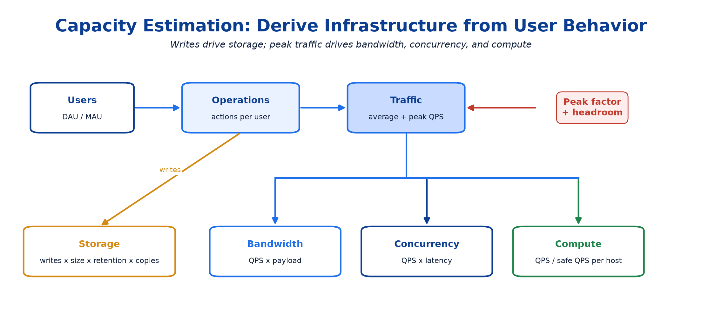

Estimates should be rounded, unit-consistent, and tied to a consequence such as caching, partitioning, connection limits, or capacity headroom. **If a number cannot move a decision, it is not worth computing.**


---

## 3. Requirements & the contract

### Requirement types

| Type | Question | Examples |
|---|---|---|
| Functional | What must the system do? | Create, read, update, notify |
| Non-functional | How well must it behave? | p99 latency, availability, durability |
| Constraint | What boundary must be respected? | Residency, legacy integration, deadline |
| Out of scope | What are we deliberately excluding? | Admin UI, analytics queries |

### Quality attributes

| Attribute | Meaning | Interview prompt | How it is measured |
|---|---|---|---|
| Latency | Time per operation | Which percentile and operation? | p50 / p99 per endpoint, over a window |
| Throughput | Work per second | Average or peak? Read or write? | Requests or bytes per second at peak |
| Availability | Ability to serve requests | What failure must be tolerated? | Successful requests / total requests |
| Durability | Protection from acknowledged-data loss | Can an accepted write be lost? | Annual probability of losing an object (e.g. 11 nines) |
| Consistency | Versions readers may observe | Is stale data acceptable here? | Maximum staleness window, e.g. "≤ 5 s" |
| Security | Protection across trust boundaries | Who can perform each operation? | Authz coverage, audit trail, blast radius of a leaked credential |
| Cost | Resource and operational spend | What dominates at 10× scale? | $/month, $/request, $/GB stored |

### High-leverage clarification questions

A question is only useful if the answer changes something. Each one below states what it decides:

| Question | Decides |
|---|---|
| Who are the users, and what are the top 2–3 use cases? | What the critical path is |
| What is explicitly out of scope? | Where you are allowed to stop |
| Current, peak, and projected traffic? | Peak factor, headroom, whether to shard at all |
| Which paths need consistency vs availability vs latency? | Per-operation storage and replication choices |
| Retention, security, privacy, residency constraints? | Storage growth, encryption, region placement |
| Greenfield, or must it coexist with an existing system? | Migration path, dual writes, contract compatibility |
| Built to survive 10× traffic, or a v1 to revisit? | How much complexity is justified *today* |
| Business success metric, deadlines, budget, team size? | Build vs buy, and how much operational load the team can carry |

### The minimal contract

The Contract phase is 11% of the clock and is where many candidates wave their hands. Keep it small: the fewest endpoints, entities, and access patterns that cover the use cases. Using the URL shortener from §8:

```text
POST /links      {url, alias?, ttl?}   ->  201 {code, short_url}
GET  /{code}                           ->  302 Location: <url>   (404 if unknown/expired)
```

```text
Link: code (PK) | long_url | owner_id | created_at | expires_at

Access patterns, ranked by volume:
  1. point lookup by code   (redirect  - 8,000/s peak, p99 < 100 ms)
  2. insert by code         (create    - 80/s peak, must be durable)
  3. scan expired           (cleanup   - batch, off the critical path)
```

!!! tip "Derive the schema from the access patterns, never the reverse"
    Three access patterns, one point lookup dominating by 100×. That is what *justifies* a key-value store with a cache in front, rather than you asserting it. If you draw tables first, you end up defending joins nobody asked for.

Also state **idempotency** for every write: can the client safely retry `POST /links`? If not, a timeout followed by a retry creates two links. An idempotency key or a deterministic code avoids that.

---

## 4. Capacity estimation toolkit

You do not need memorized benchmark tables. You need a few shortcuts, one method, and the habit of tying every number to a decision.

### Unit sanity

Most estimation mistakes are unit mistakes, not bad assumptions. Three shortcuts cover almost every conversion:

| Shortcut | How to use it |
|---|---|
| **1 day ≈ 100,000 seconds** | Per day → per second: divide by 100,000. So 1 million/day ≈ 12/s, and 1 billion/day ≈ 12,000/s |
| **1 month ≈ 2.6 million seconds** | Per month → per second: divide by 2.6 million (30 days × 86,400 s) |
| **Each size unit is 1,000× the last** | KB → MB → GB → TB → PB |

Round freely. You want the right order of magnitude, not the exact figure.

### Choosing a peak factor

Systems break at the peak, not the average. Multiply average traffic by a **peak factor** that matches how users arrive:

| How traffic arrives | Peak factor |
|---|---|
| Spread across time zones (global consumer apps) | 2–3× |
| Concentrated in business or local hours | 3–5× |
| All at once (flash sales, live events, push campaigns) | 10× or more |

This is why the examples here use 3× for steady traffic and 10× for viral links. When *you* trigger the spike, with a push notification or a marketing email, you can also soften it by staggering the sends.

### Sanity-check by order of magnitude

A number only helps if you know what it means for the design. Instead of memorizing benchmarks, ask four questions:

| Question | Rule of thumb |
|---|---|
| Can stateless app servers handle the load? | Almost always: add more instances |
| Can one database primary take the writes? | Writes are usually the first ceiling; start worrying in the low thousands per second |
| Does the hot data fit in one machine's memory? | Tens to hundreds of GB fit; beyond that, shard the cache |
| Are users far away? | Distance adds 100+ ms that no server fix removes; only moving data closer (CDN, more regions) helps |

Say "roughly" out loud. The interviewer is grading the reasoning, not the figure.

### Working set and cache hit ratio

Two ideas decide most caching conversations:

- **Working set:** the data accessed often enough to be worth keeping in memory (hot records × record size). It decides whether a cache is one node or a cluster. Access is usually skewed, with a small share of records getting most of the traffic, so you rarely need to cache everything.
- **Hit ratio:** the share of reads the cache answers. Load on the database = total load × (1 − hit ratio). Dropping from 99% to 95% looks small, but it sends **5× more traffic** to the database.

This is why hit ratio is worth alerting on, and why a cold cache after a restart is a real incident.

### Storage reality check

Raw payload math undercounts. Indexes, metadata, and storage-engine overhead make the real footprint **1.5–3×** the raw payload, before replication. Saying so earns credibility for free.

### Minimum capacity worksheet

| Estimate | Why it matters |
|---|---|
| Peak read/write QPS | Compute, storage topology, connection limits |
| Read/write ratio | Cache and replica usefulness |
| Payload sizes | Network and serialization cost |
| Data growth and retention | Storage, partitioning, backup windows |
| Working set | Whether useful data can fit in memory |
| Fan-out | Hidden downstream traffic multiplication |
| Failure headroom | Ability to survive host or zone loss |

!!! warning "Avoid decorative arithmetic"
    If an estimate cannot affect a decision, skip it. Twelve decimal places of QPS will not rescue an unjustified architecture.

---

## 5. Availability, latency & SLOs

### The nines

| Level | Availability | Downtime per year | Typical use |
|---|---:|---:|---|
| **Two nines** | 99% | 3.65 days | Batch jobs, internal tooling |
| **Three nines** | 99.9% | 8.77 hours | Typical internal service |
| **Three and a half nines** | 99.95% | 4.38 hours | Common cloud-provider SLA |
| **Four nines** | 99.99% | 52.6 minutes | Typical customer-facing SLO |
| **Five nines** | 99.999% | 5.26 minutes | Rarely justified; usually aspirational |

Each extra nine costs roughly an order of magnitude more engineering: redundancy, automation, testing, on-call. Ask what the business actually loses per minute of downtime before promising one.

### Availability composes

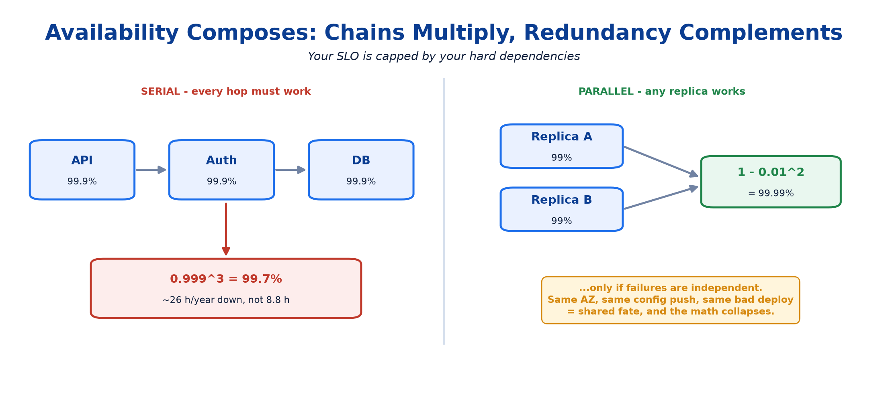

```text
Serial dependencies MULTIPLY (all must work):
  0.999 × 0.999 × 0.999 = 0.997   -> ~26 h/year down, not 8.8 h
  A service with 5 hard dependencies at 99.9% cannot promise 99.9%.

Redundant replicas COMPLEMENT (any one works):
  1 - (1 - 0.99)^2 = 0.9999       -> two 99% replicas give ~4 nines
```

The redundancy math assumes **independent failures**. Same AZ, same config push, same bad deploy, same upstream dependency is *shared fate*, and the math collapses back towards one replica.

!!! tip "The Staff-level insight"
    Your availability is capped by your hard dependency chain. To raise it, **remove hard dependencies or make them soft**: cache, fall back, or move them off the synchronous path. This arithmetic is what justifies the failure table in §7.

### Latency is a distribution, not a number

**p99** means "1 in 100 requests is slower than this." At 8,000 requests/s, that is 80 unhappy users *every second*. The mean is a trap: a p50 of 20 ms and a p99 of 900 ms average to something that looks fine and describes nobody.

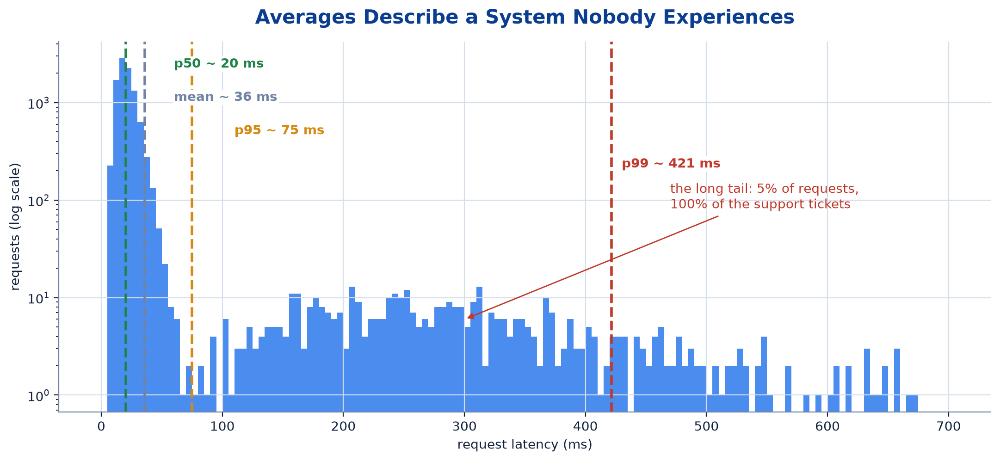

Always state latency targets as **percentile + operation**: "redirect p99 < 100 ms," never "fast."

### Tail amplification under fan-out

When one request waits on N parallel calls, it is as slow as the slowest one:

```text
Each dependency has p99 = 10 ms. Chance a request avoids EVERY slow path = 0.99^N
  N = 1    -> 99% fast
  N = 10   -> 90% fast
  N = 100  -> 37% fast   the dependency's p99 is now the caller's MEDIAN
```

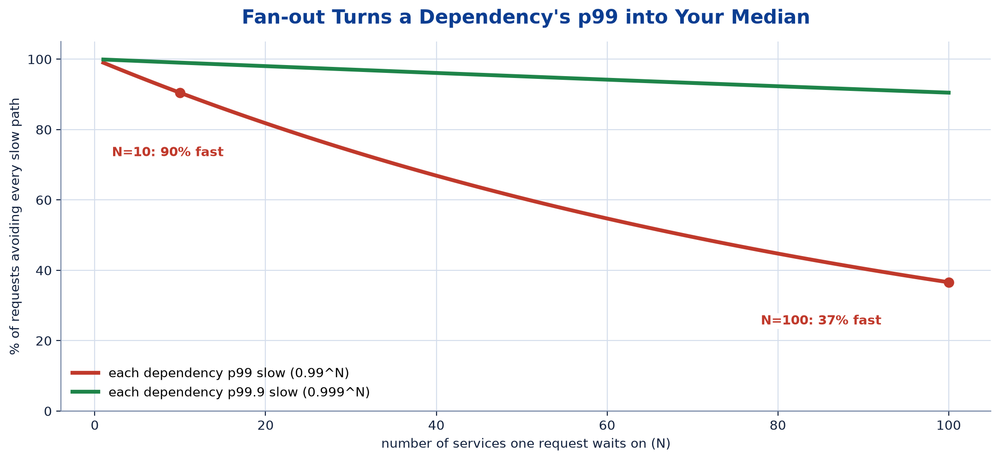

This block reframes "just add another microservice call" permanently. Mitigations: fewer synchronous hops, tighter per-dependency tails (p99.9, the green curve), **hedged requests** (send a backup request after the p95 and take whichever returns first), and moving fan-out off the synchronous path.

### SLI → SLO → error budget

| Term | What it is | Example |
|---|---|---|
| **SLI** (Service Level Indicator) | A measured number that shows how the service behaves from the user's point of view, usually the percentage of requests that were good | % of redirects returning 3xx in under 100 ms |
| **SLO** (Service Level Objective) | The target you set for an SLI over a time window: the line between "reliable enough" and "needs work" | 99.9% of redirects good, over a rolling 30 days |
| **Error budget** | The amount of failure the SLO still allows (100% − SLO). Spend it on releases and experiments; when it runs out, reliability work comes first | 0.1% ≈ 43 minutes of bad redirects per month |

The error budget **turns reliability from an argument into arithmetic**. Budget left means ship faster; budget burned means freeze risky launches and fix reliability. Alert on *burn rate* (how fast the budget is being consumed), not on single blips.

---

## 6. Decision and trade-off tables

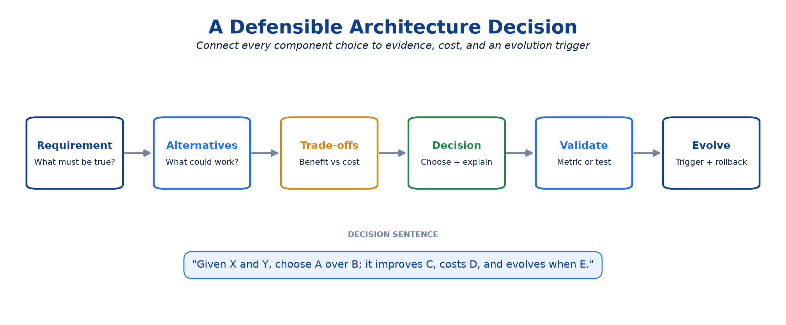

!!! abstract "The decision template: memorize this"
    Given **requirement X** and **estimate Y**, choose **A** over **B** because it improves **C**. It costs **D**. Validate it using **E**, and evolve when **F** occurs.

Two worked instances:

> Given **8,000 peak redirects/s** and a **100 ms p99**, choose **cache-aside** over reading the store directly because it cuts origin load **~100×**. It costs **staleness bounded by TTL and stampede risk on a cold start**. Validate with **hit ratio and origin QPS**. Evolve to an **edge/CDN tier** when one hot key exceeds a single cache shard.

> Given **~2.5 TB over five years** and **80 writes/s**, choose **one replicated database** over **sharding** because it keeps **transactions, uniqueness checks, and operations simple**. It costs **a vertical-scaling ceiling**. Validate with **disk growth and primary CPU**. Evolve when **write QPS or data size approaches single-primary limits** (§4 sanity checks).

### Common evolution choices

| Decision | Simple starting point | Scale-oriented option | When to evolve |
|---|---|---|---|
| Compute | Run on one larger server (vertical scaling). It is the simplest to build, deploy, and debug. | Run many identical, stateless servers behind a load balancer (horizontal scaling), so any one of them can fail or be replaced. | When one server's CPU or memory is maxed out, or when the availability target requires surviving the loss of a server. |
| Data | Use one relational database. It gives one source of truth, strong consistency, and easy joins. | Add read replicas, split the data across shards, or move a workload to a store built for its access pattern. | When writes, data volume, or a specific query pattern outgrow what one database can serve efficiently. |
| Reads | Read from the database on every request. Data is always fresh, and there are no extra components. | Serve repeated reads from a cache, a CDN, or read replicas, so the primary database is protected. | When read latency misses its target, or read traffic starts slowing down writes on the primary. |
| Work | Do all the work inside the request before responding. It is easy to follow and debug. | Put slow or optional work on a queue, and let background workers process it later. | When work is slow, is not needed for the response, or triggers many downstream calls. |
| Search | Search with `LIKE '%term%'` queries on the main database. It works for small data with no extra systems. | Maintain a dedicated search index (Elasticsearch/OpenSearch), kept up to date from database change events. | When search queries slow down the main database, or users need relevance ranking and typo tolerance. |
| Analytics | Run reports directly against the production database. | Copy data, by stream or batch, into a separate analytics warehouse built for large queries. | When reports compete with customer traffic, or need history the production database does not keep. |
| Traffic control | Accept every request with no limits, trusting clients to behave. | Apply per-client rate limits, and shed low-priority traffic first when overloaded. | When one client can starve the others, or peaks exceed the capacity you provisioned. |
| Geography | Run in a single region. It has the lowest cost and complexity. | Run in several regions: active-passive for disaster recovery, or active-active to serve users from the nearest region. | When recovery-time goals cannot be met from one region, data-residency laws require it, or distant users see unacceptable latency. |

### Consistency and availability: choose per operation

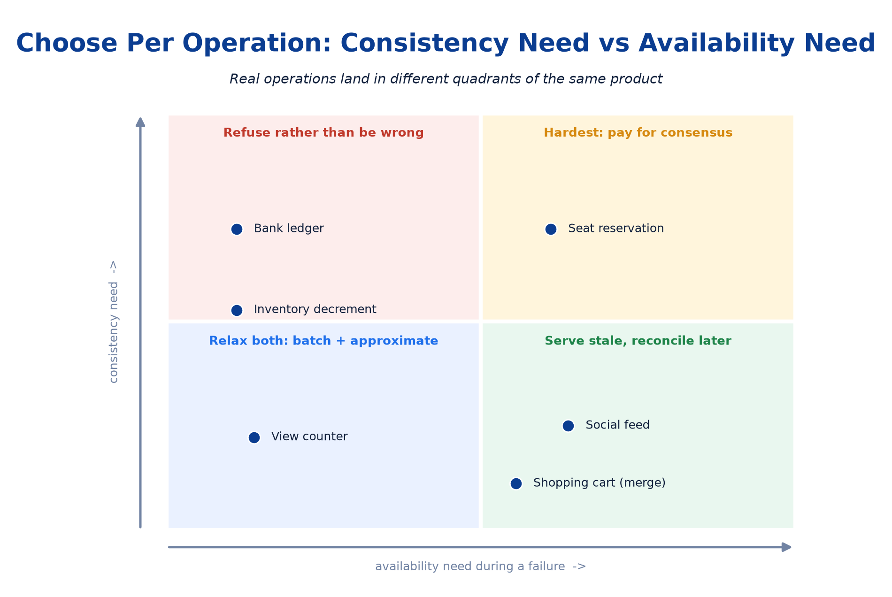

One product contains every quadrant. A shop's inventory decrement must refuse rather than oversell. Its cart should merge and reconcile. Its view counter can be approximate and batched. **Never pick one consistency model for a whole system.**

| Tension | Favor the left when… | Favor the right when… | Cost to discuss |
|---|---|---|---|
| Consistency vs availability | Stale or wrong data causes real harm (account balance, oversellable inventory) | Serving users beats perfect freshness (social feed, recommendations) | Coordination overhead vs the staleness window readers must tolerate |
| Reliability vs cost | Downtime has financial, safety, or trust impact (checkout, payments) | Non-critical, low-traffic, or cheaply retried (internal report, batch job) | Redundancy spend vs longer recovery |
| Security vs performance | Sensitive data or actions (PII, credentials, money movement) | Public, low-risk, latency-sensitive paths (public product page) | Checks, crypto overhead, and complexity vs residual risk |
| Simplicity vs flexibility | Requirements are stable and well understood | Multiple use cases genuinely need different behavior today | Abstractions to maintain vs rework if requirements diverge |

### Say what it costs, in money

Cost is a quality attribute, and a rough dollar figure is a strong Principal signal. Useful ratios: **RAM costs roughly 100× more per GB than disk**; **egress to the internet usually dwarfs storage cost**; **cross-AZ traffic is not free**; and **people are the most expensive component**, so every new system you introduce needs someone to run it.

---

## 7. Failure scenarios & resilience

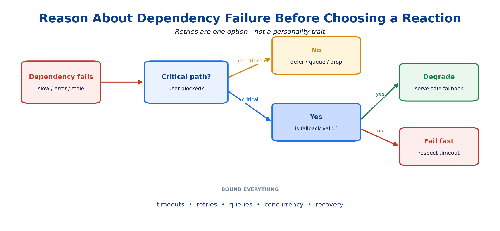

| Failure | Safe response | Guardrail | Blast radius |
|---|---|---|---|
| Non-critical dependency fails (recommendations, personalization) | Defer, queue, or drop per policy; the primary response must not fail | Bounded queue, visible drop rate | Feature degraded for everyone; core works |
| Critical dependency is slow (DB behind checkout) | Fail fast once the deadline is spent, or return a pre-approved safe default | End-to-end deadline shared across the chain | Every request on that path |
| Cache fails or goes cold | Fall back to origin, but bound concurrency to it | Origin concurrency limit plus request coalescing | Everyone, via origin overload if unbounded |
| Durable store fails or cannot confirm a write | Reject the write rather than pretend it succeeded | Never acknowledge a write that is not durable | All writes; reads may survive via cache |
| Queue consumers lag | Scale consumers, or shed the least important events first | Lag alert plus retention headroom to catch up | Delayed async features only |
| Hot key / noisy tenant | Isolate, coalesce, or rate-limit that key or tenant | Per-key and per-tenant limits | One shard, which becomes everyone sharing it |
| Zone fails | Shift traffic to surviving zones | N+1 capacity pre-provisioned; failover actually tested | One AZ's share, if headroom exists |

Blast-radius thinking (does this hurt one user, one tenant, one shard, one zone, or everyone?) is a distinctly Staff+ habit. Cell-based architectures exist purely to shrink it.

### Timeouts: one deadline, propagated

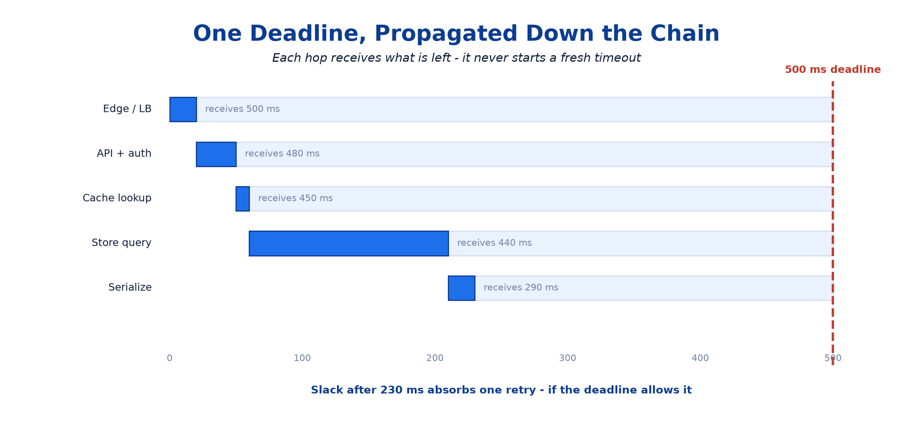

Set one end-to-end deadline at the edge and pass the *remaining* time down (gRPC deadlines, or a header). A hop that starts a fresh 500 ms timeout keeps working on a request whose caller gave up long ago: all cost, no benefit.

### Retries: the mechanism behind most cascading outages

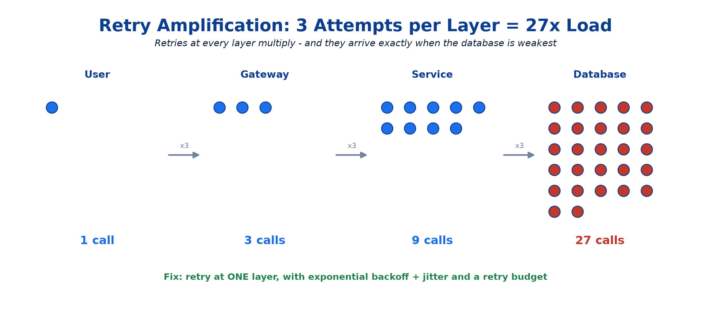

Retries at every layer **multiply**: 3 attempts × 3 layers = 27× load, arriving exactly when the dependency is weakest. Rules:

- **Retry at one layer**, usually the one closest to the user that owns the deadline.
- **Exponential backoff + jitter**, so retries do not arrive in synchronized waves.
- **Retry budget**: cap retries at ~10% of traffic, so retries cannot become the traffic.
- **Only retry idempotent operations**, or make them idempotent first (§3).

### Circuit breakers and bulkheads

- **Circuit breaker:** after N failures, stop calling the dependency for a cool-down, then send a probe. It converts slow failure (threads stuck waiting) into fast failure (immediate fallback), and gives the dependency room to recover.
- **Bulkhead:** separate pools per dependency or tenant, so one slow dependency exhausts *its* pool, not the whole process. Named after ship compartments: one flooded, the ship floats.
- **Load shedding:** when saturated, reject low-priority work early and cheaply instead of letting everything slow down together.

!!! warning "Failures are not independent"
    Redundancy only helps against *uncorrelated* failures. Most big outages are correlated: a bad config push to every region, a certificate expiring everywhere at once, a shared dependency. Mitigate with staged rollouts, cells, and config treated as code.

For each dependency, state: timeout and retry owner; idempotency and duplicate behavior; queue, pool, and concurrency bounds; fallback validity and maximum staleness; detection, recovery, and reconciliation steps.

---

## 8. Worked example: URL shortener

**The prompt you actually get:** "Design a URL shortener." That is the entire brief, one deliberately vague sentence. The first few minutes belong to questions, not boxes and arrows.

### Questions to ask before designing anything

Each one either pins down a requirement or rules something out of scope:

1. Who creates links, and who follows them: internal tool or public service? Decides whether we need auth, rate limiting, and abuse protection.
2. How many links per month, and how many clicks per link? This read/write ratio drives most of the architecture.
3. System-generated codes only, or custom aliases like `/spring-sale`? Aliases add uniqueness checks, conflicts, and squatting.
4. Do links expire: fixed TTL, user-specified date, or never? Decides whether we need a cleanup path and whether storage grows forever.
5. How fast must a redirect be, and what breaks if redirects are down? A slow redirect looks the same as a broken link, so this sets latency and availability targets.
6. Must a new link work instantly, or is a brief 404 acceptable? This is the **read-after-write** question: can the writer immediately read back what they just wrote? It decides whether reads may come from lagging replicas.
7. Are click analytics needed, and must they be real time? Decides whether analytics sits on the redirect path or behind a queue.
8. Any safety or compliance needs: malicious-URL scanning, residency, takedowns? Cheap to plan for, expensive to retrofit.

### Scope

Create a short link, redirect a short code to the original URL, and expire links once their lifetime passes. Analytics dashboards and customer-owned domains are out of scope, though click events are still collected asynchronously, so reporting can be added later without touching the redirect path.

### Targets

Redirects are the critical path: 99.99% available, p99 under 100 ms. Link creation is low volume but must be durable: once the API returns a short code, that code can never be lost. New links need read-after-write behavior, because the creator is usually the first person to click. Standard fixes: read from the primary for a few seconds after a create, write the new link into the cache on create, or route the creator's reads sticky to the primary.

### Assumptions

None of these numbers come from the prompt. They are estimates you state out loud so the interviewer can correct them before you build on top of them. The shape that matters is write-once, read-many.

```text
20 million new links/month        (write volume)
100 redirects per link creation   (read/write ratio - reads dominate)
10× peak factor                   (viral, event-driven clicks - see §4)
700 bytes stored per link         (long URL, short code, owner, timestamps)
5-year retention, 3 replicas      (how long links live, copies kept for durability)
```

### Derived scale

```text
Average creates/s ≈ 20M / 2.6M ≈ 8        (≈2.6M seconds in a 30-day month)
Peak creates/s    ≈ 80                     (8 × 10× peak factor)
Peak redirects/s  ≈ 8 × 100 × 10 ≈ 8,000   (creates × redirect ratio × peak factor)
Total links       ≈ 20M × 12 × 5 ≈ 1.2B
Replicated storage ≈ 1.2B × 700 B × 3 ≈ 2.5 TB   (~4-7 TB with index overhead)
Origin QPS at 99% hit ratio ≈ 80           (§4 hit-ratio formula)
```

The headline number is **8,000 peak redirects per second against roughly 80 peak creates per second**, a two-orders-of-magnitude gap. That ratio justifies a cache in front of redirects instead of optimizing the write path; say it explicitly. The storage figure matters differently: even with index overhead, this fits one well-provisioned database, so **sharding would be complexity without a requirement behind it.**

### Generating the short code

This is the single most-asked deep dive for this problem.

| Strategy | How | Pros | Cons |
|---|---|---|---|
| Counter + base62 | Global sequence ID, encoded in `[0-9a-zA-Z]` | Shortest codes, no collisions | Codes are enumerable; needs a distributed ID source (pre-allocate ranges per host) |
| Random + check | Generate 7 random base62 chars, insert-if-absent | Unpredictable, no coordination | Uniqueness check on every write; retries grow as the space fills |
| Hash + truncate | First 7 chars of base62(hash(url)) | Same URL gives same code (free dedupe) | Collisions must be handled; dedupe leaks whether a URL was shortened before |

```text
Sizing: 62^7 ≈ 3.5 trillion codes. We need ~1.2B over five years.
        -> 7 characters is ~3,000× the space we need; random collisions stay rare.
```

A sensible default for a public service: **counter ranges per host, lightly scrambled** (so codes are not trivially enumerable), with custom aliases going through an insert-if-absent path.

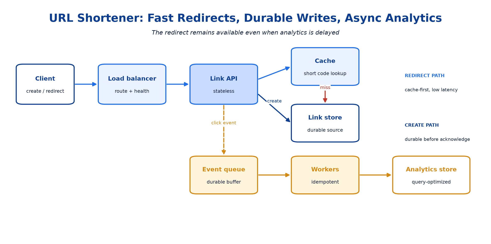

| Choice | Optimizes for | Costs / risks |
|---|---|---|
| Stateless API | Horizontal scaling and easy replacement | State moves to shared dependencies, which must scale instead |
| Cache-aside redirects | Low latency and ~100× less load on the store | Staleness, hot keys on viral links, cold-cache stampede |
| Durable link store | A create is never lost once confirmed | Higher write latency than an in-memory option |
| Async click analytics | Redirects stay fast even if analytics is degraded | Analytics lag, duplicate or out-of-order events |
| Single region initially | Simplicity and lower cost | A regional outage takes the service down; distant users pay latency |
| 302 over 301 redirect | Every click reaches us (analytics, expiry, takedown work) | More redirect traffic than a browser-cached 301 |

### Failure walk-through

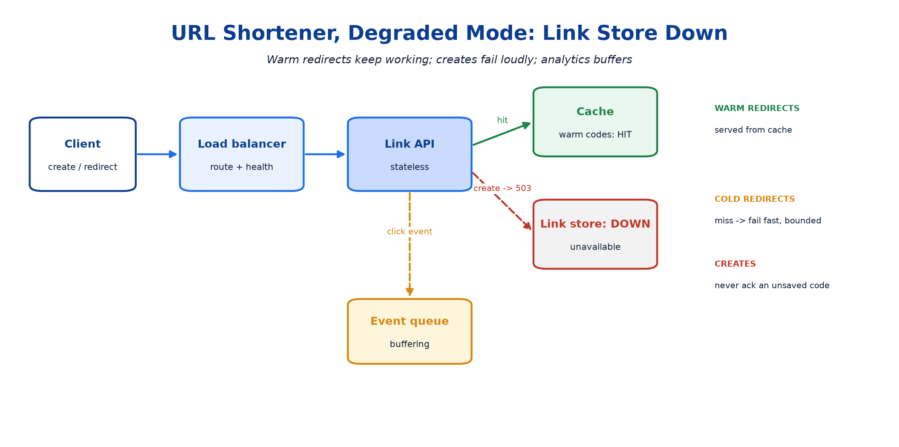

| Failure | User-visible behavior | Detection | Recovery |
|---|---|---|---|
| Link store down | Warm redirects work; cold redirects fail fast; creates return 503 | Store health checks, create error rate | Store failover; cache keeps most traffic alive meanwhile |
| Cache down or cold | Redirects slower; origin protected by a concurrency limit | Hit ratio drop, origin QPS spike | Warm the cache gradually; coalesce concurrent misses |
| Viral hot key | One cache shard saturates while total QPS looks normal | Per-key / per-shard QPS | Coalescing, local in-process cache, or push that code to the CDN |
| Analytics queue backed up | Nothing: redirects unaffected by design | Consumer lag alert | Scale consumers; retention covers the backlog |

The one non-negotiable: **never hand back a short code that was not durably saved.** Refusing to create a link is annoying; a link that 404s after someone printed it on a billboard is a very bad day.

---

## 9. Anti-patterns that cost points

- Jumping to microservices before stating a single requirement.
- Sharding 2 TB of data. (It fits on one machine. You know this now.)
- "We'll use Kafka" with no consumer, ordering, or replay story.
- Designing for 100× traffic that nobody asked for.
- Adding a cache without stating the invalidation rule or the cold-start behavior.
- Quoting average latency.
- Retries at every layer.

---

## 10. Final revision checklist

```text
[ ] CLARIFY users, use cases, constraints, and out-of-scope items
[ ] QUANTIFY peak QPS, ratio, payloads, storage, working set, headroom
[ ] DEFINE minimal APIs/events, entities, and ranked access patterns
[ ] DRAW read, write, async, and trust-boundary paths
[ ] COMPOSE availability across hard dependencies; state latency as percentiles
[ ] FIND the likely bottleneck and deep-dive it
[ ] EXPLAIN deadlines, retry owner, bounds, degradation, and blast radius
[ ] DEFEND each choice: optimizes, costs, validates, evolves
[ ] CLOSE with requirements met, biggest risk, and 10× evolution
```

!!! success "The Staff-level finish"
    Summarize the architecture, identify its first likely bottleneck, explain degraded behavior, and name the metric or trigger that would justify the next layer of complexity.
