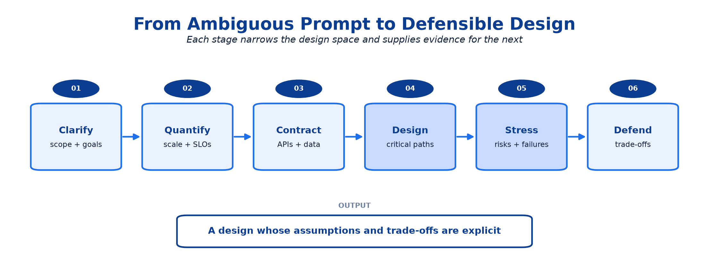
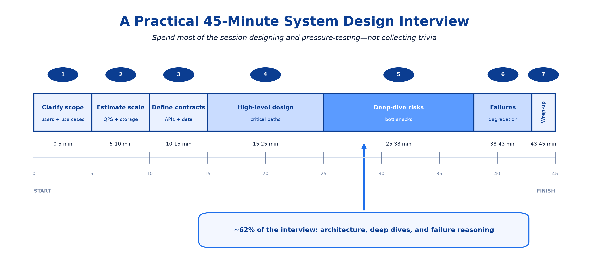
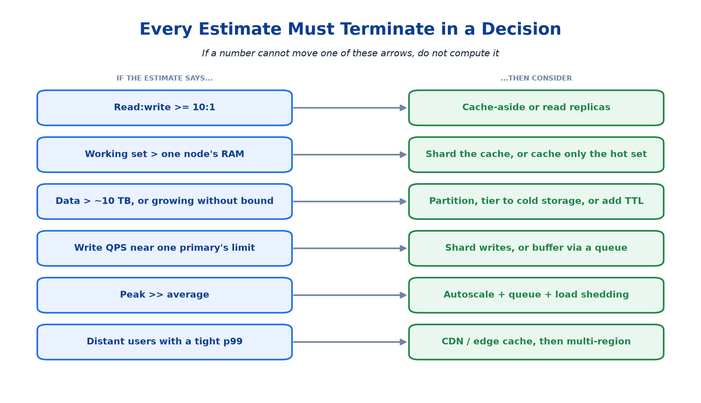
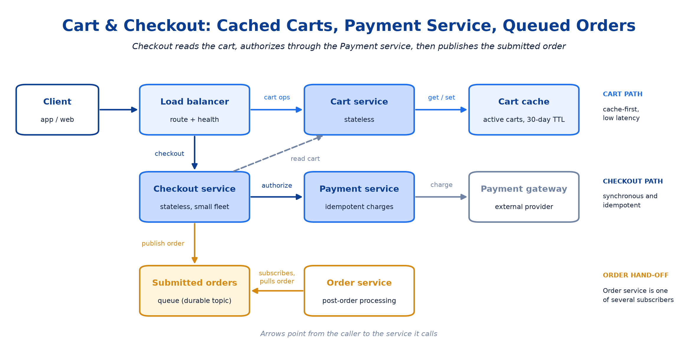

# Interview Framework & Capacity Estimation

## Terms to know before you start

You do not need to memorize these. Come back to this table whenever a term feels unfamiliar.

| Term | What it means in plain words |
|---|---|
| **QPS** (queries per second) | The number of requests that reach the system every second. It is the basic unit of "how busy is this system?" |
| **Average vs peak** | The average is the load spread evenly over a whole day. The peak is the load during the busiest moment, which is always higher and is what the system must survive. |
| **Read/write ratio** | How many times data is read compared to how many times it is written. A ratio of 100:1 means every piece of data is read about 100 times after it is created. |
| **Latency** | How long one request takes from the moment it is sent until the response arrives, usually measured in milliseconds (ms). |
| **p99 latency** | The time within which 99% of requests finish. If the p99 is 100 ms, then only 1 request in 100 is slower than 100 ms. We use percentiles because averages hide the slow requests that users actually notice. |
| **Availability** | The percentage of time (or of requests) the system answers successfully. 99.9% availability allows about 8.8 hours of downtime per year. |
| **Replica** | An extra copy of the data kept on another machine, so the data survives if one machine fails. |
| **Cache** | A small, fast store kept in memory that holds frequently read data, so most reads do not have to reach the slower database. |
| **Working set** | The portion of the data that is read often enough to be worth keeping in the cache. |
| **Idempotency key** | A unique value a client sends with a request so that retrying the same request twice does the work only once. Essential for any action that spends money. |

---

## 1. What a system design interview looks like



A system design interview starts with a deliberately vague prompt such as "Design the cart and checkout flow for an online store." Your job is not to produce a perfect architecture; your job is to show a clear, step-by-step way of thinking. The framework above is a funnel: you start broad by understanding what matters, then narrow down by putting numbers on it, defining the interface, drawing the design, and finally explaining the trade-offs you made.



| Phase | Time | What you are trying to achieve |
|---|---:|---|
| Clarify | 0–5 min | Agree with the interviewer on the two or three most important use cases, and say out loud what you are choosing not to build. |
| Quantify | 5–10 min | Estimate the traffic, storage, and other numbers that will actually influence the design. This page spends most of its time here. |
| Contract | 10–15 min | Define the small set of API endpoints and data entities the system needs to support the use cases. |
| Design | 15–25 min | Draw one diagram that shows how a request flows through the system, from the user to the data and back. |
| Stress | 25–38 min | Pick the part of the design most likely to break under load and explain how you would handle it. |
| Fail | 38–43 min | Explain what the user experiences when an important component, such as the database, goes down. |
| Close | 43–45 min | Summarize the design, the main trade-off you made, and what you would change if traffic grew tenfold. |

!!! tip "The interview in one sentence"
    Given the requirements and the expected scale, choose the simplest architecture that works, and be ready to explain what it costs and when it would need to change.

As a beginner, focus on getting the first four phases right. The Stress, Fail, and Close phases build on topics later in the curriculum, and you will get much better at them as you work through those topics.

---

## 2. Requirements: deciding what you are building

Before drawing anything, sort what you learn about the problem into four buckets. Doing this out loud shows the interviewer that you design from needs rather than from favorite technologies.

| Type | The question it answers | Cart & checkout example |
|---|---|---|
| **Functional** | What must the system do for its users? | Shoppers can add, update, and remove items in a cart, see the running total, and check out to turn the cart into a paid order. |
| **Non-functional** | How well must the system behave while doing it? | Cart reads and writes should feel instant (p99 under 150 ms) and can tolerate rare, harmless inconsistency. Checkout must be strongly consistent and safe to retry: the same checkout request submitted twice must never create two orders or charge the customer twice. |
| **Constraint** | What boundary must the design respect? | Prices are in Mexican pesos (MXN) and include IVA, Mexico's 16% value-added tax. Charges go through an external payment gateway the team does not control. |
| **Out of scope** | What are we deliberately not building today? | Product catalog/search, inventory availability, shipping and fulfillment, fraud/risk scoring, and post-order processing are owned by other services. Multi-currency pricing and split-tender payments are not needed for a single-country, peso-only market. |

Non-functional requirements are only useful when they are specific. "Checkout should be reliable" cannot guide a decision, but "a checkout request retried after a timeout must never create a second order" can, because you can test whether a design meets it.

??? info "Go deeper (optional): what the 'nines' of availability mean"
    Availability is often described by counting the nines in the percentage. Each extra nine cuts the allowed downtime by ten, and typically costs far more engineering effort to achieve, so only promise what the business actually needs.

    | Availability | Allowed downtime per year | Where it is typical |
    |---:|---:|---|
    | 99% | About 3.65 days | Batch jobs and internal tools that can be rerun later |
    | 99.9% | About 8.8 hours | A typical internal service |
    | 99.99% | About 53 minutes | A typical customer-facing service |
    | 99.999% | About 5 minutes | Rarely justified, and very expensive to achieve |

    The arithmetic for combining the availability of several components is covered in **Basics 14 (Availability & Deployment Fundamentals)**.

---

## 3. Clarifying questions that actually change the design

A clarifying question is only worth asking if the answer would change something in your design. For this page, assume the interviewer says: "this is Walmart's cart and checkout platform for the Mexico market" — Walmart de México y Centroamérica, Walmart's largest international market, operating roughly 3,000 Walmart Supercenter, Bodega Aurrera, and Sam's Club locations across a country of about 129 million people. Each question below states what its answer decides, along with the answer we will assume at that scale.

| Question | What the answer decides | Assumed answer for cart & checkout |
|---|---|---|
| Who are the users, and what are the top two or three things they do? | It decides which request path is the most important one to make fast and reliable, and which one is the most important to make *correct*. | Shoppers add, update, and remove cart items constantly. Checking out is rare by comparison, but it is the one action that moves real money. |
| What is explicitly out of scope? | It decides where you are allowed to stop designing, so you do not waste time on features nobody asked for. | Product catalog, inventory, shipping, and fraud detection are separate services we only call into. |
| Roughly how much traffic should we expect? | It decides whether a single server and database are enough, or whether the design must scale out. | About 1.2 billion cart actions per month, but only about 10 million completed checkouts per month. |
| How long must the data be kept? | It decides how much storage the system needs and whether storage keeps growing forever. | Abandoned carts expire after 30 days. Completed orders and payment records are kept for 5 years, the period Mexico's Código Fiscal de la Federación requires for accounting records. |
| How fast and how reliable must the most important action be? | It decides the latency, consistency, and safety targets the design will be measured against. | Cart operations should finish within 150 ms and can tolerate an occasional lost update. Checkout must be strongly consistent, durable, and idempotent: retrying it must never double-charge a customer. |

The interviewer may not give you every number. When they do not, propose a reasonable value, say it out loud, and ask whether it sounds right. Stating an assumption clearly is always better than silently guessing.

---

## 4. Capacity estimation, one step at a time


Capacity estimation means turning user behavior into infrastructure needs. You start with how many users there are and what they do, derive the traffic from that, and then derive storage, bandwidth, memory, and server counts from the traffic. The diagram above shows that chain.

The goal is not precision. You want the right order of magnitude (is it 10, 1,000, or 100,000 requests per second?), because that is what changes the design. Round your numbers freely, and always finish an estimate by saying what it means for the design.

!!! tip "The one rule of estimation"
    If a number cannot change a decision, it is not worth computing. Every estimate below ends with a short "what this tells us" statement for exactly this reason.

The sections below form a ladder. Each level introduces one new idea, applies it to the cart and checkout flow at Walmart Mexico's scale, and then gives you a practice problem. The practice problems all use the same second example, Walmart Mexico's store and distribution-center inventory network, so you can carry your answers forward from one level to the next.

### Level 0: Unit shortcuts

Most estimation mistakes are unit mistakes rather than bad assumptions. These shortcuts let you do the arithmetic in your head.

| Shortcut | Why it works and how to use it |
|---|---|
| **1 day ≈ 100,000 seconds** | A day has 86,400 seconds, which is close enough to 100,000. To turn "per day" into "per second", divide by 100,000. |
| **1 month ≈ 2.5 million seconds** | Thirty days of 86,400 seconds is about 2.6 million, and 2.5 million makes the division easier. To turn "per month" into "per second", divide by 2.5 million. |
| **Each size unit is 1,000 times the previous one** | A kilobyte (KB) is 1,000 bytes, then megabyte (MB), gigabyte (GB), terabyte (TB), and petabyte (PB), each 1,000 times larger. |
| **Network speeds are quoted in bits, not bytes** | One byte is 8 bits, so multiply bytes per second by 8 to compare against a network link rated in megabits or gigabits per second. |

For example, 1 million events per day is 1,000,000 / 100,000 = **10 per second**, and 1 billion events per day is **10,000 per second**.

!!! question "Practice"
    1. Walmart Mexico's app logs 50 million search events per day. About how many events per second is that?
    2. Walmart Mexico's price-lookup service handles 2 billion requests per month. About how many requests per second is that?

??? success "Answer"
    1. 50,000,000 / 100,000 = **500 events per second**.
    2. 2,000,000,000 / 2,500,000 = **800 requests per second**.

### Level 1: Average QPS from user behavior

Traffic is rarely given to you as QPS. You derive it by multiplying the number of actions per period, then dividing by the number of seconds in that period.

```text
Average QPS = actions per period / seconds in that period
```

For Walmart's Mexico cart and checkout flow, 9 million daily active shoppers perform 1.2 billion cart actions per month (adding, updating, or removing an item):

```text
Average cart-write QPS = 1,200,000,000 / 2,500,000 ≈ 480 cart actions per second
```

**What this tells us:** 480 writes per second is meaningful but ordinary load for a well-built cart store. The interesting number is not here — it is in how rarely a cart action turns into a checkout, which is where correctness, not throughput, becomes the hard problem.

!!! question "Practice: Walmart Mexico's store inventory network"
    Walmart Mexico's inventory network spans about 3,000 Walmart Supercenter, Bodega Aurrera, and Sam's Club locations, and the network records 15,000 stock-change events per day per location (sales, restocks, returns, damage write-offs). What is the average write QPS?

??? success "Answer"
    3,000 locations × 15,000 events = 45,000,000 events per day.
    45,000,000 / 100,000 = **450 writes per second** on average.

### Level 2: Read/write ratio and peak traffic

Two adjustments turn the average write rate into the numbers the design must actually handle.

First, apply the **read/write ratio**. Most systems read data far more often than they write it, and the reads usually dominate the load. Second, apply a **peak factor**. Traffic is never spread evenly over the day; lunchtime, a push notification, or a viral post can multiply it. Systems fail at the peak, not at the average, so you design for the peak.

```text
Average read QPS = average write QPS × reads per write
Peak QPS         = average QPS × peak factor
```

Choose the peak factor based on how users arrive:

| How the traffic arrives | Typical peak factor |
|---|---|
| Users are spread across many time zones, as in a global consumer app. | 2–3× |
| Usage is concentrated in business hours or a single region's waking hours. | 3–5× |
| Users arrive all at once, as with flash sales, live events, or links going viral on social media. | 10× or more |

Mexico gives us two real peaks worth naming, and they are not the same size. Every two weeks, Mexican payroll cycles around **quincena** (paydays on the 15th and the last day of the month), which reliably pushes traffic to roughly 2–3× the average for a day or two. Once a year, **El Buen Fin**, Mexico's national shopping event held every November over the long weekend around Revolution Day, can push traffic past 10× the average. The lesson is to design for the bigger of the two realistic peaks, not just the one that happens more often, so we use a 10× peak factor here. Each cart action is also preceded by a shopper checking their cart about 8 times (open cart, change a quantity, re-check the total), and only a small fraction of all that activity ever reaches checkout — about 10 million completed checkouts per month, against 1.2 billion cart actions:

```text
Average cart-read QPS = 480 × 8                  = 3,840 per second
Average checkout QPS  = 10,000,000 / 2,500,000   = 4 per second
Peak cart-write QPS   = 480 × 10                 = 4,800 per second
Peak cart-read QPS    = 3,840 × 10               = 38,400 per second
Peak checkout QPS     = 4 × 10                   = 40 per second
```

**What this tells us:** cart reads dominate by volume, same as any read-heavy system, so a cache belongs in front of the cart store. But look at the checkout number: 40 requests per second at peak is small next to 38,400 cart reads. This is a lesson the old URL-shortener example could never teach, because its two paths (create and redirect) differed only in volume: **low QPS does not mean low stakes.** Checkout is the one path in this whole system where a bug costs real money, so it earns a design budget completely out of proportion to its traffic.

!!! question "Practice: Walmart Mexico's store inventory network"
    Each stock change is preceded by an availability check about 6 times (product pages, cart adds, reorder jobs), and inventory traffic spikes during El Buen Fin and Hot Sale too, so use an 8× peak factor. What are the peak read and write QPS?

??? success "Answer"
    Average reads = 450 × 6 = 2,700 per second.
    **Peak reads = 2,700 × 8 = 21,600 per second.**
    **Peak writes = 450 × 8 = 3,600 per second.**

### Level 3: Storage over time

Traffic tells you how busy the system is right now. Storage tells you how much disk the data will consume over its lifetime. Build it up in four steps so that no factor is forgotten.

```text
1. Size of one record
2. Number of records  = records created per period × retention period
3. Raw storage        = number of records × size of one record
4. Real storage       = raw storage × replicas × overhead for indexes and metadata
```

The overhead factor matters because databases store more than your raw data. Indexes, metadata, and the storage engine's own bookkeeping usually make the real footprint 1.5 to 3 times the raw size, before replication.

Carts and orders need very different retention policies, and that difference is itself a design decision. A cart record holds the cart ID, user ID, line items (product ID, quantity, price snapshot), and timestamps — about 800 bytes. Carts are not kept forever: an abandoned cart expires after 30 days of inactivity, so the store only ever needs to hold carts touched recently, not a history of every cart since launch.

```text
Live carts (30-day window) ≈ 45 million
Raw storage      = 45 million × 800 bytes   = 36 GB
With 3 replicas  = 36 GB × 3                = 108 GB
With overhead    = 108 GB × 1.5 to 3        ≈ 160 to 325 GB
```

**What this tells us:** because carts expire, this store never grows past a bounded size — even at Walmart Mexico's scale it fits comfortably in memory across a small cluster, which is a strong hint that the cart store should live in a distributed cache rather than a traditional disk-backed database.

A completed order is a different story. Once a shopper pays, the order (owned by the Order service) and its payment record (owned by the Payment service) become financial documents that Mexican tax law requires keeping for 5 years, not 30 days. Together, an order with its line items and its payment record is about 1.5 KB.

```text
Orders per year    = 10 million per month × 12            = 120 million
Orders over 5 years                                          = 600 million
Raw storage        = 600 million × 1.5 KB                   = 0.9 TB
With 3 replicas    = 0.9 TB × 3                              ≈ 2.7 TB
With overhead      = 2.7 TB × 1.5 to 3                       ≈ 4 to 8 TB
```

**What this tells us:** at this scale, the order and payment records cross the line from "fits comfortably on one well-provisioned database" into "needs to be partitioned." Several terabytes of transactional data, growing every month, is the point where most teams start splitting the ledger by date range (older orders move to cheaper storage) or by customer ID (spreading writes across machines) — both covered in **Basics 12 (Data Partitioning, Sharding & Replication)**. Notice that this is a genuinely different conclusion from the cart store just above: the *same* estimation method says the cart stays on one bounded cluster forever, while the order ledger does not, because retention without an expiry keeps growing and request volume alone never would have told you that.

!!! question "Practice: Walmart Mexico's store inventory network"
    An inventory row tracks one SKU in one location (SKU ID, location ID, quantity on hand, last updated) and is about 100 bytes. Not every SKU sits in every location — across the whole network there are about 300 million SKU-location combinations actively tracked. Unlike a cart or an order, a sale updates this row in place; it does not add a new row. How much storage is needed, and what does that suggest about how to estimate storage here?

??? success "Answer"
    Raw storage = 300,000,000 × 100 bytes = 30 GB.
    With 3 replicas: 90 GB, and with overhead: **about 135 to 270 GB.**

    The lesson: storage for a current-state table is driven by the number of distinct keys you track, not by how many events touch it or how long you keep history — very different from the cart and order stores, which grow with retention.

### Level 4: Bandwidth

Bandwidth is the amount of data moving over the network every second. It tells you whether the network, rather than the servers or the database, could become the bottleneck.

```text
Bandwidth = peak QPS × size of each response (or request)
```

A cart response is small, about 1 KB once you include the item list and totals:

```text
Peak cart-read bandwidth = 38,400 × 1 KB = 38.4 MB per second (about 307 megabits per second)
```

**What this tells us:** 307 megabits per second is well within what a modern server's network card handles, but it is now large enough that it should clearly be spread across several cart-service instances and, ideally, across Walmart Mexico's regional presence (Mexico City, Guadalajara, Monterrey) rather than funneled through one box — as long as the cart response only carries product IDs and prices. The moment someone inlines full product images or long descriptions into the cart payload, this number explodes by a factor of a thousand, which is exactly why product details belong in a separate, independently cacheable catalog service rather than embedded in the cart record. That boundary is covered in **Basics 5 (Architecture Styles & Service Decomposition)**.

!!! question "Practice: Walmart Mexico's store inventory network"
    Using the peak read QPS from Level 2 and 100 bytes per inventory row, what is the peak read bandwidth?

??? success "Answer"
    21,600 × 100 bytes = **2.16 MB per second** (about 17.3 megabits per second), which is trivial for any server to handle.

### Level 5: Memory and the cache working set

Reading from memory is much faster than reading from disk, so read-heavy systems keep their most popular data in a cache. The question for estimation is whether that popular data, the working set, fits in the memory of one machine.

The usual rule of thumb is that about 20% of the items receive about 80% of the reads — true for something like a viral link, where a small set of items absorbs most of the traffic. A shopping cart does not behave that way: a shopper almost only ever reads their own cart, so the working set here is closer to "one entry per currently active shopper" than "the 20% most popular items."

```text
Concurrently active carts at peak ≈ 4 million
Cache size = 4 million × 1 KB      ≈ 4 GB
```

**What this tells us:** 4 GB fits trivially on a couple of cache nodes with room to spare, even at Walmart Mexico's scale. The interesting design decision is not the size — it is that this cache is the *primary* store for active carts, not just a read-through accelerator sitting in front of a database, because cart data is cheap to lose (the shopper just re-adds the item) but expensive to make slow.

??? info "Go deeper (optional): why the cache hit ratio matters so much"
    The **hit ratio** is the share of reads the cache answers without going to the backing store. The load that still reaches the backing store is:

    ```text
    Backing-store read QPS = total read QPS × (1 − hit ratio)
    ```

    At 38,400 peak cart reads per second, a 99% hit ratio sends 384 reads per second to the backing store. If the hit ratio drops to 95%, the backing store receives 1,920 reads per second — five times more. A change that looks small as a percentage can multiply backing-store load, which is why teams monitor the hit ratio closely. Caching strategies are covered in **Basics 9 (Caching Core)**.

!!! question "Practice: Walmart Mexico's store inventory network"
    Reads per day = 2,700 average reads per second × 100,000 seconds = 270 million. Using the same 20%-of-items rule and 100 bytes per row, how big should the cache be — and what extra risk does this working set carry that the cart cache does not?

??? success "Answer"
    Cache size = 270,000,000 × 20% × 100 bytes = **5.4 GB**, which fits easily on one or two small cache nodes.

    Unlike the cart, inventory traffic really is skewed by popularity — one SKU going viral in a flash sale can draw far more than the 80/20 average predicts. That exposes this cache to the **hot-key problem**, covered in **Advanced 8 (Distributed Caching & High-Concurrency Failures)**, in a way the per-shopper cart cache simply is not.

### Level 6: How many servers

The final step turns peak traffic into a server count. The number of requests one server can safely handle depends on how much work each request does, and in real life it comes from load testing. In an interview, state it as an assumption.

You also need headroom. If every server runs at 100% during the peak, losing a single server or receiving a slightly bigger spike will overload the rest. A common habit is to plan for servers to run at about 70% of their capacity during the peak.

```text
Servers = peak QPS / (safe QPS per server × 0.7)
```

Cart operations are simple key-value reads and writes against the cache described above. Assume one cart-service instance safely handles 1,500 operations per second. Combined peak cart traffic is 4,800 writes plus 38,400 reads per second:

```text
Cart servers = 43,200 / (1,500 × 0.7) = 43,200 / 1,050 ≈ 42 servers
```

Checkout is a different animal: each request reads the cart from the cart service, recalculates prices and IVA, waits on a synchronous call to the Payment service (which itself waits on the external gateway), and then publishes the submitted order to a queue. That is heavier work, so assume one checkout-service instance safely handles 40 requests per second. Peak checkout traffic is only 40 per second:

```text
Checkout servers = 40 / (40 × 0.7) = 40 / 28 ≈ 2 servers, by the math
```

**What this tells us:** 42 cart servers is a real, Walmart-sized fleet, but checkout only needs about 2 by the math. You would still never run just 2: running at least 3 instances across separate failure domains is a decision driven by *availability*, not throughput — if a single checkout server dies mid-deploy during El Buen Fin, nobody can pay for anything. **Basics 14 (Availability & Deployment Fundamentals)** covers exactly this gap between "enough capacity" and "enough redundancy."

??? info "Go deeper (optional): concurrency and Little's Law"
    The capacity diagram at the top of this section includes **concurrency**: the number of requests being processed at the same moment. It matters because thread pools and database connection pools have fixed sizes. Little's Law estimates it:

    ```text
    Requests in flight = requests per second × seconds each request takes
                       = 40 × 0.3 seconds (300 ms, most of it waiting on the Payment service)
                       ≈ 12 checkout requests in flight across all servers
    ```

    The warning is the same as ever, just scarier at this scale: if the external gateway slows from 300 ms to 3 seconds under its own El Buen Fin load, the Payment service slows with it, and in-flight checkout requests jump from about 12 to about 120. The absolute numbers are still small compared to the cart fleet, but a slow payment path can exhaust a checkout thread pool fast and start queuing up customers' money — exactly the scenario circuit breakers and timeout budgets exist for. This is covered properly in **Basics 16 (Threads, Thread Pools, Parallelization)** and **Advanced 7 and 11**.

!!! question "Practice: Walmart Mexico's store inventory network"
    Peak traffic is 3,600 writes plus 21,600 reads per second. Each check-and-update touches a row lock, so assume one server safely handles 800 requests per second. How many servers do you need?

??? success "Answer"
    Servers = (3,600 + 21,600) / (800 × 0.7) = 25,200 / 560 ≈ **45 servers**.

---

## 5. Turning numbers into decisions



Estimates are only valuable when they lead to a design choice. The diagram above lists the most common patterns: when the numbers look like the left-hand side, the right-hand side is the option worth considering. You do not need to know how every option works yet; each one has its own topic later in the curriculum.

When you are unsure whether a number is "big", these rough rules of thumb help you decide:

| Question to ask yourself | Rule of thumb |
|---|---|
| Can stateless application servers handle the load? | Almost always, because you can keep adding more identical servers behind a load balancer. |
| Can one database server handle all the writes? | Writes are usually the first limit you hit. Start paying attention when writes reach the low thousands per second. |
| Does the frequently read data fit in one machine's memory? | Tens to a few hundred gigabytes fit on one machine. Beyond that, the cache must be split across several machines. |
| Are the users far away from the servers? | Physical distance can add 100 ms or more that no server optimization can remove. Only moving data closer to users, for example with a CDN, helps. |

!!! warning "Avoid decorative arithmetic"
    Precise numbers do not impress interviewers; clear reasoning does. Say "roughly" out loud, round aggressively, and spend your time explaining what each number means for the design.

---

## 6. Putting it together: the cart, checkout, and payment flow

This section collects everything from the ladder into the summary you would write on the whiteboard during the Quantify phase.

### Assumptions stated out loud

None of these numbers come from the original one-sentence prompt. They are estimates you state clearly so the interviewer can correct them before you build on them.

```text
Walmart de México y Centroamérica: ~3,000 stores and clubs, ~129 million people in Mexico
9 million daily active shoppers
1.2 billion cart actions per month           (write volume: add, update, remove)
8 cart reads per cart action                 (read/write ratio, so reads dominate)
10 million completed checkouts per month     (the rare, high-stakes path)
10× peak factor                              (El Buen Fin and Navidad; quincena is a smaller, 2–3× recurring peak)
800 bytes per cart record, 30-day TTL
~1.5 KB per order + payment record, 5-year retention (Mexican tax law), 3 replicas
All prices in MXN, IVA (16%) included
```

### Derived numbers and what each one decides

| Estimate | Value | What it decides |
|---|---|---|
| Peak cart reads | About 38,400 per second | Reads dominate, so an in-memory cache fronts — and largely *is* — the cart store. |
| Peak cart writes | About 4,800 per second | Needs a real fleet of cart-service instances, but still one logical cache tier; no sharding needed for the cart itself. |
| Peak checkout | About 40 per second | Small volume, but the one path that must never silently fail or double-charge. |
| Submitted-order messages | About 40 per second at peak, about 330,000 per day | Trivial for any message broker. The requirement is durability, not throughput. |
| Cart storage | About 160–325 GB (bounded by the 30-day TTL) | Fits entirely in a distributed cache cluster. |
| Order + payment storage | About 4–8 TB (5-year retention) | The Order and Payment services' stores need partitioning by date or customer ID (Basics 12). |
| Cart servers | About 42 | A real, horizontally-scaled fleet behind a load balancer. |
| Checkout servers | 2–3+ (availability-driven, not load-driven) | A small fleet is enough for load, but redundancy matters more than capacity here. |

The headline to say out loud is: **"About 38,400 cart reads per second against about 40 checkouts per second — this is a system with one firehose and one needle, and at Walmart's scale the needle's own data store is now big enough to need partitioning, even though its traffic never will."**

### The minimal contract

Keep the API as small as possible while still covering the use cases:

```text
POST   /cart/items          {product_id, qty}               -> 200 OK {cart}
PATCH  /cart/items/{itemId} {qty}                            -> 200 OK {cart}
DELETE /cart/items/{itemId}                                  -> 200 OK {cart}
GET    /cart                                                 -> 200 OK {cart}
POST   /checkout  {cart_id, payment_method, idempotency_key} -> 202 Accepted {order_id, status: SUBMITTED}
GET    /orders/{order_id}                                    -> 200 OK {order, payment_status}
```

Checkout returns `202 Accepted` rather than `201 Created` on purpose: once payment is authorized, the order is *submitted* to a queue, and the Order service creates it moments later. The client already has the `order_id`, so it can show a confirmation straight away and poll `GET /orders/{order_id}` for the final status.

The data model needs three related entities, each owned by exactly one service:

```text
Cart:    cart_id (PK)    | user_id | items[] (product_id, qty, price_snapshot) | updated_at | expires_at   -- Cart service
Order:   order_id (PK)   | user_id | items[] | subtotal | discount | iva | total | status | created_at  -- Order service
Payment: payment_id (PK) | order_id | amount_mxn | status | gateway_ref | idempotency_key | created_at -- Payment service
```

Unlike a single-entity URL shortener, these entities have real relationships to manage: one order has many items, and one order has (usually) one payment, but may have more after a retry. Modeling those relationships well is covered in **Basics 11 (Practical Data Modeling & Query Design)**.

### The design



Each component in the diagram exists because of a specific number or requirement from the earlier sections:

| Component | Why it is in the design |
|---|---|
| **Load balancer** | Spreads requests across the cart-service and checkout-service fleets, and stops sending traffic to any instance that becomes unhealthy. |
| **Cart service (stateless) + distributed cache** | Cart reads outnumber writes 8 to 1, and the entire 30-day working set fits in a small cache cluster, so the cache *is* the primary store for active carts, not just an accelerator in front of one. The cart service is the only owner of cart data, so checkout asks it for the cart instead of reading the cache directly. |
| **Checkout service (stateless)** | Orchestrates one checkout: read the cart from the cart service, price it, ask the Payment service to authorize, then publish the submitted order. It owns no long-lived data. It runs as its own fleet because it scales for availability, not throughput, and it has a very different blast radius from the cart. |
| **Payment service** | The only service that talks to the external payment gateway, and the owner of every payment record. Retries, timeout budgets, idempotency keys, and gateway quirks all live in this one place, instead of being copied into every service that needs to take money. |
| **Payment gateway (external)** | The third-party provider that actually moves the money. It is outside our control, so the design assumes it can be slow or unavailable. |
| **Submitted-order queue** | A durable topic. Checkout publishes the order only after payment is authorized, then returns to the customer straight away. New subscribers can be added later without touching checkout. Queues are covered in **Basics 13 (Asynchronous Processing Basics)**. |
| **Order service** | One subscriber to the queue. It picks up each submitted order, stores it in the partitioned order store (Basics 12), and starts post-order processing, which is out of scope for this design. |

Notice what is still simple in this design: there is no second region yet, and no saga orchestrator. Notice, too, the one crack it leaves open on purpose. If payment is authorized but publishing to the queue fails, the customer has paid for an order nobody will process. Closing that gap reliably, usually with a *transactional outbox* that records the order and the outgoing message together, is picked up in **Basics 13** and **Advanced 4 (Distributed Transactions & Consensus)**, along with inventory reservation and multi-service fulfillment across Walmart Mexico's logistics network.

??? info "Go deeper (optional): why checkout needs an idempotency key"
    A mobile network blip is enough to make a client retry a checkout request it never actually received a response for. Without protection, that retry can submit a second order and charge the card twice. The fix is an idempotency key, generated once by the client and sent with the request: checkout passes the same key on to the Payment service, which checks whether it has already processed that key and, if so, returns the original result instead of charging again. The Order service uses the `order_id` the same way, so a message delivered twice by the queue still creates only one order.

    Designing this properly, including how long to remember keys and what happens when two requests race each other, is covered in **Advanced 7 (Idempotency & Retries)**.

---

## 7. Common beginner mistakes

- **Drawing boxes before stating requirements.** Without requirements, there is no way to tell whether a design is good, so the interviewer cannot give you credit for it.
- **Treating cart and checkout as one problem with one consistency model.** The cart can lose an update and nobody notices; checkout cannot.
- **Sizing checkout as if raw throughput were the hard part.** Forty requests per second is not a scaling problem; double-charging a customer is a correctness problem, and no amount of extra servers fixes that.
- **Applying one sharding decision to the whole system.** At Walmart Mexico's scale the cart store should still stay on one bounded, TTL-driven cache cluster, while the order ledger genuinely needs partitioning — the same estimation method correctly gives two different answers for two different stores.
- **Computing numbers that never influence a decision.** Every estimate should end with a sentence that starts with "so the design should…".
- **Quoting average latency instead of a percentile.** An average can look healthy while one request in a hundred is painfully slow, so always state latency as a percentile such as p99.
- **Adding retries to the payment call without an idempotency key.** That turns a harmless network blip into a duplicate charge.
- **Letting every service call the external payment gateway directly.** One Payment service that owns the gateway keeps retries, idempotency, and vendor quirks in one place.

---

## 8. Test yourself

These three problems increase in difficulty, and all three are other Walmart Mexico systems. Try each one on paper before opening the answer.

!!! question "Problem 1 (warm-up): a price and availability API"
    Walmart Mexico's price and availability API serves the app, the website, and in-store price checkers across about 3,000 locations, and receives 300 million requests per day. Most of Mexico's population shares one time zone, so traffic is concentrated in waking hours: assume a 4× peak factor. What are the average and peak QPS?

??? success "Answer"
    Average QPS = 300,000,000 / 100,000 = **3,000 requests per second**.
    Peak QPS = 3,000 × 4 = **12,000 requests per second**.

!!! question "Problem 2 (storage): electronic invoices (CFDI)"
    Mexican law requires a CFDI, an electronic invoice stamped by the tax authority (SAT), whenever a customer asks for a *factura*. Assume Walmart Mexico issues 1 million CFDIs per day across stores and online, each stored XML and PDF pair averages 10 KB, invoices are kept for the legally required 5 years, and storage keeps 3 replicas. How much storage is needed, and what does the number suggest?

??? success "Answer"
    Data per day = 1,000,000 × 10 KB = 10 GB.
    Over 5 years: 10 GB × 1,825 days ≈ 18 TB raw, and with 3 replicas that is **about 55 TB**, before any index overhead.

    That is far more than one database server should hold. A sensible decision is to keep the small, searchable metadata (the CFDI's UUID, the customer's RFC tax ID, date, and total) in the database and store the XML and PDF files in cheaper storage built for large files. Storage types are covered in **Advanced 13 (Storage Types)**.

!!! question "Problem 3 (full estimate): app clickstream analytics"
    Walmart Mexico's app and website have 9 million daily active shoppers. Each shopper generates 150 clickstream events per day (views, searches, taps), each event is about 500 bytes, and each event is read by 2 downstream consumers (analytics and personalization). Events are kept for 1 year with 3 replicas, and an ordinary day's peak factor is 3×. Estimate the peak write QPS, peak read QPS, storage, and peak read bandwidth. Then say which number matters most for the design.

??? success "Answer"
    ```text
    Events per day      = 9 million × 150          = 1.35 billion
    Average write QPS   = 1.35 billion / 100,000   = 13,500 per second
    Peak write QPS      = 13,500 × 3               = 40,500 per second
    Peak read QPS       = 40,500 × 2               = 81,000 per second
    Storage per day     = 1.35 billion × 500 bytes = 675 GB
    Storage per year    = 675 GB × 365             ≈ 246 TB raw, about 740 TB with 3 replicas
    Peak read bandwidth = 81,000 × 500 bytes       ≈ 40 MB per second
    ```

    **The number that matters most is the 40,500 writes per second**, and on El Buen Fin, at 10×, it passes 130,000. One database server starts to struggle in the low thousands of writes per second, so this design must spread writes across many machines, for example with a log partitioned by shopper ID. The storage size points the same way. The bandwidth, by contrast, is moderate and needs no special attention.

    Compare this with the cart and checkout flow: that system split cleanly into a huge, cheap read path and a tiny, precious write path, while this one is dominated by writes everywhere and needs the data split across machines. The same estimation method led to two very different designs for the same company, which is exactly why estimation comes before design.

---

## 9. Checklist and what comes next

```text
[ ] CLARIFY the users, the top two or three use cases, and what is out of scope
[ ] STATE your assumptions out loud and ask the interviewer to confirm them
[ ] ESTIMATE peak read and write QPS, storage, bandwidth, cache size, and servers
[ ] CONNECT every estimate to a design decision
[ ] DEFINE the smallest API and data model that cover the use cases
[ ] DRAW one diagram and justify every component with a number or requirement
[ ] SUMMARIZE the design and say what you would change at ten times the traffic
```

This page skipped several topics on purpose. Here is where each one is covered once you have the right foundations:

| Topic you may have heard about | Where it is covered |
|---|---|
| Combining the availability of several components, and removing single points of failure | Basics 14: Availability & Deployment Fundamentals |
| Cache strategies, eviction, CDNs, and hit ratios | Basics 9: Caching Core |
| Splitting data across machines, and database replicas | Basics 12: Data Partitioning, Sharding & Replication |
| Queues and background processing | Basics 13: Asynchronous Processing Basics |
| Generating unique order IDs and idempotency keys | Basics 15: Distributed ID Generation |
| Concurrency, thread pools, and Little's Law | Basics 16: Threads, Thread Pools, Parallelization |
| Retries, timeouts, circuit breakers, and bulkheads | Advanced 7, 10, and 11 |
| Tail latency and overload protection | Advanced 10: Backpressure, Admission Control & Overload Protection |
| Consistency versus availability (CAP) | Advanced 12: Data Consistency & Clock Synchronization |
| SLIs, SLOs, and error budgets | Advanced 14: Observability, Monitoring & Alerting |
| Hot keys and cache stampedes | Advanced 8: Distributed Caching & High-Concurrency Failures |
