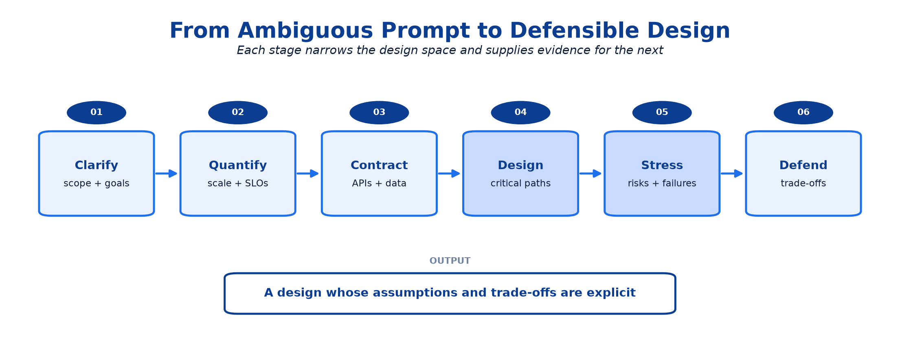
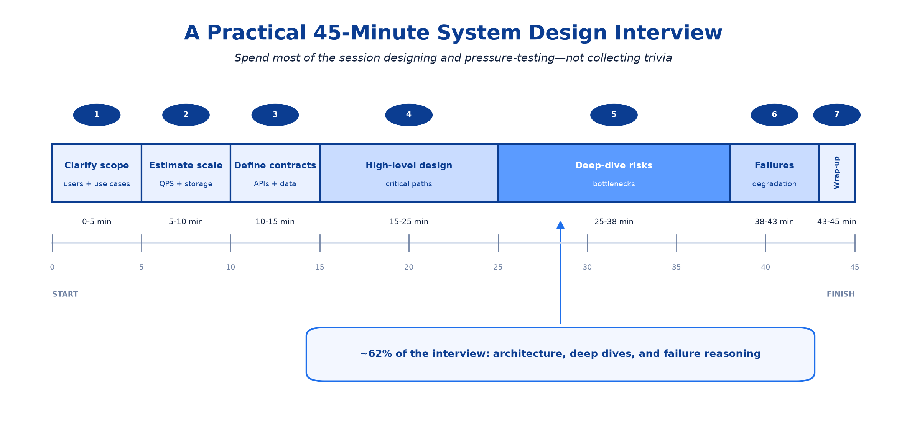
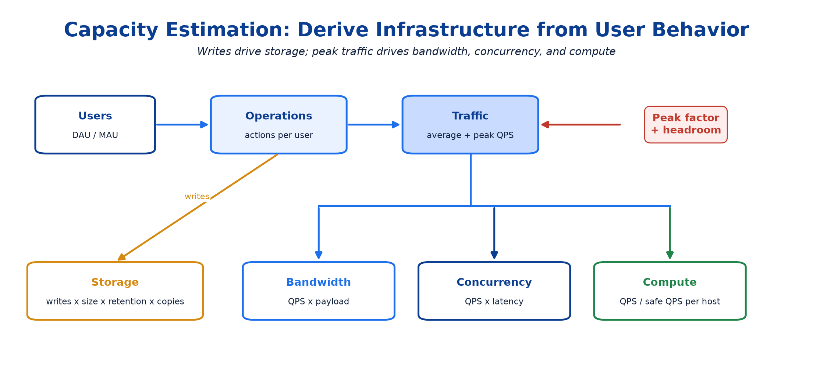
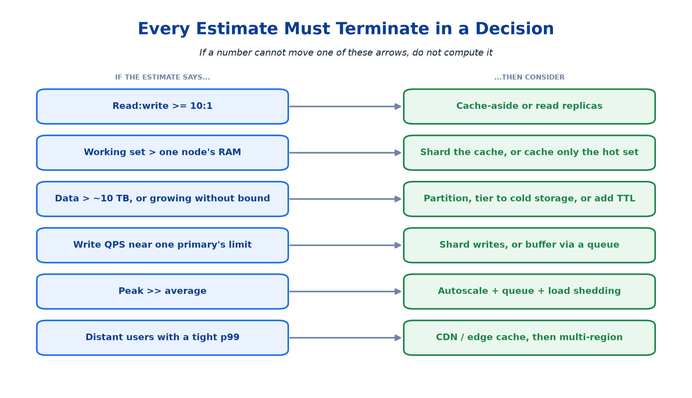
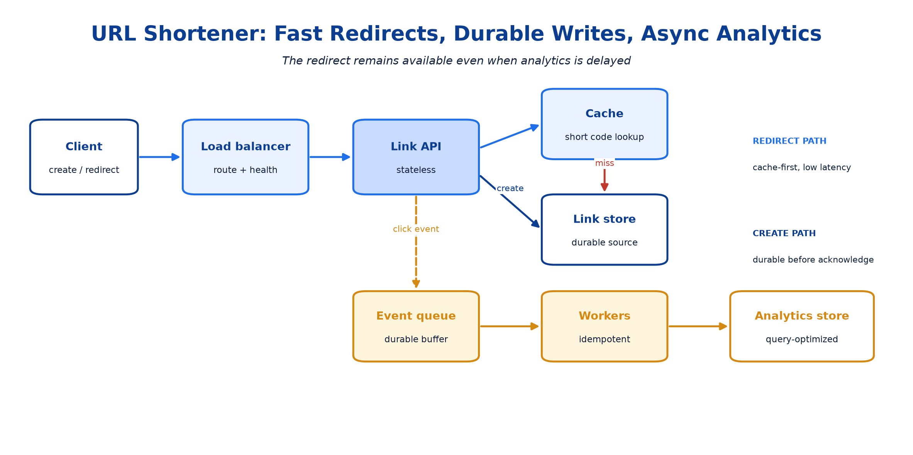

# Interview Framework & Capacity Estimation (v2: gentle start)

## Terms to know before you start

You do not need to memorize these. Come back to this table whenever a term feels unfamiliar.

| Term | What it means in plain words |
|---|---|
| **QPS** (queries per second) | The number of requests that reach the system every second. It is the basic unit of "how busy is this system?" |
| **Average vs peak** | The average is the load spread evenly over a whole day. The peak is the load during the busiest moment, which is always higher and is what the system must survive. |
| **Read/write ratio** | How many times data is read compared to how many times it is written. A ratio of 100:1 means every piece of data is read about 100 times after it is created. |
| **Latency** | How long one request takes from the moment it is sent until the response arrives, usually measured in milliseconds (ms). |
| **p99 latency** | The time within which 99% of requests finish. If the p99 is 100 ms, then only 1 request in 100 is slower than 100 ms. We use percentiles because averages hide the slow requests that users actually notice. |
| **Availability** | The percentage of time (or of requests) the system answers successfully. 99.9% availability allows about 8.8 hours of downtime per year. |
| **Replica** | An extra copy of the data kept on another machine, so the data survives if one machine fails. |
| **Cache** | A small, fast store kept in memory that holds frequently read data, so most reads do not have to reach the slower database. |
| **Working set** | The portion of the data that is read often enough to be worth keeping in the cache. |

---

## 1. What a system design interview looks like



A system design interview starts with a deliberately vague prompt such as "Design a URL shortener." Your job is not to produce a perfect architecture; your job is to show a clear, step-by-step way of thinking. The framework above is a funnel: you start broad by understanding what matters, then narrow down by putting numbers on it, defining the interface, drawing the design, and finally explaining the trade-offs you made.



| Phase | Time | What you are trying to achieve |
|---|---:|---|
| Clarify | 0–5 min | Agree with the interviewer on the two or three most important use cases, and say out loud what you are choosing not to build. |
| Quantify | 5–10 min | Estimate the traffic, storage, and other numbers that will actually influence the design. This page spends most of its time here. |
| Contract | 10–15 min | Define the small set of API endpoints and data entities the system needs to support the use cases. |
| Design | 15–25 min | Draw one diagram that shows how a request flows through the system, from the user to the data and back. |
| Stress | 25–38 min | Pick the part of the design most likely to break under load and explain how you would handle it. |
| Fail | 38–43 min | Explain what the user experiences when an important component, such as the database, goes down. |
| Close | 43–45 min | Summarize the design, the main trade-off you made, and what you would change if traffic grew tenfold. |

!!! tip "The interview in one sentence"
    Given the requirements and the expected scale, choose the simplest architecture that works, and be ready to explain what it costs and when it would need to change.

As a beginner, focus on getting the first four phases right. The Stress, Fail, and Close phases build on topics later in the curriculum, and you will get much better at them as you work through those topics.

---

## 2. Requirements: deciding what you are building

Before drawing anything, sort what you learn about the problem into four buckets. Doing this out loud shows the interviewer that you design from needs rather than from favorite technologies.

| Type | The question it answers | URL shortener example |
|---|---|---|
| **Functional** | What must the system do for its users? | Users can create a short link for a long URL, and anyone who visits the short link is redirected to the original URL. |
| **Non-functional** | How well must the system behave while doing it? | Redirects should be fast (p99 under 100 ms) and highly available, because a broken short link looks like a broken website. |
| **Constraint** | What boundary must the design respect? | The service must be built by a small team, so it should avoid operationally heavy components unless they are clearly needed. |
| **Out of scope** | What are we deliberately not building today? | Analytics dashboards, custom domains, and user accounts are out of scope for this interview. |

Non-functional requirements are only useful when they are specific. "Redirects should be fast" cannot guide a decision, but "redirects should finish within 100 ms for 99% of requests" can, because you can check whether a design meets it.

??? info "Go deeper (optional): what the 'nines' of availability mean"
    Availability is often described by counting the nines in the percentage. Each extra nine cuts the allowed downtime by ten, and typically costs far more engineering effort to achieve, so only promise what the business actually needs.

    | Availability | Allowed downtime per year | Where it is typical |
    |---:|---:|---|
    | 99% | About 3.65 days | Batch jobs and internal tools that can be rerun later |
    | 99.9% | About 8.8 hours | A typical internal service |
    | 99.99% | About 53 minutes | A typical customer-facing service |
    | 99.999% | About 5 minutes | Rarely justified, and very expensive to achieve |

    The arithmetic for combining the availability of several components is covered in **Basics 14 (Availability & Deployment Fundamentals)**.

---

## 3. Clarifying questions that actually change the design

A clarifying question is only worth asking if the answer would change something in your design. Each question below states what its answer decides, along with the answer we will assume for the URL shortener.

| Question | What the answer decides | Assumed answer for the URL shortener |
|---|---|---|
| Who are the users, and what are the top two or three things they do? | It decides which request path is the most important one to make fast and reliable. | The public creates links and clicks them. Clicking (redirecting) is by far the most common action. |
| What is explicitly out of scope? | It decides where you are allowed to stop designing, so you do not waste time on features nobody asked for. | Analytics dashboards and custom domains are out of scope. |
| Roughly how much traffic should we expect? | It decides whether a single server and database are enough, or whether the design must scale out. | About 20 million new links per month, and each link is clicked about 100 times. |
| How long must the data be kept? | It decides how much storage the system needs and whether storage keeps growing forever. | Links are kept for five years. |
| How fast and how reliable must the most important action be? | It decides the latency and availability targets that the design will be measured against. | Redirects should finish within 100 ms for 99% of requests and should almost never fail. |

The interviewer may not give you every number. When they do not, propose a reasonable value, say it out loud, and ask whether it sounds right. Stating an assumption clearly is always better than silently guessing.

---

## 4. Capacity estimation, one step at a time



Capacity estimation means turning user behavior into infrastructure needs. You start with how many users there are and what they do, derive the traffic from that, and then derive storage, bandwidth, memory, and server counts from the traffic. The diagram above shows that chain.

The goal is not precision. You want the right order of magnitude (is it 10, 1,000, or 100,000 requests per second?), because that is what changes the design. Round your numbers freely, and always finish an estimate by saying what it means for the design.

!!! tip "The one rule of estimation"
    If a number cannot change a decision, it is not worth computing. Every estimate below ends with a short "what this tells us" statement for exactly this reason.

The sections below form a ladder. Each level introduces one new idea, applies it to the URL shortener, and then gives you a practice problem. The practice problems all use the same second example, a note-taking app, so you can carry your answers forward from one level to the next.

### Level 0: Unit shortcuts

Most estimation mistakes are unit mistakes rather than bad assumptions. These shortcuts let you do the arithmetic in your head.

| Shortcut | Why it works and how to use it |
|---|---|
| **1 day ≈ 100,000 seconds** | A day has 86,400 seconds, which is close enough to 100,000. To turn "per day" into "per second", divide by 100,000. |
| **1 month ≈ 2.5 million seconds** | Thirty days of 86,400 seconds is about 2.6 million, and 2.5 million makes the division easier. To turn "per month" into "per second", divide by 2.5 million. |
| **Each size unit is 1,000 times the previous one** | A kilobyte (KB) is 1,000 bytes, then megabyte (MB), gigabyte (GB), terabyte (TB), and petabyte (PB), each 1,000 times larger. |
| **Network speeds are quoted in bits, not bytes** | One byte is 8 bits, so multiply bytes per second by 8 to compare against a network link rated in megabits or gigabits per second. |

For example, 1 million events per day is 1,000,000 / 100,000 = **10 per second**, and 1 billion events per day is **10,000 per second**.

!!! question "Practice"
    1. An app logs 50 million events per day. About how many events per second is that?
    2. A service handles 2 billion requests per month. About how many requests per second is that?

??? success "Answer"
    1. 50,000,000 / 100,000 = **500 events per second**.
    2. 2,000,000,000 / 2,500,000 = **800 requests per second**.

### Level 1: Average QPS from user behavior

Traffic is rarely given to you as QPS. You derive it by multiplying the number of actions per period, then dividing by the number of seconds in that period.

```text
Average QPS = actions per period / seconds in that period
```

For the URL shortener, users create 20 million links per month:

```text
Average create QPS = 20,000,000 / 2,500,000 ≈ 8 creates per second
```

**What this tells us:** eight writes per second is a very light load. Any ordinary database can handle it, so the write path is not where this design will struggle.

!!! question "Practice: the note-taking app"
    A note-taking app has 5 million daily active users, and each user saves 4 notes per day. What is the average write QPS?

??? success "Answer"
    5,000,000 users × 4 notes = 20,000,000 notes per day.
    20,000,000 / 100,000 = **200 writes per second** on average.

### Level 2: Read/write ratio and peak traffic

Two adjustments turn the average write rate into the numbers the design must actually handle.

First, apply the **read/write ratio**. Most systems read data far more often than they write it, and the reads usually dominate the load. Second, apply a **peak factor**. Traffic is never spread evenly over the day; lunchtime, a push notification, or a viral post can multiply it. Systems fail at the peak, not at the average, so you design for the peak.

```text
Average read QPS = average write QPS × reads per write
Peak QPS         = average QPS × peak factor
```

Choose the peak factor based on how users arrive:

| How the traffic arrives | Typical peak factor |
|---|---|
| Users are spread across many time zones, as in a global consumer app. | 2–3× |
| Usage is concentrated in business hours or a single region's waking hours. | 3–5× |
| Users arrive all at once, as with flash sales, live events, or links going viral on social media. | 10× or more |

For the URL shortener, each link is clicked about 100 times, and short links are shared on social media where they can go viral, so we use a 10× peak factor:

```text
Average redirect QPS = 8 × 100      = 800 per second
Peak redirect QPS    = 800 × 10     = 8,000 per second
Peak create QPS      = 8 × 10       = 80 per second
```

**What this tells us:** redirects outnumber creates by about 100 to 1. This is a read-heavy system, so the design should focus on making reads fast and cheap, which usually points towards a cache in front of the database.

!!! question "Practice: the note-taking app"
    Each saved note is read about 10 times, and the app is used mostly during local working hours, so assume a 3× peak factor. What are the peak read QPS and the peak write QPS?

??? success "Answer"
    Average reads = 200 × 10 = 2,000 per second, so **peak reads = 6,000 per second**.
    **Peak writes = 200 × 3 = 600 per second.**

### Level 3: Storage over time

Traffic tells you how busy the system is right now. Storage tells you how much disk the data will consume over its lifetime. Build it up in four steps so that no factor is forgotten.

```text
1. Size of one record
2. Number of records  = records created per period × retention period
3. Raw storage        = number of records × size of one record
4. Real storage       = raw storage × replicas × overhead for indexes and metadata
```

The overhead factor matters because databases store more than your raw data. Indexes, metadata, and the storage engine's own bookkeeping usually make the real footprint 1.5 to 3 times the raw size, before replication.

For the URL shortener, one link record holds the short code, the long URL, the creation time, and the expiry time. Rounding generously, that is about 500 bytes.

```text
Number of links  = 20 million per month × 12 months × 5 years = 1.2 billion
Raw storage      = 1.2 billion × 500 bytes                     = 600 GB
With 3 replicas  = 600 GB × 3                                  = 1.8 TB
With overhead    = 1.8 TB × 1.5 to 3                           ≈ 3 to 5 TB
```

**What this tells us:** a few terabytes fits comfortably on one well-provisioned database server with replicas. Splitting the data across many database servers (sharding) would add a lot of complexity without any requirement that needs it.

!!! question "Practice: the note-taking app"
    Each note is about 2 KB, notes are kept for 3 years, and the database keeps 3 replicas. Ignoring index overhead, how much storage does the app need? What does that suggest for the design?

??? success "Answer"
    Notes per day = 20 million, so data per day = 20,000,000 × 2 KB = 40 GB.
    Over 3 years: 40 GB × 365 × 3 ≈ 44 TB of raw data, and with 3 replicas that is **about 130 TB**.

    That is far more than one database server should hold. The design will need to split the data across several machines, or move old, rarely read notes to cheaper storage. Both options are covered in **Basics 12 (Partitioning, Sharding & Replication)**.

### Level 4: Bandwidth

Bandwidth is the amount of data moving over the network every second. It tells you whether the network, rather than the servers or the database, could become the bottleneck.

```text
Bandwidth = peak QPS × size of each response (or request)
```

A redirect response is tiny, because it only contains a status code and the destination URL in a header. Assume about 500 bytes:

```text
Peak redirect bandwidth = 8,000 × 500 bytes = 4 MB per second (about 32 megabits per second)
```

**What this tells us:** 32 megabits per second is a small fraction of what a single server's network card can handle, so bandwidth is not a concern for this design and we can move on.

!!! question "Practice: the note-taking app"
    1. Using the peak read QPS from Level 2 and 2 KB per note, what is the peak read bandwidth?
    2. Now imagine every read also downloads a 2 MB image attachment. What happens to the bandwidth, and what would you change?

??? success "Answer"
    1. 6,000 × 2 KB = **12 MB per second**, which is easy for any server to handle.
    2. 6,000 × 2 MB = **12 GB per second**, which is a thousand times more and far beyond what the application servers should serve directly. Large, unchanging files like images should be served from a content delivery network (CDN), which keeps copies close to users. This is covered in **Basics 9 (Caching Core)**.

    The lesson is that bandwidth rarely matters for small text responses, but it quickly dominates once large files are involved.

### Level 5: Memory and the cache working set

Reading from memory is much faster than reading from disk, so read-heavy systems keep their most popular data in a cache. The question for estimation is whether that popular data, the working set, fits in the memory of one machine.

Real traffic is skewed: a small share of the data receives most of the requests. A common rule of thumb is that about 20% of the items receive about 80% of the reads, so caching that 20% handles most of the load.

```text
Cache size ≈ items read per day × 20% × size of each item
```

Using the number of reads per day as the starting point is a safe overestimate, because the same popular link is often clicked many times in one day.

```text
Redirects per day = 800 per second × 100,000 seconds = 80 million
Cache size        = 80 million × 20% × 500 bytes      = 8 GB
```

**What this tells us:** 8 GB fits easily in the memory of a single cache server, so we need one cache node (plus a spare for safety), not a large cache cluster. As a rough guide, tens to a few hundred gigabytes can fit on one machine; beyond that, the cache must be split across several machines.

??? info "Go deeper (optional): why the cache hit ratio matters so much"
    The **hit ratio** is the share of reads the cache answers without going to the database. The load that still reaches the database is:

    ```text
    Database read QPS = total read QPS × (1 − hit ratio)
    ```

    At 8,000 peak redirects per second, a 99% hit ratio sends 80 reads per second to the database. If the hit ratio drops to 95%, the database receives 400 reads per second, which is five times more. A change that looks small as a percentage can multiply the database load, which is why teams monitor the hit ratio closely. Caching strategies are covered in **Basics 9 (Caching Core)**.

!!! question "Practice: the note-taking app"
    Cache size is based on how many reads happen over a whole day, so start from the average read QPS rather than the peak. With 2,000 average reads per second and 2 KB per note, how big should the cache be?

??? success "Answer"
    Reads per day = 2,000 × 100,000 = 200 million.
    Cache size = 200 million × 20% × 2 KB = **80 GB**.

    That fits on one large-memory machine, but it is big enough that splitting it across a few smaller cache nodes is also reasonable. Either choice is defensible as long as you state the reason.

### Level 6: How many servers

The final step turns peak traffic into a server count. The number of requests one server can safely handle depends on how much work each request does, and in real life it comes from load testing. In an interview, state it as an assumption.

You also need headroom. If every server runs at 100% during the peak, losing a single server or receiving a slightly bigger spike will overload the rest. A common habit is to plan for servers to run at about 70% of their capacity during the peak.

```text
Servers = peak QPS / (safe QPS per server × 0.7)
```

A redirect is very simple work: look up a code and return a response. Assume one server safely handles 1,000 redirects per second. The total peak load is about 8,000 redirects plus 80 creates per second:

```text
Servers = 8,080 / (1,000 × 0.7) = 8,080 / 700 ≈ 12 servers
```

**What this tells us:** about a dozen application servers behind a load balancer is enough. Because the servers do not keep any data of their own (they are *stateless*), we can add or remove them freely as traffic changes.

??? info "Go deeper (optional): concurrency and Little's Law"
    The capacity diagram at the top of this section includes **concurrency**: the number of requests being processed at the same moment. It matters because thread pools and database connection pools have fixed sizes. Little's Law estimates it:

    ```text
    Requests in flight = requests per second × seconds each request takes
                       = 8,000 × 0.05 seconds (50 ms per redirect)
                       = 400 requests in flight across all servers
    ```

    The important warning is that if each request suddenly takes twice as long, twice as many requests are in flight at once. Pools fill up, new requests start waiting, waiting makes latency even worse, and the system can collapse quickly. This is covered properly in **Basics 16 (Threads, Thread Pools, Parallelization)**.

!!! question "Practice: the note-taking app"
    Peak traffic is 6,000 reads plus 600 writes per second. Saving and loading notes involves more work than a redirect, so assume one server safely handles 500 requests per second. How many servers do you need?

??? success "Answer"
    Servers = 6,600 / (500 × 0.7) = 6,600 / 350 ≈ **19 servers**.

---

## 5. Turning numbers into decisions



Estimates are only valuable when they lead to a design choice. The diagram above lists the most common patterns: when the numbers look like the left-hand side, the right-hand side is the option worth considering. You do not need to know how every option works yet; each one has its own topic later in the curriculum.

When you are unsure whether a number is "big", these rough rules of thumb help you decide:

| Question to ask yourself | Rule of thumb |
|---|---|
| Can stateless application servers handle the load? | Almost always, because you can keep adding more identical servers behind a load balancer. |
| Can one database server handle all the writes? | Writes are usually the first limit you hit. Start paying attention when writes reach the low thousands per second. |
| Does the frequently read data fit in one machine's memory? | Tens to a few hundred gigabytes fit on one machine. Beyond that, the cache must be split across several machines. |
| Are the users far away from the servers? | Physical distance can add 100 ms or more that no server optimization can remove. Only moving data closer to users, for example with a CDN, helps. |

!!! warning "Avoid decorative arithmetic"
    Precise numbers do not impress interviewers; clear reasoning does. Say "roughly" out loud, round aggressively, and spend your time explaining what each number means for the design.

---

## 6. Putting it together: the URL shortener

This section collects everything from the ladder into the summary you would write on the whiteboard during the Quantify phase.

### Assumptions stated out loud

None of these numbers come from the original one-sentence prompt. They are estimates you state clearly so the interviewer can correct them before you build on them.

```text
20 million new links per month    (write volume)
100 redirects per link            (read/write ratio, so reads dominate)
10× peak factor                   (links can go viral on social media)
500 bytes per link record         (short code, long URL, timestamps)
5-year retention, 3 replicas      (how long links live, and copies kept for safety)
```

### Derived numbers and what each one decides

| Estimate | Value | What it decides |
|---|---|---|
| Peak redirects | About 8,000 per second | Reads dominate, so a cache should sit in front of the database. |
| Peak creates | About 80 per second | Writes are light, so one database server can handle them. |
| Total storage | About 3–5 TB with replicas and overhead | The data fits on one database server with replicas, so sharding is not needed. |
| Peak bandwidth | About 4 MB per second | The network is not a bottleneck, so no special work is needed here. |
| Cache size | About 8 GB | A single cache node (plus a spare) holds the working set. |
| Application servers | About 12 | A small, stateless fleet behind a load balancer is enough. |

The headline to say out loud is: **"About 8,000 redirects per second against about 80 creates per second, and the data fits on one database."** Those two facts justify the whole architecture below.

### The minimal contract

Keep the API as small as possible while still covering the use cases. Two endpoints are enough:

```text
POST /links      {url}    ->  201 Created  {code, short_url}
GET  /{code}              ->  302 Found    Location: <original url>   (404 if the code is unknown)
```

The data model needs only one entity:

```text
Link: code (primary key) | long_url | created_at | expires_at
```

Almost every request looks up a single link by its code, so the code is the natural primary key. Choosing the key from the most common access pattern, rather than designing tables first, is a habit covered in **Basics 11 (Practical Data Modeling & Query Design)**.

### The design



Each component in the diagram exists because of a specific number or requirement from the earlier sections:

| Component | Why it is in the design |
|---|---|
| **Load balancer** | It spreads requests across the twelve or so application servers and stops sending traffic to any server that becomes unhealthy. |
| **Link API (stateless)** | The servers keep no data of their own, so any server can handle any request and servers can be added or replaced freely. |
| **Cache** | Redirects outnumber creates 100 to 1, and the 8 GB working set fits in one cache node, so the cache answers most redirects quickly and protects the database. |
| **Link store** | The database is the durable source of truth. A new link is only confirmed to the user after it has been safely saved here, so a short link is never lost. |
| **Event queue, workers, and analytics store** | Recording each click is useful but not urgent. Putting click events on a queue lets the redirect finish immediately while background workers process the events later, so the redirect stays fast even if analytics is slow. Queues are covered in **Basics 13 (Asynchronous Processing Basics)**. |

Notice what is *not* in the design: there is no sharding, no second region, and no microservices. None of the numbers require them, and adding them would only make the system harder to build and run.

??? info "Go deeper (optional): how long does the short code need to be?"
    Short codes usually use the 62 characters `0-9`, `a-z`, and `A-Z` (called *base62*). A 7-character code allows 62⁷, or about 3.5 trillion, different codes. We need about 1.2 billion over five years, so 7 characters gives roughly 3,000 times more codes than we need.

    How to generate those codes without two servers producing the same one is a classic deep-dive question. The options and their trade-offs are covered in **Basics 15 (Distributed ID Generation)**.

---

## 7. Common beginner mistakes

- **Drawing boxes before stating requirements.** Without requirements, there is no way to tell whether a design is good, so the interviewer cannot give you credit for it.
- **Splitting data across many databases when it fits on one.** The URL shortener needs only a few terabytes, and sharding it would add complexity that no requirement asks for.
- **Designing for a hundred times more traffic than anyone mentioned.** Design for the stated scale, and then explain what you would change if traffic grew.
- **Computing numbers that never influence a decision.** Every estimate should end with a sentence that starts with "so the design should…".
- **Quoting average latency instead of a percentile.** An average can look healthy while one request in a hundred is painfully slow, so always state latency as a percentile such as p99.
- **Adding a cache, queue, or new technology without saying why.** Every component should be justified by a number or a requirement, as in the design table above.

---

## 8. Test yourself

These three problems increase in difficulty. Try each one on paper before opening the answer.

!!! question "Problem 1 (warm-up): a weather API"
    A public weather API receives 300 million requests per day. Traffic is spread across time zones, so assume a 3× peak factor. What are the average and peak QPS?

??? success "Answer"
    Average QPS = 300,000,000 / 100,000 = **3,000 requests per second**.
    Peak QPS = 3,000 × 3 = **9,000 requests per second**.

!!! question "Problem 2 (storage): a text-sharing service"
    A service similar to Pastebin receives 1 million new text pastes per day. Each paste averages 10 KB, pastes are kept for 2 years, and the database keeps 3 replicas. How much storage is needed, and what does the number suggest?

??? success "Answer"
    Data per day = 1,000,000 × 10 KB = 10 GB.
    Over 2 years: 10 GB × 730 days ≈ 7.3 TB raw, and with 3 replicas that is **about 22 TB**. Adding index overhead could push it towards 30–60 TB.

    That is more than one database server should comfortably hold. A sensible decision is to keep the small metadata (paste ID, owner, creation time) in the database and store the large text bodies in cheaper storage built for large files. Storage types are covered in **Advanced 13 (Storage Types)**.

!!! question "Problem 3 (full estimate): a chat app"
    A chat app has 50 million daily active users. Each user sends 40 messages per day, each message is about 200 bytes, and each message is read on average by 2 people. Messages are kept for 1 year with 3 replicas, and the peak factor is 3×. Estimate the peak write QPS, peak read QPS, storage, and peak read bandwidth. Then say which number matters most for the design.

??? success "Answer"
    ```text
    Messages per day   = 50 million × 40          = 2 billion
    Average write QPS  = 2 billion / 100,000      = 20,000 per second
    Peak write QPS     = 20,000 × 3               = 60,000 per second
    Peak read QPS      = 60,000 × 2               = 120,000 per second
    Storage per day    = 2 billion × 200 bytes    = 400 GB
    Storage per year   = 400 GB × 365             ≈ 146 TB raw, about 440 TB with 3 replicas
    Peak read bandwidth = 120,000 × 200 bytes     = 24 MB per second
    ```

    **The number that matters most is the 60,000 writes per second.** One database server starts to struggle in the low thousands of writes per second, so this design must spread writes across many database servers, for example by splitting the data by conversation. The storage size points the same way. The bandwidth, by contrast, is small and needs no special attention.

    Compare this with the URL shortener: that system was dominated by reads and solved with a cache, while this one is dominated by writes and needs the data split across machines. The same estimation method led to two very different designs, which is exactly why estimation comes before design.

---

## 9. Checklist and what comes next

```text
[ ] CLARIFY the users, the top two or three use cases, and what is out of scope
[ ] STATE your assumptions out loud and ask the interviewer to confirm them
[ ] ESTIMATE peak read and write QPS, storage, bandwidth, cache size, and servers
[ ] CONNECT every estimate to a design decision
[ ] DEFINE the smallest API and data model that cover the use cases
[ ] DRAW one diagram and justify every component with a number or requirement
[ ] SUMMARIZE the design and say what you would change at ten times the traffic
```

This page skipped several topics on purpose. Here is where each one is covered once you have the right foundations:

| Topic you may have heard about | Where it is covered |
|---|---|
| Combining the availability of several components, and removing single points of failure | Basics 14: Availability & Deployment Fundamentals |
| Cache strategies, eviction, CDNs, and hit ratios | Basics 9: Caching Core |
| Splitting data across machines, and database replicas | Basics 12: Data Partitioning, Sharding & Replication |
| Queues and background processing | Basics 13: Asynchronous Processing Basics |
| Generating unique short codes and IDs | Basics 15: Distributed ID Generation |
| Concurrency, thread pools, and Little's Law | Basics 16: Threads, Thread Pools, Parallelization |
| Retries, timeouts, circuit breakers, and bulkheads | Advanced 7, 10, and 11 |
| Tail latency and overload protection | Advanced 10: Backpressure, Admission Control & Overload Protection |
| Consistency versus availability (CAP) | Advanced 12: Data Consistency & Clock Synchronization |
| SLIs, SLOs, and error budgets | Advanced 14: Observability, Monitoring & Alerting |
| Hot keys and cache stampedes | Advanced 8: Distributed Caching & High-Concurrency Failures |
