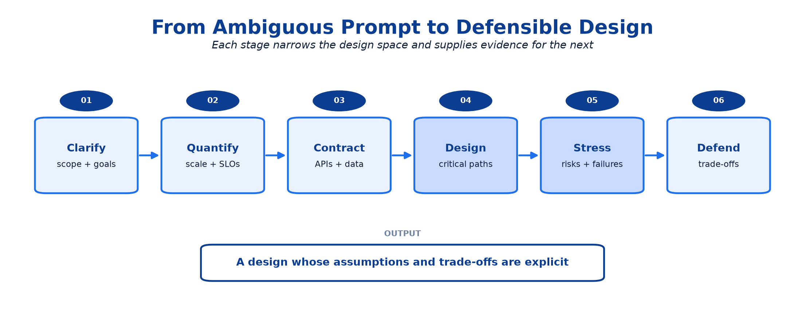
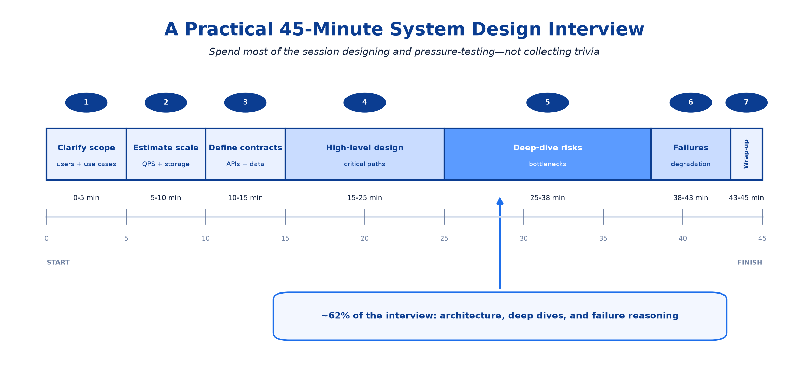
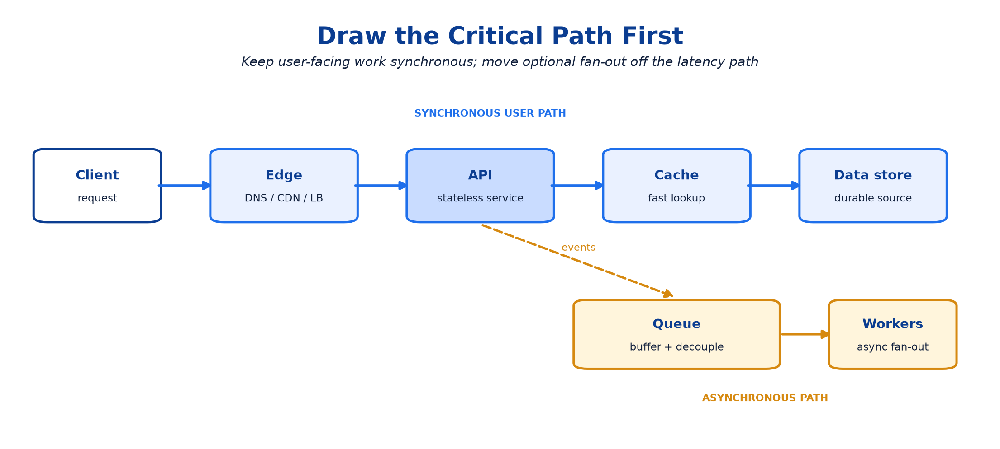
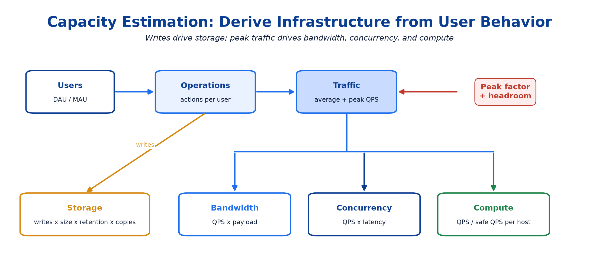
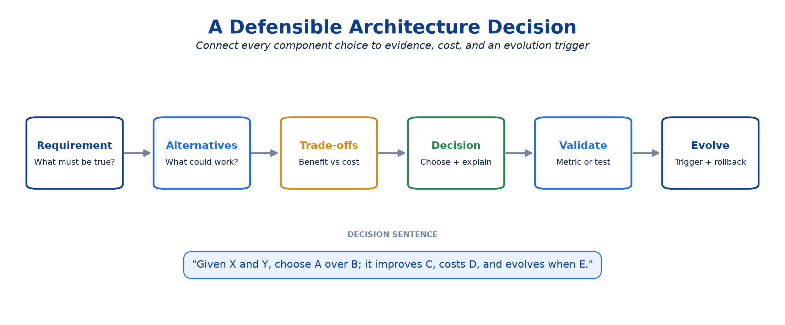
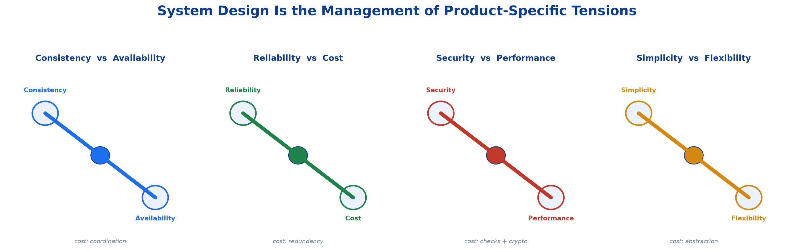
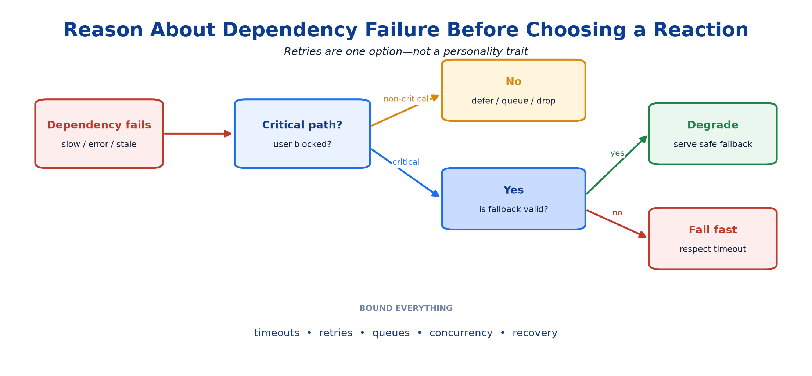
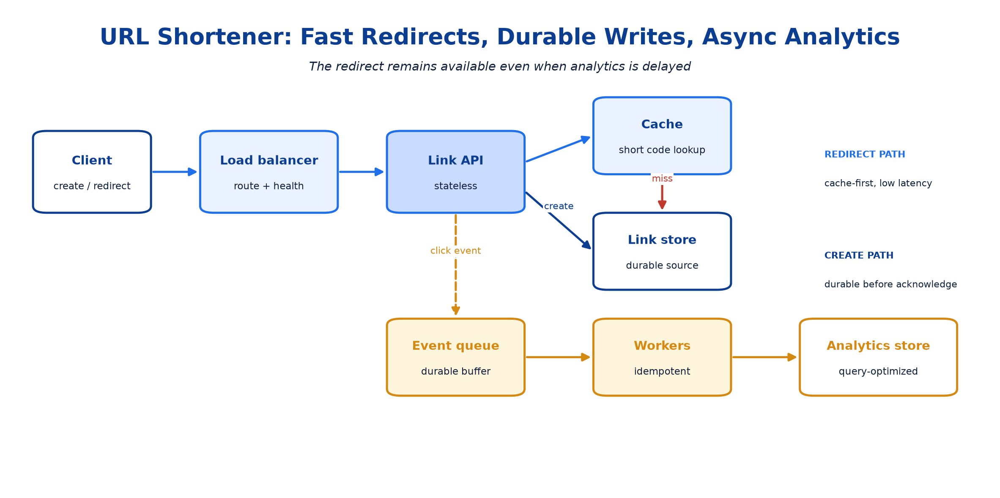

# System Design Interview Framework & Capacity Estimation

> A compact, visual guide for turning an ambiguous prompt into a defensible design. Use it to structure the interview, quantify scale, expose risks, and explain why each decision is appropriate.

---

## 1. One-page visual summary



The framework is a narrowing funnel: establish what matters, quantify it, define contracts, draw critical paths, stress the risky parts, and defend the resulting trade-offs.



| Phase | Time | Deliverable |
|---|---:|---|
| Clarify | 0–5 min | Core use cases, constraints, out-of-scope items |
| Quantify | 5–10 min | Peak QPS, read/write ratio, storage, SLOs |
| Contract | 10–15 min | Minimal APIs/events and core entities |
| Design | 15–25 min | Read, write, and asynchronous paths |
| Stress | 25–38 min | Deep dives into the largest risks |
| Fail | 38–43 min | Degraded behavior and recovery |
| Close | 43–45 min | Decisions, trade-offs, and evolution trigger |

!!! tip "The interview in one sentence"
    Given the requirements and scale, choose the simplest architecture that works; explain its failure behavior, cost, and trigger for evolution.

---

## 2. Core mental model

### Requirements → load → paths → pressure → decision

1. **Requirements** define what success means.
2. **Load estimates** reveal which resources may become constrained.
3. **Critical paths** show where latency and availability are spent.
4. **Pressure tests** expose bottlenecks and failure propagation.
5. **Decisions** balance product priorities rather than chasing universal “best practices.”



The synchronous path determines user latency and immediate availability. Optional analytics, notifications, and fan-out work should leave that path when delayed completion is acceptable.

### Capacity is derived—not guessed



Start with users and operations. Derive average and peak traffic, then compute only the quantities that can change an architectural decision.

```text
Average QPS = operations per day / 86,400
Peak QPS = average QPS × peak factor
Bandwidth = QPS × payload size
Storage = records × record size × retention × replicas
Concurrency ≈ throughput × latency in seconds
```

Estimates should be rounded, unit-consistent, and tied to a consequence such as caching, partitioning, connection limits, or capacity headroom.

---

## 3. Important concepts

### Requirement types

| Type | Question | Examples |
|---|---|---|
| Functional | What must the system do? | Create, read, update, notify |
| Non-functional | How well must it behave? | p99 latency, availability, durability |
| Constraint | What boundary must be respected? | Residency, legacy integration, deadline |
| Out of scope | What are we deliberately excluding? | Admin UI, analytics queries |

### Quality attributes

| Attribute | Meaning | Interview prompt |
|---|---|---|
| Latency | Time per operation | Which percentile and operation? |
| Throughput | Work per second | Average or peak? Read or write? |
| Availability | Ability to serve requests | What failure must be tolerated? |
| Durability | Protection from acknowledged-data loss | Can an accepted write be lost? |
| Consistency | Versions readers may observe | Is stale data acceptable here? |
| Security | Protection across trust boundaries | Who can perform each operation? |
| Cost | Resource and operational spend | What dominates at 10× scale? |

### High-leverage clarification questions

1. Who are the users, and what are the top two or three use cases?
2. What is explicitly out of scope?
3. What are current, peak, and projected traffic levels?
4. Which paths prioritize consistency, availability, or latency?
5. What are the retention, security, privacy, and residency constraints?
6. Is this greenfield, or must it coexist with an existing system?

### Minimum capacity worksheet

| Estimate | Why it matters |
|---|---|
| Peak read/write QPS | Compute, storage topology, connection limits |
| Read/write ratio | Cache and replica usefulness |
| Payload sizes | Network and serialization cost |
| Data growth and retention | Storage, partitioning, backup windows |
| Working set | Whether useful data can fit in memory |
| Fan-out | Hidden downstream traffic multiplication |
| Failure headroom | Ability to survive host or zone loss |

!!! warning "Avoid decorative arithmetic"
    If an estimate cannot affect a decision, skip it. Twelve decimal places of QPS will not rescue an unjustified architecture.

---

## 4. Decision and trade-off tables



Use this sentence structure:

> Given **requirement X** and **estimate Y**, choose **A** over **B** because it improves **C**. It costs **D**. Validate it using **E**, and evolve when **F** occurs.

### Common evolution choices

| Decision | Simple starting point | Scale-oriented option | Evolution trigger |
|---|---|---|---|
| Compute | Vertical scaling | Stateless horizontal scaling | Saturation or availability target |
| Data | One relational database | Replicas, partitioning, specialized store | QPS, size, or access-pattern limit |
| Reads | Database reads | Cache, CDN, read replicas | Latency or database pressure |
| Work | Synchronous processing | Queue and workers | Slow, non-critical, or fan-out work |
| Geography | Single region | Active-passive or active-active | RTO, residency, or global latency |



| Tension | Favor the left when… | Favor the right when… | Cost to discuss |
|---|---|---|---|
| Consistency vs availability | Incorrect/stale data is dangerous | Continued service is more valuable | Coordination or staleness |
| Reliability vs cost | Downtime impact is high | Workload is non-critical | Redundancy or recovery time |
| Security vs performance | Data or action is sensitive | Path is public and low-risk | Checks, cryptography, complexity |
| Simplicity vs flexibility | Requirements are stable | Multiple use cases genuinely differ | Abstraction and operations |

There is no globally correct position. Choose per operation, based on product impact.

---

## 5. Failure scenarios



| Failure | Safe response | Guardrail |
|---|---|---|
| Non-critical dependency fails | Queue, defer, or drop according to policy | Bounded queue and observable loss |
| Critical dependency is slow | Fail fast or use a safe fallback | End-to-end timeout budget |
| Cache fails | Controlled origin fallback | Concurrency limit; prevent stampede |
| Durable store fails | Reject writes that cannot be guaranteed | Never acknowledge an undurable write |
| Queue consumers lag | Scale consumers or shed optional events | Lag alert and retention headroom |
| Zone fails | Shift traffic to surviving capacity | N+1 capacity and tested failover |

For each dependency, state:

- timeout and retry owner;
- idempotency and duplicate behavior;
- queue, pool, and concurrency bounds;
- fallback validity and maximum staleness;
- detection, recovery, and reconciliation steps.

### Common interview failure modes

- Jumping to products before clarifying requirements.
- Sizing from averages while ignoring peaks and failures.
- Assuming uniform traffic and missing hot keys.
- Drawing only the read path or only the happy path.
- Adding caches, queues, shards, or regions without a requirement.
- Naming technology without explaining mechanics and operational cost.

---

## 6. One focused worked example

### URL shortener

**Scope:** create short links, redirect them, and optionally expire them. Analytics queries and custom domains are out of scope.

**Targets:** redirects should be highly available with p99 below 100 ms; acknowledged link creation must be durable; newly created links need read-after-write behavior.

**Assumptions**

```text
20 million new links/month
100 redirects per link creation
10× peak factor
700 bytes stored per link
5-year retention, 3 replicas
```

**Derived scale**

```text
Average creates/s ≈ 20M / 2.6M ≈ 8
Peak creates/s ≈ 80
Peak redirects/s ≈ 8 × 100 × 10 ≈ 8,000
Replicated storage ≈ 20M × 12 × 5 × 700 B × 3 ≈ 2.5 TB
```



| Choice | Optimizes for | Costs / risks |
|---|---|---|
| Stateless API | Horizontal scaling and replacement | State moves to shared dependencies |
| Cache-aside redirects | Low latency and lower store QPS | Staleness, hot keys, cache failure |
| Durable link store | Correct acknowledged writes | Higher write latency |
| Async click analytics | Fast and resilient redirects | Lag and duplicate processing |
| Single region initially | Simplicity and cost | Regional outage and distant-user latency |

**Failure walk-through:** cached redirects may survive a store outage, but link creation must fail if durability cannot be guaranteed. Analytics delays must not block redirects. A viral short code requires hot-key mitigation or edge caching.

---

## 7. Senior/Principal interview signals

| Senior signal | Staff/Principal extension |
|---|---|
| Decisions tied to measurable requirements | Requirements reconciled across products and teams |
| Normal and degraded paths explained | Blast radius and dependency criticality managed |
| Dominant workloads quantified | Capacity and cost modeled across growth stages |
| Complexity introduced only when justified | Migration, compatibility, and rollback planned |
| Metrics validate assumptions | Uncertainty retired through tests and production evidence |
| Operational cost acknowledged | Ownership and organizational scalability addressed |

### Defend a choice clearly

> “Given 8,000 peak redirects per second and a 100 ms p99 target, I would start with cache-aside rather than database-only reads. It reduces origin load and tail latency, at the cost of invalidation and another dependency. I would validate hit rate, p99 latency, and origin QPS; edge caching becomes worthwhile if global traffic or hot links dominate.”

When requirements change, identify the affected quality attribute, trace the impacted path, revise only the necessary components, and state the newly introduced cost.

---

## 8. Final revision checklist

```text
[ ] CLARIFY users, use cases, constraints, and out-of-scope items
[ ] QUANTIFY peak QPS, ratio, payloads, storage, concurrency, headroom
[ ] DEFINE minimal APIs/events, entities, and access patterns
[ ] DRAW read, write, async, and trust-boundary paths
[ ] DEEP-DIVE the largest scale, correctness, and failure risks
[ ] EXPLAIN timeouts, retries, bounds, degradation, and recovery
[ ] DEFEND each choice: optimizes, costs, validates, evolves
[ ] CLOSE with requirements met, biggest risk, and 10× evolution
```

!!! success "The senior-level finish"
    Summarize the architecture, identify its first likely bottleneck, explain degraded behavior, and name the metric or trigger that would justify the next layer of complexity.
