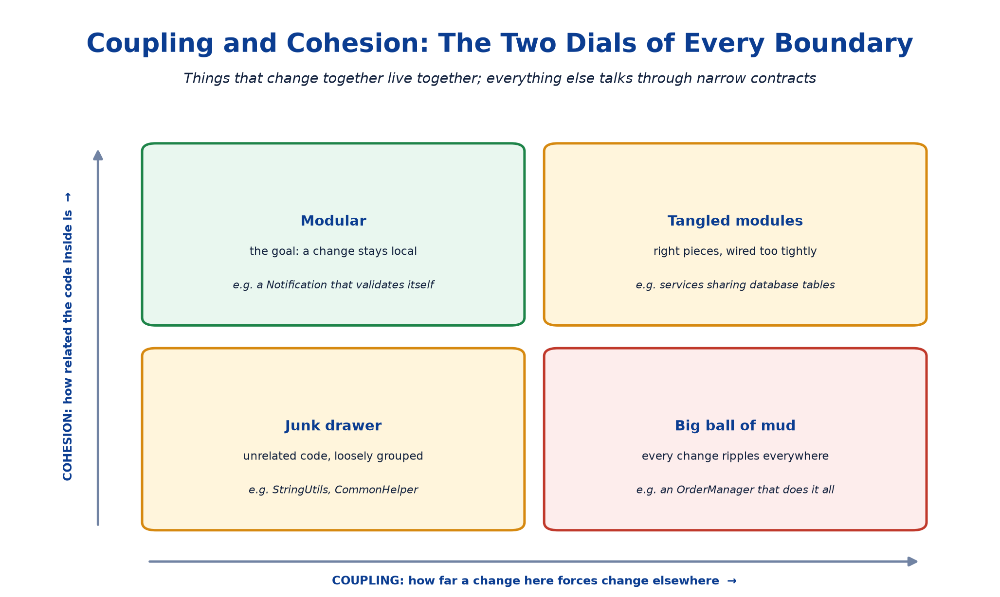
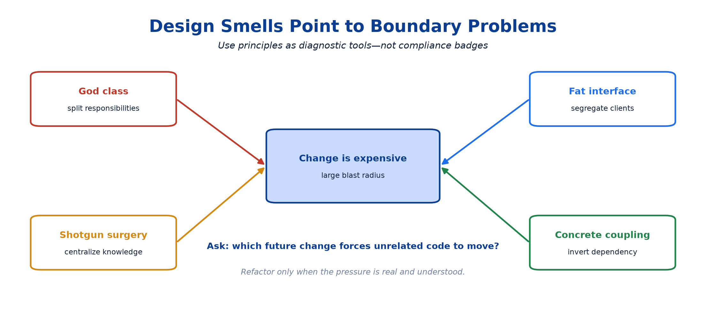

# LLD: Object-Oriented Principles & Clean Code

> A visual guide to designing classes that survive the next requirement. Use it to structure a low-level design round, choose boundaries from the changes you expect, defend each abstraction, and spot the smells that make change expensive.

---

## 1. One-page visual summary


The low-level design round is the same narrowing funnel as system design, one zoom level down: find the use cases, name the objects that own them, fix their contracts, connect them, write the core path, and then prove the design absorbs a change.

| Phase | Time | Deliverable | On the whiteboard before moving on |
|---|---:|---|---|
| Clarify | 0–5 min | Use cases, actors, scope, likely changes | 3–4 use cases, an out-of-scope list, 1–2 named "likely changes" |
| Model | 5–12 min | Entities and their responsibilities | Each class with a one-sentence responsibility |
| Contract | 12–18 min | Interfaces, invariants, error semantics | 2–4 interfaces and the rules each object guarantees |
| Relate | 18–25 min | Class diagram: has-a, is-a, depends-on | One diagram where every arrow is justified |
| Code | 25–38 min | The core flow in real code | The happy path plus one failure path |
| Extend | 38–45 min | A change scenario and its test | "Adding X touches only Y" and the test that proves it |

**Machine-coding rounds (60–90 min):** the extra time goes into *Code* and running tests. Clarify and Model should not grow. A sprawling class diagram with no code reads as avoidance.


| Principle | Ask | Smell in review | Healthy outcome |
|---|---|---|---|
| **S** — Single Responsibility | Which actor asks for this class to change? | One class edited for finance, ops, and UX reasons | One cohesive reason to change |
| **O** — Open/Closed | Can a new case arrive as a new class? | A `switch` on a type code that grows every sprint | Extension at a deliberate seam; tested code untouched |
| **L** — Liskov Substitution | Can every subtype stand in for its base safely? | Overrides that throw, no-op, or demand more | Subtypes demand no more and promise no less |
| **I** — Interface Segregation | Does each client use everything it depends on? | `UnsupportedOperationException` stubs | Small, client-shaped interfaces |
| **D** — Dependency Inversion | Can the business policy run without infrastructure? | `new MySqlRepo()` inside a service | Policy owns the interface; details plug in |

!!! tip "The LLD round in one sentence"
    Find the likely changes, give each one a single owner behind a small contract, and prove that a new requirement becomes a new class rather than an edit.

---

## 2. Core mental model

### Design around change and invariants

An object owns **state plus the behavior that keeps that state valid**. An **invariant** is a rule that must always hold: a balance never goes negative, an order always has at least one line. A boundary earns its place when it contains one cohesive policy and stops unrelated changes from spreading.

```text
Useful boundary = cohesive responsibility + protected invariant + explicit contract
Design quality  = cost of a likely change × confidence that behavior is still correct
```

The second line is the only test that matters: when a likely change arrives, how many classes must you edit, and will a test tell you if you broke something?


### Coupling and cohesion: the two dials

Every principle in this guide tunes one of two dials. **Cohesion** measures how strongly the things inside a module belong together: do they change for the same reason? **Coupling** measures how much one module knows about another: does a change here force a change there?



Not all coupling is equal. From worst to most acceptable:

| Coupling kind | What it looks like | Why it hurts |
|---|---|---|
| Content | Reaching into another class's fields or internals | Any internal refactor breaks you |
| Global | Shared mutable statics; singletons holding state | Hidden dependencies; order-dependent tests |
| Control | A boolean or enum argument telling the callee *what to do* | The caller knows the callee's internals |
| Stamp | Passing a whole `Order` when only `orderId` is needed | Changes to unused fields ripple outward |
| Data | Passing exactly the values the callee needs | The goal: the narrowest honest contract |

### Tell, don't ask

Push behavior to the object that owns the data instead of pulling the data out to decide elsewhere. A chain of getters is coupling you can see:

```java
// Ask: the caller knows customers have wallets, and how wallets are debited
order.getCustomer().getWallet().debit(order.total());

// Tell: the order owns the rule; the caller states intent
order.chargeCustomer();
```

This is the **Law of Demeter**: talk to your immediate collaborators, not to their collaborators. Fluent builders and streams are fine, because each call returns the same abstraction.

---

## 3. The four pillars, done right

| Pillar | What it buys you | The misuse that costs points |
|---|---|---|
| **Encapsulation** | Invariants enforced in one place | Private fields with a public setter for each |
| **Abstraction** | Callers depend on *what*, not *how* | Hiding a decision the caller needs (cost, latency, blocking) |
| **Inheritance** | Reuse of a true, stable is-a contract | Inheriting for code reuse; deep hierarchies |
| **Polymorphism** | Variation without conditionals in callers | One interface with one permanent implementation |

### Encapsulation: the rule lives with the data

```java
// Bad: the invariant lives nowhere, so every caller invents its own version
class BankAccount { public Money balance; }
account.balance = account.balance.minus(amount);      // nothing stops a negative balance

// Good: one owner, one rule
final class BankAccount {
    private Money balance = Money.ZERO;

    void withdraw(Money amount) {
        if (amount.isGreaterThan(balance)) throw new InsufficientFundsException(balance, amount);
        balance = balance.minus(amount);
    }
    Money balance() { return balance; }               // read access, never write access
}
```

Go one step further with **value objects**: make invalid states unrepresentable, so validation happens once, at construction, instead of in every caller.

```java
record EmailAddress(String value) {
    EmailAddress {
        if (value == null || !value.contains("@")) throw new IllegalArgumentException("invalid email");
    }
}
// A method taking EmailAddress never re-validates. A String could be anything.
```

**Careful:** a private field with a public setter is not encapsulation. It is a public field with extra steps.

### Abstraction: hide the how, not the decision

```java
// Bad: every caller depends on SMTP mechanics, in the right order
smtp.connect(host, 587); smtp.authenticate(user, password);
smtp.send(to, subject, body); smtp.disconnect();

// Good: the contract is the intent
interface Sender { SendResult send(Notification notification); }
```

A good abstraction hides **irrelevant** detail. It must not hide what the caller needs in order to decide: if `send` can block for 30 seconds or costs money per call, that belongs in the contract (a timeout, a result type, an honest name). The opposite failure is a **leaky abstraction**, where callers end up catching `SMTPException` anyway.

### Inheritance: only for an is-a that keeps every promise

Inheritance couples the child to the parent's **implementation**, not just its interface. The classic demonstration, from *Effective Java*:

```java
class InstrumentedHashSet<E> extends HashSet<E> {
    int addCount = 0;
    @Override public boolean add(E e) { addCount++; return super.add(e); }
    @Override public boolean addAll(Collection<? extends E> c) { addCount += c.size(); return super.addAll(c); }
}
// addAll(List.of("a", "b", "c")) leaves addCount == 6, not 3
```

`HashSet` inherits an `addAll` that calls `add` for each element, so every item is counted twice. Nothing in the documented interface says so: the subclass broke on a parent implementation detail. This is the **fragile base class** problem, and it is why "favor composition over inheritance" exists.

Use inheritance when the hierarchy is shallow, stable, and every subtype honors the parent's full contract (template-method frameworks, sealed domain hierarchies). Otherwise, compose.

### Polymorphism: replace the type switch

```java
// Bad: every new channel edits this switch, and every other switch on Channel
switch (channel) {
    case EMAIL -> smtp.send(n);
    case SMS   -> smsGateway.send(n);
}

// Good: the variation lives behind one contract, chosen at wiring time
senders.get(channel).send(n);                          // Map<Channel, Sender>
```

**The senior nuance: a switch is not always wrong.** This is the *expression problem*. Polymorphism makes adding **types** cheap and adding **operations** expensive; a switch over a closed set does the reverse. With sealed types (Java 17) and pattern-matching `switch` (Java 21), an exhaustive switch is compiler-checked: add a variant, and every switch fails to compile until it handles it.

```java
sealed interface Shape permits Circle, Square {}
record Circle(double r) implements Shape {}
record Square(double side) implements Shape {}

double area(Shape shape) {
    return switch (shape) {                            // no default: exhaustiveness is checked
        case Circle c -> Math.PI * c.r() * c.r();
        case Square s -> s.side() * s.side();
    };
}
```

Rule of thumb: an **open set of variants with rich behavior** calls for polymorphism. A **closed, stable set whose operations keep growing** calls for sealed types and exhaustive switches.

### Composition over inheritance


```java
interface FlyBehavior { void fly(); }

final class Bird {
    private final FlyBehavior flight;
    Bird(FlyBehavior flight) { this.flight = flight; }
    void fly() { flight.fly(); }
}
Bird sparrow = new Bird(new WingedFlight());
Bird penguin = new Bird(new NoFlight());               // no override, no exception
```

The contract of `fly()` is now "perform this bird's flight behavior", which honestly includes none. The same move fixes `InstrumentedHashSet`: wrap a `Set` and forward to it (a decorator), and the counter no longer depends on how `HashSet` implements `addAll`. The quick test: if you are about to override a method to throw or do nothing, the relationship was never is-a.

---

## 4. SOLID, as questions about change

The §1 table is the summary. Here each principle gets a realistic failure, the fix, and the trap.

### S — Single Responsibility: one actor, one reason to change

"A module should be responsible to one, and only one, actor." The question is not "does it do one thing?" but **"who asks for it to change?"**

```java
// Bad: finance (pay rules), the DBA (schema), and HR comms (email copy) all edit this class
class PayrollService {
    Money calculatePay(Employee e) { ... }
    void save(Paycheck p)          { ... }             // SQL
    void emailPayslip(Paycheck p)  { ... }             // templates + SMTP
}

// Good: one class per actor
final class PayCalculator      { Money calculatePay(Employee e) { ... } }
final class PaycheckRepository { void save(Paycheck p) { ... } }
final class PayslipMailer      { void send(Paycheck p) { ... } }
```

**Careful:** SRP is not "one method per class". Methods that protect the same invariant belong together; splitting them scatters one rule across files, which is the opposite of the goal.

### O — Open/Closed: new cases arrive as new classes

```java
// Bad: every new shipping rule reopens tested code
Money shippingCost(Order order) {
    if (order.isExpress()) return Money.of(15);
    if (order.total().isAbove(Money.of(50))) return Money.ZERO;
    return Money.of(5);
}

// Good: each rule is a class; the list is ordered by priority
interface ShippingRule { Optional<Money> costFor(Order order); }

Money shippingCost(Order order) {
    return rules.stream()
        .map(rule -> rule.costFor(order)).flatMap(Optional::stream)
        .findFirst().orElse(DEFAULT_COST);
}
```

**Careful:** "closed" applies to the axes of change you have evidence for. Adding a seam for a variation you have never seen is YAGNI, not OCP.

### L — Liskov Substitution: subtypes keep the base contract

Matching method signatures is the easy part; LSP is about **behavior**. A subtype must obey four rules:

| Rule | Meaning | Violation example |
|---|---|---|
| Preconditions | Cannot be **strengthened** | Base accepts any amount; subtype rejects amounts over 1,000 |
| Postconditions | Cannot be **weakened** | Base guarantees a receipt; subtype returns `null` |
| Invariants | Must be **preserved** | `Square extends Rectangle` breaks "width and height vary independently" |
| Exceptions | No **new** failure modes | Base never throws on `refund`; subtype throws `UnsupportedOperationException` |

The JDK has a famous case: `List.of(...)` returns a list whose `add()` throws. The Javadoc marks `add` as an *optional operation*, which keeps it technically legal and moves the failure from compile time to production. A senior answer names this as a deliberate trade-off (one `List` type instead of a mutable/immutable split), not a model to copy.

```java
// Bad: a refund-capable base type with a subtype that cannot refund
class PaymentMethod { Receipt charge(Money m) { ... }  Receipt refund(Money m) { ... } }
class GiftCard extends PaymentMethod {
    @Override Receipt refund(Money m) { throw new UnsupportedOperationException(); }
}

// Good: model each capability honestly
interface Chargeable { Receipt charge(Money amount); }
interface Refundable { Receipt refund(Money amount); }
final class CreditCard implements Chargeable, Refundable { ... }
final class GiftCard   implements Chargeable { ... }
```

**How to prove it:** write one contract test against the base type and run it against every implementation (§9).

### I — Interface Segregation: interfaces shaped by their clients

```java
// Bad: every implementation must support checkout, analytics, and ops needs
interface CustomerRepository {
    Customer findById(CustomerId id);
    void save(Customer customer);
    Report monthlyRevenueReport();                     // the analytics team's need
    void purgeInactive(Duration olderThan);            // the ops team's need
}

// Good: role interfaces, one per kind of client
interface CustomerReader    { Customer findById(CustomerId id); }
interface CustomerWriter    { void save(Customer customer); }
interface CustomerReporting { Report monthlyRevenueReport(); }
```

One class may still implement several of them. The point is that **each client depends only on what it calls**, so checkout code is not recompiled, or re-mocked, because analytics added a report. **Careful:** split by client need, not by method; one-method interfaces for everything is *interface confetti*.

### D — Dependency Inversion: policy owns the interface


```java
// Bad: business policy constructs infrastructure
class OrderService {
    private final MySqlOrderRepo repo = new MySqlOrderRepo();     // welded to MySQL
}

// Good: the interface lives in the policy's package; details implement it
interface OrderRepository { Optional<Order> find(OrderId id); void save(Order order); }

final class OrderService {
    private final OrderRepository orders;
    OrderService(OrderRepository orders) { this.orders = orders; }   // injected
}
```

Interviewers probe two things. **Ownership:** the interface belongs to the high-level module and is shaped by its needs (`find`, `save`), not by what MySQL offers; an interface that mirrors the driver is indirection, not inversion. **Inversion is not injection:** DI is one way to wire the design, and a Spring container full of concrete classes is still concrete coupling.

---

## 5. Clean code: DRY, KISS, YAGNI


SOLID decides where responsibilities go; these three decide **how much** abstraction to build. They pull in opposite directions, and that tension is the point.

| Rule | Guards against | Apply when | Misuse to avoid |
|---|---|---|---|
| **DRY** — Don't Repeat Yourself | One rule with several sources of truth | The same *knowledge* is written twice | Merging code that only looks alike |
| **KISS** — Keep It Simple | Accidental complexity | Complexity buys no required capability | Hiding genuinely complex domain rules |
| **YAGNI** — You Aren't Gonna Need It | Speculative features and abstractions | No current evidence for the variation | Refusing a cheap, obvious seam |

### DRY is about knowledge, not text

```java
// Two copies of one rule: when the GST rate changes, one will be missed
class Checkout      { Money tax(Money subtotal) { return subtotal.times(0.18); } }
class RefundService { Money tax(Money subtotal) { return subtotal.times(0.18); } }

// One owner
final class TaxPolicy { Money taxOn(Money subtotal, Region region) { ... } }
```

The reverse mistake is just as common. Two validation methods that look identical today but belong to different actors (signup and KYC) should stay separate: merge them, and the first divergent requirement adds a boolean flag, then another. "Duplication is far cheaper than the wrong abstraction" (Sandi Metz). The **rule of three** is the practical tie-breaker: tolerate the second copy, abstract on the third.

### KISS: complexity must buy something

```java
// Three channels in one repository, so... a plugin framework with discovery and priorities
ServiceLoader.load(SenderPlugin.class).stream().sorted(byPriority()).forEach(registry::register);

// What the requirement actually needs
Map<Channel, Sender> senders = Map.of(EMAIL, emailSender, SMS, smsSender, PUSH, pushSender);
```

KISS removes *accidental* complexity. Tax law, retry semantics, and pricing tiers are *essential* complexity; flattening them into something that looks clean but gets edge cases wrong is a bug, not simplicity.

### YAGNI: leave the seam, not the scaffolding

One `PaymentGateway` interface with a single `StripeGateway` behind it costs one file and keeps checkout tests independent of Stripe. Writing `PaypalGateway` and `RazorpayGateway` stubs "for later" means coding against guessed APIs that will be wrong on the day they are needed. §6 shows how to defend exactly this decision.

### Code-level signals interviewers notice

| Signal | Prefer | Avoid |
|---|---|---|
| Names | `ReservationExpiryPolicy`, `isEligibleForRefund()` | `Manager`, `Helper`, `Util`, `data`, `flag` |
| Functions | One level of abstraction; guard clauses first | 80-line methods mixing rules and I/O |
| Arguments | Value objects (`Money`, `OrderId`) | Boolean flag parameters; primitive obsession |
| State | Immutable by default: `final` fields, records | A setter for everything; shared mutable state |
| Errors | Typed results or specific exceptions | `catch (Exception e) {}`; `null` meaning "not found" |
| Comments | Why a decision was made | What the next line does |

---

## 6. Decision and trade-off tables

!!! abstract "The decision template: memorize this"
    Given **likely change X**, choose **A** over **B** because it keeps that change **local to C**. It costs **D**. Validate it with **test E**, and revisit when **F** happens.

Two worked instances:

> Given **new channels arriving every quarter**, choose **a `Sender` interface with one adapter per channel** over **a `switch` in the service** because a new channel becomes **one new class plus one wiring line**. It costs **an interface, a registry, and indirection when debugging**. Validate with **a shared contract test every adapter must pass**. Revisit if **channels need different workflows**, not just different transports.

> Given **one payment provider and no second one signed**, choose **a concrete `StripeGateway` behind a narrow `PaymentGateway` port** over **a multi-provider plugin framework** because it **keeps the code honest to the one real API**. It costs **a refactor when provider two arrives**. Validate with **checkout tests against a fake gateway**. Revisit when **a second provider is contracted**.

### Composition or inheritance?

| Question | Prefer composition | Consider inheritance |
|---|---|---|
| Relationship | Object **has** a replaceable capability | Subtype **is** the base type, in every behavior |
| Variation | Changes independently or at runtime | Hierarchy is stable and shallow (two levels at most) |
| Reuse goal | Reuse a capability | Share a true invariant and contract |
| Main risk | More objects and wiring | Fragile base class; subtypes coupled to parent internals |
| How to test | Swap in a fake | Run base contract tests against every subtype |

### Add an abstraction?

| Evidence | Decision | Optimizes for | Cost |
|---|---|---|---|
| Two or more real implementations | Extract a contract | Substitution and OCP | Indirection |
| One implementation, but it is I/O or a third party | Narrow port (interface) | Testability and isolation | One extra type |
| One stable, in-process implementation | Keep it concrete | Readability | Extract later if change arrives |
| Variants change weekly | Strategy or rule list | Local extension | Discovery and ordering rules |
| Only a hypothetical future | Defer | YAGNI | Refactor when evidence appears |

---

## 7. Design smells & refactoring



| Smell | How you spot it in review | Principle at stake | Refactoring move | Risk of the fix |
|---|---|---|---|---|
| God class | Edited in most PRs; name ends in `Manager` | SRP | Extract a class per actor | Splitting one invariant across classes |
| Shotgun surgery | One rule change touches five or more files | DRY | Move the knowledge to one owner | Over-merging coincidental code |
| Type switch | The same `switch` or `instanceof` in several places | OCP | Replace conditional with polymorphism | An interface for a closed, stable set |
| Refused bequest | Overrides that throw or no-op | LSP | Split the hierarchy; compose capabilities | Many small types to wire |
| Fat interface | Implementers stub methods | ISP | Role interfaces per client | Interface confetti |
| Concrete coupling | `new` of infrastructure in business logic | DIP | Inject a policy-owned port | An interface that mirrors the driver |
| Feature envy | A method uses another class's getters more than its own fields | Encapsulation | Move the method to the data's owner | Moving behavior into the wrong class |
| Primitive obsession | `String email` and `long amountInCents` everywhere | Encapsulation | Introduce value objects | Wrapping values that have no rules |
| Service locator | Dependencies fetched from a global registry mid-method | DIP | Constructor injection: the signature tells the truth | Constructors with many parameters (often an SRP hint) |

!!! warning "Refactor from evidence, not taste"
    Name the change that hurt (or will), measure its blast radius, and make the smallest boundary move that contains it. "This could be cleaner" is not a reason. "This rule changed three times and we missed a copy twice" is.

---

## 8. Finding the change hotspot

"Make it extensible" is only useful with a method for finding *where*:

```text
1. List the likely changes: ask the interviewer, or read them off the requirements.
     new variant | new rule | swapped vendor | new client | new failure mode
2. For each change, trace the classes you would EDIT (not add).
3. Blast radius = classes edited + tests that must change.
4. The change with the LARGEST radius is your deep dive.
5. Say it out loud: "Adding a channel today edits N classes.
   With a Sender seam, it edits none and adds one."
```

Applied to the notification service: adding a channel, tuning retries, and adding quiet hours are all likely. In the naive design (one `NotificationService` with a channel `switch`), adding a channel has the largest radius: the switch, the validation, the retry code that special-cases SMS, and all their tests. That seam is worth designing first. Retry timing is a constant until proven otherwise.

**Universal change killers.** Look for these in any class diagram or code sample: a **type switch repeated in several places**, **static mutable state**, **`new` of infrastructure inside policy**, **boolean flag parameters**, and **inheritance deeper than two levels**.

---

## 9. Worked example: notification service

**Prompt:** "Design the classes for a service that notifies users about order events by email, SMS, or push."

### Questions to ask before designing anything

| Question | Why it matters | Assumed answer |
|---|---|---|
| Which channels now, and which next? | Decides whether a channel seam is evidence-based | Email, SMS, push now; WhatsApp planned |
| Can users opt out per channel or set quiet hours? | Whether preferences need their own policy | Yes, both |
| What happens when a provider fails? | Retry semantics shape the `Sender` contract | Retry transient failures; stop on permanent ones |
| Must each notification arrive at most once? | Idempotency key in the model | Yes: no duplicate texts on retry |
| Synchronous to the caller, or queued? | Where retries and latency live | Called by a queue worker; may take seconds |

**Scope.** *In:* route an order event to each channel the user allows, render the content, deliver it, retry transient failures, and report a per-channel outcome. *Out:* the queue itself, scheduling, analytics, and template authoring.

### Classes and responsibilities

| Class | Responsibility | Changes when | Principle at work |
|---|---|---|---|
| `Notification` (record) | A valid message: recipient, channel, body, idempotency key | Message fields change | Encapsulation |
| `Sender` (interface) | Deliver one notification and classify the outcome | Rarely: it is the stable contract | ISP, DIP |
| `EmailSender`, `SmsSender`, `PushSender` | Speak one provider's API | That provider changes | OCP, SRP |
| `PreferencePolicy` | Decide which channels a user allows right now | Product rules change | SRP |
| `RetryPolicy` | Decide whether and when to retry | Reliability tuning | Composition |
| `NotificationService` | Orchestrate: channels → render → send → collect | The workflow changes | SRP (coordination only) |

### Contracts

```java
record Notification(UserId to, Channel channel, String body, String idempotencyKey) {
    Notification {
        Objects.requireNonNull(to, "to"); Objects.requireNonNull(channel, "channel");
        if (body == null || body.isBlank()) throw new IllegalArgumentException("empty body");
    }
}

sealed interface SendResult permits Delivered, RetryableFailure, PermanentFailure {}
record Delivered(String providerMessageId) implements SendResult {}
record RetryableFailure(String reason)    implements SendResult {}   // timeout, 503, throttled
record PermanentFailure(String reason)    implements SendResult {}   // invalid number, blocked

interface Sender {
    Channel channel();
    SendResult send(Notification notification);   // classifies provider errors; never throws them
}
```

Why a sealed result instead of exceptions? Retry logic depends on the **classification**, and the compiler now forces every caller to handle all three outcomes. That classification is part of the `Sender` contract: an adapter that returns `PermanentFailure` for a timeout breaks substitution, even though it compiles.


### Core flow

```java
final class NotificationService {
    private final Map<Channel, Sender> senders;     // toMap(Sender::channel, s -> s) over injected adapters
    private final PreferencePolicy preferences;
    private final TemplateRenderer renderer;
    private final RetryPolicy retry;
    private final Clock clock;                      // even time is a dependency
    // Constructor: all five collaborators are injected; nothing here calls `new`.

    Map<Channel, SendResult> notify(UserId user, OrderEvent event) {
        Map<Channel, SendResult> results = new EnumMap<>(Channel.class);
        for (Channel channel : preferences.allowedChannels(user, clock.instant())) {
            Notification notification = renderer.render(user, channel, event);
            Sender sender = senders.get(channel);
            results.put(channel, retry.execute(() -> sender.send(notification)));
        }
        return results;
    }
}
```

Three details worth saying out loud. Building the map with `toMap` throws at startup if two adapters claim the same channel, so a wiring bug fails fast instead of at 2 a.m. The injected `Clock` makes quiet-hours logic testable without waiting for 22:00. And `RetryPolicy` retries only `RetryableFailure`, which is safe because the idempotency key lets providers drop duplicates.

### Change walkthrough

| Change request | What you edit | What you add | What stays untouched |
|---|---|---|---|
| Add WhatsApp | One wiring line | `WhatsAppSender` | Service, policies, other adapters |
| Quiet hours 22:00–07:00 | `PreferencePolicy` | Its tests | Service and all adapters |
| Swap SMS provider | Wiring | `TwilioSmsSender` | Everything else |
| Exponential backoff | `RetryPolicy` | — | Everything else |
| Daily digest instead of instant sends | `NotificationService` | `DigestScheduler` | Adapters and their contract |

The last row matters. A digest is a **workflow** change, and the orchestrator is supposed to change for workflow reasons. OCP protects the axes you anticipated, not every possible change, and saying so is a stronger answer than claiming the design is closed to everything.

### Proving substitution: contract tests

```java
abstract class SenderContractTest {
    protected abstract Sender sender();                 // each adapter's test supplies one
    protected abstract void providerTimesOut();
    protected abstract void providerRejectsRecipient();

    @Test void timeoutIsRetryable() {
        providerTimesOut();
        assertInstanceOf(RetryableFailure.class, sender().send(sampleNotification()));
    }
    @Test void invalidRecipientIsPermanent() {
        providerRejectsRecipient();
        assertInstanceOf(PermanentFailure.class, sender().send(sampleNotification()));
    }
}
class SmsSenderTest extends SenderContractTest { /* stubs the SMS gateway */ }
```

Every new adapter inherits the whole suite. This is where LSP stops being a slogan: substitution is verified, not assumed. (Inheritance is right here: every concrete test genuinely *is* a sender contract test.)

---

## 10. Senior / Staff / Principal signals

The same question, answered at three levels:

| Dimension | Senior answer | Staff answer | Principal answer |
|---|---|---|---|
| Requirements | Asks about use cases | Asks which changes are likely, and designs seams for those only | Asks who owns each part, and draws boundaries around teams |
| Modeling | Clean classes with clear names | Encapsulates invariants in value objects | Identifies the few contracts that must stay stable across services |
| SOLID | Recites and applies the principles | Explains each through a concrete change and its cost | Knows when to break one, and says what that saves |
| Extensibility | Adds interfaces | Adds interfaces only where variation is proven | Plans the migration from today's code, not a greenfield ideal |
| Correctness | Writes unit tests | Writes contract tests that every implementation runs | Defines compatibility and versioning rules for plugin ecosystems |
| Trade-offs | Lists pros and cons | Picks one and defends the cost | Names the signal that would reverse the decision |

### Anti-patterns that cost points

- Drawing a 20-class diagram before writing one line of the core flow.
- An interface for every class "for testability", each with exactly one implementation.
- `Manager`, `Processor`, and `Helper` classes holding most of the logic.
- Inheriting to reuse code (`class Stack extends ArrayList`).
- Getters and setters for every field, with the rules implemented in callers.
- Naming a pattern ("I'll use a Strategy here") without saying which change it absorbs.
- Claiming the design is "open to any future requirement".

---

## 11. Practice questions & drills

### Code-review drills

Spot the smell, name the principle, and propose the smallest fix before opening the answer.

??? question "A `ReportService` loads orders from SQL, computes totals, renders a PDF, and emails it. Which change hurts most, and what do you split first?"
    Four actors: data (schema), finance (totals), design (PDF), and comms (email). Finance rules change most and are the riskiest to break, so extract `RevenueCalculator` first and test it without SQL or PDF. Then put loading behind an `OrderSource` port. **Principle:** SRP, then DIP. Don't split all four at once without a reason.

??? question "`ReadOnlyAccount extends Account` and overrides `withdraw()` to throw. What is wrong, and what replaces it?"
    It strengthens a precondition (no withdrawals at all) on a type whose callers expect withdrawal to work: an LSP violation that compiles and fails in production. Model the capability (`Withdrawable` only on accounts that allow it), or make "frozen" a state the account enforces with a documented error. **Principle:** LSP. Prefer modeling a capability or state over a subtype that lies.

??? question "A `switch` over `STANDARD`, `EXPRESS`, and `SAME_DAY` appears in pricing, ETA, and label printing. Polymorphism or sealed switch?"
    Ask which axis grows. If new delivery types arrive often, move pricing, ETA, and labels behind a `DeliveryOption` interface so a new type is one class. If the set is fixed but new *operations* keep appearing (insurance, carbon cost), a sealed type with exhaustive switches keeps each operation in one place, and the compiler catches missing cases. **Principle:** OCP, decided by the expression problem.

??? question "`OrderService` calls `new KafkaProducer<>(props)` in its constructor, so unit tests need a running broker. Fix it."
    Define an `OrderEvents` port in the order package (`void orderPlaced(Order order)`), inject it, and implement `KafkaOrderEvents` in the infrastructure package. Tests pass a recording fake. Don't name the port `MessageProducer` with Kafka-shaped methods: that is indirection, not inversion. **Principle:** DIP with a policy-owned interface.

??? question "Two teams' `validate()` methods are identical today. A teammate wants one shared `Validator`. Do you agree?"
    Only if it is the same knowledge with one owner. Signup validation (product) and KYC validation (compliance) change for different actors and will diverge; merging them produces a flag-driven method. Keep both, and revisit on a third copy or if they turn out to encode the same regulation. **Principle:** DRY is about knowledge; SRP decides ownership.

### Discussion questions

Practice answering these out loud using the §6 template.

1. When is inheritance the right choice in modern Java, and how do you keep the hierarchy safe?
2. Your team adds an interface for every service "for mocking". What do you keep, and what do you collapse?
3. How would you introduce a `Sender` seam into a 3,000-line legacy `NotificationManager` without a big-bang rewrite?
4. Where does validation belong: the controller, the service, or the domain object? Defend one answer.
5. Exceptions or result types for expected failures? Where would you draw the line in the notification example?
6. A principal engineer asks, "Why not put every channel behind its own microservice?" Argue both sides.

---

## 12. Final revision checklist

```text
[ ] CLARIFY use cases, scope, and the 1–2 changes most likely to come
[ ] MODEL entities with one-sentence responsibilities and one actor each
[ ] PROTECT invariants inside objects; use value objects for validated data
[ ] CONTRACT small, client-shaped interfaces owned by the policy that uses them
[ ] SUBSTITUTE only when subtypes keep preconditions, postconditions, invariants, errors
[ ] COMPOSE capabilities; inherit only for a stable, shallow, honest is-a
[ ] EXTEND by showing a likely change become a new class, not an edit
[ ] RIGHT-SIZE: DRY for knowledge, KISS for mechanism, YAGNI for speculation
[ ] PROVE substitution with contract tests every implementation must pass
[ ] DEFEND each choice: change localized, cost, validation, revisit trigger
```

!!! success "The Staff-level finish"
    Summarize the core classes, name the change the design absorbs best, admit the change it does not absorb (and why that is acceptable), and show how a test proves every implementation keeps the contract.
