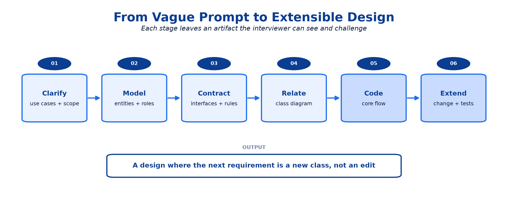

# LLD: Object-Oriented Principles & Clean Code

## Terms to know before you start

You do not need to memorize these. Come back to this table whenever a term feels unfamiliar.

| Term | What it means in plain words |
|---|---|
| **Class and object** | A class is a blueprint that describes data and the methods that work on it. An object is one concrete instance created from that blueprint. |
| **Interface** | A list of methods that a class promises to provide, without saying how. Code that uses an interface works with any class that implements it. |
| **Implementation** | A class that provides the actual code behind an interface. One interface can have many implementations. |
| **Caller (or client)** | The code that uses an object by calling its methods. |
| **Invariant** | A rule about an object's data that must always be true, such as "a notification always has a non-empty message". |
| **Contract** | Everything a caller may rely on when using an object: its methods, what they accept, what they return, and how they fail. |
| **Dependency** | Something a class needs in order to do its job. If class A calls class B, then A depends on B. |
| **Wiring** | The code that creates objects and connects them to their dependencies, usually at application startup. |
| **Coupling** | How much one class knows about another. High coupling means a change in one class forces changes in others. |
| **Cohesion** | How closely the code inside one class belongs together. High cohesion means everything in the class serves one purpose. |
| **Refactoring** | Changing the structure of code without changing what it does, usually to make the next change easier. |
| **Test double (fake)** | A simple stand-in object used in tests instead of a real dependency, such as a fake email sender that records messages instead of sending them. |

??? info "Java syntax used on this page (open if you learned Java before version 17)"
    - **`final class`** means the class cannot be extended by inheritance.
    - **`record`** is a short way to declare a class whose job is to hold data. `record Point(int x, int y) {}` automatically creates private final fields, a constructor, and the accessor methods `x()` and `y()`.
    - **`switch` with `->`** is the newer switch syntax. Each case runs only its own branch, so there is no `break` and no accidental fall-through.
    - **`Map.of(key1, value1, key2, value2)`** creates a small map that cannot be modified afterwards.
    - **`() -> sender.send(notification)`** is a lambda: a small piece of code passed around as a value, to be run later.
    - **`Supplier<T>`** is the standard interface for a lambda that takes no input and returns a value of type `T`.

---

## 1. The running example: one messy class

Every principle on this page is easier to understand when you watch it fix a real problem. So instead of using a different example for each idea, the whole page improves one piece of code step by step.

An online shop needs to tell users when something happens to their order, for example when it ships. Users can be notified by email, SMS, or push notification. Here is a first version that works, but that is painful to change:

```java
class NotificationManager {
    public String recipient;                  // anyone can set these to anything
    public String channel;                    // "EMAIL", "SMS", or "PUSH"
    public String body;

    void send() {
        if (userHasOptedOut(recipient, channel)) return;           // preference rules
        switch (channel) {                                         // channel rules
            case "EMAIL" -> {
                smtp.connect("smtp.example.com", 587);             // email protocol details
                smtp.authenticate(SMTP_USER, SMTP_PASSWORD);
                smtp.send(recipient, "Your order update", body);
                smtp.disconnect();
            }
            case "SMS"  -> new TwilioClient(API_KEY).sendText(recipient, body);
            case "PUSH" -> firebase.push(recipient, body);
        }
    }
}
```

This class has five separate problems, and each level below fixes one of them:

| Problem in `NotificationManager` | Fixed in |
|---|---|
| Any caller can create a notification with an empty message or an invalid channel. | Level 1: Encapsulation |
| The class is full of email protocol steps that have nothing to do with notifying a user. | Level 2: Abstraction |
| Adding a new channel means editing the `switch`, and every other `switch` on the channel. | Level 3: Polymorphism |
| Adding retries tempts you into a tangle of subclasses. | Level 4: Composition over inheritance |
| The class knows about SMTP, Twilio, Firebase, and user preferences all at once. | Level 5: Coupling and cohesion |

---

## 2. The four pillars of object-oriented design


The four pillars build on each other. Encapsulation protects data, abstraction hides details behind a simple interface, polymorphism lets many implementations share one interface, and composition assembles small objects into bigger behavior. Together they lead to the goal shown at the bottom of the diagram: when requirements change, only a small number of classes need to change.

### Level 1: Encapsulation, keeping the rules with the data

**Encapsulation** means an object keeps its data private and only exposes methods that keep that data valid. The rules about the data (its invariants) are enforced in exactly one place: inside the object that owns the data.

In `NotificationManager`, the fields are public, so nothing stops a caller from writing `manager.body = "";` and sending an empty message. Every caller would have to remember to validate the data, and sooner or later one of them would forget.

The fix is to make the notification responsible for its own validity. It checks its data once, in the constructor, and never allows that data to change afterwards:

```java
enum Channel { EMAIL, SMS, PUSH }                      // replaces the error-prone "EMAIL" strings

record Notification(String recipient, Channel channel, String body) {
    Notification {                                     // runs before the fields are set
        if (recipient == null || recipient.isBlank()) throw new IllegalArgumentException("recipient is required");
        if (channel == null) throw new IllegalArgumentException("channel is required");
        if (body == null || body.isBlank()) throw new IllegalArgumentException("body must not be empty");
    }
}
```

Now an invalid notification simply cannot exist. Any method that receives a `Notification` can trust it without checking it again. Replacing the `String channel` with an `enum` follows the same idea, because a typo such as `"EMIAL"` now fails at compile time instead of in production.

!!! warning "A common trap"
    Making every field private and then adding a public setter for each one is not encapsulation. Callers can still put the object into any state they like, so the rules still live in the callers. Only add methods that keep the object valid.

!!! question "Practice"
    What is wrong with this class, and how would you fix it?

    ```java
    class Cart {
        public List<Item> items = new ArrayList<>();
        public double total;
    }
    // A caller elsewhere:
    cart.items.add(item);
    cart.total += item.price();
    ```

??? success "Answer"
    The rule "the total always equals the sum of the item prices" lives in the callers. If any caller adds an item and forgets to update the total, the cart becomes wrong, and nothing detects it. The fix is to make the fields private and give the cart an `addItem(Item item)` method that updates both together, or, even simpler, to compute `total()` from the items whenever it is asked for.

### Level 2: Abstraction, hiding the how

**Abstraction** means callers depend on *what* an object does, not *how* it does it. The caller states its intent, and the details stay hidden behind a simple interface.

In `NotificationManager`, the email branch contains four SMTP steps that must run in exactly the right order. The class that decides *whom to notify* should not need to know how the email protocol works. We hide those details behind an interface:

```java
enum SendResult { DELIVERED, RETRYABLE_FAILURE, PERMANENT_FAILURE }

interface Sender {
    SendResult send(Notification notification);
}

final class EmailSender implements Sender {
    public SendResult send(Notification notification) {
        // connect, authenticate, send, and disconnect all live here, and only here
        return SendResult.DELIVERED;
    }
}
```

Notice that `send` returns a `SendResult` instead of returning nothing. A good abstraction hides details the caller does not need, but it must not hide information the caller needs in order to make a decision. The caller needs to know whether the send worked, and whether trying again could help, so that information is part of the contract.

!!! question "Practice"
    A caller exports a report by opening a file, writing a header row, writing every data row, flushing the stream, and closing the file. What would a better abstraction look like?

??? success "Answer"
    Hide the steps behind an intent-based method such as `reportExporter.export(report, destination)`. The caller only expresses what it wants, and the file-handling steps live inside one exporter class. If the format later changes from CSV to Excel, only the exporter changes, and none of its callers do.

### Level 3: Polymorphism, replacing the type switch

**Polymorphism** means the same method call can behave differently depending on which object receives it. It lets you replace `if` and `switch` statements that check an object's type with a single call through an interface.

In `NotificationManager`, every new channel means editing the `switch`. Worse, in real code the same `switch` on channel tends to appear in several places, such as sending, formatting, and cost calculation, and every one of them must be found and updated.

Now that every channel has its own `Sender` implementation, the `switch` from section 1 can disappear completely. One call works for every channel, including channels added later:

```java
Map<Channel, Sender> senders = Map.of(Channel.EMAIL, emailSender, Channel.SMS, smsSender, Channel.PUSH, pushSender);
senders.get(notification.channel()).send(notification);
```

Adding WhatsApp is now a new `WhatsAppSender` class plus one extra entry in the map. None of the existing, already-tested code has to be edited.

!!! tip "A switch is not always wrong"
    Polymorphism is the right tool when new types keep arriving and each type has its own behavior. A plain `switch` is perfectly fine for a small, fixed set of values that rarely changes, such as the days of the week. Choose based on what is likely to change.

??? info "Go deeper (optional): sealed types and exhaustive switches"
    Modern Java offers a middle ground. A `sealed` interface lists every allowed implementation, and a `switch` over it must handle every one of them, or the code does not compile:

    ```java
    sealed interface Shape permits Circle, Square {}
    record Circle(double radius) implements Shape {}
    record Square(double side) implements Shape {}

    double area(Shape shape) {
        return switch (shape) {                        // no default branch is needed
            case Circle c -> Math.PI * c.radius() * c.radius();
            case Square s -> s.side() * s.side();
        };
    }
    ```

    The trade-off is known as the *expression problem*. Polymorphism makes adding a new **type** cheap and a new **operation** expensive; a sealed switch is the reverse, and the compiler points out every switch that a new type must update.

!!! question "Practice"
    How would you remove the type checks from this method?

    ```java
    double area(Shape shape) {
        if (shape.type.equals("circle")) return Math.PI * shape.radius * shape.radius;
        if (shape.type.equals("square")) return shape.side * shape.side;
        throw new IllegalArgumentException("unknown shape");
    }
    ```

??? success "Answer"
    Make `Shape` an interface with an `area()` method, and let `Circle` and `Square` each implement it. The caller then simply calls `shape.area()`. A new shape, such as a triangle, becomes a new class, and the existing code does not change.

### Level 4: Composition over inheritance

**Inheritance** creates an *is-a* relationship: a subclass reuses its parent's code and promises to behave like its parent everywhere. **Composition** creates a *has-a* relationship: an object holds another object and hands work over to it.

The classic illustration is a bird that can fly, and a penguin that cannot:


If `Penguin extends Bird` and overrides `fly()` to throw an exception, any code that calls `bird.fly()` on a list of birds crashes on the penguin. With composition, a bird *has* a flight behavior, and a penguin is simply a bird given `NoFlight`. No method is overridden, and nothing breaks.

The notification service runs into the same problem when we add retries. Suppose temporary failures, such as timeouts, should be retried a few times. Inheritance tempts us towards `RetryingEmailSender extends EmailSender`, then `RetryingSmsSender`, then `RetryingPushSender`. If logging is added later in the same way, the number of classes doubles again. Composition avoids that explosion: we write one `RetryPolicy` class, and the service *has* one:

```java
final class RetryPolicy {
    private final int maxAttempts;
    RetryPolicy(int maxAttempts) { this.maxAttempts = maxAttempts; }

    SendResult run(Supplier<SendResult> attempt) {
        // Call attempt.get() again while the result is RETRYABLE_FAILURE, up to maxAttempts times.
    }
}
```

One `RetryPolicy` now works with every sender, including senders that do not exist yet, and changing the retry rules means editing exactly one class.

Inheritance is still the right tool when the relationship is a true *is-a*, the hierarchy is shallow (one or two levels), and every subclass keeps every promise its parent makes. A quick test: if you are about to override a method just to throw an exception or do nothing, the relationship was never *is-a*, so use composition instead.

??? info "Go deeper (optional): the fragile base class problem"
    Inheritance ties a subclass to its parent's *implementation*, not just its interface. This example, from the book *Effective Java*, tries to count how many items are added to a set:

    ```java
    class InstrumentedHashSet<E> extends HashSet<E> {
        int addCount = 0;
        @Override public boolean add(E e) { addCount++; return super.add(e); }
        @Override public boolean addAll(Collection<? extends E> c) { addCount += c.size(); return super.addAll(c); }
    }
    // addAll(List.of("a", "b", "c")) leaves addCount at 6, not 3
    ```

    Internally, `HashSet.addAll` calls `add` once per item, so every item is counted twice. Nothing in the documentation promises or forbids this, so the subclass broke because of a hidden detail inside its parent. Wrapping a `Set` and forwarding calls to it (composition) avoids the problem, because the wrapper no longer depends on how `HashSet` works inside. That wrapping technique is the *Decorator* pattern, covered in **Basics 3 (Creational & Structural Design Patterns)**.

!!! question "Practice"
    Some older Java code declares `class Stack<E> extends ArrayList<E>`. Why is that a poor design?

??? success "Answer"
    A stack should only allow adding and removing items at the top. By extending `ArrayList`, the stack also inherits methods such as `add(index, item)` and `remove(index)`, so any caller can insert or remove items in the middle and break the stack's main rule. A stack is not really a list. It should *have* a private list and expose only `push`, `pop`, and `peek`.

---

## 3. Coupling and cohesion (Level 5)


Coupling and cohesion are the two measurements behind almost every design principle.

- **Cohesion** asks whether the code inside one class belongs together. A class has high cohesion when everything in it serves one purpose and changes for the same reason.
- **Coupling** asks how much one class knows about another. Two classes are tightly coupled when a change in one forces a change in the other.

The goal is the green quadrant: high cohesion and low coupling, so that every change stays local. The original `NotificationManager` sits in the red quadrant. It mixes SMTP, Twilio, Firebase, and preference rules in one class (low cohesion), and it creates those dependencies directly, so it is welded to all of them (high coupling). After Levels 1 to 4, each class has one job, and classes talk to each other only through small interfaces such as `Sender`.

A practical habit that reduces coupling is **"tell, don't ask"**: instead of pulling data out of an object to make a decision elsewhere, ask the object that owns the data to make the decision.

```java
// Ask: the caller must know how users store their settings, three levels deep
if (user.getSettings().getNotificationSettings().isSmsEnabled()) { ... }

// Tell: the user owns the rule, and the caller only states what it wants to know
if (user.allows(Channel.SMS)) { ... }
```

A long chain of getters is coupling you can see. If the way settings are stored ever changes, every caller with a chain like that breaks. This guideline is also known as the *Law of Demeter*: talk to the objects you hold directly, not to the objects inside them.

??? info "Go deeper (optional): the kinds of coupling, from worst to best"
    | Kind of coupling | What it looks like |
    |---|---|
    | Content coupling | One class reaches directly into another class's private fields or internal workings. |
    | Global coupling | Classes share mutable global state, which hides dependencies and makes test results depend on the order the tests run in. |
    | Control coupling | A caller passes a flag that tells the method *what to do*, so the caller must understand how the method works inside. |
    | Stamp coupling | A method receives a whole object, such as an `Order`, when it only needs one value from it, such as the order ID. |
    | Data coupling | A method receives exactly the values it needs and nothing more. This is the goal. |

!!! question "Practice"
    How would you reduce the coupling in this line?

    ```java
    if (order.getCustomer().getAddress().getCountry().equals("IN")) { applyDomesticShipping(order); }
    ```

??? success "Answer"
    Move the question to the object that owns the data, for example `if (order.isDomestic())`. The order (or the customer it holds) decides how to answer, and the caller no longer depends on how customers, addresses, and countries are structured.

---

## 4. SOLID, one letter at a time (Level 6)


SOLID is a set of five guidelines for keeping change local. Each letter is best remembered as a question you ask about your code, and each one has a typical symptom, or *smell*, that tells you it is being broken. The sections below apply each letter to the notification service.

### S: Single Responsibility

**A class should have only one reason to change.** The useful way to apply this is to ask *who* would ask for the class to change.

The original `NotificationManager` is changed by three different groups: the marketing team edits message wording, the product team edits opt-out rules, and the operations team switches SMS providers. Their edits collide in one file. The fix gives each group its own class, and keeps one small class that coordinates them:

```java
final class PreferencePolicy  { Set<Channel> allowedChannels(User user) { ... } }      // product team
final class TemplateRenderer  { Notification render(User user, Channel channel, OrderEvent event) { ... } } // marketing
final class SmsSender implements Sender { ... }                                        // operations
final class NotificationService { /* coordinates the others, shown in section 6 */ }
```

**Trap:** single responsibility does not mean "one method per class". Methods that protect the same rule belong together. Splitting them across many files scatters one rule, which is the opposite of the goal.

### O: Open/Closed

**A class should be open for extension but closed for modification.** In plain words, a new case should arrive as a new class, without editing code that is already tested.

Level 3 already achieved this for channels. Adding WhatsApp means writing a `WhatsAppSender` class and adding one entry where the senders are wired together. The `NotificationService` itself is not edited.

**Trap:** only build extension points for changes you have real evidence for. The product team has asked for new channels, so a channel extension point is justified. Adding extension points for changes nobody has asked for is guessing, and that breaks YAGNI (Level 7).

### L: Liskov Substitution

**Any implementation must be usable wherever its interface is expected, without surprising the caller.** Matching the method signatures is the easy part. What matters is that every implementation *behaves* the way the contract promises.

The `Sender` contract promises that `send` returns `RETRYABLE_FAILURE` for temporary problems, such as a timeout, and `PERMANENT_FAILURE` for problems that will never succeed, such as an invalid phone number. Imagine an `SmsSender` that returns `PERMANENT_FAILURE` on a timeout, or throws the provider's exception instead of returning a result. The code still compiles, but the retry logic now gives up on messages it should have retried. That implementation cannot be safely substituted for a `Sender`.

The other common symptom is a method that an implementation cannot support. If `Sender` also had a `recall(messageId)` method for "unsending" a message, `EmailSender` would have to throw `UnsupportedOperationException`, because an email cannot be unsent. Any caller that trusts the interface would crash. The fix is to model capabilities honestly: keep `recall` in a separate `Recallable` interface that only channels which support it implement.

The classic interview example is `Square extends Rectangle`. Code that sets a rectangle's width and then its height expects both values to stick, but a square must keep its sides equal, so it silently changes the other side and surprises the caller.

??? info "Go deeper (optional): the four formal substitution rules"
    | Rule | Meaning | Violation example |
    |---|---|---|
    | Preconditions | An implementation cannot demand more from callers than the interface does. | The interface accepts any message, but one implementation rejects messages over 160 characters. |
    | Postconditions | An implementation cannot promise less than the interface does. | The interface guarantees a result, but one implementation returns `null`. |
    | Invariants | An implementation must keep every rule the interface keeps true. | A `Square` breaks the rectangle rule that width and height can change independently. |
    | Exceptions | An implementation cannot add new ways to fail. | The interface never throws on `send`, but one implementation throws `UnsupportedOperationException`. |

### I: Interface Segregation

**No caller should be forced to depend on methods it does not use.** Interfaces should be shaped around what each kind of caller actually needs.

Suppose `Sender` grew over time to include everything anyone asked for:

```java
// Too big: the service only calls send, but every implementation must provide everything
interface Sender {
    SendResult send(Notification notification);
    void recall(String messageId);                     // only some channels support this
    DeliveryStats monthlyStats();                      // only the analytics team needs this
}

// Better: small interfaces, one per kind of caller
interface Sender      { SendResult send(Notification notification); }
interface Recallable  { void recall(String messageId); }
interface StatsSource { DeliveryStats monthlyStats(); }
```

One class may still implement several of these interfaces. The point is that the `NotificationService` depends only on `send`, so it is not affected when the analytics team changes its statistics methods.

**Trap:** split interfaces by what callers need, not mechanically by method. A codebase where every interface has exactly one method is just as hard to work with as one giant interface.

### D: Dependency Inversion

**Business logic should depend on interfaces it owns, not on concrete infrastructure.** Infrastructure, such as databases and third-party providers, then plugs in behind those interfaces.

The original `NotificationManager` creates `new TwilioClient(API_KEY)` itself. That welds the business logic to Twilio, makes it impossible to test without sending real text messages, and means switching providers requires editing the business logic. The fix is to depend on the `Sender` interface and receive the implementations from outside, through the constructor:

```java
final class NotificationService {
    private final Map<Channel, Sender> senders;

    NotificationService(Map<Channel, Sender> senders) {     // handed in, never created here
        this.senders = senders;
    }
}
// In production, the wiring passes real senders. In tests, it passes a FakeSender.
```

The diagram below shows the same move in its most common form, with a database instead of a notification provider. Before the change, the business logic points at MySQL. After it, both the real MySQL repository and an in-memory test fake point up at an interface that belongs to the business logic.


**Trap:** the interface must be shaped by what the business logic needs, such as `send(notification)`, not copied from the provider's API, such as `sendText(apiKey, from, to, body)`. An interface that mirrors one vendor adds a layer without removing the dependency. Also note that *dependency injection* (passing dependencies in through the constructor) is just the technique used to wire this design; the principle is about which way the dependency points.

!!! question "Practice: which SOLID letter does each snippet break?"
    1. `class InvoiceService { Money calculate(...); void saveToDatabase(...); void emailPdf(...); }`
    2. A `discount(Customer c)` method with an `if / else if` branch for every customer tier, and marketing adds a new tier every quarter.
    3. `class ReadOnlyFile extends File { @Override void write(byte[] data) { throw new UnsupportedOperationException(); } }`
    4. `interface Printer { void print(); void scan(); void fax(); }`, where the `BasicPrinter` implementation throws on `scan` and `fax`.
    5. `class ReportService { private final PostgresClient db = new PostgresClient("prod-db-host"); }`

??? success "Answer"
    1. **S (Single Responsibility).** Calculation, storage, and email change for different reasons and are requested by different people, so they belong in different classes.
    2. **O (Open/Closed).** Every new tier edits tested code. Each tier could instead be its own discount rule class.
    3. **L (Liskov Substitution).** Code that writes to a `File` crashes when it receives a `ReadOnlyFile`, so the subtype cannot be safely substituted.
    4. **I (Interface Segregation),** and also L. The basic printer is forced to provide methods it cannot support. Splitting the interface into `Printer`, `Scanner`, and `Fax` fixes both problems.
    5. **D (Dependency Inversion).** The service creates its own database client, so it cannot be tested without a real database, and switching databases means editing the service.

---

## 5. DRY, KISS, and YAGNI (Level 7)


SOLID tells you *where* responsibilities should go. These three guidelines tell you *how much* abstraction to build. They pull in opposite directions, and good design sits in the middle.

### DRY: Don't Repeat Yourself

**Every piece of knowledge should have one owner.** If the same business rule is written in several places, the copies eventually drift apart.

Suppose each sender builds the message text itself, so the wording "Your order #123 has shipped" exists in three classes. When marketing changes the wording, someone updates two of the three, and SMS users get the old text. Moving the wording into the single `TemplateRenderer` gives that knowledge one home.

**Trap:** DRY is about duplicated *knowledge*, not duplicated *text*. Two methods that look identical but belong to different owners, such as signup validation and identity verification, should stay separate. If you merge them, the first requirement that applies to only one of them adds a boolean flag, and then another. As Sandi Metz put it, "duplication is far cheaper than the wrong abstraction". A useful tie-breaker is the **rule of three**: tolerate a second copy, and extract a shared abstraction when a third copy appears.

### KISS: Keep It Simple

**Every layer of complexity must buy a capability you actually need.** With only three channels, it can be tempting to build a plugin framework that discovers senders automatically and sorts them by priority. The one-line map from Level 3 already does the job, and anyone can read it in seconds.

**Trap:** KISS removes complexity that the design added by accident. It does not mean ignoring complexity that is genuinely part of the problem, such as tax rules or retry behavior. Flattening real rules into something that looks simple but handles edge cases wrongly is a bug.

### YAGNI: You Aren't Gonna Need It

**Do not build for a future that nobody has asked for.** The `Sender` interface is worth having today: it costs one small file, and it lets us test the service with a fake. Writing `TelegramSender` and `SignalSender` stubs "just in case" is not worth it, because you would be coding against guessed requirements that will probably be wrong when the real need arrives. Keep the extension point, but do not build the extensions early.

!!! question "Practice"
    The signup flow and the identity-verification flow each contain an identical 10-line method that validates a user's name and date of birth. A teammate wants to merge them into one shared method. What should you consider?

??? success "Answer"
    Ask whether the two methods share the same *knowledge* or only look the same today. The two flows are owned by different teams and follow different rules: identity verification is usually driven by legal requirements, while signup is driven by product decisions. They are likely to diverge, so keeping them separate is often the better choice. If the rule really is shared, for example a single company-wide definition of a valid date of birth, then extract that one rule into its own class and let both flows use it.

---

## 6. Putting it together: the notification service

After all seven levels, the messy `NotificationManager` has become a set of small classes, each with one clear job:


The dashed line in the diagram separates stable business logic (above) from details that change often (below). The classes above the line never mention SMTP, Twilio, or Firebase, so providers can be replaced, and channels added, without editing them.

| Class | What it is responsible for | Who asks for it to change |
|---|---|---|
| `Notification` | It holds one valid message and refuses to exist with invalid data. | Rarely anyone, unless the message fields change. |
| `Sender` (interface) | It defines the contract for delivering one notification and reporting the outcome. | Almost nobody, because it is the stable contract everything else depends on. |
| `EmailSender`, `SmsSender`, `PushSender` | Each one talks to exactly one provider's API. | The operations team, when a provider or its API changes. |
| `PreferencePolicy` | It decides which channels a user currently allows. | The product team, when opt-out or quiet-hours rules change. |
| `TemplateRenderer` | It turns an order event into the message text for each channel. | The marketing team, when message wording changes. |
| `RetryPolicy` | It decides whether to try a failed send again, and how many times. | The engineering team, when reliability settings are tuned. |
| `NotificationService` | It coordinates the others: choose channels, render the message, send it, and retry if needed. | Anyone who changes the overall workflow. |

The coordinating class is now short, and it contains no channel, provider, or retry details of its own:

```java
final class NotificationService {
    private final Map<Channel, Sender> senders;
    private final PreferencePolicy preferences;
    private final TemplateRenderer renderer;
    private final RetryPolicy retryPolicy;
    // The constructor receives all four dependencies, exactly as in the Dependency Inversion section.

    void notifyUser(User user, OrderEvent event) {
        for (Channel channel : preferences.allowedChannels(user)) {
            Notification notification = renderer.render(user, channel, event);
            Sender sender = senders.get(channel);
            retryPolicy.run(() -> sender.send(notification));
        }
    }
}
```

The real test of a design is how it handles change. Here is what each likely change request touches:

| Change request | What you edit | What you add | What stays untouched |
|---|---|---|---|
| Add WhatsApp as a channel. | You edit only the wiring, by adding one map entry. | You add a `WhatsAppSender` class. | The service, the policies, and every other sender stay untouched. |
| Add quiet hours from 22:00 to 07:00. | You edit `PreferencePolicy`. | You add tests for the new rule. | The service and all the senders stay untouched. |
| Switch to a different SMS provider. | You edit only the wiring that chooses the SMS sender. | You add a new SMS sender class for the new provider. | Every other class stays untouched. |
| Retry up to five times instead of three. | You edit the `RetryPolicy` configuration. | You do not need to add anything. | Every other class stays untouched. |
| Send one daily summary instead of instant messages. | You edit `NotificationService`, because the workflow itself changes. | You add a scheduler class that triggers the daily summary. | The senders and their contract stay untouched. |

The last row is important. A daily summary changes the *workflow*, and the coordinating class is supposed to change for workflow reasons. No design absorbs every possible change, and saying so honestly is a stronger answer than claiming the design is open to anything.

??? info "Go deeper (optional): proving substitution with contract tests"
    Level 6 said every `Sender` must classify failures the same way. A *contract test* turns that promise into something the build checks. You write the tests once, against the interface, and every implementation's test class inherits them:

    ```java
    abstract class SenderContractTest {
        protected abstract Sender sender();            // each implementation's test supplies one
        protected abstract void simulateTimeout();
        protected abstract void simulateInvalidRecipient();

        @Test void timeoutIsRetryable() {
            simulateTimeout();
            assertEquals(SendResult.RETRYABLE_FAILURE, sender().send(sampleNotification()));
        }
        @Test void invalidRecipientIsPermanent() {
            simulateInvalidRecipient();
            assertEquals(SendResult.PERMANENT_FAILURE, sender().send(sampleNotification()));
        }
    }
    class SmsSenderTest extends SenderContractTest { /* simulates the SMS provider's responses */ }
    ```

    Every new sender automatically has to pass the whole suite, so substitution is verified rather than assumed. Inheritance is the right tool here, because every concrete test class truly *is* a sender contract test.

---

## 7. Design smells to recognize


A *smell* is a visible symptom that a design will make change expensive. Learning to spot these is the fastest way to apply the principles in real code reviews. Each smell below maps to one of the principles on this page.

| Smell | How you notice it | Principle at stake | Usual fix |
|---|---|---|---|
| **God class** | One class is edited in most pull requests, often with a name ending in `Manager`. | Single Responsibility | Split it into one class per group of people that asks for changes. |
| **Type switch** | The same `switch` or `instanceof` check on a type appears in several places. | Open/Closed | Replace the checks with an interface and one implementation per type. |
| **Refused bequest** | A subclass overrides inherited methods just to throw an exception or do nothing. | Liskov Substitution | Stop inheriting, and compose the capabilities that the class really has. |
| **Fat interface** | Implementations are forced to write empty or throwing versions of methods they cannot support. | Interface Segregation | Split the interface into smaller ones shaped around each kind of caller. |
| **Concrete coupling** | Business logic creates databases or provider clients itself with `new`. | Dependency Inversion | Depend on an interface owned by the business logic, and pass the implementation in. |
| **Shotgun surgery** | Changing one business rule means editing many files. | DRY | Move that knowledge into one owner that every other class uses. |

!!! warning "Refactor because of evidence, not taste"
    "This could be cleaner" is not a strong reason to restructure code. "This rule changed three times, and we missed one copy twice" is. Name the change that hurts, and make the smallest structural change that keeps it local.

---

## 8. Test yourself

These three problems increase in difficulty. Try each one on paper before opening the answer.

!!! question "Problem 1 (warm-up): a user profile"
    ```java
    class User {
        public String email;
        private int age;
        public void setAge(int age) { this.age = age; }
    }
    ```
    Which principle does this break, and how would you fix it?

??? success "Answer"
    It breaks **encapsulation**. The `email` field is public, so anyone can set it to an invalid value, and `setAge` accepts negative ages. Make the fields private and final, validate both values once in the constructor (or in an `Email` type that validates itself), and only allow changes through methods that enforce the rules, such as `changeEmail(Email newEmail)`.

!!! question "Problem 2 (code review): a report generator"
    ```java
    class ReportGenerator extends PostgresConnection {
        String generate(String format) {
            if (format.equals("PDF")) { /* build a PDF from query results */ }
            else if (format.equals("CSV")) { /* build a CSV from query results */ }
            ...
        }
    }
    ```
    This class has three separate problems. Name each one, the principle it breaks, and the fix.

??? success "Answer"
    1. **Inheriting to reuse code.** A report generator is not a database connection; it only *uses* one. Extending `PostgresConnection` exposes every connection method on the generator. Use composition: the generator should *have* a data source.
    2. **A type switch on the format** breaks Open/Closed, because every new format edits this method. Give each format its own class behind a `ReportFormatter` interface.
    3. **Concrete coupling to Postgres** breaks Dependency Inversion, because the generator cannot be tested without a real database. Depend on a small `ReportData` interface shaped around what the report needs, and pass the Postgres implementation in from outside.

!!! question "Problem 3 (design): a logging library"
    Design the main classes for a logging library. Logs can be written to the console, a file, or a remote server, and each log line can be formatted as plain text or JSON. New destinations and formats are expected in the future.

??? success "Answer"
    The tempting inheritance design creates a class for every combination, such as `ConsoleJsonLogger` and `FilePlainLogger`. Three destinations and two formats already need six classes, and every new format adds three more.

    Composition keeps the two kinds of variation independent:

    ```java
    interface Formatter   { String format(LogEvent event); }          // PlainFormatter, JsonFormatter
    interface Destination { void write(String line); }                // ConsoleDestination, FileDestination, RemoteDestination

    final class Logger {
        private final Formatter formatter;
        private final List<Destination> destinations;
        // The constructor receives the formatter and the destinations from outside.

        void log(LogEvent event) {
            String line = formatter.format(event);
            for (Destination destination : destinations) destination.write(line);
        }
    }
    ```

    A new format is one new `Formatter` class, and a new destination is one new `Destination` class, with no combinations to multiply. Each class has a single responsibility, the `Logger` depends only on interfaces (Dependency Inversion), and tests can pass in a fake destination that simply records lines.

---

## 9. How this shows up in an LLD interview



A low-level design (LLD) interview asks you to design the classes for a small system, and often to write the core code. It follows the same funnel as the system design interview in Basics 1, one level closer to the code.

| Stage | What you are trying to achieve |
|---|---|
| Clarify | Agree on the main use cases, say what is out of scope, and name one or two changes that are likely to come. |
| Model | List the main classes, and give each one a single-sentence responsibility. |
| Contract | Define the key interfaces and the rules each object guarantees. |
| Relate | Draw a class diagram that shows which classes have, implement, or depend on which others. |
| Code | Write the main flow in real code, including at least one failure case. |
| Extend | Walk through a likely change and show that it becomes a new class rather than an edit to existing code. |

!!! tip "The LLD round in one sentence"
    Find the changes that are likely to come, give each one a single owner behind a small interface, and show that a new requirement becomes a new class rather than an edit.

### Checklist

```text
[ ] Keep each object's data private, and enforce its rules in one place.
[ ] Let callers depend on what an object does, not on how it does it.
[ ] Replace repeated type switches with an interface and one class per type.
[ ] Use composition for capabilities; use inheritance only for a true, stable is-a.
[ ] Aim for high cohesion inside classes and low coupling between them.
[ ] Check each SOLID question: who changes it, can it extend, can it substitute,
    does each caller use the whole interface, and can it run without real infrastructure?
[ ] Apply DRY to knowledge, KISS to mechanisms, and YAGNI to guesses about the future.
[ ] Show how a likely change becomes a new class, and admit which changes the design does not absorb.
```

### What comes next

| Topic you may have heard about | Where it is covered |
|---|---|
| Factory, Builder, Singleton, Adapter, Decorator, and other structural patterns | Basics 3: Creational & Structural Design Patterns |
| Strategy, Observer, Template Method, and other behavioral patterns | Advanced 1: Behavioral Design Patterns |
| Full machine-coding case studies, such as a parking lot or a ticket booking system | Advanced 2: Real-World Machine Coding Case Studies |
| Service boundaries, modular monoliths, and microservices | Basics 5: Architecture Styles & Service Decomposition |
| Queues that deliver notifications in the background | Basics 13: Asynchronous Processing Basics |
| Safe retries and avoiding duplicate messages | Advanced 7: Idempotency & Retries |
