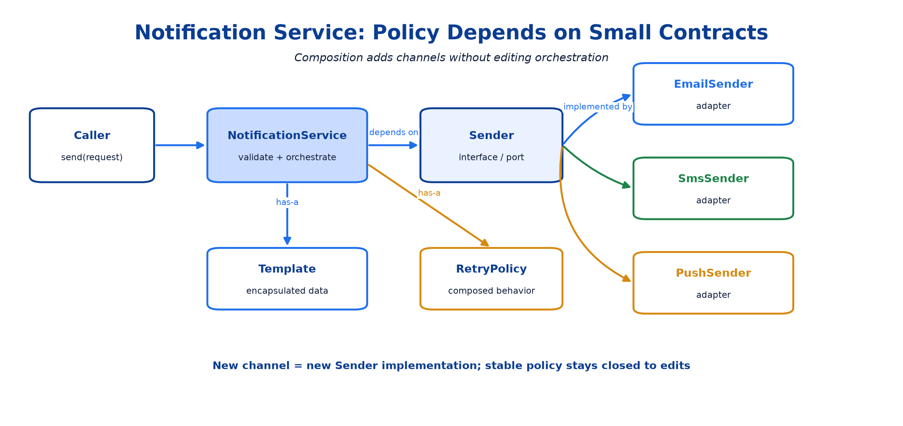

# LLD: Object-Oriented Principles & Clean Code

> A compact guide to designing code whose invariants are protected, behavior is replaceable, and future changes stay local. Use principles to diagnose change pressure—not to decorate class diagrams with fashionable interfaces.

---

## 1. One-page visual summary


Good object design moves volatile behavior behind small contracts while keeping state transitions close to the rules they must preserve.


| Principle | Interview question | Healthy outcome |
|---|---|---|
| **S** — Single Responsibility | Which actor or concern causes this class to change? | One cohesive responsibility |
| **O** — Open/Closed | Can new behavior be added without risky edits to stable policy? | Extension at a deliberate seam |
| **L** — Liskov Substitution | Can every subtype safely replace its base type? | Preserved behavioral contract |
| **I** — Interface Segregation | Does each client depend only on operations it uses? | Small, client-shaped interfaces |
| **D** — Dependency Inversion | Does policy depend on details or on abstractions? | Replaceable infrastructure |

!!! tip "Mental shortcut"
    Encapsulate what must remain valid; abstract what genuinely varies; compose behavior; verify that substitution preserves expectations.

---

## 2. Core mental model

### Design around change and invariants

An object owns **state plus the behavior that keeps that state valid**. A module boundary is useful when it contains a cohesive policy and prevents unrelated changes from spreading.

```text
Useful boundary = cohesive responsibility + protected invariant + explicit contract
Design quality   = cost of a likely change + confidence that behavior remains correct
```

### Encapsulation

Encapsulation is not merely making fields `private`. It prevents callers from creating invalid state by forcing mutation through behavior that enforces rules.

```java
final class BankAccount {
    private BigDecimal balance;

    void withdraw(BigDecimal amount) {
        if (amount.signum() <= 0 || amount.compareTo(balance) > 0)
            throw new IllegalArgumentException("Invalid withdrawal");
        balance = balance.subtract(amount);
    }
}
```

`account.withdraw(amount)` exposes intent and preserves the non-negative-balance invariant. A public `setBalance(...)` would let every caller reinterpret that rule and duplicate validation.

### Abstraction and polymorphism

- **Abstraction** exposes the behavior clients need while hiding irrelevant detail.
- **Polymorphism** lets callers use one contract while implementations supply different behavior.

```java
interface Sender { void send(Message message); }
final class EmailSender implements Sender { public void send(Message m) { /* SMTP */ } }
final class SmsSender implements Sender { public void send(Message m) { /* SMS API */ } }

void notify(Sender sender, Message message) {
    sender.send(message);              // no instanceof or channel switch
}
```

The caller knows the `Sender` capability, not SMTP or SMS mechanics. Polymorphism is valuable only when implementations honor one real behavioral contract; an interface with one stable implementation may be speculative ceremony.

### Composition before inheritance


**Inheritance** models a stable behavioral **is-a** relationship. **Composition** assembles replaceable **has-a** capabilities. Prefer composition for varying policies; use inheritance when the subtype truly preserves the parent contract and identity.

```java
final class Bird {
    private final FlyBehavior flight;
    Bird(FlyBehavior flight) { this.flight = flight; }
    void fly() { flight.fly(); }
}
// new Bird(new WingedFlight());  new Bird(new NoFlight());
```

Here flight can vary without inventing a subtype or forcing non-flying birds to inherit `fly()` behavior they cannot support.

---

## 3. Important concepts

### Single Responsibility Principle (SRP)

> A module should have one reason to change—usually one business actor or cohesive concern.

A class that calculates invoices, persists them, and emails customers changes for finance, database, and communication reasons. Separate those policies:

```java
final class InvoiceCalculator {
    Money total(Order order) { return pricing.total(order); }
}
interface InvoiceRepository { void save(Invoice invoice); }
interface InvoiceMailer { void send(Invoice invoice); }
```

Each type now changes for one concern and can be tested independently. **Do not confuse SRP with “one method per class.”** Cohesive methods that protect one responsibility belong together.

### Open/Closed Principle (OCP)

> Software entities should be open for extension but closed to modification at established variation points.

Use a strategy, plugin, or polymorphic implementation when new cases are frequent and predictable:

```java
interface DiscountPolicy { Money apply(Money subtotal); }
final class RegularDiscount implements DiscountPolicy {
    public Money apply(Money amount) { return amount.percentOff(5); }
}
final class FestivalDiscount implements DiscountPolicy {
    public Money apply(Money amount) { return amount.percentOff(15); }
}

Money checkout(Order order, DiscountPolicy policy) {
    return policy.apply(order.subtotal());
}
```

Adding `EmployeeDiscount` does not edit checkout policy. OCP does not mean existing code is never edited; premature extension points violate YAGNI and increase indirection.

### Liskov Substitution Principle (LSP)

> Code using a base type should remain correct when given any subtype.

A subtype must preserve the observable contract: preconditions, postconditions, invariants, side effects, and failure semantics.

```java
interface FileStore { byte[] read(String key) throws NotFoundException; }
final class S3Store implements FileStore {
    public byte[] read(String key) { return client.get(key); }
}
final class BrokenStore implements FileStore {
    public byte[] read(String key) { throw new UnsupportedOperationException(); }
}
```

`BrokenStore` matches the Java signature but is not substitutable if callers are promised readable storage. Likewise, if `Penguin extends Bird` inherits required flight behavior, taxonomy is fighting the contract; compose `FlyBehavior` or narrow the base type.

### Interface Segregation Principle (ISP)

> Clients should not depend on methods they do not use.

Prefer client-specific capabilities over a giant service interface:

```java
interface Printer { void print(Document document); }
interface Scanner { Image scan(Page page); }
final class BasicPrinter implements Printer {
    public void print(Document d) { spooler.print(d); }
}
final class MultiFunctionDevice implements Printer, Scanner {
    public void print(Document d) { spooler.print(d); }
    public Image scan(Page p) { return scanner.scan(p); }
}
```

`BasicPrinter` is not forced to throw from an irrelevant `scan()` method. Too many tiny interfaces can also obscure the domain; split around distinct client needs, not every method.

### Dependency Inversion Principle (DIP)

> High-level policy and low-level details should depend on abstractions owned near the policy.

A notification policy should depend on a policy-owned port rather than constructing an SMTP detail:

```java
interface Sender { SendResult send(Notification notification); }
final class NotificationService {
    private final Sender sender;
    NotificationService(Sender sender) { this.sender = sender; }
    SendResult notify(Notification n) { return sender.send(n); }
}
```

Production injects `SmtpSender`; tests inject a deterministic fake. **Dependency inversion is a design direction; dependency injection is one wiring technique.** A DI container does not automatically produce a decoupled design.

### DRY, KISS, and YAGNI


| Rule | Apply when | Misuse to avoid |
|---|---|---|
| DRY | The same knowledge or rule has multiple sources of truth | Merging coincidentally similar code |
| KISS | Complexity does not purchase a required capability | Hiding necessary domain complexity |
| YAGNI | A feature or abstraction has no current evidence | Blocking obvious, low-cost evolution paths |

DRY is about duplicated **knowledge**, not identical syntax. Centralize one business rule, while leaving unrelated look-alike code alone:

```java
final class TaxPolicy {
    Money taxFor(Address address, Money subtotal) { /* one owned rule */ }
}
// Checkout and RefundService both call TaxPolicy; neither copies tax brackets.
```

For **KISS**, prefer `Map<Channel, Sender>` lookup over a plugin framework when channels are known and local. For **YAGNI**, do not add scheduling, localization, or ten provider adapters until requirements justify them; preserve a seam that allows those changes later.

---

## 4. Decision and trade-off tables

### Composition or inheritance?

| Question | Prefer composition | Consider inheritance |
|---|---|---|
| Relationship | Object **has** a replaceable capability | Subtype behaviorally **is** the base type |
| Variation | Behavior changes independently or at runtime | Hierarchy is stable and shallow |
| Reuse goal | Reuse capability without identity coupling | Share a true invariant and contract |
| Risk | More collaborators and wiring | Fragile base class and tight coupling |
| Test | Swap a fake or strategy | Run base-contract tests against every subtype |

### Add an abstraction?

| Evidence | Decision | Optimizes for | Cost |
|---|---|---|---|
| Multiple implementations exist | Extract a stable contract | Substitution and testing | Indirection |
| One implementation, likely boundary | Use a narrow port | Isolation from volatile detail | Extra type and wiring |
| One stable implementation | Keep it concrete | Simplicity | Later extraction if change arrives |
| Cases change frequently | Strategy/plugin seam | OCP and local extension | Discovery and lifecycle complexity |
| Hypothetical future only | Defer | YAGNI and readability | Refactor later if evidence appears |

### Principle collisions

| Tension | Balanced decision |
|---|---|
| DRY vs SRP | Do not unify knowledge owned by different actors |
| OCP vs YAGNI | Add extension points only where variation is demonstrated |
| ISP vs discoverability | Split by client capability, not into interface confetti |
| DIP vs simplicity | Invert volatile/external dependencies; keep stable local details concrete |
| Encapsulation vs convenience | Protect invariants even if direct field mutation looks shorter |

---

## 5. Failure scenarios


| Smell | Likely problem | Focused response |
|---|---|---|
| God class | Multiple responsibilities and actors | Split cohesive policy from details |
| Shotgun surgery | One rule duplicated across modules | Establish one owner/source of truth |
| Fat interface | Clients depend on irrelevant operations | Introduce client-specific capabilities |
| Concrete coupling | Policy constructs infrastructure details | Inject a policy-owned abstraction |
| Type-switch logic | Variation lives in caller conditionals | Move behavior behind polymorphism |
| Deep hierarchy | Subtypes inherit irrelevant behavior | Flatten and compose capabilities |
| Anemic model | Callers manipulate state and rules | Move invariant-preserving behavior inward |

### How principles fail in practice

- **Premature abstraction:** an interface is extracted before the variation is understood.
- **Wrong abstraction:** unrelated cases are forced together to satisfy DRY.
- **Inheritance leakage:** base-class changes unexpectedly alter every subtype.
- **LSP violation:** subtype methods reject valid base inputs or silently change guarantees.
- **Service locator:** dependencies are hidden behind global lookup rather than explicit contracts.
- **Pattern worship:** more factories and strategies are added than the problem contains.

Refactor from observed pressure: name the expected change, identify its blast radius, and choose the smallest boundary adjustment that contains it.

---

## 6. One focused worked example

### Extensible notification delivery

**Requirement:** send a validated notification through email, SMS, or push. New channels should not require edits to orchestration. Retry policy and template data must be testable and replaceable.



```text
interface Sender {
    SendResult send(Notification message)
}

NotificationService(sender, retryPolicy) {
    send(request):
        message = template.renderValidated(request)
        return retryPolicy.execute(() -> sender.send(message))
}
```

| Design choice | Principle | Optimizes for | Cost / guardrail |
|---|---|---|---|
| `Notification` validates required fields | Encapsulation | Valid state everywhere | Avoid setters that bypass rules |
| One `Sender` capability | ISP | Small client contract | Add methods only all senders guarantee |
| Adapters implement `Sender` | DIP + polymorphism | Replaceable delivery detail | Preserve result/error semantics for LSP |
| New adapter per channel | OCP | Local extension | Register and observe adapter lifecycle |
| `RetryPolicy` is composed | Composition | Replaceable resilience behavior | Retry only safe/idempotent operations |
| Orchestrator only coordinates | SRP | One reason to change | Do not absorb adapter-specific rules |

**Failure path:** if an adapter reports a transient failure, `RetryPolicy` applies bounded retry rules. Permanent validation or destination errors return immediately. Every `Sender` must preserve these classifications; otherwise substitution breaks despite matching method signatures.

---

## 7. Senior/Principal interview signals

| Senior signal | Staff/Principal extension |
|---|---|
| Explains principles through likely changes | Identifies ownership and actor boundaries across teams |
| Protects invariants inside the model | Defines contracts that remain stable across services |
| Tests behavioral substitution | Establishes contract tests for plugin/adapter ecosystems |
| Uses composition deliberately | Controls extension lifecycle, discovery, and observability |
| Avoids speculative abstractions | Creates an incremental migration from the current design |
| Names trade-offs, not slogans | Measures change failure rate and blast radius |

Strong interview language:

> “Channel delivery is volatile, so orchestration depends on a small `Sender` contract. This optimizes for local extension and testability, at the cost of indirection and wiring. I would verify LSP with contract tests over success, transient failure, permanent failure, and timeout behavior.”

At Principal level, discuss how module contracts affect team autonomy, versioning, rollout safety, and whether an abstraction should exist in-process, across a service boundary, or not at all.

---

## 8. Final revision checklist

```text
[ ] SRP: identify the actor and one cohesive reason to change
[ ] OCP: name the proven variation point before adding an extension seam
[ ] LSP: verify preconditions, postconditions, invariants, and failure semantics
[ ] ISP: shape interfaces around client capabilities
[ ] DIP: make policy own abstractions; inject volatile details
[ ] DRY: remove duplicated knowledge, not coincidental syntax
[ ] KISS: choose the simplest design that preserves required behavior
[ ] YAGNI: defer unsupported features and abstractions
[ ] ENCAPSULATE: expose intent and keep invalid state unrepresentable
[ ] POLYMORPHISM: replace type switches with a genuine shared contract
[ ] COMPOSITION: prefer replaceable capabilities over fragile hierarchies
[ ] DEFEND: state the expected change, optimization, cost, and validation test
```

!!! success "The senior-level finish"
    Principles are constraints on change, not goals by themselves. Defend a design by showing which likely change it localizes, which invariant it protects, and which complexity it deliberately avoids.
