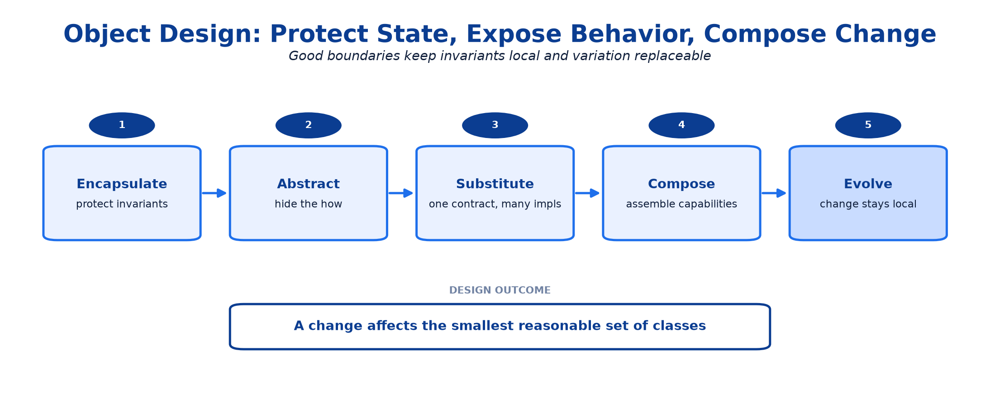
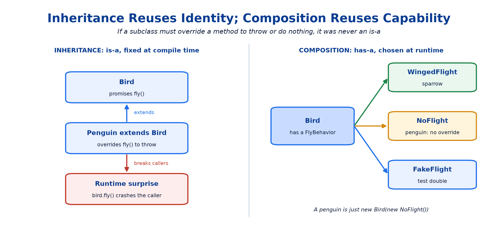

# LLD: Object-Oriented Principles & Clean Code

> A compact guide to designing code whose invariants are protected, behavior is replaceable, and future changes stay local. Use principles to diagnose change pressure—not to decorate class diagrams with fashionable interfaces.

---

## 1. One-page visual summary



Good object design moves volatile behavior behind small contracts while keeping state transitions close to the rules they must preserve.


| Principle | Interview question | Healthy outcome |
|---|---|---|
| **S** — Single Responsibility | Which actor or concern causes this class to change? If finance, the DBA, and the comms team all have reasons to edit it, that is three. | One cohesive responsibility — the class does one job, so a change for one concern cannot break another |
| **O** — Open/Closed | Can new behavior be added without risky edits to stable policy? Or does every new case mean reopening a method that already works? | Extension at a deliberate seam — new cases arrive as new classes, leaving tested code untouched |
| **L** — Liskov Substitution | Can every subtype safely replace its base type? Would any subtype throw, no-op, or tighten the rules and surprise a caller? | Preserved behavioral contract — subtypes demand no more and promise no less than the base type |
| **I** — Interface Segregation | Does each client depend only on operations it uses? Are implementers stubbing out methods they never needed? | Small, client-shaped interfaces — no class is dragged into supporting capabilities it does not have |
| **D** — Dependency Inversion | Does policy depend on details or on abstractions? Can you test the business logic without a real database or network? | Replaceable infrastructure — swap SMTP for SMS, or a real store for a fake, without touching the policy |

!!! tip "Mental shortcut"
    Encapsulate what must remain valid; abstract what genuinely varies; compose behavior; verify that substitution preserves expectations.

---

## 2. Core mental model

### Design around change and invariants

An object owns **state plus the behavior that keeps that state valid**. An **invariant** is a rule that must always hold — an account balance never goes negative, an order always has at least one line item. A module boundary is useful when it contains a cohesive policy and prevents unrelated changes from spreading.

```text
Useful boundary = cohesive responsibility + protected invariant + explicit contract
Design quality   = cost of a likely change + confidence that behavior remains correct
```

Read the second line as the only test that matters: when a likely change arrives, how many files must you touch, and will you know if you broke something?

### The four pillars of OOP at a glance

| Pillar | Simple meaning |
|---|---|
| **Encapsulation** | Hide the data; expose behavior that keeps it valid |
| **Abstraction** | Show *what* it does, hide *how* it does it |
| **Inheritance** | Share common behavior through an is-a relationship |
| **Polymorphism** | One contract, many implementations |

Let's understand each with simple Java examples.

### 1. Encapsulation

**Definition:** A class should bundle its data together with the behavior that protects that data, and should restrict direct access from the outside. In simple words, callers must not be able to reach in and put the object into an invalid state.

**Bad design**

```java
class BankAccount {
    public BigDecimal balance;      // anyone can write anything
}

account.balance = new BigDecimal("-5000");   // now the account is invalid
```

The rule "a balance must never go negative" lives nowhere. Every caller is free to invent its own version of it, so the same validation gets copy-pasted everywhere and drifts:

```text
Checkout   ──┐
Transfer   ──┼──► account.balance    (three places enforcing the rule, badly)
AdminTool  ──┘
```

**Good design**

```java
final class BankAccount {
    private BigDecimal balance;                        // nobody touches this directly

    void withdraw(BigDecimal amount) {
        if (amount.signum() <= 0 || amount.compareTo(balance) > 0)
            throw new IllegalArgumentException("Invalid withdrawal");
        balance = balance.subtract(amount);            // the rule lives here, once
    }
}
```

`account.withdraw(amount)` states intent and guarantees the invariant. **Careful:** encapsulation is not just typing `private` — a class with a `private` field and a public `setBalance()` has simply added a step on the way to the same broken state.

### 2. Abstraction

**Definition:** A type should expose a simple contract that hides the complicated details sitting behind it. In simple words, the caller needs to know *what* the operation does, and should never have to care *how* it is done.

**Bad design**

```java
// Caller is forced to know every step, in the right order
smtp.connect("mail.corp.com", 587);
smtp.authenticate(user, password);
smtp.compose(to, subject, body);
smtp.transmit();
smtp.disconnect();
```

Every calling class now depends on SMTP mechanics. Change the mail provider and you edit all of them.

**Good design**

```java
interface Sender { void send(Message message); }

// caller
sender.send(message);        // that's the whole contract
```

The details (connect, auth, retry, disconnect) live behind `send`. **Careful:** a good abstraction hides *irrelevant* detail — it should not hide things the caller genuinely needs to decide about, like whether an operation costs money or may block for a minute.

### 3. Inheritance

**Definition:** A child class derives state and behavior from a parent class, which establishes an **is-a** relationship between them. In simple words, a `Dog` is an `Animal`, so it automatically gets everything that every animal can already do.

**Bad design**

```java
class Dog { void eat() { /* same code */ } void sleep() { /* same code */ } void bark() {} }
class Cat { void eat() { /* same code */ } void sleep() { /* same code */ } void meow() {} }
```

`eat()` and `sleep()` are duplicated. Fix a bug in one and you must remember the other.

**Good design**

```java
abstract class Animal {
    void eat()   { /* shared once */ }
    void sleep() { /* shared once */ }
}

class Dog extends Animal { void bark() {} }
class Cat extends Animal { void meow() {} }
```

```text
      Animal          (eat, sleep)
      /    \
    Dog     Cat       (bark)   (meow)
```

**Careful:** inheritance is the most over-used pillar. It is only correct when the child genuinely *is* the parent and honors its promises — `Penguin extends Bird` breaks the moment `Bird` promises `fly()`. Inheritance also couples tightly: a change to `Animal` reaches every descendant. When in doubt, prefer composition (next subsection).

### 4. Polymorphism

**Definition:** A single contract can be fulfilled by many different implementations, and the correct one is selected at runtime. In simple words, you call the same method every time and each object responds with the behavior that is right for it.

**Bad design**

```java
void notify(String channel, Message m) {
    if (channel.equals("EMAIL"))     new EmailSender().send(m);
    else if (channel.equals("SMS"))  new SmsSender().send(m);
    // every new channel edits this method
}
```

The variation lives in a conditional that grows forever, and the caller must know every channel that exists.

**Good design**

```java
interface Sender { void send(Message m); }
final class EmailSender implements Sender { public void send(Message m) { /* SMTP    */ } }
final class SmsSender   implements Sender { public void send(Message m) { /* SMS API */ } }

void notify(Sender sender, Message m) {
    sender.send(m);                 // no instanceof, no switch
}
```

```text
notify(Sender) ──► send()
                     ├── EmailSender.send()
                     └── SmsSender.send()      (chosen at runtime)
```

Adding `PushSender` requires no change to `notify`. **Careful:** polymorphism only pays off when every implementation honors the *same* behavioral contract. One interface with a single permanent implementation is usually ceremony, not design.

### Composition before inheritance



**Inheritance** models a stable behavioral **is-a** relationship. **Composition** assembles replaceable **has-a** capabilities. Prefer composition for varying policies; use inheritance when the subtype truly preserves the parent contract and identity.

```java
final class Bird {
    private final FlyBehavior flight;
    Bird(FlyBehavior flight) { this.flight = flight; }
    void fly() { flight.fly(); }
}
// new Bird(new WingedFlight());  new Bird(new NoFlight());
```

Here flight can vary without inventing a subtype or forcing non-flying birds to inherit `fly()` behavior they cannot support. The quick test: if you find yourself overriding a parent method to throw or do nothing, the relationship was never really **is-a**.

---

## 3. Important concepts

The SOLID principles are five object-oriented design principles that help you write code that is easy to understand, maintain, test, and extend. Think of them as guidelines for avoiding tightly coupled, fragile code.

### The 5 SOLID principles at a glance

| Letter | Principle | Simple meaning |
|---|---|---|
| **S** | Single Responsibility | One class should have one reason to change |
| **O** | Open/Closed | Open for extension, closed for modification |
| **L** | Liskov Substitution | Child classes should be safely usable wherever the parent is expected |
| **I** | Interface Segregation | Don't force classes to implement methods they don't need |
| **D** | Dependency Inversion | Depend on abstractions, not concrete implementations |

Let's understand each with simple Java examples.

### 1. S — Single Responsibility Principle

**Definition:** A class should have exactly one reason to change. In simple words, one class should own one responsibility and nothing more.

**Bad design**

```java
class Employee {
    void calculateSalary() { /* salary rules */ }
    void saveToDatabase()  { /* persistence  */ }
    void sendEmail()       { /* notification */ }
}
```

This class is doing three different jobs:

```text
Employee
│
├── Salary calculation
├── Database persistence
└── Email notification
```

If the email system changes → `Employee` changes. If the database changes → `Employee` changes. If salary rules change → `Employee` changes. That's multiple reasons to change.

**Good design**

```java
class SalaryCalculator { Money calculate(Employee e) { /* salary rules */ } }
class EmployeeRepository { void save(Employee e)     { /* persistence  */ } }
class EmployeeMailer    { void sendWelcome(Employee e) { /* email      */ } }
```

Each class now has one reason to change, and each can be tested on its own. **Careful:** SRP does not mean "one method per class" — methods that protect the *same* responsibility belong together.

### 2. O — Open/Closed Principle

**Definition:** Software entities should be open for extension but closed for modification. In simple words, you should be able to add new behavior by writing new code rather than by editing code that already works.

**Bad design**

```java
class DiscountCalculator {
    Money apply(String type, Money amount) {
        if (type.equals("REGULAR"))  return amount.percentOff(5);
        if (type.equals("FESTIVAL")) return amount.percentOff(15);
        return amount;                      // every new type edits this method
    }
}
```

Every new discount type forces you back into a class that already works — and every edit risks breaking the types that were already correct.

**Good design**

```java
interface DiscountPolicy { Money apply(Money amount); }

class RegularDiscount  implements DiscountPolicy { public Money apply(Money a) { return a.percentOff(5);  } }
class FestivalDiscount implements DiscountPolicy { public Money apply(Money a) { return a.percentOff(15); } }
```

Adding `EmployeeDiscount` now means adding a class — the checkout code never changes. **Careful:** don't add extension points for variations you haven't actually seen; that's YAGNI.

### 3. L — Liskov Substitution Principle

**Definition:** Objects of a child class should be usable anywhere the parent class is expected, without breaking the program. In simple words, a subclass must honor every promise that its parent already made to callers.

**Bad design**

```java
class Bird { void fly() { /* flies */ } }

class Penguin extends Bird {
    void fly() { throw new UnsupportedOperationException("Penguins can't fly"); }
}
```

Any code holding a `Bird` reasonably expects `fly()` to work. Hand it a `Penguin` and it crashes:

```text
void makeItFly(Bird bird) {
    bird.fly();        // works for Sparrow, explodes for Penguin
}
```

**Good design**

```java
class Bird { void eat() { /* all birds eat */ } }
interface CanFly { void fly(); }

class Sparrow extends Bird implements CanFly { public void fly() { /* flies */ } }
class Penguin extends Bird { /* simply never claims it can fly */ }
```

The rule of thumb: a subclass may not demand *more* from callers or promise *less* back than the parent did. If you're overriding a method just to throw or do nothing, the inheritance was wrong.

### 4. I — Interface Segregation Principle

**Definition:** Clients should not be forced to depend on methods that they never use. In simple words, several small and focused interfaces are better than one large interface that tries to cover everything.

**Bad design**

```java
interface Machine { void print(Doc d); void scan(Doc d); void fax(Doc d); }

class SimplePrinter implements Machine {
    public void print(Doc d) { /* fine */ }
    public void scan(Doc d)  { throw new UnsupportedOperationException(); }
    public void fax(Doc d)   { throw new UnsupportedOperationException(); }
}
```

A basic printer is dragged into implementing scanning and faxing it will never support. Those `UnsupportedOperationException` stubs are the smell.

**Good design**

```java
interface Printer { void print(Doc d); }
interface Scanner { void scan(Doc d); }

class SimplePrinter implements Printer { public void print(Doc d) { /* fine */ } }
class OfficeMachine implements Printer, Scanner { /* implements both, honestly */ }
```

**Careful:** split around real client needs, not every individual method — otherwise you end up with interface confetti.

### 5. D — Dependency Inversion Principle

**Definition:** High-level modules should not depend on low-level modules, because both should depend on abstractions instead. In simple words, your code should depend on *what* a collaborator does, never on *how* that collaborator happens to do it.

**Bad design**

```java
class NotificationService {
    private final SmtpEmailSender sender = new SmtpEmailSender();   // welded to SMTP
    void notify(String msg) { sender.send(msg); }
}
```

This class can never send an SMS, and you can't unit-test it without a real mail server:

```text
NotificationService ──► SmtpEmailSender   (policy depends on detail)
```

**Good design**

```java
interface Sender { void send(String message); }

class NotificationService {
    private final Sender sender;
    NotificationService(Sender sender) { this.sender = sender; }   // injected
    void notify(String msg) { sender.send(msg); }
}
```

Now both sides point at the abstraction: production passes `SmtpSender`, tests pass a fake, and adding `SmsSender` touches nothing. **Careful:** dependency inversion is the *design direction*; dependency injection is just one way to wire it. A DI container does not automatically give you a decoupled design.

### DRY, KISS, and YAGNI


Where SOLID shapes how responsibilities are divided, these three guard against three different everyday failures: duplicating a rule, over-building a solution, and building something nobody asked for.

| Rule | Stands for | Simple meaning |
|---|---|---|
| **DRY** | Don't Repeat Yourself | Every rule should have exactly one home |
| **KISS** | Keep It Simple, Stupid | Choose the simplest thing that satisfies the requirement |
| **YAGNI** | You Aren't Gonna Need It | Don't build it until something actually needs it |

### 1. DRY — Don't Repeat Yourself

**Definition:** Every piece of knowledge should have a single, unambiguous home in the system. In simple words, a business rule should be written down once, so that changing it means editing one place rather than hunting for copies.

**Bad design**

```java
class Checkout {
    Money tax(Money sub) { return sub.times(0.18); }     // 18% GST
}
class RefundService {
    Money tax(Money sub) { return sub.times(0.18); }     // same rule, second copy
}
```

The tax rate is now knowledge with two owners. When the rate changes to 20%, one of these will be missed, and the bug shows up as refunds that quietly disagree with charges.

**Good design**

```java
final class TaxPolicy {
    Money taxFor(Address address, Money subtotal) { /* one owned rule */ }
}
// Checkout and RefundService both call TaxPolicy; neither copies tax brackets.
```

**Careful:** DRY is about duplicated **knowledge**, not identical-looking syntax. Two methods that happen to read the same today but change for different reasons should stay separate — merging them couples two unrelated concerns, and you will be splitting them apart again later.

### 2. KISS — Keep It Simple, Stupid

**Definition:** A solution should be no more complicated than the problem requires. In simple words, complexity has to buy you a capability you actually need, otherwise it is pure cost.

**Bad design**

```java
// Three known channels, so we built a plugin framework
ServiceLoader<SenderPlugin> plugins = ServiceLoader.load(SenderPlugin.class);
registry.discover(plugins).withFallback(...).withPriority(...);
```

Classpath scanning, plugin lifecycle, and priority rules — all to reach one of three classes that ship in the same repository. Every future reader must understand the machinery before they can answer "which sender runs?"

**Good design**

```java
Map<Channel, Sender> senders = Map.of(
    EMAIL, new EmailSender(),
    SMS,   new SmsSender());

senders.get(channel).send(message);
```

**Careful:** KISS means removing *accidental* complexity, not pretending the domain is simpler than it is. Tax rules, pricing tiers, and retry semantics are genuinely complicated; collapsing them into something "clean" that gets edge cases wrong is not simplicity, it is a bug.

### 3. YAGNI — You Aren't Gonna Need It

**Definition:** Do not build functionality on the basis of speculation about the future. In simple words, wait until a real requirement exists, because most predicted requirements never arrive.

**Bad design**

```java
interface PaymentGateway { /* ... */ }
class StripeGateway  implements PaymentGateway { /* the only one actually used */ }
class PaypalGateway  implements PaymentGateway { throw new TODO(); }
class RazorpayGateway implements PaymentGateway { throw new TODO(); }
class CryptoGateway  implements PaymentGateway { throw new TODO(); }
```

Four gateways were written for a product that integrates with one. The unused three still need to compile, still confuse readers, and are usually wrong anyway — written against a guess rather than a real API.

**Good design**

```java
interface PaymentGateway { PaymentResult charge(Money amount, Card card); }
final class StripeGateway implements PaymentGateway { /* the one we need today */ }
// The interface is the seam; add a second implementation when a second provider is real.
```

**Careful:** YAGNI targets speculative *features and abstractions*, not basic good structure. Leaving a clean seam costs almost nothing and makes the future change easy; building out the whole future is what YAGNI forbids.

### When they collide

| Rule | Apply when | Misuse to avoid |
|---|---|---|
| DRY | The same knowledge or rule has multiple sources of truth | Merging coincidentally similar code |
| KISS | Complexity does not purchase a required capability | Hiding necessary domain complexity |
| YAGNI | A feature or abstraction has no current evidence | Blocking obvious, low-cost evolution paths |

These three can pull against each other, and against SOLID. DRY pushes you to extract a shared abstraction, while KISS and YAGNI push back and ask whether that abstraction is worth its indirection. The tie-breaker is evidence: unify a rule when it is genuinely one rule with one owner, and leave the duplication alone when the two copies simply happen to look alike today.

---

## 4. Decision and trade-off tables

### Composition or inheritance?

| Question | Prefer composition | Consider inheritance |
|---|---|---|
| Relationship | Object **has** a replaceable capability | Subtype behaviorally **is** the base type |
| Variation | Behavior changes independently or at runtime | Hierarchy is stable and shallow |
| Reuse goal | Reuse capability without identity coupling | Share a true invariant and contract |
| Risk | More collaborators and wiring | Fragile base class and tight coupling |
| Test | Swap a fake or strategy | Run base-contract tests against every subtype |

### Add an abstraction?

| Evidence | Decision | Optimizes for | Cost |
|---|---|---|---|
| Multiple implementations exist | Extract a stable contract | Substitution and testing | Indirection |
| One implementation, likely boundary | Use a narrow port | Isolation from volatile detail | Extra type and wiring |
| One stable implementation | Keep it concrete | Simplicity | Later extraction if change arrives |
| Cases change frequently | Strategy/plugin seam | OCP and local extension | Discovery and lifecycle complexity |
| Hypothetical future only | Defer | YAGNI and readability | Refactor later if evidence appears |

### Principle collisions

| Tension | Balanced decision |
|---|---|
| DRY vs SRP | Do not unify knowledge owned by different actors |
| OCP vs YAGNI | Add extension points only where variation is demonstrated |
| ISP vs discoverability | Split by client capability, not into interface confetti |
| DIP vs simplicity | Invert volatile/external dependencies; keep stable local details concrete |
| Encapsulation vs convenience | Protect invariants even if direct field mutation looks shorter |

---

## 5. Failure scenarios


| Smell | Likely problem | Focused response |
|---|---|---|
| God class | Multiple responsibilities and actors | Split cohesive policy from details |
| Shotgun surgery | One rule duplicated across modules | Establish one owner/source of truth |
| Fat interface | Clients depend on irrelevant operations | Introduce client-specific capabilities |
| Concrete coupling | Policy constructs infrastructure details | Inject a policy-owned abstraction |
| Type-switch logic | Variation lives in caller conditionals | Move behavior behind polymorphism |
| Deep hierarchy | Subtypes inherit irrelevant behavior | Flatten and compose capabilities |
| Anemic model | Callers manipulate state and rules | Move invariant-preserving behavior inward |

### How principles fail in practice

- **Premature abstraction:** an interface is extracted before the variation is understood.
- **Wrong abstraction:** unrelated cases are forced together to satisfy DRY.
- **Inheritance leakage:** base-class changes unexpectedly alter every subtype.
- **LSP violation:** subtype methods reject valid base inputs or silently change guarantees.
- **Service locator:** dependencies are hidden behind global lookup rather than explicit contracts.
- **Pattern worship:** more factories and strategies are added than the problem contains.

Refactor from observed pressure: name the expected change, identify its blast radius, and choose the smallest boundary adjustment that contains it.

---

## 6. One focused worked example

### Extensible notification delivery

**Requirement:** send a validated notification through email, SMS, or push. New channels should not require edits to orchestration. Retry policy and template data must be testable and replaceable.


```text
interface Sender {
    SendResult send(Notification message)
}

NotificationService(sender, retryPolicy) {
    send(request):
        message = template.renderValidated(request)
        return retryPolicy.execute(() -> sender.send(message))
}
```

| Design choice | Principle | Optimizes for | Cost / guardrail |
|---|---|---|---|
| `Notification` validates required fields | Encapsulation | Valid state everywhere | Avoid setters that bypass rules |
| One `Sender` capability | ISP | Small client contract | Add methods only all senders guarantee |
| Adapters implement `Sender` | DIP + polymorphism | Replaceable delivery detail | Preserve result/error semantics for LSP |
| New adapter per channel | OCP | Local extension | Register and observe adapter lifecycle |
| `RetryPolicy` is composed | Composition | Replaceable resilience behavior | Retry only safe/idempotent operations |
| Orchestrator only coordinates | SRP | One reason to change | Do not absorb adapter-specific rules |

**Failure path:** if an adapter reports a transient failure, `RetryPolicy` applies bounded retry rules. Permanent validation or destination errors return immediately. Every `Sender` must preserve these classifications; otherwise substitution breaks despite matching method signatures.

---

## 7. Senior/Principal interview signals

| Senior signal | Staff/Principal extension |
|---|---|
| Explains principles through likely changes | Identifies ownership and actor boundaries across teams |
| Protects invariants inside the model | Defines contracts that remain stable across services |
| Tests behavioral substitution | Establishes contract tests for plugin/adapter ecosystems |
| Uses composition deliberately | Controls extension lifecycle, discovery, and observability |
| Avoids speculative abstractions | Creates an incremental migration from the current design |
| Names trade-offs, not slogans | Measures change failure rate and blast radius |

Strong interview language:

> “Channel delivery is volatile, so orchestration depends on a small `Sender` contract. This optimizes for local extension and testability, at the cost of indirection and wiring. I would verify LSP with contract tests over success, transient failure, permanent failure, and timeout behavior.”

At Principal level, discuss how module contracts affect team autonomy, versioning, rollout safety, and whether an abstraction should exist in-process, across a service boundary, or not at all.

---

## 8. Final revision checklist

```text
[ ] SRP: identify the actor and one cohesive reason to change
[ ] OCP: name the proven variation point before adding an extension seam
[ ] LSP: verify preconditions, postconditions, invariants, and failure semantics
[ ] ISP: shape interfaces around client capabilities
[ ] DIP: make policy own abstractions; inject volatile details
[ ] DRY: remove duplicated knowledge, not coincidental syntax
[ ] KISS: choose the simplest design that preserves required behavior
[ ] YAGNI: defer unsupported features and abstractions
[ ] ENCAPSULATE: expose intent and keep invalid state unrepresentable
[ ] POLYMORPHISM: replace type switches with a genuine shared contract
[ ] COMPOSITION: prefer replaceable capabilities over fragile hierarchies
[ ] DEFEND: state the expected change, optimization, cost, and validation test
```

!!! success "The senior-level finish"
    Principles are constraints on change, not goals by themselves. Defend a design by showing which likely change it localizes, which invariant it protects, and which complexity it deliberately avoids.
