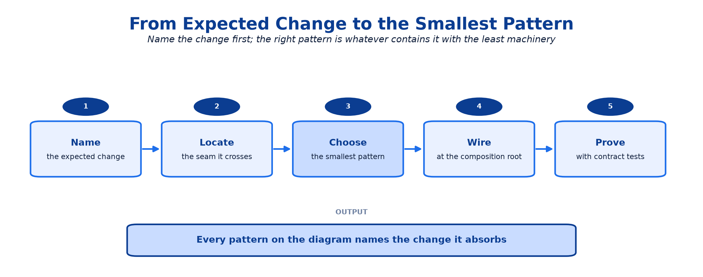
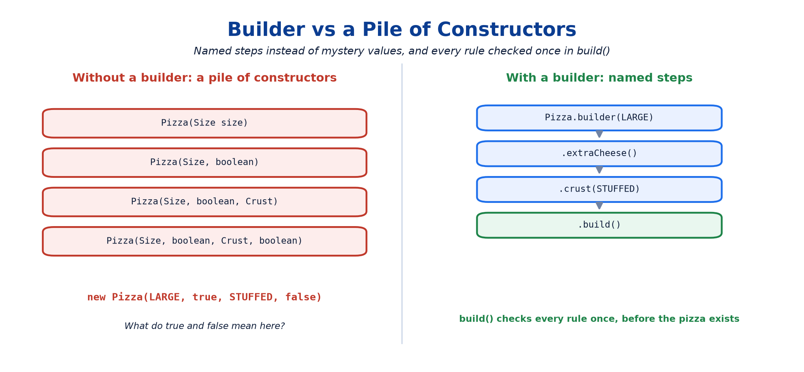
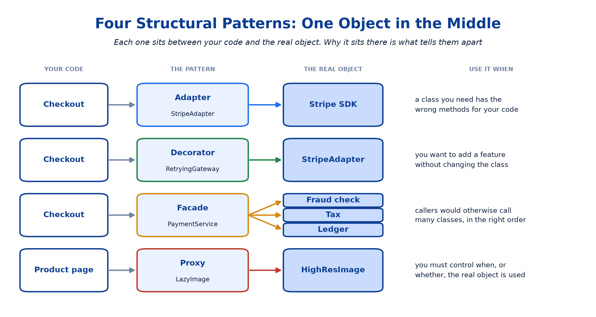
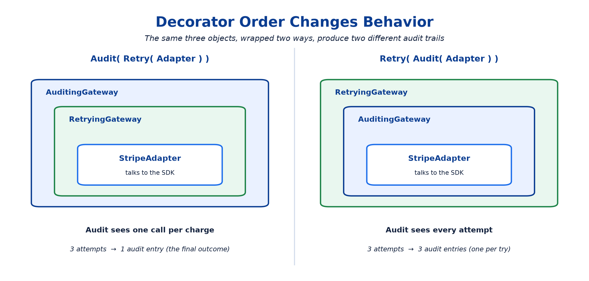
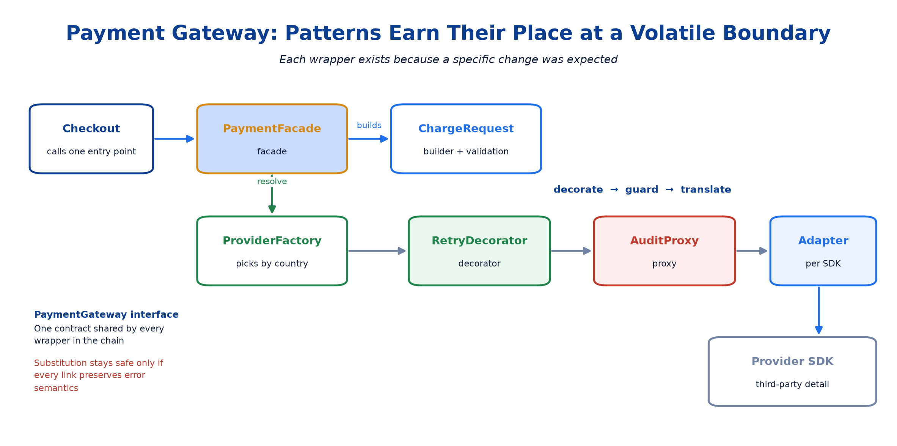

# LLD: Creational & Structural Design Patterns

> A visual guide to the patterns that decide **who builds an object** and **how objects are wired together**. Use it to choose the smallest pattern that contains a change you expect, tell look-alike patterns apart, and defend every pattern you put on the whiteboard.

---

## 1. Start from the change, not the pattern

A design pattern is a well-known, named solution to a common design problem. This page covers two families: **creational** patterns decide *who builds an object*, and **structural** patterns decide *how objects are wired together*. Sections 3 and 4 explain each pattern, and section 6 compares them side by side.

The usual beginner mistake is to start from a pattern ("let's add a Factory here"). Start from the change you expect instead, and only then pick a pattern:



In the example, a second payment provider is really coming, so an Adapter is worth the extra class. If you cannot name a change like that, plain code is the right answer, and you do not need a pattern yet.

---

## 2. Three ideas before the patterns

### Every pattern has a cost

A pattern makes one kind of change easy. In return, it adds extra classes, and an extra step that everyone reading the code has to follow. So use a pattern only when the change it helps with is actually expected: the YAGNI rule from [Basics 2](02_LLD_Object_Oriented_Principles_And_Clean_Code.md).

Patterns are also shared vocabulary. Once two engineers know the names, "wrap the Stripe adapter in a retry decorator" describes a whole design in one sentence. That is a big part of their value in an interview.

### Two families of patterns


- **Creational patterns** answer: *who creates this object, and how?*
- **Structural patterns** answer: *how do these objects fit together?*

Here is the problem both families solve, in one class:

```java
final class Checkout {
    ChargeResult pay(Order order) {
        StripeGateway gateway = new StripeGateway(apiKey);   // Checkout creates Stripe itself...
        return gateway.charge(order.total());                 // ...and calls Stripe's own API
    }
}
```

`Checkout` has to know which payment provider to use, how to create it, and how its API works. Switching provider, or testing without making real payments, means editing `Checkout`. A creational pattern moves the `new StripeGateway(...)` somewhere else. A structural pattern, such as Adapter, puts your own interface in front of Stripe's, so `Checkout` never sees Stripe's API.

### Where objects should be created

If business code should not create its dependencies with `new`, something still has to. The usual answer is one place, at application start-up near `main()`, that creates the real objects and passes them in. It is called the **composition root**. Frameworks such as Spring do this for you.

```java
public static void main(String[] args) {
    PaymentGateway gateway = new StripeAdapter(new StripeClient(config.stripeKey()));
    Checkout checkout = new Checkout(gateway);          // Checkout only sees the interface
    server.start(checkout);
}
```

Most of the time, this is all you need. A creational pattern is only worth it when objects must be created **later**, **many times**, or **based on information known only while the program runs**, such as the payment provider a customer picks.

---

## 3. Creational patterns


Creational patterns are about creating objects. Each one below starts with what it does in plain words, then an example, then what it costs. (Pattern books call the object being created the *product*; this page just says "the object".)

### Start simple: constructors and static factory methods

Most objects need no pattern at all. A **constructor** is fine when there are two or three required values. A **static factory method** is a static method that creates the object for you, so it can have a helpful name, check its input, or reuse an existing object:

```java
final class Money {
    private Money(BigDecimal amount, Currency currency) { ... }

    static Money of(String amount, String currency) {          // a clear name, and validation
        return new Money(new BigDecimal(amount), Currency.getInstance(currency));
    }
    static Money zero(Currency currency) { return ZEROS.get(currency); }   // reuses a cached object
}
```

A **simple factory** goes one step further: one method that picks which class to create from its input, such as `SenderFactory.forChannel(EMAIL)` returning an `EmailSender`. It is very common, but it is *not* the Factory Method pattern below, and interviewers like to check that you know the difference.

### Factory Method: subclasses decide what to create

**What it is:** a parent class defines the steps of a process, and leaves one step, "create the object I need", to its subclasses.

A delivery company runs every delivery the same way: load the order, then travel to the address. Only the vehicle differs:

```java
abstract class Delivery {
    abstract Vehicle createVehicle();             // the factory method: each subclass decides

    void deliver(Order order) {                   // the same steps for every delivery
        Vehicle vehicle = createVehicle();
        vehicle.load(order);
        vehicle.travelTo(order.address());
    }
}
final class RoadDelivery extends Delivery { Vehicle createVehicle() { return new Truck(); } }
final class SeaDelivery  extends Delivery { Vehicle createVehicle() { return new Ship(); } }
```

Adding air delivery means one new `AirDelivery` subclass. The `deliver()` steps are never edited.

**Watch out:** every new variant needs a new subclass. If you only need to pick a class from a value, a simple factory is simpler.

### Abstract Factory: create a matching set of objects

**What it is:** one factory creates *several related objects* that must always be used together, so they can never be mixed up.

An app with light and dark themes needs buttons and checkboxes that match. A dark button next to a light checkbox would be a bug:

```java
interface ThemeFactory {
    Button createButton();
    Checkbox createCheckbox();
}
final class DarkTheme implements ThemeFactory {
    public Button createButton()     { return new DarkButton(); }
    public Checkbox createCheckbox() { return new DarkCheckbox(); }
}
// LightTheme does the same with LightButton and LightCheckbox.
```

The screen receives one `ThemeFactory` and asks it for every widget, so everything on the screen matches automatically.

**Watch out:** adding a new kind of widget, such as a `Slider`, means editing *every* theme factory. Use it only when mixing would really be a bug.

### Builder: build a complex object step by step

**What it is:** instead of one constructor with a long list of values, you set each value with a named method, then call `build()`, which checks everything once and creates the object.

Think of a pizza order. Without a builder, the class grows a pile of constructors, each adding one more value, and calls become a guessing game:



```java
final class Pizza {
    private final Size size;
    private final boolean extraCheese;
    private final Crust crust;

    private Pizza(Builder builder) {
        size = builder.size; extraCheese = builder.extraCheese; crust = builder.crust;
    }
    static Builder builder(Size size) { return new Builder(size); }   // the required value goes first

    static final class Builder {
        private final Size size;
        private boolean extraCheese;
        private Crust crust = Crust.CLASSIC;                         // a sensible default

        private Builder(Size size) { this.size = size; }
        Builder extraCheese()      { this.extraCheese = true; return this; }
        Builder crust(Crust crust) { this.crust = crust; return this; }

        Pizza build() {                                              // every rule is checked here, once
            if (crust == Crust.STUFFED && size != Size.LARGE)
                throw new IllegalStateException("stuffed crust is only available on large pizzas");
            return new Pizza(this);
        }
    }
}

Pizza pizza = Pizza.builder(Size.LARGE).extraCheese().crust(Crust.STUFFED).build();
```

The call reads like the order itself. Because `build()` is the only way to get a `Pizza`, an invalid pizza can never exist. Java's own `HttpRequest.newBuilder()` works the same way.

**Watch out:** a builder is a whole extra class. For two or three required values, a constructor or a record is clearer.

### Prototype: copy an existing object

**What it is:** create a new object by copying one that is already set up, then change only what differs.

An email tool keeps a ready-made campaign template with a subject and a recipient list. Each new campaign starts as a copy of it:

```java
final class EmailTemplate {
    private final String subject;
    private final List<String> recipients;            // a list that can be changed

    EmailTemplate(String subject, List<String> recipients) { ... }

    EmailTemplate copyShallow() { return new EmailTemplate(subject, recipients); }                    // BUG
    EmailTemplate copy()        { return new EmailTemplate(subject, new ArrayList<>(recipients)); }   // correct
}
```

**Watch out:** the shallow copy shares the *same* recipient list with the original, so adding a recipient to the copy silently adds it to the template too. A correct copy gives the new object its own copy of anything that can change. In Java, write a `copy()` method like this one rather than using `Cloneable`, which is awkward and easy to get wrong.

### Singleton: only one instance

**What it is:** a class that allows only one object of itself to exist, and gives the whole program a global way to reach it.

```java
// A Singleton: the enum guarantees exactly one instance, reachable from anywhere
enum AppConfig {
    INSTANCE;
    private final Map<String, String> values = load();
    String get(String key) { return values.get(key); }
}
String url = AppConfig.INSTANCE.get("db.url");     // any class can do this, and it never shows in its constructor

// Usually better: create one object at start-up and pass it in
Config config = Config.loadFrom(Path.of("app.yaml"));
OrderService orders = new OrderService(config);    // the dependency is visible, and easy to fake in tests
```

**Watch out:** Singleton is the most overused pattern. Because any class can reach it, you cannot see which classes depend on it, tests cannot swap it for a fake, and shared data changed from many threads causes bugs. Usually you just want *one object*, not *global access*: create it at start-up and pass it in, which is what Spring does by default. If you really must enforce a single instance, an `enum` like the one above is the simplest safe way.

---

## 4. Structural patterns



All four main structural patterns put an object between a client and a target. They differ only in **intent**, so in an interview, always say *why* the wrapper exists, not just what it is called.

### Adapter: make a foreign interface fit

> Convert an existing interface into the one your code expects.

```java
final class StripeAdapter implements PaymentGateway {          // our contract
    private final StripeClient stripe;                         // their SDK (simplified here)

    public ChargeResult charge(ChargeRequest request) {
        try {
            StripeCharge raw = stripe.createCharge(request.amountInMinorUnits(), request.currency());
            return ChargeResult.approved(raw.id());            // translate data...
        } catch (StripeCardException e) {
            return ChargeResult.declined(e.declineCode());     // ...and translate errors
        }
    }
}
```

Adapter is the standard defence at a third-party boundary: vendor types stop at the adapter and never leak into domain code, so swapping providers touches one class. **Translate errors as carefully as data.** An adapter that reports a provider failure as success breaks every caller above it.

### Decorator: add behavior, keep the interface

> Wrap an object to add a responsibility, without changing its interface.

```java
final class RetryingGateway implements PaymentGateway {
    private final PaymentGateway inner;                        // same interface it implements
    private final RetryPolicy policy;

    public ChargeResult charge(ChargeRequest request) {
        return policy.execute(() -> inner.charge(request));
    }
}
```

Because a decorator implements the same interface it wraps, decorators **compose**: `new RetryingGateway(new AuditingGateway(adapter))`. Each concern (retry, audit, metrics, caching) stays in its own small class and can be added or removed per wiring, instead of piling flags onto one class.



**Order is part of the behavior.** With audit outside retry, audit sees one call and logs the final outcome. With retry outside audit, every attempt passes through audit and gets logged. Neither is wrong, but you must choose deliberately, and say which one you chose and why.

### Facade: one simple entry point

> Give callers one simple interface to a subsystem of several parts.

```java
final class PaymentService {                     // facade over fraud, tax, gateway, ledger
    Receipt pay(Order order) {
        fraudCheck.verify(order);
        Money total = taxCalculator.totalWithTax(order);
        ChargeRequest request = ChargeRequest.builder().order(order).amount(total).build();
        ChargeResult result = gateways.forCountry(order.country()).charge(request);
        return ledger.record(order, result);
    }
}
```

A facade reduces how many concepts a caller must learn. It **orchestrates**; it should not **decide**. Tax rules belong in the tax calculator, not in the facade. A facade that collects business rules is a god class with a nicer name. It also does not forbid advanced callers from using the subsystem directly.

### Proxy: control access to the real object

> Stand in for another object, with the same interface, to control access to it.

```java
final class LazyReportProxy implements Report {
    private Report real;                         // created only on first use

    public byte[] render() {
        if (real == null) real = new ExpensiveReport();
        return real.render();
    }
}
```

The common variants are **virtual** (create the target lazily), **protection** (check permissions first), **remote** (hide a network call), and **caching**. Proxy and Decorator have identical code shapes; the difference is that a proxy *controls* its target (it may create, guard, or locate it), while a decorator *enhances* a target it was handed.

!!! warning "Proxies hide cost"
    A proxy makes a slow or failing operation look like an ordinary method call. Hibernate's lazy-loading proxies are the classic case: a harmless-looking getter inside a loop triggers one database query per item. And Spring's `@Transactional` works through a proxy, so a method calling another `@Transactional` method **on the same object** skips the proxy, and the transaction rule silently does not apply.

### The other three structural patterns

These come up less often, but you should recognize them:

| Pattern | What it does | Typical example | Watch out for |
|---|---|---|---|
| **Composite** | Treats a single object and a group of objects through the same interface, so trees can be handled recursively. | A cart where a bundle's price is the sum of its items; files and folders. | Operations that only make sense for groups, like adding a child, end up on the shared interface. |
| **Bridge** | Separates an abstraction from its implementation, so each can vary on its own. | Notification types (alert, digest) × delivery channels (email, SMS), without one class per combination. | Two hierarchies to understand; only worth it when both dimensions really vary. |
| **Flyweight** | Shares common, immutable state between many small objects to save memory. | Characters in a text editor; `Integer.valueOf` reusing cached small values. | Shared state must be immutable, and callers must pass in the part that varies. |

---

## 5. Telling look-alike patterns apart

Interviewers love these comparisons, because they reveal whether you know a pattern's intent or only its shape.

| These look alike | The difference that matters | Quick test |
|---|---|---|
| Decorator vs Proxy | Both wrap an object behind the same interface. A decorator adds behavior to an object it was handed; a proxy controls access to, or the lifecycle of, its target. | Did the wrapper receive its target from outside (decorator), or does it create, guard, or locate the target itself (proxy)? |
| Adapter vs Facade | An adapter makes one existing interface fit the one a client expects. A facade gives one simpler entry point to several classes. | Is it changing the shape of one thing, or hiding many things behind one door? |
| Factory Method vs simple factory | Factory Method lets a subclass override a creation step inside a larger algorithm. A simple factory is one method that picks a class from its input. | Is a subclass overriding a `create` method? If not, it is a simple factory. |
| Factory Method vs Abstract Factory | Factory Method creates one object, chosen by a subclass. Abstract Factory creates a matching set of objects that must be used together. | Does the factory have one creation method, or several related ones? |
| Builder vs factory | A factory decides *which* class to create. A builder assembles *one* class step by step from many options. | Is the hard part choosing the type, or filling in the fields? |
| Singleton vs one injected instance | A singleton enforces a single instance and gives global access to it. An injected instance is single by decision, and visible in every constructor that uses it. | Can a test replace it without touching global state? |

### Patterns you already use

Recognizing patterns in familiar libraries makes them easier to recall, and it makes for a strong, concrete interview answer:

| Pattern | Where you have already seen it |
|---|---|
| Static factory | `List.of(...)`, `Integer.valueOf(...)`, and `Duration.ofSeconds(...)` all name and control creation. |
| Factory Method | `Collection.iterator()`: each collection class decides which iterator to return. |
| Abstract Factory | JDBC: each driver's `Connection` creates the matching `Statement` and `PreparedStatement` for its database. |
| Builder | `HttpRequest.newBuilder()...build()` in `java.net.http`, `StringBuilder`, and Lombok's `@Builder`. |
| Prototype | Copy constructors such as `new ArrayList<>(other)`. |
| Singleton | `Runtime.getRuntime()`; Spring beans are single per container, but injected rather than global. |
| Adapter | `InputStreamReader` turns a byte `InputStream` into a character `Reader`; `Arrays.asList` presents an array as a `List`. |
| Decorator | `new BufferedInputStream(new FileInputStream(file))`: each layer adds behavior behind the same `InputStream` type. |
| Facade | SLF4J, literally the "Simple Logging Facade for Java", in front of Logback or Log4j. |
| Proxy | Spring's `@Transactional` and `@Cacheable` beans, Hibernate's lazy-loaded entities, and `Collections.unmodifiableList` as a protection proxy. |

---

## 6. Decision and trade-off tables

!!! abstract "The decision template: memorize this"
    Given **expected change X**, use **pattern A** instead of **simpler option B**, because it keeps that change **inside C**. It costs **D**. Prove it with **test E**, and revisit when **F** happens.

Two worked instances:

> Given **a second payment provider signed for next quarter**, use **an Adapter per provider behind a `PaymentGateway` interface** instead of **calling the Stripe SDK from checkout**, because a new provider becomes **one new adapter plus one registry entry**. It costs **a translation layer, including error mapping**. Prove it with **one contract test suite that every adapter must pass**. Revisit if **providers start needing different checkout flows**, not just different APIs.

> Given **retry and audit needed on some gateways but not others**, use **Decorators** instead of **a `BaseGateway` superclass with on/off flags**, because each concern **composes independently, in a chosen order**. It costs **a deeper stack trace, and an order that must be documented**. Prove it with **a test asserting one audit entry per attempt**. Revisit if **the chain grows past three or four wrappers**.

### Which creational option?

| Evidence | Choose | Optimizes for | Cost |
|---|---|---|---|
| There is one concrete type, and it is stable. | A plain constructor. | Simplicity: nothing to learn. | A small refactor later, if variation actually arrives. |
| The caller picks from a known set of variants. | A static or simple factory. | Readable intent at the call site. | One central `switch` that grows with each variant. |
| A subclass must choose which object to create, inside steps that stay the same. | Factory Method. | Adding variants without editing the steps. | One subclass per variant. |
| Several objects must always match each other. | Abstract Factory. | Guaranteed consistency across the set. | Every new kind of object touches every factory. |
| The object has many optional fields, or cross-field rules. | Builder. | Readable call sites and one validation gate. | An extra class and some boilerplate. |
| Copying a configured object beats building a new one. | Prototype. | Cheap duplication at runtime. | Careful deep copies of every mutable part. |
| The object should exist once. | One instance created at the composition root and injected. | Testability with a single instance. | Wiring it through constructors; enforce a true Singleton only if a second instance would be a bug. |

### Which structural option?

| Problem | Choose | Does the interface change? | Guardrail |
|---|---|---|---|
| A class you do not control has the wrong interface. | Adapter. | Yes: it is translated into yours. | Translate errors, not just data, and keep vendor types inside the adapter. |
| You need optional, combinable behavior around an object. | Decorator. | No: it stays identical. | Keep chains short, and document the order, because order changes behavior. |
| Callers struggle with a subsystem of many parts. | Facade. | Yes: it is narrowed to a few calls. | It orchestrates but must not absorb business rules. |
| Access must be controlled, deferred, or made remote. | Proxy. | No: it stays identical. | Make the hidden cost visible, through naming, docs, or timeouts. |
| Single items and groups must be handled the same way. | Composite. | No: leaves and groups share one interface. | Keep group-only operations off the shared interface where possible. |

---

## 7. How patterns fail in practice

| Failure | How you spot it | Fix | Guardrail for next time |
|---|---|---|---|
| A factory that only ever builds one kind of object. | The factory has a single branch and has never grown. | Inline it, and use a constructor. | Add a factory only when a second variant is real or contracted. |
| A singleton holding mutable state. | Flaky tests that depend on run order, or race conditions under load. | Make the state immutable, or create one instance at the root and inject it. | Treat any global mutable state as a design smell in review. |
| Decorators wrapped in the wrong order. | Audit logs, metrics, or caches show the wrong number of entries. | Reorder the chain, and write a test that pins the expected behavior. | Build every chain in one place, with a comment on why the order matters. |
| A wrapper chain too deep to follow. | Stack traces with five or more wrappers, and nobody can say what each one does. | Remove wrappers that have no real job, or merge closely related ones. | Each wrapper must name the concern it owns. |
| An adapter that leaks vendor types. | SDK classes appear in domain code or method signatures. | Map everything to your own types inside the adapter. | A test or lint rule that forbids SDK imports outside the adapter package. |
| An adapter that misreports errors. | Callers see success for declined or partial operations. | Map every provider outcome explicitly, including timeouts. | One contract test suite every adapter must pass, covering failures too. |
| A facade that turned into a god class. | Business rules and `if` statements accumulate inside the facade. | Push each rule back into the subsystem class that owns it. | The facade's methods should read like a short, plain list of steps. |
| A shallow prototype copy. | Changing a clone also changes the original. | Copy every mutable nested object explicitly. | A test that modifies the copy and asserts the original is unchanged. |
| A proxy that hides cost. | Latency spikes or many small queries traced back to innocent-looking getters. | Fetch eagerly where needed, or batch the calls. | Name or document anything that may hit the network, and set timeouts on it. |

!!! warning "Collapse patterns that absorb nothing"
    A pattern is justified by the change it contains. If that change never arrived and is no longer expected, replace the pattern with the simpler code it was protecting. Removing a pattern is as much a design skill as adding one.

---

## 8. Worked example: payment gateway

**Prompt:** "Design the classes that let checkout charge customers through payment providers that differ by country."

### Questions to ask before designing anything

| Question | Why it matters | Assumed answer |
|---|---|---|
| Which providers are needed now, and which are coming? | It decides whether a provider interface is worth adding yet. | Stripe now; Adyen for Germany next quarter. |
| Does the provider depend on the customer's country? | It decides how a gateway is chosen at runtime. | Yes, by billing country. |
| Which failures are worth retrying, and is a charge safe to repeat? | It shapes the retry rules and the `ChargeRequest` fields. | Retry timeouts and rate limits; an idempotency key makes repeats safe. |
| What must be audited: each attempt, or each charge? | It fixes the order of the decorators. | Each attempt, for reconciliation with the provider. |
| Can provider SDK types appear in our domain code? | It decides where translation happens. | No: SDK types stay inside the adapters. |

**Scope.** *In:* choosing a provider by country, building a valid charge request, charging, retrying temporary failures, auditing every attempt, and returning a clear result. *Out:* refunds, payouts, fraud models, and the checkout UI.



### Patterns in the design

| Design element | Pattern | Change it absorbs | Cost or guardrail |
|---|---|---|---|
| `PaymentService.pay(order)` | Facade | Checkout stays the same when fraud, tax, or ledger steps change. | It must orchestrate only; rules stay in the subsystem classes. |
| `ChargeRequest.builder()` | Builder | New optional fields, like metadata or a statement descriptor, need no new constructors. | `build()` must check every rule, such as a positive amount and a present idempotency key. |
| `GatewayRegistry.forCountry(...)` | Simple factory (a registry, not Factory Method) | A new country or provider is one new registry entry. | It must fail clearly for unsupported countries instead of returning `null`. |
| `RetryingGateway` | Decorator | Retry rules change without touching any provider code. | Retry only temporary failures, and only because the idempotency key prevents double charges. |
| `AuditingGateway` | Decorator | Audit can be added, changed, or removed per provider. | It sits **inside** retry, so every attempt is recorded. |
| `StripeAdapter`, `AdyenAdapter` | Adapter | A provider's SDK can change or be replaced behind one class. | Every provider outcome, including errors, maps to our `ChargeResult`. |

### Core code

```java
interface PaymentGateway { ChargeResult charge(ChargeRequest request); }

final class AuditingGateway implements PaymentGateway {
    private final PaymentGateway inner;
    private final AuditLog audit;
    AuditingGateway(PaymentGateway inner, AuditLog audit) { this.inner = inner; this.audit = audit; }

    public ChargeResult charge(ChargeRequest request) {
        ChargeResult result = inner.charge(request);
        audit.record(request.idempotencyKey(), result);       // one entry per attempt (it sits inside retry)
        return result;
    }
}

final class GatewayRegistry {
    private final Map<Country, PaymentGateway> byCountry;
    GatewayRegistry(Map<Country, PaymentGateway> byCountry) { this.byCountry = Map.copyOf(byCountry); }

    PaymentGateway forCountry(Country country) {
        PaymentGateway gateway = byCountry.get(country);
        if (gateway == null) throw new UnsupportedCountryException(country);
        return gateway;
    }
}

// Composition root: the only place that knows the concrete classes and the wrapper order
PaymentGateway withPolicies(PaymentGateway adapter) {
    return new RetryingGateway(new AuditingGateway(adapter, auditLog), retryPolicy);
}
PaymentGateway stripe = withPolicies(new StripeAdapter(stripeClient));
PaymentGateway adyen  = withPolicies(new AdyenAdapter(adyenClient));
GatewayRegistry gateways = new GatewayRegistry(Map.of(US, stripe, IN, stripe, DE, adyen));
```

Three details are worth saying out loud. `withPolicies` builds every chain in one place, so the wrapper order is written down once instead of copied per provider. The registry copies its map and fails loudly for an unknown country, so a missing entry is caught on the first request rather than causing a `NullPointerException` deep inside checkout. And there is no Proxy here: nothing controls access or lifecycle, and adding one just to use the name would be pattern worship.

**Failure path.** A timeout from Stripe comes back from the adapter as a retryable result. `AuditingGateway` records it, and `RetryingGateway` tries again with the **same idempotency key**, so Stripe treats any duplicate as the same charge. A card decline is permanent: it is audited once and returned immediately. If an adapter ever reported a decline as success, every wrapper above it would faithfully pass on the wrong answer. The chain is only as correct as its lowest link, which is why every adapter must pass the same contract tests (as in [Topic 02](02_LLD_Object_Oriented_Principles_And_Clean_Code.md)).

### Change walkthrough

| Change request | What you edit | What you add | What stays untouched |
|---|---|---|---|
| Add Adyen for German customers. | One registry entry in the composition root. | An `AdyenAdapter` class that passes the contract tests. | Checkout, the facade, both decorators, and the Stripe adapter. |
| Add a circuit breaker for a flaky provider. | The `withPolicies` wiring. | A `CircuitBreakingGateway` decorator. | Every adapter and the facade. |
| Upgrade to a new Stripe SDK version. | `StripeAdapter` only. | Nothing. | Everything else. |
| Record latency metrics per provider. | The `withPolicies` wiring. | A `MetricsGateway` decorator. | Every adapter and the facade. |
| Add a fraud check before charging. | `PaymentService`, because the workflow itself changes. | A `FraudCheck` subsystem class. | The gateway chain and its contract. |

The last row matters. A new step in the workflow is exactly what the facade is supposed to absorb, so editing it is correct, not a design failure. Patterns protect the changes you anticipated, and saying so is a stronger answer than claiming the design handles everything.

---

## 9. Anti-patterns that cost points

- Naming a pattern ("I'll use a Strategy here") without saying which change it absorbs.
- Using a Singleton for anything that holds mutable state.
- Calling every factory "Factory Method".
- Building an Abstract Factory for a family that has only one member.
- Wrapping a decorator around every class "for flexibility".
- Letting vendor SDK types leak past the adapter.
- Hiding network calls behind proxies with no timeout and no documentation.
- Claiming a design is "open to any future change".

---

## 10. Final revision checklist

```text
[ ] NAME the expected change before naming any pattern
[ ] START with a constructor or static factory; add patterns only for real variation
[ ] CREATE objects at the composition root; inject them instead of using global access
[ ] FACTORY METHOD only when a subclass chooses which object to create, inside fixed steps
[ ] ABSTRACT FACTORY only when several objects must always match, like a theme
[ ] BUILDER for many optional fields or cross-field rules; validate once in build()
[ ] PROTOTYPE copies deeply wherever state is mutable
[ ] ADAPTER keeps vendor types at the edge and translates errors, not just data
[ ] DECORATOR chains are short, built in one place, and their order is deliberate
[ ] FACADE orchestrates steps but holds no business rules
[ ] PROXY makes hidden cost visible: naming, docs, and timeouts
[ ] TELL look-alikes apart by intent, not by code shape
[ ] DEFEND each pattern: the change it absorbs, its cost, the test that proves it
[ ] REMOVE any pattern whose change never arrived
```

!!! success "The Staff-level finish"
    Patterns are vocabulary for trade-offs that already exist in the design. Justify each one by the change it contains and the cost it adds, then show the simpler design you would use if that change never arrived.
