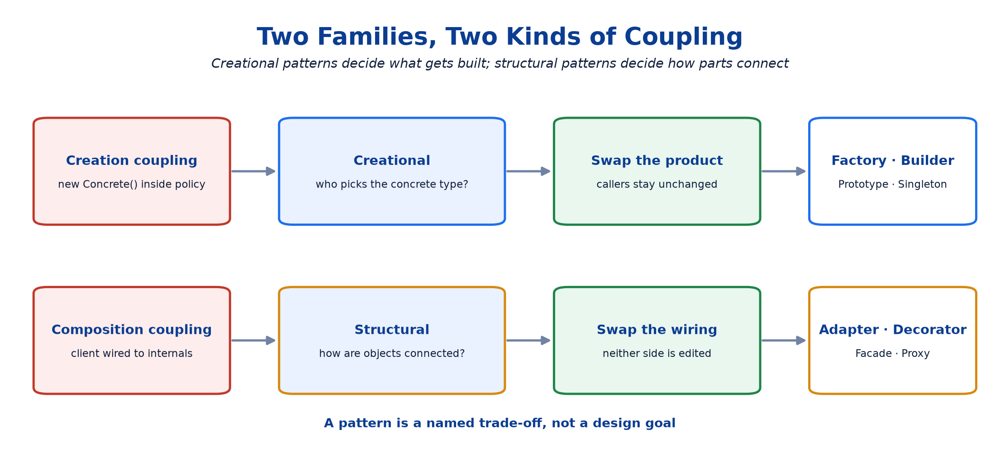

# LLD: Creational & Structural Design Patterns

> A visual guide to the patterns that decide **who builds an object** and **how objects are wired together**. Use it to choose the smallest pattern that contains a change you expect, tell look-alike patterns apart, and defend every pattern you put on the whiteboard.

---

## 1. Start from the change, not the pattern

A design pattern is a well-known, named solution to a common design problem. This page covers two families: **creational** patterns decide *who builds an object*, and **structural** patterns decide *how objects are wired together*. Sections 3 and 4 explain each pattern, and section 6 compares them side by side.

The usual beginner mistake is to start from a pattern ("let's add a Factory here"). Start from the change you expect instead, and only then pick a pattern:


In the example, a second payment provider is really coming, so an Adapter is worth the extra class. If you cannot name a change like that, plain code is the right answer, and you do not need a pattern yet.

---

## 2. Three ideas before the patterns

### Every pattern has a cost

A pattern makes one kind of change easy. In return, it adds extra classes, and an extra step that everyone reading the code has to follow. So use a pattern only when the change it helps with is actually expected: the YAGNI rule from [Basics 2](02_LLD_Object_Oriented_Principles_And_Clean_Code.md).

Patterns are also shared vocabulary. Once two engineers know the names, "wrap the Stripe adapter in a retry decorator" describes a whole design in one sentence. That is a big part of their value in an interview.

### Two families of patterns



- **Creational patterns** answer: *who creates this object, and how?*
- **Structural patterns** answer: *how do these objects fit together?*

Here is the problem both families solve, in one class:

```java
final class Checkout {
    ChargeResult pay(Order order) {
        StripeGateway gateway = new StripeGateway(apiKey);   // Checkout creates Stripe itself...
        return gateway.charge(order.total());                 // ...and calls Stripe's own API
    }
}
```

`Checkout` has to know which payment provider to use, how to create it, and how its API works. Switching provider, or testing without making real payments, means editing `Checkout`. A creational pattern moves the `new StripeGateway(...)` somewhere else. A structural pattern, such as Adapter, puts your own interface in front of Stripe's, so `Checkout` never sees Stripe's API.

### Where objects should be created

In the example above, the problem is the line `new StripeGateway(apiKey)` *inside* `Checkout`. The fix: `Checkout` stops creating the gateway itself, and receives it through its constructor instead.

```java
final class Checkout {
    private final PaymentGateway gateway;          // an interface, not Stripe

    Checkout(PaymentGateway gateway) {             // someone else creates it and hands it in
        this.gateway = gateway;
    }
    ChargeResult pay(Order order) {
        return gateway.charge(order.total());
    }
}
```

Now `Checkout` works with any payment provider that implements `PaymentGateway`, and a test can hand it a fake one.

But *someone* still has to call `new`. That job moves to one place that runs when the application starts, usually `main()`. It creates the real objects, connects them, and starts the app. This place is called the **composition root**:

```java
public static void main(String[] args) {
    PaymentGateway gateway = new StripeGateway(config.stripeKey());   // 1. create the real object
    Checkout checkout = new Checkout(gateway);                        // 2. hand it to the class that needs it
    server.start(checkout);                                           // 3. start the app
}
```

#### The same thing in Spring

In a Spring Boot application, you do not write that `main()` wiring yourself. You mark your classes with annotations, and Spring becomes the composition root:

```java
@Component
class StripeGateway implements PaymentGateway {
    StripeGateway(@Value("${stripe.api-key}") String apiKey) { ... }   // Spring reads the key from config
}

@Service
class Checkout {
    private final PaymentGateway gateway;
    Checkout(PaymentGateway gateway) { this.gateway = gateway; }      // Spring passes in a StripeGateway
}

@SpringBootApplication
public class ShopApplication {
    public static void main(String[] args) {
        SpringApplication.run(ShopApplication.class, args);          // creates and connects everything
    }
}
```

When the application starts, Spring:

1. Finds every class marked `@Component` or `@Service`.
2. Reads each constructor to see what it needs: `Checkout` needs a `PaymentGateway`, and `StripeGateway` is one.
3. Creates `StripeGateway` first, then creates `Checkout` and passes the gateway in.

`Checkout` is the same plain class in both versions. It never knows who created its gateway, which is the whole point. By default, Spring creates just one object of each class and shares it: one instance, without the global access that makes the Singleton pattern risky.

#### When you still need a creational pattern

The composition root runs once, at start-up. That is enough for most objects. It cannot help when an object depends on something that happens *later*, such as the payment method a customer picks at checkout, or when a *new* object is needed every time, such as a `Pizza` for every order. Those are the cases the creational patterns below are for.

---

## 3. Creational patterns


Creational patterns are about creating objects. Each one below starts with what it does in plain words, then an example, then what it costs. (Pattern books call the object being created the *product*; this page just says "the object".)

### Start simple: constructors and static factory methods

Most objects need no pattern at all. A **constructor** is fine when there are two or three required values and their meaning is obvious.

A **static factory method** is a static method that creates the object for you. Its big advantage is a *name*. Take a temperature: `new Temperature(25)` cannot say whether 25 is Celsius or Fahrenheit, and Java does not allow two constructors that both take one `double`. Two named methods solve it:

```java
final class Temperature {
    private final double degreesCelsius;

    private Temperature(double degreesCelsius) {   // private: callers must use the methods below
        this.degreesCelsius = degreesCelsius;
    }
    static Temperature celsius(double value)    { return new Temperature(value); }
    static Temperature fahrenheit(double value) { return new Temperature((value - 32) * 5 / 9); }
}

Temperature today = Temperature.celsius(25);       // the call says exactly what it means
Temperature oven  = Temperature.fahrenheit(350);
```

You already use static factory methods every day: `List.of(1, 2, 3)`, `LocalDate.of(2025, 1, 31)`, and `Integer.valueOf(42)`, which hands back an existing cached object for small numbers instead of creating a new one.

A **simple factory** goes one step further: one method that picks which class to create from its input, such as `SenderFactory.forChannel(EMAIL)` returning an `EmailSender`. It is very common, but it is *not* the Factory Method pattern below, and interviewers like to check that you know the difference.

### Factory Method: subclasses decide what to create

**What it is:** a parent class defines the steps of a process, and leaves one step, "create the object I need", to its subclasses.

A delivery company runs every delivery the same way: load the order, then travel to the address. Only the vehicle differs:

```java
abstract class Delivery {
    abstract Vehicle createVehicle();             // the factory method: each subclass decides

    void deliver(Order order) {                   // the same steps for every delivery
        Vehicle vehicle = createVehicle();
        vehicle.load(order);
        vehicle.travelTo(order.address());
    }
}
final class RoadDelivery extends Delivery { Vehicle createVehicle() { return new Truck(); } }
final class SeaDelivery  extends Delivery { Vehicle createVehicle() { return new Ship(); } }
```

Adding air delivery means one new `AirDelivery` subclass. The `deliver()` steps are never edited.

**Watch out:** every new variant needs a new subclass. If you only need to pick a class from a value, a simple factory is simpler.

### Abstract Factory: create a matching set of objects

**What it is:** a *factory* is an object whose only job is to create other objects. An Abstract Factory creates a whole **set of objects that belong together**, with one factory per set. You pick one factory, and everything you get from it matches.

Think of a furniture store. Choose the "Modern" collection, and the chair, sofa, and table you get all match; you never end up with a modern chair beside a vintage sofa. In code, each collection is a factory.

An app with light and dark themes works the same way. Its buttons and checkboxes must match, because a dark button next to a light checkbox would be a bug:

```java
interface ThemeFactory {
    Button createButton();
    Checkbox createCheckbox();
}
final class DarkTheme implements ThemeFactory {
    public Button createButton()     { return new DarkButton(); }
    public Checkbox createCheckbox() { return new DarkCheckbox(); }
}
// LightTheme does the same with LightButton and LightCheckbox.
```

The screen is given one factory and asks it for every widget. It never names a theme itself, so it cannot mix them:

```java
void drawSettingsScreen(ThemeFactory theme) {
    Button save = theme.createButton();           // dark if the theme is dark...
    Checkbox alerts = theme.createCheckbox();     // ...and so is this, always
}

drawSettingsScreen(new DarkTheme());              // switch every widget by changing one line
```

**Watch out:** adding a new kind of widget, such as a `Slider`, means editing *every* theme factory. Use it only when mixing would really be a bug.

### Builder: build a complex object step by step

**What it is:** a helper object that collects an object's settings one at a time, using named methods, and creates the finished object when you call `build()`.

**The problem.** When a class has many optional settings, its constructor turns into a row of values that nobody can read:

```java
new Pizza(LARGE, true, STUFFED, false);   // what do true and false mean?
```

**The fix.** With a builder, every value has a name, and you only set what you need:

```java
Pizza pizza = Pizza.builder(LARGE)        // size is required, so it comes first
        .extraCheese()
        .crust(STUFFED)
        .build();                         // checks the order, then creates the pizza
```


**How it works.** The builder is a small class inside `Pizza`. Each method stores one setting and returns the builder, which is what lets the calls chain. Settings you never call keep their defaults. `build()` checks the rules, and only then creates the `Pizza`:

```java
class Pizza {
    static class Builder {
        private final Size size;
        private boolean extraCheese = false;      // defaults, used if you don't choose
        private boolean mushrooms = false;
        private Crust crust = Crust.CLASSIC;

        Builder(Size size)         { this.size = size; }
        Builder extraCheese()      { this.extraCheese = true; return this; }
        Builder mushrooms()        { this.mushrooms = true; return this; }
        Builder crust(Crust crust) { this.crust = crust; return this; }

        Pizza build() {
            if (crust == Crust.STUFFED && size != Size.LARGE)
                throw new IllegalStateException("stuffed crust is only for large pizzas");
            return new Pizza(size, extraCheese, crust, mushrooms);
        }
    }

    static Builder builder(Size size) { return new Builder(size); }

    private Pizza(Size size, boolean extraCheese, Crust crust, boolean mushrooms) { ... }   // private: only build() calls it
}
```

Because the constructor is private, `build()` is the only way to get a `Pizza`, so an invalid pizza can never be created. In real projects, Lombok's `@Builder` annotation can generate this whole class for you, and Java's `HttpRequest.newBuilder()` works the same way.

**Watch out:** a builder is extra code. For two or three required values, a plain constructor or a record is clearer.

### Prototype: copy an existing object

**What it is:** with Prototype, you create a new object by copying an existing object that is already set up, and then you change only the parts that are different.

**When it helps.** Imagine an email tool where the marketing team keeps a ready-made campaign template. The template already has a subject line and a list of recipients. When the team starts a new campaign, it is easier to copy the template and adjust the copy than to set everything up again from nothing:

```java
EmailTemplate summerSale = template.copy();              // start from the ready-made template
summerSale.addRecipient("new.customer@example.com");     // change only what is different
```

**How to copy correctly.** The copy must get its *own* recipient list. If the copy and the template share one list, changing one of them changes both:

```java
final class EmailTemplate {
    private final String subject;
    private final List<String> recipients;

    EmailTemplate(String subject, List<String> recipients) {
        this.subject = subject;
        this.recipients = recipients;
    }

    void addRecipient(String email) {
        recipients.add(email);
    }

    EmailTemplate copy() {
        return new EmailTemplate(subject, new ArrayList<>(recipients));   // the copy gets its own new list
    }
}
```

The subject does not need copying, because a Java `String` can never be changed once it is created.

**Watch out:** the most common mistake is writing `new EmailTemplate(subject, recipients)` inside `copy()`. That hands the copy the *same* list object as the template, so adding a recipient to the summer sale campaign would silently add them to the original template as well. This mistake is called a **shallow copy**. To avoid it, give the copy its own new version of anything that can change, as `copy()` does above. In Java, write your own `copy()` method like this one instead of using the built-in `Cloneable` interface, which is awkward and easy to get wrong.

### Singleton: only one instance

**What it is:** a Singleton is a class that allows only one object of itself to exist, and that lets any part of the program reach that one object directly.

**When it seems useful.** Some things should exist only once in an application, such as its configuration settings. A Singleton guarantees there is just one, and lets any class get to it without anyone handing it over:

```java
enum AppConfig {                        // Java creates exactly one INSTANCE, and never another
    INSTANCE;

    private final Map<String, String> values = loadFromFile();

    String get(String key) {
        return values.get(key);
    }
}

String databaseUrl = AppConfig.INSTANCE.get("db.url");   // any class, anywhere, can do this
```

**Why it causes problems.** The danger is the "reach it from anywhere" part:

- **Hidden dependencies.** When `OrderService` calls `AppConfig.INSTANCE` inside one of its methods, nothing in its constructor shows that it needs the configuration. You only find out by reading every line of the class.
- **Hard to test.** A test cannot give `OrderService` a fake configuration, because `OrderService` always grabs the real one itself.
- **Shared changes.** If the single object holds data that can change, many threads changing it at the same time can cause bugs that are very hard to find.

**The better option.** Most of the time, you only need *one object*; you do not need *global access* to it. So create the object once at start-up, and pass it to the classes that need it, exactly like the composition root earlier on this page:

```java
Config config = Config.loadFrom(Path.of("app.yaml"));   // created once, at start-up
OrderService orders = new OrderService(config);         // the dependency is visible in the constructor
```

Now the dependency is visible, and a test can simply pass in a fake `Config`. Spring works this way by default: it creates one object of each class and passes it to whoever needs it, so you get a single instance without global access.

**Watch out:** Singleton is the most overused design pattern. Use it only when a second instance would be a real bug *and* passing the object in is not possible. If you do need one, an `enum` like `AppConfig` above is the simplest thread-safe way to write it in Java.

---

## 4. Structural patterns


Structural patterns are about how objects fit together. The four main ones all work the same way: they put one object *between* your code and the real object it uses. What makes them different is *why* the object in the middle is there, so in an interview, always give the reason, not just the name.

### Adapter: make a class fit the interface your code expects

**What it is:** an adapter sits between your code and a class whose methods do not match what your code expects, and translates every call from one to the other. It works like a travel plug adapter: neither the plug nor the socket changes, and the adapter makes them fit.

**When it helps.** Checkout expects a `PaymentGateway` with a `charge(request)` method. Stripe's SDK has its own classes, its own method names, and its own errors, and you cannot change Stripe's code. So you write an adapter that implements your interface by calling Stripe:

```java
class StripeAdapter implements PaymentGateway {         // your interface on the outside...
    private final StripeClient stripe;                  // ...Stripe's SDK on the inside

    public ChargeResult charge(ChargeRequest request) {
        try {
            StripeCharge charge = stripe.createCharge(request.amountInCents(), request.currency());
            return ChargeResult.approved(charge.id());          // translate Stripe's answer into yours
        } catch (StripeCardException e) {
            return ChargeResult.declined(e.getMessage());       // translate Stripe's errors too
        }
    }
}
```

The rest of your code only ever sees `PaymentGateway`. If Stripe changes its SDK, or you add another provider, only the adapter changes.

**Watch out:** translate errors as carefully as successful results. If the adapter reported a declined card as a success, every class above it would trust the wrong answer.

### Decorator: add a feature without changing the class

**What it is:** a decorator wraps an object and adds one extra feature, such as retrying, logging, or caching, while offering exactly the same methods as the object it wraps. Think of a phone case: the phone works exactly as before, and the case adds protection.

**When it helps.** Suppose payments should be retried when the provider times out. Instead of adding retry code inside `StripeAdapter`, you wrap it in a class that does only the retrying:

```java
class RetryingGateway implements PaymentGateway {     // the same interface as the object it wraps
    private final PaymentGateway inner;               // the gateway being wrapped
    private final RetryPolicy policy;

    public ChargeResult charge(ChargeRequest request) {
        return policy.execute(() -> inner.charge(request));   // call the inner gateway, retrying temporary failures
    }
}
```

Because every decorator has the same interface as the object it wraps, you can stack them, each one adding a single feature:

```java
PaymentGateway gateway = new StripeAdapter(stripeClient);    // talks to Stripe
gateway = new AuditingGateway(gateway, auditLog);            // + records every attempt
gateway = new RetryingGateway(gateway, retryPolicy);         // + retries temporary failures
```

Checkout receives `gateway` and has no idea how many layers it has. Each feature lives in its own small class, and adding or removing one is a one-line change.


**Watch out:** the order of the layers changes the behavior. In the stack above, audit sits *inside* retry, so every attempt is recorded: three attempts produce three audit entries. Swap the two lines, and audit sees only the final result. Neither order is wrong, but choose it on purpose and be ready to explain why.

### Facade: one simple entry point to many classes

**What it is:** a facade is one class with a simple method that calls several other classes in the right order, so that callers do not have to. It is like a waiter in a restaurant: you place one order, and the waiter deals with the kitchen, the bar, and the bill.

**When it helps.** Paying for an order takes four steps: a fraud check, the tax calculation, the charge itself, and a record in the ledger. Without a facade, every caller would need to know all of those classes and call them in the right order. With a facade, checkout makes a single call, `paymentService.pay(order)`:

```java
class PaymentService {                                         // the facade
    Receipt pay(Order order) {
        fraudCheck.verify(order);                              // 1. stop suspicious orders
        Money total = taxCalculator.totalWithTax(order);       // 2. work out the total
        ChargeRequest request = ChargeRequest.builder().order(order).amount(total).build();
        ChargeResult result = gateways.forCountry(order.country()).charge(request);   // 3. charge the customer
        return ledger.record(order, result);                   // 4. record the result
    }
}
```

**Watch out:** a facade should only *coordinate* the steps; it should not contain business rules. Tax rules belong in the tax calculator, not in `PaymentService`. A facade that keeps collecting rules slowly turns into one huge class that does everything.

### Proxy: control access to the real object

**What it is:** a proxy stands in for the real object, with exactly the same methods, and decides *when* or *whether* the real object is used. The calling code cannot tell the difference.

**When it helps.** A product page shows 100 high-resolution images, but most customers only look at the first few. Loading all 100 from disk up front is slow and wasteful. A proxy loads each image only when it is shown for the first time:

```java
class LazyImage implements Image {                 // the proxy: the same interface as the real image
    private final String fileName;
    private Image real;                            // not loaded yet

    LazyImage(String fileName) {
        this.fileName = fileName;
    }

    public void show() {
        if (real == null) {
            real = new HighResImage(fileName);     // load from disk only the first time
        }
        real.show();
    }
}
```

Proxies are also used to check permissions before a call, to cache results, and to make a call to another server look like an ordinary method call.

**Proxy or Decorator?** The code looks almost the same. The difference is the reason it exists: a decorator *adds a feature* to an object it was given, while a proxy *controls access* to the real object, and often creates that object itself.

**Watch out:** a proxy can hide slow work behind what looks like an ordinary method call. Two well-known surprises in Java projects:

- Hibernate loads related data through proxies, so a simple getter inside a loop can quietly run one database query per item.
- Spring's `@Transactional` works through a proxy. When a method calls another `@Transactional` method *on the same object*, the call skips the proxy, and the transaction setting is silently ignored.

### The other three structural patterns

These come up less often, but you should recognize them:

| Pattern | What it does | Typical example | Watch out for |
|---|---|---|---|
| **Composite** | Lets you treat a single item and a group of items in the same way. | A shopping cart where a bundle's price is the sum of its items; files and folders. | Some actions only make sense for groups, such as "add an item to this bundle". |
| **Bridge** | Splits one class hierarchy into two independent ones that can be combined freely. | Notification types (alert, digest) combined with channels (email, SMS), without one class per combination. | There are two hierarchies to learn, so it is only worth it when both really change. |
| **Flyweight** | Lets many small objects share the same data, to save memory. | The letters in a text editor share font data; `Integer.valueOf` reuses objects for small numbers. | The shared data must never change, or every object sharing it changes too. |

---

## 5. Telling look-alike patterns apart

Interviewers love these comparisons, because they reveal whether you know a pattern's intent or only its shape.

| These look alike | The difference that matters | Quick test |
|---|---|---|
| Decorator vs Proxy | Both wrap an object behind the same interface. A decorator adds behavior to an object it was handed; a proxy controls access to, or the lifecycle of, its target. | Did the wrapper receive its target from outside (decorator), or does it create, guard, or locate the target itself (proxy)? |
| Adapter vs Facade | An adapter makes one existing interface fit the one a client expects. A facade gives one simpler entry point to several classes. | Is it changing the shape of one thing, or hiding many things behind one door? |
| Factory Method vs simple factory | Factory Method lets a subclass override a creation step inside a larger algorithm. A simple factory is one method that picks a class from its input. | Is a subclass overriding a `create` method? If not, it is a simple factory. |
| Factory Method vs Abstract Factory | Factory Method creates one object, chosen by a subclass. Abstract Factory creates a matching set of objects that must be used together. | Does the factory have one creation method, or several related ones? |
| Builder vs factory | A factory decides *which* class to create. A builder assembles *one* class step by step from many options. | Is the hard part choosing the type, or filling in the fields? |
| Singleton vs one injected instance | A singleton enforces a single instance and gives global access to it. An injected instance is single by decision, and visible in every constructor that uses it. | Can a test replace it without touching global state? |

### Patterns you already use

Recognizing patterns in familiar libraries makes them easier to recall, and it makes for a strong, concrete interview answer:

| Pattern | Where you have already seen it |
|---|---|
| Static factory | `List.of(...)`, `Integer.valueOf(...)`, and `Duration.ofSeconds(...)` all name and control creation. |
| Factory Method | `Collection.iterator()`: each collection class decides which iterator to return. |
| Abstract Factory | JDBC: each driver's `Connection` creates the matching `Statement` and `PreparedStatement` for its database. |
| Builder | `HttpRequest.newBuilder()...build()` in `java.net.http`, `StringBuilder`, and Lombok's `@Builder`. |
| Prototype | Copy constructors such as `new ArrayList<>(other)`. |
| Singleton | `Runtime.getRuntime()`; Spring beans are single per container, but injected rather than global. |
| Adapter | `InputStreamReader` turns a byte `InputStream` into a character `Reader`; `Arrays.asList` presents an array as a `List`. |
| Decorator | `new BufferedInputStream(new FileInputStream(file))`: each layer adds behavior behind the same `InputStream` type. |
| Facade | SLF4J, literally the "Simple Logging Facade for Java", in front of Logback or Log4j. |
| Proxy | Spring's `@Transactional` and `@Cacheable` beans, Hibernate's lazy-loaded entities, and `Collections.unmodifiableList` as a protection proxy. |

---

## 6. Decision and trade-off tables

!!! abstract "The decision template: memorize this"
    Given **expected change X**, use **pattern A** instead of **simpler option B**, because it keeps that change **inside C**. It costs **D**. Prove it with **test E**, and revisit when **F** happens.

Two worked instances:

> Given **a second payment provider signed for next quarter**, use **an Adapter per provider behind a `PaymentGateway` interface** instead of **calling the Stripe SDK from checkout**, because a new provider becomes **one new adapter plus one registry entry**. It costs **a translation layer, including error mapping**. Prove it with **one shared set of tests that every adapter must pass**. Revisit if **providers start needing different checkout flows**, not just different APIs.

> Given **retry and audit needed on some gateways but not others**, use **Decorators** instead of **a `BaseGateway` superclass with on/off flags**, because each concern **composes independently, in a chosen order**. It costs **a deeper stack trace, and an order that must be documented**. Prove it with **a test asserting one audit entry per attempt**. Revisit if **the chain grows past three or four wrappers**.

### Which creational option?

| Evidence | Choose | Optimizes for | Cost |
|---|---|---|---|
| There is one concrete type, and it is stable. | A plain constructor. | Simplicity: nothing to learn. | A small refactor later, if variation actually arrives. |
| The caller picks from a known set of variants. | A static or simple factory. | Readable intent at the call site. | One central `switch` that grows with each variant. |
| A subclass must choose which object to create, inside steps that stay the same. | Factory Method. | Adding variants without editing the steps. | One subclass per variant. |
| Several objects must always match each other. | Abstract Factory. | Guaranteed consistency across the set. | Every new kind of object touches every factory. |
| The object has many optional fields, or cross-field rules. | Builder. | Readable call sites and one validation gate. | An extra class and some boilerplate. |
| Copying a configured object beats building a new one. | Prototype. | Cheap duplication at runtime. | Careful deep copies of every mutable part. |
| The object should exist once. | One instance created at the composition root and injected. | Testability with a single instance. | Wiring it through constructors; enforce a true Singleton only if a second instance would be a bug. |

### Which structural option?

| Problem | Choose | Does the interface change? | Guardrail |
|---|---|---|---|
| A class you do not control has the wrong interface. | Adapter. | Yes: it is translated into yours. | Translate errors, not just data, and keep vendor types inside the adapter. |
| You need optional, combinable behavior around an object. | Decorator. | No: it stays identical. | Keep chains short, and document the order, because order changes behavior. |
| Callers struggle with a subsystem of many parts. | Facade. | Yes: it is narrowed to a few calls. | It orchestrates but must not absorb business rules. |
| Access must be controlled, deferred, or made remote. | Proxy. | No: it stays identical. | Make the hidden cost visible, through naming, docs, or timeouts. |
| Single items and groups must be handled the same way. | Composite. | No: leaves and groups share one interface. | Keep group-only operations off the shared interface where possible. |

---

## 7. How patterns fail in practice

| Failure | How you spot it | Fix | Guardrail for next time |
|---|---|---|---|
| A factory that only ever builds one kind of object. | The factory has a single branch and has never grown. | Inline it, and use a constructor. | Add a factory only when a second variant is real or contracted. |
| A singleton holding mutable state. | Flaky tests that depend on run order, or race conditions under load. | Make the state immutable, or create one instance at the root and inject it. | Treat any global mutable state as a design smell in review. |
| Decorators wrapped in the wrong order. | Audit logs, metrics, or caches show the wrong number of entries. | Reorder the chain, and write a test that pins the expected behavior. | Build every chain in one place, with a comment on why the order matters. |
| A wrapper chain too deep to follow. | Stack traces with five or more wrappers, and nobody can say what each one does. | Remove wrappers that have no real job, or merge closely related ones. | Each wrapper must name the concern it owns. |
| An adapter that leaks vendor types. | SDK classes appear in domain code or method signatures. | Map everything to your own types inside the adapter. | A test or lint rule that forbids SDK imports outside the adapter package. |
| An adapter that misreports errors. | Callers see success for declined or partial operations. | Map every provider outcome explicitly, including timeouts. | One shared set of tests that every adapter must pass, covering failures too. |
| A facade that turned into a god class. | Business rules and `if` statements accumulate inside the facade. | Push each rule back into the subsystem class that owns it. | The facade's methods should read like a short, plain list of steps. |
| A shallow prototype copy. | Changing a clone also changes the original. | Copy every mutable nested object explicitly. | A test that modifies the copy and asserts the original is unchanged. |
| A proxy that hides cost. | Latency spikes or many small queries traced back to innocent-looking getters. | Fetch eagerly where needed, or batch the calls. | Name or document anything that may hit the network, and set timeouts on it. |

!!! warning "Collapse patterns that absorb nothing"
    A pattern is justified by the change it contains. If that change never arrived and is no longer expected, replace the pattern with the simpler code it was protecting. Removing a pattern is as much a design skill as adding one.

---

## 8. Worked example: payment gateway

**Prompt:** "Design the classes that let checkout charge customers through payment providers that differ by country."

### Questions to ask before designing anything

| Question | Why it matters | Assumed answer |
|---|---|---|
| Which providers are needed now, and which are coming? | It decides whether a provider interface is worth adding yet. | Stripe now; Adyen for Germany next quarter. |
| Does the provider depend on the customer's country? | It decides how a gateway is chosen at runtime. | Yes, by billing country. |
| Which failures are worth retrying, and is a charge safe to repeat? | It shapes the retry rules and the `ChargeRequest` fields. | Retry timeouts and rate limits; an idempotency key makes repeats safe. |
| What must be audited: each attempt, or each charge? | It fixes the order of the decorators. | Each attempt, for reconciliation with the provider. |
| Can provider SDK types appear in our domain code? | It decides where translation happens. | No: SDK types stay inside the adapters. |

**Scope.** *In:* choosing a provider by country, building a valid charge request, charging, retrying temporary failures, auditing every attempt, and returning a clear result. *Out:* refunds, payouts, fraud models, and the checkout UI.


### Patterns in the design

| Design element | Pattern | Change it absorbs | Cost or guardrail |
|---|---|---|---|
| `PaymentService.pay(order)` | Facade | Checkout stays the same when fraud, tax, or ledger steps change. | It must orchestrate only; rules stay in the subsystem classes. |
| `ChargeRequest.builder()` | Builder | New optional fields, like metadata or a statement descriptor, need no new constructors. | `build()` must check every rule, such as a positive amount and a present idempotency key. |
| `GatewayRegistry.forCountry(...)` | Simple factory (a registry, not Factory Method) | A new country or provider is one new registry entry. | It must fail clearly for unsupported countries instead of returning `null`. |
| `RetryingGateway` | Decorator | Retry rules change without touching any provider code. | Retry only temporary failures, and only because the idempotency key prevents double charges. |
| `AuditingGateway` | Decorator | Audit can be added, changed, or removed per provider. | It sits **inside** retry, so every attempt is recorded. |
| `StripeAdapter`, `AdyenAdapter` | Adapter | A provider's SDK can change or be replaced behind one class. | Every provider outcome, including errors, maps to our `ChargeResult`. |

### Core code

```java
interface PaymentGateway { ChargeResult charge(ChargeRequest request); }

final class AuditingGateway implements PaymentGateway {
    private final PaymentGateway inner;
    private final AuditLog audit;
    AuditingGateway(PaymentGateway inner, AuditLog audit) { this.inner = inner; this.audit = audit; }

    public ChargeResult charge(ChargeRequest request) {
        ChargeResult result = inner.charge(request);
        audit.record(request.idempotencyKey(), result);       // one entry per attempt (it sits inside retry)
        return result;
    }
}

final class GatewayRegistry {
    private final Map<Country, PaymentGateway> byCountry;
    GatewayRegistry(Map<Country, PaymentGateway> byCountry) { this.byCountry = Map.copyOf(byCountry); }

    PaymentGateway forCountry(Country country) {
        PaymentGateway gateway = byCountry.get(country);
        if (gateway == null) throw new UnsupportedCountryException(country);
        return gateway;
    }
}

// Composition root: the only place that knows the concrete classes and the wrapper order
PaymentGateway withPolicies(PaymentGateway adapter) {
    return new RetryingGateway(new AuditingGateway(adapter, auditLog), retryPolicy);
}
PaymentGateway stripe = withPolicies(new StripeAdapter(stripeClient));
PaymentGateway adyen  = withPolicies(new AdyenAdapter(adyenClient));
GatewayRegistry gateways = new GatewayRegistry(Map.of(US, stripe, IN, stripe, DE, adyen));
```

Three details are worth saying out loud. `withPolicies` builds every chain in one place, so the wrapper order is written down once instead of copied per provider. The registry copies its map and fails loudly for an unknown country, so a missing entry is caught on the first request rather than causing a `NullPointerException` deep inside checkout. And there is no Proxy here: nothing controls access or lifecycle, and adding one just to use the name would be pattern worship.

**Failure path.** A timeout from Stripe comes back from the adapter as a retryable result. `AuditingGateway` records it, and `RetryingGateway` tries again with the **same idempotency key**, so Stripe treats any duplicate as the same charge. A card decline is permanent: it is audited once and returned immediately. If an adapter ever reported a decline as success, every wrapper above it would faithfully pass on the wrong answer. The chain is only as correct as its lowest link, which is why every adapter should be tested against the same list of expected results, such as "a timeout is retryable" and "a decline is permanent".

### Change walkthrough

| Change request | What you edit | What you add | What stays untouched |
|---|---|---|---|
| Add Adyen for German customers. | One registry entry in the composition root. | An `AdyenAdapter` class, tested against the same expected results as the Stripe one. | Checkout, the facade, both decorators, and the Stripe adapter. |
| Add a circuit breaker for a flaky provider. | The `withPolicies` wiring. | A `CircuitBreakingGateway` decorator. | Every adapter and the facade. |
| Upgrade to a new Stripe SDK version. | `StripeAdapter` only. | Nothing. | Everything else. |
| Record latency metrics per provider. | The `withPolicies` wiring. | A `MetricsGateway` decorator. | Every adapter and the facade. |
| Add a fraud check before charging. | `PaymentService`, because the workflow itself changes. | A `FraudCheck` subsystem class. | The gateway chain and its contract. |

The last row matters. A new step in the workflow is exactly what the facade is supposed to absorb, so editing it is correct, not a design failure. Patterns protect the changes you anticipated, and saying so is a stronger answer than claiming the design handles everything.

---

## 9. Anti-patterns that cost points

- Naming a pattern ("I'll use a Strategy here") without saying which change it absorbs.
- Using a Singleton for anything that holds mutable state.
- Calling every factory "Factory Method".
- Building an Abstract Factory for a family that has only one member.
- Wrapping a decorator around every class "for flexibility".
- Letting vendor SDK types leak past the adapter.
- Hiding network calls behind proxies with no timeout and no documentation.
- Claiming a design is "open to any future change".

---

## 10. Final revision checklist

```text
[ ] NAME the expected change before naming any pattern
[ ] START with a constructor or static factory; add patterns only for real variation
[ ] CREATE objects at the composition root; inject them instead of using global access
[ ] FACTORY METHOD only when a subclass chooses which object to create, inside fixed steps
[ ] ABSTRACT FACTORY only when several objects must always match, like a theme
[ ] BUILDER for many optional fields or cross-field rules; validate once in build()
[ ] PROTOTYPE copies deeply wherever state is mutable
[ ] ADAPTER keeps vendor types at the edge and translates errors, not just data
[ ] DECORATOR chains are short, built in one place, and their order is deliberate
[ ] FACADE orchestrates steps but holds no business rules
[ ] PROXY makes hidden cost visible: naming, docs, and timeouts
[ ] TELL look-alikes apart by intent, not by code shape
[ ] DEFEND each pattern: the change it absorbs, its cost, the test that proves it
[ ] REMOVE any pattern whose change never arrived
```

!!! success "The Staff-level finish"
    Patterns are vocabulary for trade-offs that already exist in the design. Justify each one by the change it contains and the cost it adds, then show the simpler design you would use if that change never arrived.
