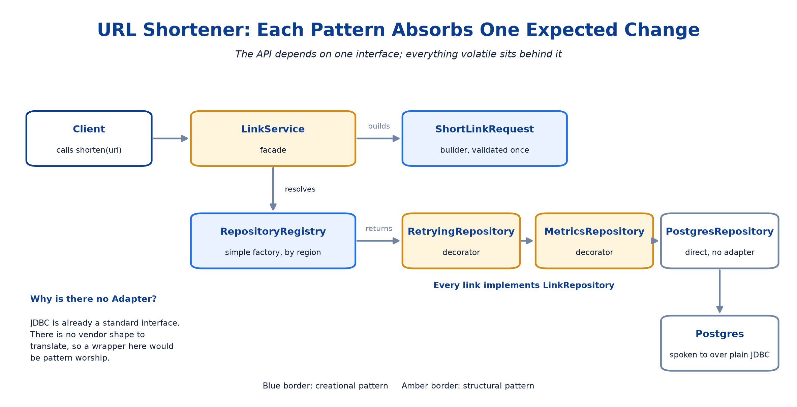

# LLD: Creational & Structural Design Patterns

## Terms to know before you start

You do not need to memorize these. Come back to this table whenever a term feels unfamiliar.

| Term | What it means in plain words |
|---|---|
| **Design pattern** | A named, reusable solution to a problem that keeps coming up when objects are created or connected. |
| **GoF** | Short for "Gang of Four", the four authors of the 1994 book that named most of the patterns on this page. |
| **Seam** | A point in the code where one implementation can be swapped for another without touching the code around it. |
| **Composition root** | The one place in an application, usually near `main()`, where concrete classes are created and wired to the interfaces they implement. |
| **Vendor SDK** | The client library a third party ships so your code can call their service, such as a database driver or a cloud provider's client. |
| **Registry** | An object that looks up which concrete implementation to use, usually from a small, fixed set, such as "by region" or "by type". |
| **Wrapper** | An object that holds another object of the same interface and adds something before or after passing the call through. Adapter, Decorator, Facade, and Proxy are all wrappers with different intents. |

---

## 1. You already wrote some of these patterns

**Basics 2** built the URL shortener's class design one principle at a time, and ended with `LinkService`, `ShortLink`, `LinkRule`, `CodeGenerator`, and `LinkRepository`. If any of those names feel unfamiliar, that page is worth a quick look before this one. Without naming them, three design patterns were already in that code:

| What you built in Basics 2 | The pattern |
|---|---|
| `LinkService` coordinates safety checks, rule checks, storage, and click tracking behind two simple methods, `shorten` and `resolve`. | **Facade** |
| The wiring that chooses `PostgresLinkRepository` (or `InMemoryLinkRepository` for tests) and hands it to `LinkService`. | A **simple factory**, feeding a **composition root** |
| `ShortLink` holding a `List<LinkRule>` so new link features arrive as new classes. | A shape close to **Strategy**, covered properly in Advanced 1 |

This page gives the rest of that toolbox a name, and adds the patterns that the next two features will need: letting customers reserve a memorable alias, and putting a cache in front of the database. Every pattern buys flexibility at one seam and charges indirection everywhere else, so always start from the question that justifies it: *what change do I expect, and where would it ripple through the code if I did nothing?* If you cannot name the change, you do not need the pattern yet.


**Creational patterns** remove *creation coupling*: code that knows which concrete class to build and how to construct it. **Structural patterns** remove *composition coupling*: a caller that knows how the parts behind an interface are wired together. The sections below work through one ladder for each family, in the order you are most likely to reach for them.

---

## 2. Creational patterns

### Level 1: Constructors, static factories, and simple factories

Before any named pattern, two plain tools cover most creation needs, and both are already in `ShortCode` and `ShortLink` from Basics 2. A **constructor** is right when there are a small number of required parameters, as in `new ShortLink(code, longUrl, createdAt, rules)`. A **static factory method** adds a name, validation, or the freedom to return a cached or subtype instance:

```java
final class ShortCode {
    private ShortCode(String value) { this.value = value; }

    static ShortCode of(String value) {                 // named, and it validates
        if (!value.matches("[0-9a-zA-Z]{7}")) throw new IllegalArgumentException("invalid code");
        return new ShortCode(value);
    }
}
```

The next step up is a **simple factory**: one method that picks a class based on its input, such as choosing a repository by region. It is not one of the patterns the GoF catalogue names, but it is the most common factory in real code. Do not call it Factory Method; the difference matters, and it is covered next.

### Level 2: Builder, for objects with many optional parts

> Assemble a complex object step by step, and validate it once before it exists.


So far, creating a link has needed four pieces of information. Now the product team asks for three more: an optional custom alias, an optional owner for billing, and optional UTM tracking tags for marketing campaigns. A constructor with seven parameters, several of them optional, is error-prone and hard to read at the call site. This is exactly the shape Builder exists for:

```java
final class ShortLinkRequest {
    private final String longUrl;
    private final String customAlias;         // may be null: no alias requested
    private final List<LinkRule> rules;

    private ShortLinkRequest(Builder builder) {
        longUrl = builder.longUrl; customAlias = builder.customAlias; rules = List.copyOf(builder.rules);
    }
    static Builder builder(String longUrl) { return new Builder(longUrl); }

    static final class Builder {
        private final String longUrl;                   // required, so it is a constructor parameter
        private String customAlias;
        private final List<LinkRule> rules = new ArrayList<>();

        private Builder(String longUrl) { this.longUrl = longUrl; }
        Builder customAlias(String alias) { this.customAlias = alias; return this; }
        Builder withRule(LinkRule rule) { rules.add(rule); return this; }

        ShortLinkRequest build() {                       // the single validation gate
            if (longUrl == null || !longUrl.startsWith("http")) throw new IllegalStateException("a valid URL is required");
            if (customAlias != null && !customAlias.matches("[a-zA-Z0-9-]{3,20}"))
                throw new IllegalStateException("alias must be 3 to 20 letters, digits, or hyphens");
            return new ShortLinkRequest(this);
        }
    }
}

ShortLinkRequest request = ShortLinkRequest.builder("https://example.com/report")
        .customAlias("q3-report").withRule(new ExpiryRule(nextFriday)).build();
```

Builder earns its place with several optional parameters, an immutable target, or rules that span fields. Because `build()` is the only way to create the object, a half-configured `ShortLinkRequest` can never exist. The required `longUrl` goes into `builder(longUrl)` itself so it cannot be forgotten. For two or three required fields and nothing optional, a constructor or a record, as `ShortLink` already is, stays clearer.

### Level 3: Singleton, the one pattern to use with caution

> Guarantee a single instance and give global access to it.

Short codes are generated from an ever-increasing counter, so that two servers never hand out the same code. If two `CounterCodeGenerator` instances each kept their own counter starting at zero, both would eventually produce `"0000001"`, and the second link would silently overwrite the first. A genuine second instance of the counter *would be a bug*, which is the one situation Singleton is built for:

```java
enum GlobalCodeCounter {
    INSTANCE;
    private final AtomicLong next = new AtomicLong(loadLastIssued());
    long nextValue() { return next.getAndIncrement(); }
}

// Usually better for most classes: one instance by decision, created at the composition root and passed in
LinkRepository repository = RepositoryRegistry.forRegion(region);
LinkService service = new LinkService(repository, codeGenerator);   // visible dependency, easy to fake in tests
```

Singleton is the most over-used pattern in the catalogue, because global access hides dependencies from constructors and blocks substitution in tests. Spring beans are single per container by default, which gives "one instance" **without** global access, and that is usually what people actually want. The counter above is one of the few cases where global access is genuinely necessary, because every part of the application must share the exact same next value. Note that the `AtomicLong` is required for thread safety: `basics/15_Distributed_ID_Generation.md` covers how a single counter stops being enough once there is more than one server.

### Level 4: Factory Method and Abstract Factory, the pair everyone confuses

**Factory Method** lets a subclass decide which product to create inside an algorithm that otherwise stays fixed:

> Define the algorithm once, and let subclasses decide which product it creates.

```java
abstract class LinkImporter {
    abstract CodeGenerator createGenerator();            // the factory method: one creation step

    List<ShortLink> importAll(InputStream source) {      // the rest of the algorithm never changes
        List<ShortLink> links = parse(source);
        CodeGenerator generator = createGenerator();
        links.forEach(link -> link.assignCodeIfMissing(generator));
        return links;
    }
}
final class CsvLinkImporter extends LinkImporter {
    CodeGenerator createGenerator() { return new CounterCodeGenerator(); }
}
```

The defining feature is **a subclass overriding a creation step inside a larger algorithm**. A method that just switches on a parameter, such as `RepositoryRegistry.forRegion(region)`, is a simple factory, not Factory Method.

**Abstract Factory** creates a *family* of related products that must always be used together:

> Create families of related objects that must be used together.

```java
interface InfrastructureKit {                              // one factory, a matching family
    LinkRepository repository();
    LinkCache cache();
    ClickPublisher clickPublisher();
}
final class LocalTestKit implements InfrastructureKit {    // every member is an in-memory fake
    public LinkRepository repository() { return new InMemoryLinkRepository(); }
    public LinkCache cache() { return new InMemoryLinkCache(); }
    public ClickPublisher clickPublisher() { return new InMemoryClickPublisher(); }
}
```

The guarantee is consistency: a test can never accidentally wire the real production database next to an in-memory cache, because one factory builds the whole, matching set. The cost is rigidity: adding a fourth member to the family, such as a rate limiter, forces an edit to every kit. Use it only when mixing members from different families would be a real bug, such as this local-versus-production split, or a cloud provider's matching storage, queue, and secrets clients.

### Level 5: Prototype, copy instead of construct

> Create a new object by copying an existing, configured one.

The marketing team wants to launch 500 campaign links that are identical except for one UTM tracking tag. Building each `ShortLinkRequest` from scratch, and re-validating it, is wasteful when 499 of them are copies of the first:

```java
final class CampaignLinkTemplate {
    private final ShortLinkRequest base;                    // already built and validated once
    CampaignLinkTemplate(ShortLinkRequest base) { this.base = base; }

    ShortLinkRequest withTag(String utmTag) {
        return ShortLinkRequest.builder(base.longUrl() + "?utm_source=" + utmTag)
                .customAlias(null).withRules(base.rules())   // deep-copies the list; rules themselves are immutable
                .build();
    }
}
```

Prototype helps when building from scratch is expensive, or when the configuration is only known at runtime, such as cloning a template a user configured in a UI. The classic defect is the **shallow copy**: if `rules` here were reused directly instead of copied, every campaign link would share the same mutable list, and changing one would silently change them all. Note that `List.copyOf` copies the list, not its elements; in Java, prefer a copy constructor or a `copy()` method over `Cloneable`, which is famously awkward.

??? info "Go deeper (optional): which creational pattern fits the evidence?"
    | Evidence | Choose | Optimizes for | Cost |
    |---|---|---|---|
    | There is one concrete type, and it is stable. | A plain constructor. | Simplicity: nothing to learn. | A small refactor later, if variation actually arrives. |
    | The caller picks from a known set of variants. | A static or simple factory. | Readable intent at the call site. | One central decision point that grows with each variant. |
    | The object has many optional fields, or cross-field rules. | Builder. | Readable call sites and one validation gate. | An extra class and some boilerplate. |
    | The object should exist exactly once, and a second copy would be a bug. | Singleton, or better, one instance created at the composition root and injected. | Testability with a single, visible instance. | Wiring it through constructors; enforce a true Singleton only when truly justified. |
    | A subclass must choose the product inside a fixed algorithm. | Factory Method. | Adding variants without editing the algorithm. | One subclass per variant. |
    | Several products must always be used together as a matching family. | Abstract Factory. | Guaranteed consistency across the family. | Every new family member touches every factory. |
    | Copying a configured object beats building a new one. | Prototype. | Cheap duplication at runtime. | Careful deep copies of every mutable part. |

!!! question "Practice: which creational pattern fits?"
    1. A `VanityCodeGenerator` is picked instead of `CounterCodeGenerator` whenever the request includes a custom alias.
    2. A `ShortLinkRequest` can include a URL, an optional alias, an optional owner, and any number of rules.
    3. A health check must reach the database exactly once per request, through one shared connection pool.
    4. A test suite needs an in-memory repository, an in-memory cache, and an in-memory click publisher, and the three must never be mixed with their real counterparts.
    5. Generating 10,000 QR codes for a batch of existing links, each only differing in the code it encodes.

??? success "Answer"
    1. A simple factory: one method picks a class based on whether an alias was requested. 2. Builder, because of the optional fields. 3. A single instance created at the composition root and injected, or a Singleton only if a second pool would truly be a bug. 4. Abstract Factory, because the whole family must stay consistent. 5. Prototype, if building the base QR template is expensive; otherwise a constructor is simplest.

---

## 3. Structural patterns


All four of these patterns put an object between a client and a target. They differ only in **intent**, so in an interview, always say *why* the wrapper exists, not just what it is called.

### Level 6: Adapter, when a dependency has the wrong shape

> Convert an existing interface into the one your code expects.

The trust and safety team wants to check every submitted URL against a third-party malicious-URL database before shortening it. The vendor's SDK has its own shape, with its own types and its own way of reporting problems:

```java
final class VendorSafetyAdapter implements UrlSafetyChecker {      // our interface, from Basics 2
    private final VendorSafeBrowsingClient client;                 // their SDK, simplified here

    public boolean isSafe(String longUrl) {
        try {
            VendorScanResult result = client.scanUrl(longUrl);
            return result.verdict() == VendorVerdict.CLEAN;        // translate their verdict...
        } catch (VendorRateLimitException e) {
            return true;                                           // ...and translate their failure into a decision
        }
    }
}
```

Adapter is the standard defense at a third-party boundary: vendor types stop at the adapter and never leak into domain code, so switching vendors touches one class. **Translate errors as carefully as data.** An adapter that treats "the vendor is unreachable" as "the URL is safe" has made a real safety decision inside what looks like plumbing, so that choice must be deliberate and visible, not accidental.

### Level 7: Decorator, for optional behavior that stacks

> Wrap an object to add a responsibility, without changing its interface.

The database is now the bottleneck on the redirect path, exactly as predicted by the capacity estimate in Basics 1. A cache needs to sit in front of `PostgresLinkRepository`, and it should be possible to measure how well the cache is working. Both needs can be met with decorators, each implementing the same `LinkRepository` interface they wrap:

```java
final class CachingLinkRepository implements LinkRepository {
    private final LinkRepository inner;
    private final LinkCache cache;

    public Optional<ShortLink> findByCode(ShortCode code) {
        Optional<ShortLink> cached = cache.get(code);
        if (cached.isPresent()) return cached;
        Optional<ShortLink> fromDb = inner.findByCode(code);
        fromDb.ifPresent(link -> cache.put(code, link));
        return fromDb;
    }
}
final class MetricsLinkRepository implements LinkRepository {
    private final LinkRepository inner;
    private final Metrics metrics;

    public Optional<ShortLink> findByCode(ShortCode code) {
        return metrics.time("link.lookup", () -> inner.findByCode(code));
    }
}
```

Because each decorator implements the same interface it wraps, decorators **compose**: `new MetricsLinkRepository(new CachingLinkRepository(postgresRepository, cache), metrics)`. Each concern (caching, metrics, retries) stays in its own small class and can be added or removed per wiring, instead of piling flags onto one class.

**Order is part of the behavior, not just an implementation detail.** The diagram below shows the same two decorators wrapped in each order:


With metrics outside the cache, every redirect is timed, hits and misses alike, which answers "how fast is the redirect path overall?" With metrics inside the cache, only database calls are timed, which answers "how fast is Postgres when the cache misses?" Neither order is wrong, but you must choose deliberately and be ready to say which question you are trying to answer.

### Level 8: Facade, for a simple front door

> Give callers one simple interface to a subsystem of several parts.

`LinkService` from Basics 2 is already a facade: `shorten` and `resolve` each coordinate several classes behind two short methods, without asking the caller to understand `UrlSafetyChecker`, `CodeGenerator`, `LinkRepository`, or `ClickRecorder` individually:

```java
final class LinkService {
    ShortCode shorten(String longUrl, List<LinkRule> rules) {
        if (!safety.isSafe(longUrl)) throw new UnsafeUrlException(longUrl);
        ShortLink link = new ShortLink(codes.next(), longUrl, Instant.now(), rules);
        links.save(link);
        return link.code();
    }
}
```

A facade reduces how many concepts a caller must learn. It **orchestrates**; it should not **decide**. The malicious-URL rule belongs in `UrlSafetyChecker`, not copied into `LinkService`. A facade that accumulates business rules of its own is a god class with a friendlier name. A facade also does not forbid advanced callers from reaching the subsystem directly when they need to.

### Level 9: Proxy, for controlling access to the real thing

> Stand in for another object, with the same interface, to control access to it.

Free-tier accounts are limited to 100 new links per day. Rather than scatter that check through `LinkService`, a proxy in front of the repository's `save` method can enforce it in one place:

```java
final class RateLimitingLinkRepository implements LinkRepository {
    private final LinkRepository real;
    private final RateLimiter perUserLimiter;

    public void save(ShortLink link) {
        if (!perUserLimiter.tryAcquire(link.ownerId())) throw new DailyLimitExceededException(link.ownerId());
        real.save(link);
    }
}
```

The common variants are **virtual** (create the target lazily), **protection** (check permissions or limits first, as above), **remote** (hide a network call behind a method that looks local), and **caching**. Proxy and Decorator have identical code shapes; the difference is intent. A proxy *controls* access to or the lifecycle of its target, while a decorator *enhances* a target it was simply handed.

!!! warning "Proxies hide cost"
    A proxy makes a slow or failing operation look like an ordinary method call. Hibernate's lazy-loading proxies are the classic case: a harmless-looking getter inside a loop can trigger one database query per item. And Spring's `@Transactional` works through a proxy, so a method calling another `@Transactional` method **on the same object** skips the proxy, and the transaction rule silently does not apply.

??? info "Go deeper (optional): Composite, Bridge, and Flyweight"
    These three come up less often, but you should recognize them.

    | Pattern | What it does | Example in this domain | Watch out for |
    |---|---|---|---|
    | **Composite** | Treats a single object and a group of objects through the same interface, so trees can be handled recursively. | A `LinkFolder` that reports a total click count equal to the sum of its links and sub-folders. | Operations that only make sense for groups, like adding a child, end up on the shared interface. |
    | **Bridge** | Separates an abstraction from its implementation, so each can vary on its own. | Link rules (expiry, password, country) × notification channels for "link about to expire" alerts, without one class per combination. | Two hierarchies to understand; only worth it when both dimensions really vary. |
    | **Flyweight** | Shares common, immutable state between many small objects to save memory. | `Currency.getInstance("USD")` in the JDK, reusing one shared instance per currency code. | Shared state must be immutable, and callers must pass in the part that varies. |

!!! question "Practice: Adapter, Decorator, Facade, or Proxy?"
    1. A class wraps the AWS SDK's `S3Client` behind our own `LinkArchiveStore` interface.
    2. A class wraps `LinkRepository` to add a short-lived cache in front of `findByCode`.
    3. A class offers one `checkout()` method that coordinates fraud checks, tax, payment, and the ledger.
    4. A class wraps `LinkRepository` and only loads the full link row from the database the first time any field is accessed.
    5. Which JDK class is built the same way as item 1: `InputStreamReader`, which turns a byte `InputStream` into a character `Reader`?

??? success "Answer"
    1. Adapter: it translates a foreign interface (the S3 SDK) into one our code expects. 2. Decorator: it adds behavior (caching) without changing the interface. 3. Facade: it narrows several subsystems to one simple entry point. 4. Proxy, specifically a virtual proxy: it defers creating the real, expensive object. 5. `InputStreamReader` is also an Adapter, for the same reason as item 1: it converts an interface (bytes) into the one callers expect (characters).

---

## 4. Telling look-alike patterns apart

Interviewers love these comparisons, because they reveal whether you know a pattern's intent or only its shape.

| These look alike | The difference that matters | Quick test |
|---|---|---|
| Decorator vs Proxy | Both wrap an object behind the same interface. A decorator adds behavior to an object it was handed; a proxy controls access to, or the lifecycle of, its target. | Did the wrapper receive its target from outside (decorator), or does it create, guard, or locate the target itself (proxy)? |
| Adapter vs Facade | An adapter makes one existing interface fit the one a client expects. A facade gives one simpler entry point to several classes. | Is it changing the shape of one thing, or hiding many things behind one door? |
| Factory Method vs simple factory | Factory Method lets a subclass override a creation step inside a larger algorithm. A simple factory is one method that picks a class from its input. | Is a subclass overriding a `create` method? If not, it is a simple factory. |
| Factory Method vs Abstract Factory | Factory Method creates one product. Abstract Factory creates a family of products that must be used together. | Does the factory have one creation method, or several related ones? |
| Builder vs factory | A factory decides *which* class to create. A builder assembles *one* class step by step from many options. | Is the hard part choosing the type, or filling in the fields? |
| Singleton vs one injected instance | A singleton enforces a single instance and gives global access to it. An injected instance is single by decision, and visible in every constructor that uses it. | Can a test replace it without touching global state? |

### Patterns you already use

Recognizing patterns in familiar libraries makes them easier to recall, and it makes for a strong, concrete interview answer:

| Pattern | Where you have already seen it |
|---|---|
| Static factory | `List.of(...)`, `Integer.valueOf(...)`, and `Duration.ofSeconds(...)` all name and control creation. |
| Builder | `HttpRequest.newBuilder()...build()` in `java.net.http`, `StringBuilder`, and Lombok's `@Builder`. |
| Singleton | `Runtime.getRuntime()`; Spring beans are single per container, but injected rather than global. |
| Factory Method | `Collection.iterator()`: each collection class decides which iterator to return. |
| Abstract Factory | JDBC: each driver's `Connection` creates the matching `Statement` and `PreparedStatement` for its database. |
| Prototype | Copy constructors such as `new ArrayList<>(other)`. |
| Adapter | `InputStreamReader` turns a byte `InputStream` into a character `Reader`; `Arrays.asList` presents an array as a `List`. |
| Decorator | `new BufferedInputStream(new FileInputStream(file))`: each layer adds behavior behind the same `InputStream` type. |
| Facade | SLF4J, literally the "Simple Logging Facade for Java", in front of Logback or Log4j. |
| Proxy | Spring's `@Transactional` and `@Cacheable` beans, Hibernate's lazy-loaded entities, and `Collections.unmodifiableList` as a protection proxy. |

---

## 5. Putting it together: the URL shortener, one year later



**Prompt:** "A year after launch, extend the URL shortener to support custom aliases and to keep working as traffic grows."

| Design element | Pattern | Change it absorbs | Cost or guardrail |
|---|---|---|---|
| `LinkService.shorten(...)` / `.resolve(...)` | Facade | Callers never see `UrlSafetyChecker`, `CodeGenerator`, `LinkRepository`, or `ClickRecorder` change. | It must orchestrate only; rules stay in the subsystem classes. |
| `ShortLinkRequest.builder(...)` | Builder | A new optional field, like a UTM tag, needs no new constructor. | `build()` must check every rule, such as alias format. |
| `RepositoryRegistry.forRegion(...)` | Simple factory | A new region is one new registry entry. | It must fail clearly for an unsupported region instead of returning `null`. |
| `MetricsLinkRepository` | Decorator | Metrics can be added, changed, or removed per environment. | Its position in the chain decides what it measures; document the order. |
| `CachingLinkRepository` | Decorator | A cache can be added without touching `PostgresLinkRepository`. | The cache must be invalidated or overwritten whenever a link is updated. |
| `PostgresLinkRepository` | No pattern needed | Nothing: it still implements `LinkRepository` directly. | JDBC is already a standard interface; wrapping it in an Adapter would add nothing. |
| `VendorSafetyAdapter` | Adapter | The malicious-URL vendor can be replaced behind one class. | Every vendor outcome, including rate limits and timeouts, maps to a clear decision. |

Two details are worth saying out loud. The decorator chain is built in exactly one place, the composition root, so the wrapper order is written down once instead of copied per environment. And there is no Proxy in this chain: nothing here controls access or lifecycle, and adding one just to use the name would be pattern worship, the same trap the "Why is there no Adapter?" note calls out from the other direction.

### Change walkthrough

| Change request | What you edit | What you add | What stays untouched |
|---|---|---|---|
| Let customers reserve a custom alias. | The wiring that picks a code generator when a request includes an alias. | A `VanityCodeGenerator` that checks the alias is not already taken. | `LinkService`, `ShortLink`, and the other rules. |
| Add a cache in front of the database. | The wiring in the composition root. | `CachingLinkRepository`, as shown in Level 7. | `PostgresLinkRepository`, `LinkService`, and every rule. |
| Store European customers' links in an EU-only database for data residency. | The wiring in the composition root. | One `RepositoryRegistry` entry and an EU `PostgresLinkRepository` instance pointed at an EU database. | `LinkService` and every decorator. |
| Enforce a daily link limit on free accounts. | The composition root's wiring. | `RateLimitingLinkRepository`, as shown in Level 9. | Every other repository decorator and `LinkService`. |
| Let link owners edit where an existing link points. | `LinkService`, because the workflow itself changes. | An "update link" method and its validation. | The rules, the generators, and the repository contract. |

The last row matters. A new workflow is exactly what the facade is supposed to absorb, so editing it is correct, not a design failure. Patterns protect the changes you anticipated, and saying so is a stronger interview answer than claiming a design handles everything.

---

## 6. When patterns go wrong

| Failure | How you spot it | Fix |
|---|---|---|
| A factory that only ever builds one product. | The factory has a single branch and has never grown. | Inline it, and use a constructor instead. |
| A singleton holding mutable state outside the one case that truly needs it. | Flaky tests that depend on run order, or race conditions under load. | Make the state immutable, or create one instance at the composition root and inject it. |
| Decorators wrapped in the wrong order. | Metrics, audit logs, or caches report the wrong numbers. | Reorder the chain, and write a test that pins the expected behavior. |
| An adapter that leaks vendor types, or misreports vendor errors. | SDK classes appear in domain code, or callers see success for a failed operation. | Map every type and every outcome, including failures, inside the adapter. |
| A facade that turned into a god class. | Business rules and `if` statements accumulate inside the facade. | Push each rule back into the subsystem class that owns it. |
| A proxy that hides real cost. | Latency spikes or many small queries traced back to an innocent-looking method call. | Name or document anything that may be slow, and give it a timeout. |

!!! warning "Collapse patterns that absorb nothing"
    A pattern is justified by the change it contains. If that change never arrived and is no longer expected, replace the pattern with the simpler code it was protecting. Removing a pattern is as much a design skill as adding one.

---

## 7. Test yourself

!!! question "Problem 1 (spot the over-engineering)"
    ```java
    interface CodeGeneratorFactory { CodeGenerator create(); }
    final class CounterCodeGeneratorFactory implements CodeGeneratorFactory {
        public CodeGenerator create() { return new CounterCodeGenerator(); }
    }
    // Nothing else has ever implemented CodeGeneratorFactory.
    ```
    What is wrong here, and what would you do instead?

??? success "Answer"
    This is a factory with exactly one product that has never changed. It adds a layer of indirection, an interface and a class, for a decision that is not actually variable yet. Inline it: let the composition root call `new CounterCodeGenerator()` directly, and introduce a factory only when a second code scheme is real or contracted.

!!! question "Problem 2 (name the pattern)"
    What pattern is `new BufferedReader(new InputStreamReader(System.in))`, and why does the order of the two constructors matter less here than it does for the cache and metrics example in Level 7?

??? success "Answer"
    Both are Decorators (and `InputStreamReader` is also an Adapter, converting bytes to characters). The order matters less here because `BufferedReader` only adds buffering in front of whatever `Reader` it is given; it does not change what the underlying bytes mean. In the caching example, order changes what is actually measured, which is a visible behavior difference, not just a performance detail.

!!! question "Problem 3 (design): a coffee shop ordering system"
    Customers order a base coffee (espresso, filter, or cold brew) and any number of add-ons (milk, extra shot, syrup), each adding to the price. New add-ons are added to the menu often. Sketch the classes.

??? success "Answer"
    An inheritance design such as `EspressoWithMilkAndSyrup extends Espresso` multiplies a class for every combination, exactly like the `ExpiringPasswordLink` problem from Basics 2. Decorator avoids it: each add-on wraps a `Beverage` and implements the same interface.

    ```java
    interface Beverage { String description(); Money cost(); }

    final class Espresso implements Beverage {
        public String description() { return "Espresso"; }
        public Money cost() { return Money.of("2.50"); }
    }

    abstract class AddOn implements Beverage {
        protected final Beverage base;
        AddOn(Beverage base) { this.base = base; }
    }
    final class Milk extends AddOn {
        Milk(Beverage base) { super(base); }
        public String description() { return base.description() + " + Milk"; }
        public Money cost() { return base.cost().plus(Money.of("0.50")); }
    }

    Beverage order = new Milk(new ExtraShot(new Espresso()));   // any combination, no new class per combination
    ```

    A new add-on is one new class, and it combines with every existing one for free, the same benefit Level 7's cache and metrics decorators give the repository.

---

## 8. Checklist and what comes next

```text
Before reaching for a pattern, name the expected change and where it would ripple.
Start with a constructor or a static factory; add a named pattern only for real variation.
Create volatile objects at the composition root, and inject them instead of using global access.
Reach for Factory Method only when a subclass chooses the product inside a fixed algorithm.
Reach for Abstract Factory only when several products must match as one family.
Use Builder for many optional fields or cross-field rules, and validate once in build().
Copy deeply in Prototype wherever state is mutable.
Keep vendor types inside the Adapter, and translate errors as carefully as data.
Keep Decorator chains short, build them in one place, and choose their order on purpose.
Let a Facade orchestrate steps; keep business rules in the classes that own them.
Make a Proxy's hidden cost visible, through naming, documentation, or timeouts.
Tell look-alike patterns apart by intent, not by code shape.
Defend each pattern by naming the change it absorbs, its cost, and the test that proves it.
Remove any pattern whose expected change never arrived.
```

| Topic you may have heard about | Where it is covered |
|---|---|
| Strategy (the shape behind `LinkRule` and `CodeGenerator`), Observer, Template Method, and other behavioral patterns | Advanced 1: Behavioral Design Patterns |
| Full machine-coding case studies, such as a parking lot or a ticket booking system | Advanced 2: Real-World Machine Coding Case Studies |
| Service boundaries, modular monoliths, and microservices | Basics 5: Architecture Styles & Service Decomposition |
| Cache strategies, expiry, and eviction in more depth | Basics 9: Caching Core |
| Generating unique short codes across many servers at once | Basics 15: Distributed ID Generation |
| Thread safety for the shared counter behind `GlobalCodeCounter` | Advanced 3: Concurrency Control, Race Conditions & Locking |
