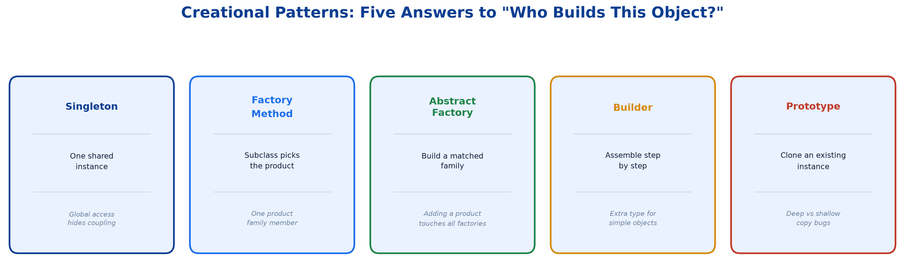
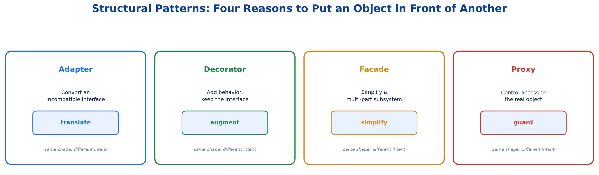

# LLD: Creational & Structural Design Patterns

> A compact guide to the patterns that decide **who builds an object** and **how objects are wired together**. Reach for a pattern when a specific change is expected—not because the class diagram looks bare without one.

---

## 1. One-page visual summary


Both families remove a specific coupling. Creational patterns take the `new ConcreteThing()` decision away from policy code; structural patterns change how objects connect without editing either side.





| Family | Removes | Interview question | Failure when overused |
|---|---|---|---|
| **Creational** | Dependence on concrete constructors | Who chooses the implementation? | Factories producing one product forever |
| **Structural** | Dependence on how parts are assembled | How does the client reach the target? | Wrapper chains nobody can trace |

!!! tip "Mental shortcut"
    Creational asks *what gets built*; structural asks *how it connects*. If you cannot name the change a pattern absorbs, you do not need the pattern yet.

---

## 2. Core mental model

### A pattern is a named trade-off

Every pattern buys flexibility at one seam and charges indirection everywhere else. The decision is identical to Topic 2's rule for abstractions: add the seam where variation is **demonstrated**, not imagined.

```text
Use a pattern when = expected variation + a seam that contains it
Skip the pattern when = one stable implementation + no pending change
```

### Creation coupling versus composition coupling

```java
// Creation coupling: policy knows the concrete type and its constructor
final class Checkout {
    Money charge(Order order) {
        StripeGateway gateway = new StripeGateway(apiKey);   // hard to swap or test
        return gateway.charge(order.total());
    }
}
```

`Checkout` now changes whenever the provider, its constructor, or its credentials change. A factory moves that decision outward; an adapter absorbs a mismatched SDK interface. Neither improves the algorithm—both shrink the blast radius of a likely change.

### The four structural patterns share one shape


All four place an object between client and target. They differ only in **intent**: Adapter changes the interface, Decorator adds behavior behind the same interface, Facade narrows a multi-part subsystem, and Proxy controls access to a target it may create or defer.

---

## 3. Important concepts

### Singleton

> Guarantee one instance and provide global access to it.

```java
enum ConfigStore {                 // JVM guarantees one instance
    INSTANCE;
    private final Map<String, String> values = loadValues();
    String get(String key) { return values.get(key); }
}
```

Singleton is the most over-applied pattern in the catalogue. Global access hides dependencies from constructors, defeats substitution in tests, and turns mutable shared state into a concurrency hazard. Prefer **one instance managed by the composition root** and injected as a normal dependency; reach for enforced singletons only when a second instance is genuinely incorrect.

### Factory Method

> Let a subclass decide which concrete product to create.

```java
abstract class Dialog {
    abstract Button createButton();          // factory method
    void render() { createButton().draw(); } // stable algorithm
}
final class WebDialog extends Dialog {
    Button createButton() { return new HtmlButton(); }
}
```

The algorithm in `render()` stays closed to modification while product creation stays open to extension—OCP applied to construction. A plain static helper that returns one type is not Factory Method; it is just a named constructor, which is often the better answer.

### Abstract Factory

> Create families of related products that must be used together.

```java
interface UiKit {                    // one factory, a matched family
    Button button();
    Checkbox checkbox();
}
final class DarkKit implements UiKit {
    public Button button() { return new DarkButton(); }
    public Checkbox checkbox() { return new DarkCheckbox(); }
}
```

This guarantees consistency: a dark button can never appear beside a light checkbox. The cost is rigidity—adding `Slider` to the family forces an edit to **every** factory implementation. Use it only when mixing families is a real defect.

### Builder

> Assemble a complex object step by step and validate it once.


```java
Report report = Report.builder()
    .title("Q3")
    .format(PDF)
    .includeCharts(true)
    .build();                        // validates invariants before construction
```

Builder earns its place with many optional parameters, immutable targets, or invariants spanning several fields. `build()` is the single gate where validation happens, so no partially-configured `Report` ever exists. For two or three required parameters, a constructor is clearer.

### Prototype

> Create a new object by copying an existing one.

```java
final class Board implements Cloneable {
    private final List<Tile> tiles;
    Board copy() { return new Board(List.copyOf(tiles)); }  // explicit deep copy
}
```

Useful when construction is expensive or the target's configuration is only known at runtime. The classic defect is a **shallow copy**: the clone shares mutable internals with the original, so mutating one silently corrupts the other.

### Adapter

> Convert an existing interface into the one a client expects.

```java
final class StripeAdapter implements PaymentGateway {   // our contract
    private final StripeClient stripe;                  // their SDK
    public ChargeResult charge(ChargeRequest request) {
        StripeCharge raw = stripe.createCharge(request.cents(), request.currency());
        return ChargeResult.from(raw);                  // translate both ways
    }
}
```

Adapter is the standard defence at a third-party boundary: the vendor's types stop at the adapter and never leak into domain code. Translate errors as carefully as data—an adapter that swallows a provider failure breaks LSP for every caller.

### Decorator

> Attach responsibilities to an object dynamically, preserving its interface.

```java
final class RetryingGateway implements PaymentGateway {
    private final PaymentGateway delegate;              // same interface
    public ChargeResult charge(ChargeRequest request) {
        return retryPolicy.execute(() -> delegate.charge(request));
    }
}
```

Because the decorator implements the same contract, wrappers compose: `new AuditingGateway(new RetryingGateway(new StripeAdapter(...)))`. Order matters—retry inside audit logs every attempt, retry outside logs one. Deep stacks make stack traces miserable, so keep chains short and deliberate.

### Facade

> Provide one simplified entry point to a multi-part subsystem.

```java
final class PaymentFacade {
    ChargeResult pay(Order order) {          // hides fraud, tax, gateway, ledger
        fraudCheck.verify(order);
        Money total = taxCalculator.applyTo(order);
        return gateway.charge(ChargeRequest.of(order, total));
    }
}
```

A facade reduces the number of concepts a caller must learn. It does **not** forbid direct access to the subsystem for advanced cases, and it must not quietly become a god class that accumulates business rules.

### Proxy

> Control access to an object, using the same interface.

```java
final class LazyReportProxy implements Report {
    private Report real;                        // created only when needed
    public byte[] render() {
        if (real == null) real = new ExpensiveReport();
        return real.render();
    }
}
```

Common variants are virtual (defer creation), protection (authorize), remote (hide network calls), and caching. **Proxy and Decorator are structurally identical**; a proxy manages the target's lifecycle or access rights, while a decorator adds behavior to a target it was handed.

---

## 4. Decision and trade-off tables

### Which creational pattern?

| Evidence | Pattern | Optimizes for | Cost |
|---|---|---|---|
| One concrete type, stable | Plain constructor | Simplicity | Refactor later if variation arrives |
| Caller picks from known variants | Static factory | Readable intent | Central switch to maintain |
| Subclass must choose the product | Factory Method | Extension without editing policy | Class per variant |
| Products must match as a family | Abstract Factory | Cross-product consistency | New product touches every factory |
| Many optional fields or invariants | Builder | Readable, validated construction | Extra type and boilerplate |
| Copying beats constructing | Prototype | Cheap runtime duplication | Deep-copy correctness |

### Which structural pattern?

| Problem | Pattern | Interface changes? | Guardrail |
|---|---|---|---|
| Interface mismatch at a boundary | Adapter | Yes—translated | Translate errors, not just data |
| Optional behavior added per call site | Decorator | No—identical | Keep chains short; order is semantic |
| Subsystem is hard to learn | Facade | Yes—narrowed | Must not absorb business rules |
| Access, laziness, or location control | Proxy | No—identical | Document the hidden cost |

### Pattern collisions

| Tension | Balanced decision |
|---|---|
| Factory vs plain constructor | Add a factory only when the concrete type must vary |
| Singleton vs injected instance | Prefer one injected instance; enforce uniqueness rarely |
| Decorator vs Proxy | Adding behavior is a decorator; controlling access is a proxy |
| Facade vs leaky convenience | Keep the facade thin; complexity belongs in the subsystem |
| Builder vs YAGNI | Use a constructor until optional fields make call sites unreadable |

---

## 5. Failure scenarios

| Smell | Likely problem | Focused response |
|---|---|---|
| Factory with one product | Speculative seam | Inline it; use a constructor |
| Singleton everywhere | Hidden global dependencies | Inject one instance from the root |
| Wrapper chain five deep | Untraceable behavior and stack traces | Collapse to the wrappers with real jobs |
| Adapter leaking vendor types | Boundary is not sealed | Map to domain types inside the adapter |
| Facade with business logic | God class in disguise | Push rules back into the subsystem |
| Shallow prototype copy | Clone shares mutable state | Copy nested collections explicitly |
| Abstract Factory for one family | Rigidity without benefit | Collapse to a simple factory |

### How these patterns fail in practice

- **Pattern-first design:** a name is chosen before the change it should absorb is understood.
- **Mutable singleton state:** shared configuration becomes a race condition under load.
- **Decorator ordering bugs:** retry, cache, and audit wrappers produce different semantics per arrangement.
- **Silent proxies:** a lazy or remote proxy hides latency and failure behind an innocent method call.
- **Adapter contract drift:** the adapter returns success for a partial vendor failure, breaking substitution.

Refactor from evidence: name the change you expect, check whether a seam already contains it, and only then introduce the smallest pattern that helps.

---

## 6. One focused worked example

### Payment gateway boundary

**Requirement:** charge an order through region-specific providers. New providers must not require edits to checkout. Every attempt must be audited, transient failures retried, and provider SDK types kept out of the domain.


```text
interface PaymentGateway { ChargeResult charge(ChargeRequest request) }

PaymentFacade.pay(order):
    request = ChargeRequest.builder()...build()      // validated once
    gateway = providerFactory.forCountry(order.country())
    return gateway.charge(request)                   // audit → retry → adapter → SDK
```

| Design choice | Pattern | Optimizes for | Cost / guardrail |
|---|---|---|---|
| One `pay(order)` entry point | Facade | Small client surface | Must not accumulate pricing rules |
| `ChargeRequest.builder()` | Builder | Validated, immutable request | Extra type for a simple payload |
| `providerFactory.forCountry(...)` | Factory Method | New provider without editing checkout | Registration and lifecycle to manage |
| `RetryingGateway` wrapper | Decorator | Resilience added per composition | Retry only idempotent charges |
| `AuditingGateway` wrapper | Proxy | Enforced audit before access | Hidden latency on every call |
| One adapter per SDK | Adapter | Vendor types stay at the edge | Must translate error semantics |

**Failure path:** if the provider returns a transient error, the retry decorator applies bounded attempts using the idempotency key from the request; the audit proxy records each attempt. A permanent decline returns immediately. If an adapter reports a decline as success, every wrapper above it is now wrong—substitution safety depends on the **lowest** link in the chain.

---

## 7. Senior/Principal interview signals

| Senior signal | Staff/Principal extension |
|---|---|
| Names the change a pattern absorbs | Maps patterns to team and ownership boundaries |
| Chooses constructor over factory when stable | Defines when a seam becomes a service boundary |
| Knows Decorator and Proxy differ by intent | Specifies wrapper order, lifecycle, and observability |
| Seals vendor types behind adapters | Plans provider migration and dual-running |
| Avoids mutable singleton state | Governs shared state and concurrency across services |
| Discusses cost of indirection | Measures debuggability and onboarding friction |

Strong interview language:

> "Providers are volatile, so checkout depends on a `PaymentGateway` contract and a factory resolves the region-specific implementation. Retry and audit are decorators because they compose independently of the provider. This costs indirection and a deeper stack trace; I would verify it with contract tests covering success, decline, timeout, and duplicate-charge behavior."

At Principal level, discuss whether a seam should stay in-process, become a shared library, or graduate to a service—and what the migration and rollback path looks like.

---

## 8. Final revision checklist

```text
[ ] NAME the expected change before naming the pattern
[ ] SINGLETON: prefer one injected instance; avoid mutable global state
[ ] FACTORY METHOD: use when a subclass must choose the product
[ ] ABSTRACT FACTORY: use when products must match as a family
[ ] BUILDER: use for optional fields and validate once in build()
[ ] PROTOTYPE: copy deliberately; deep vs shallow is a correctness bug
[ ] ADAPTER: seal vendor types and translate error semantics
[ ] DECORATOR: same interface, composable, order is meaningful
[ ] FACADE: narrow the surface without absorbing business rules
[ ] PROXY: control access or lifecycle; document the hidden cost
[ ] COLLAPSE any wrapper or factory that absorbs no real variation
[ ] DEFEND each pattern: optimizes, costs, validates, evolves
```

!!! success "The senior-level finish"
    Patterns are vocabulary for trade-offs already present in the design. Justify each one by the change it localizes and the cost it adds—then show the simpler design you would use if that change never arrived.
