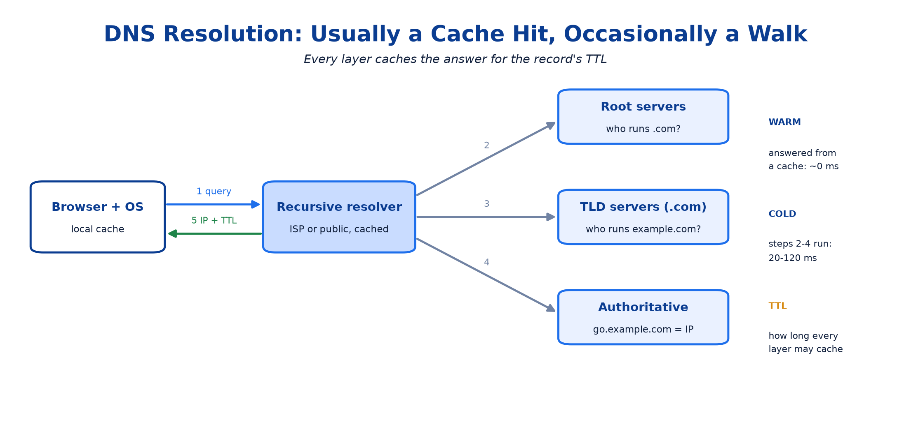
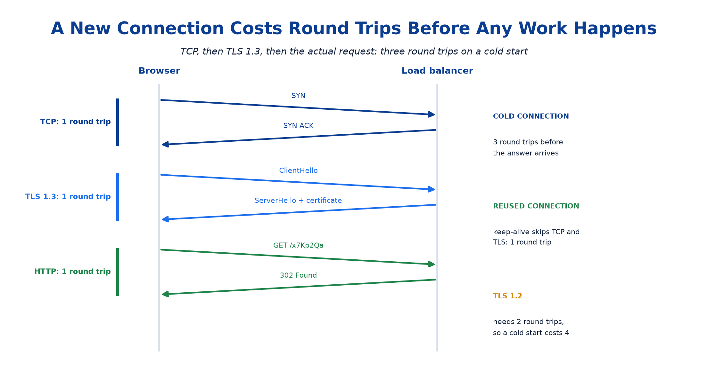
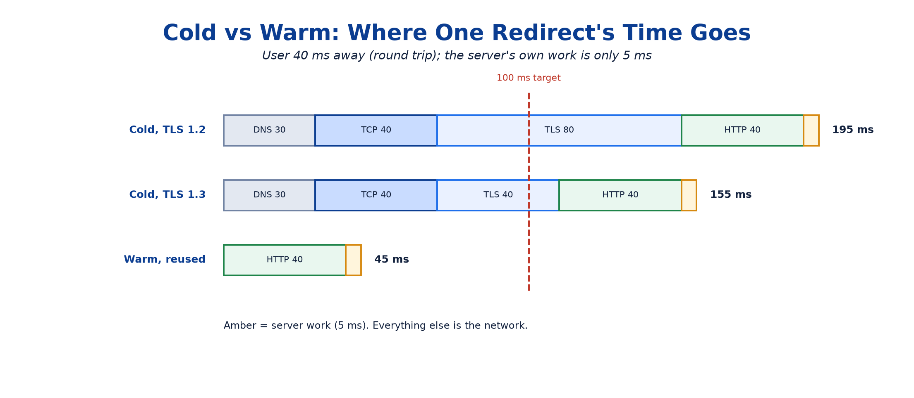

# Networking & Request Lifecycle

## Terms to know before you start

You do not need to memorize these. Come back to this table whenever a term feels unfamiliar.

| Term | What it means in plain words |
|---|---|
| **IP address** | The numeric address of a machine on a network, such as `203.0.113.10`. Computers connect to addresses, not names. |
| **DNS** (Domain Name System) | The internet's phone book. It turns a name such as `go.example.com` into an IP address. |
| **Round trip (RTT)** | The time for a message to travel to another machine and for the reply to come back. Most network costs are counted in round trips. |
| **TCP** | The protocol most of the web runs on. It delivers bytes reliably and in order, at the price of a setup handshake and some waiting when packets are lost. |
| **UDP** | A simpler protocol that sends individual packets with no setup and no delivery guarantee. Faster to start, but the application must cope with loss. |
| **TLS** | The encryption layer that turns HTTP into HTTPS. It proves the server's identity with a certificate and encrypts everything sent. |
| **Handshake** | The back-and-forth messages two machines exchange before real data can flow. Each handshake costs at least one round trip. |
| **Connection pool** | A set of already-open connections that a service keeps and reuses, so it does not pay for a new handshake on every request. |
| **Timeout** | The longest a caller is willing to wait for an answer before giving up. Without one, a caller can wait forever. |
| **Packet loss** | When a piece of data disappears on the way and must be sent again. A little loss causes a lot of slow requests. |

---

## 1. The life of one request


Basics 1 designed a URL shortener that must answer about 8,000 redirects per second, with 99% of them finishing within 100 ms. Every one of those redirects starts with a person clicking a link such as `https://go.example.com/x7Kp2Qa`. This page follows that single click from the browser to the database and back, because each step either costs time or can fail, and usually both.

| Step | What happens | What can go wrong |
|---|---|---|
| 1. DNS lookup | The browser asks DNS for the IP address of `go.example.com`. | The name does not resolve, or resolves to an old address after a migration. |
| 2. TCP handshake | The browser opens a connection to that address. | The packets are lost, or nothing answers and the browser waits. |
| 3. TLS handshake | The browser and the load balancer agree on encryption, and the browser checks the certificate. | The certificate has expired, so every HTTPS request fails at once. |
| 4. HTTP request | The browser sends `GET /x7Kp2Qa`, and the load balancer forwards it to a Link API server. | The chosen server is slow or overloaded. |
| 5. Cache lookup | The Link API looks up the code in the cache. | The cache is slow, so every redirect becomes slow. |
| 6. Database, on a miss | About 1 request in 100 is not in the cache and goes to the link store. | The database is slow or down. |
| 7. Response | The Link API returns `302 Found` with the long URL, and the browser follows it. | The response is lost and the browser retries. |

!!! tip "The request lifecycle in one sentence"
    Most of a request's time is spent getting to your code and back, so the cheapest latency win is usually avoiding round trips, not making your code faster.

Steps 5 and 6 happen inside the data center and take a few milliseconds. Steps 1 to 4 and step 7 cross the public internet to the user, and that is where most of the time goes. The rest of this page explains why.

---

## 2. The network, one layer at a time

The sections below form a ladder, like the capacity ladder in Basics 1. Each level introduces one idea, applies it to the URL shortener, and ends with a practice problem about the same note-taking app from Basics 1.

### Level 0: Round trips and distance

Light in optical fiber travels about 200,000 km per second, which is 200 km per millisecond. A round trip covers the distance twice, which gives a handy rule:

```text
Minimum round trip ≈ 1 ms per 100 km of distance
```

Real networks do not run in straight lines, so actual round trips are usually 1.5 to 2 times the minimum. These typical values are worth remembering:

| Path | Typical round trip |
|---|---:|
| Two servers in the same data center | About 0.5 ms |
| Two data centers in the same region | About 1–2 ms |
| Across one continent | About 30–80 ms |
| Between continents | About 100–250 ms |

**What this tells us:** a user on another continent costs over 100 ms per round trip, and no amount of server tuning can change the speed of light. The only fixes are needing fewer round trips, or putting something closer to the user.

!!! question "Practice: the note-taking app"
    The note-taking app's servers are about 3,000 km from most of its users. What is the minimum round trip, and what is a realistic one?

??? success "Answer"
    Minimum: 3,000 km / 100 km per ms = **30 ms**.
    Realistic: 30 ms × 1.5 to 2 = **about 45–60 ms**.

### Level 1: DNS, turning a name into an address



When the browser needs the address of `go.example.com`, it first checks its own cache and the operating system's cache. If neither has the answer, it asks a **recursive resolver**, usually run by the internet provider or a public service. On a cold lookup, that resolver walks the hierarchy: the root servers point to the `.com` servers, which point to the **authoritative** servers for `example.com`, which return the IP address.

Every answer carries a **TTL** (time to live): how many seconds every layer may cache it. Because of caching, almost every lookup is answered in about 0 ms. A full walk takes roughly 20–120 ms, and happens only when caches are empty or expired.

The TTL is a trade-off you choose for your own domain:

| TTL | What it buys | What it costs |
|---|---|---|
| Long (hours to a day) | Fewer lookups, so slightly faster for users and less DNS traffic. | After you change the IP address, some users keep going to the old one for hours. |
| Short (1–5 minutes) | Changes and failovers take effect within minutes. | More lookups, so more cold-start latency and more load on DNS. |

DNS fails in a few classic ways: a record points to the wrong address after a change, a domain or DNS provider stops answering, or a long TTL keeps sending users to servers that no longer exist. DNS is also a poor tool for fast failover: some clients and resolvers cache answers longer than the TTL says, so a "1-minute" switch can take much longer for some users.

!!! question "Practice: the note-taking app"
    The note-taking app is moving to new servers with a new IP address. Its DNS record has a TTL of 3,600 seconds. After the record is updated, how long might users still reach the old servers, and what should the team do before and after the change?

??? success "Answer"
    Up to **1 hour** for well-behaved resolvers, and longer for some that ignore the TTL.

    Before: lower the TTL to about 60–300 seconds at least one full old TTL (an hour) before the move, so caches pick up the short TTL first.
    After: keep the old servers running until their traffic drops to nearly zero, then raise the TTL again.

### Level 2: TCP vs UDP

Once the browser has an address, it needs a way to send data. Two protocols cover almost everything:

| | TCP | UDP |
|---|---|---|
| Setup | A handshake (SYN, SYN-ACK, ACK): 1 round trip before data flows. | None. The first packet carries data. |
| Delivery | Reliable. Lost packets are re-sent automatically. | Best effort. Lost packets stay lost unless the application re-sends them. |
| Order | Bytes arrive in the order they were sent. | Packets can arrive out of order. |
| The hidden cost | If one packet is lost, everything sent after it waits until it is re-sent. | The application must handle loss, ordering, and congestion itself. |
| Typical uses | Web pages, APIs, database connections, file transfer. | DNS lookups, voice and video calls, online games, and QUIC (which HTTP/3 uses). |

"UDP is faster" is only half the story. UDP skips the handshake and never makes later data wait for lost data, which is exactly what a video call wants: a late video frame is useless, so it is better to skip it. A saved note or a redirect needs every byte, so it uses TCP and accepts the cost.

!!! question "Practice: the note-taking app"
    Pick TCP or UDP for each feature, and say what would go wrong with the other choice:
    1. Saving a note.
    2. A new voice-memo feature that streams live audio to a collaborator.

??? success "Answer"
    1. **TCP.** A note must arrive complete and in order. With UDP, the app would have to rebuild reliability itself.
    2. **UDP** (usually through a real-time protocol built on it). With TCP, one lost packet would freeze the audio until it was re-sent, and by then the moment has passed.

### Level 3: TLS, HTTPS, and where encryption ends

HTTPS is HTTP sent inside a TLS connection. TLS does two jobs: the server's **certificate** proves the browser is talking to the real `go.example.com`, and the handshake agrees on keys that encrypt everything afterwards. The current version, **TLS 1.3**, needs 1 round trip for its handshake; the older TLS 1.2 needs 2.

**TLS termination** is the place where encryption ends and the request is read as plain HTTP. You choose where that happens:

| Option | How it works | Trade-off |
|---|---|---|
| Terminate at the load balancer | The load balancer decrypts, then talks plain HTTP to the servers inside the private network. | Simplest: certificates live in one place, and the load balancer can route by URL path. Traffic inside the network is unencrypted. |
| Terminate and re-encrypt | The load balancer decrypts, reads the request, then opens a new TLS connection to the server. | Encrypted everywhere and still routable by path, at the cost of extra handshakes and more certificates to manage. |
| Pass through | The load balancer forwards encrypted bytes untouched; the server decrypts. | End-to-end encryption, but the load balancer cannot see paths or headers, so it can only route by address and port. |

For the URL shortener, terminating at the load balancer is the usual starting point. Many organizations then re-encrypt internally because their security policy requires encryption inside the network too; that policy discussion belongs to **Basics 6 (API Correctness, Security & Resource Design)**.

The most common TLS outage is not a clever attack. It is an **expired certificate**: every HTTPS request fails at the same moment. Certificates are often valid for only 90 days, so renewal must be automated and monitored.

!!! question "Practice: the note-taking app"
    The note-taking app wants its load balancer to send `/api/attachments/*` requests to a separate fleet of servers. Which termination option rules this out, and why?

??? success "Answer"
    **Pass-through.** The load balancer only sees encrypted bytes, so it cannot read the URL path to route on it. Terminating, or terminating and re-encrypting, both allow path-based routing.

### Level 4: The price of a new connection



Put the last three levels together. Before a brand-new connection can carry the redirect, the browser needs a DNS answer, a TCP round trip, and a TLS round trip, and only then can it send the request. Assume a user 40 ms away, a cold DNS lookup of 30 ms, and 5 ms of server work:

```text
Cold connection, TLS 1.3 = DNS 30 + TCP 40 + TLS 40 + HTTP 40 + server 5 = 155 ms
Cold connection, TLS 1.2 = DNS 30 + TCP 40 + TLS 80 + HTTP 40 + server 5 = 195 ms
Reused connection        =                          HTTP 40 + server 5 =  45 ms
```



**What this tells us:** the server's own work is 5 ms out of 155. A cold connection alone blows through the 100 ms target from Basics 1, while a reused one meets it comfortably. That raises a question you should always ask about a latency target: *where is it measured?* A target measured at the server is a statement about your code. A target measured at the user's device is mostly a statement about round trips, and is met by reusing connections, upgrading to TLS 1.3, and moving the connection's far end closer to the user with a CDN or edge location (**Basics 9: Caching Core**).

!!! question "Practice: the note-taking app"
    Using the realistic 50 ms round trip from Level 0, TLS 1.3, a cold DNS lookup of 30 ms, and 20 ms of server work to load a note, what do a cold and a warm note load cost?

??? success "Answer"
    Cold: 30 + 50 + 50 + 50 + 20 = **200 ms**.
    Warm: 50 + 20 = **70 ms**.
    Most of the cold cost is setup, so keeping the app's connection open between note loads is worth more than shaving milliseconds off the server.

### Level 5: HTTP/1.1 vs HTTP/2 vs HTTP/3


HTTP is the language of the request itself. Its three versions differ mainly in how many requests can share one connection, and in what happens when a packet is lost:

| | HTTP/1.1 | HTTP/2 | HTTP/3 |
|---|---|---|---|
| Runs on | TCP | TCP | QUIC, which runs on UDP |
| Requests per connection | One at a time, so browsers open about 6 connections per site to compensate | Many at once (streams), all sharing one connection | Many at once, each stream independent |
| A lost packet | Delays the request it belongs to | Delays *every* stream, because TCP holds all later bytes until the lost one arrives (head-of-line blocking) | Delays only the stream it belongs to |
| Setup cost | TCP + TLS: 2 round trips with TLS 1.3 | Same as HTTP/1.1 | Transport and encryption combined: 1 round trip |
| Other benefits | Simple, supported everywhere | Compressed headers, one connection instead of six | Survives a network change, such as Wi-Fi to mobile, without reconnecting |

For the URL shortener's redirect itself, the version barely matters: it is one tiny request. The version matters for pages that load dozens of files at once, and for mobile users on lossy networks, where HTTP/3's independent streams and 1-round-trip setup make a visible difference. Inside the data center, where round trips are short and loss is rare, HTTP/1.1 or HTTP/2 with long-lived connections is normal; protocols such as gRPC build on HTTP/2 (**Basics 7: API Design & Service Communication**).

??? info "Go deeper (optional): 0-RTT and why it only suits safe requests"
    When a browser reconnects to a server it visited recently, TLS 1.3 and QUIC can send the request in the very first packet, with *zero* round trips of setup. The catch is that an attacker who records that first packet can replay it. Replaying a redirect is harmless, but replaying "transfer money" is not, so servers accept 0-RTT data only for requests that are safe to repeat. Making requests safe to repeat is the subject of **Advanced 7 (Idempotency & Retries)**.

!!! question "Practice: the note-taking app"
    The note-taking app's web version loads 60 small files (scripts, icons, styles) on startup, and many users are on mobile networks. Which HTTP version helps most, and why?

??? success "Answer"
    **HTTP/3**, with HTTP/2 as a fallback. Both load all 60 files over one connection instead of queuing them across about 6. On lossy mobile networks, HTTP/3 also stops one lost packet from stalling all 60 files, and it sets up in 1 round trip instead of 2.

### Level 6: Keep-alive and connection pools

Level 4 showed that a new connection is expensive. Two habits avoid paying for it repeatedly:

- **Keep-alive** means leaving a connection open after a response, so the next request on it skips the TCP and TLS handshakes. Browsers and load balancers do this by default.
- A **connection pool** is a service's set of open connections to something it calls often, such as the cache or the database. A request borrows a connection, uses it, and returns it, instead of opening and closing a new one.

Pooling is not only about speed. Every outgoing connection uses a temporary port number on the server, and after a connection closes, Linux holds that port for about 60 seconds (the `TIME_WAIT` state) before reusing it. With about 28,000 temporary ports available by default:

```text
New connections per second to one destination ≈ 28,000 ports / 60 seconds ≈ 470
```

A Link API server handles about 8,080 / 12 ≈ 670 requests per second at peak. If it opened a fresh cache connection for every redirect, it would run out of ports and start failing, even though the cache itself was healthy.

Sizing a pool uses Little's Law from Basics 1: connections in use = calls per second × seconds each call holds the connection.

```text
Cache:     670 lookups/s per server × 0.001 s       ≈ 0.7 connections busy
Database:  160 queries/s (80 misses + 80 creates) / 12 servers ≈ 13 per server
           13 queries/s × 0.005 s                    ≈ 0.07 connections busy
```

So a pool of about 5–10 connections per server is generous. There are two traps. First, **pools multiply**: 12 servers with 10 database connections each is 120 connections, and PostgreSQL allows only 100 by default. Second, **slow dependencies drain pools**: if database queries slow from 5 ms to 1 second, each server needs 13 connections busy at once, so a pool of 10 runs out and requests start queuing for a connection.

!!! question "Practice: the note-taking app"
    The note-taking app has 19 servers. At peak it sends about 1,200 queries per second to its database (600 writes plus 600 cache misses), each taking about 10 ms. The database accepts 100 connections. How many connections are actually busy, and what pool size per server is safe?

??? success "Answer"
    Busy connections = 1,200 × 0.01 = **12 in total**, well under 1 per server.

    A pool of 10 per server would allow 190 connections, which exceeds the database's limit of 100. A pool of **5 per server** (95 in total) is safe and still leaves plenty of room. Above that, teams put a connection-pooling proxy, such as PgBouncer, in front of the database.

### Level 7: Timeout budgets


Every network call needs a timeout, because the alternative is waiting forever. That is a real risk: some common HTTP clients have no timeout by default. There are two kinds:

- A **connect timeout** limits how long to wait for a connection to open. Keep it short (tens of milliseconds inside a data center), because a healthy server accepts a connection almost instantly.
- A **request timeout** limits how long to wait for the answer once the request is sent.

Timeouts must also fit together into a **budget**. The rule is that every callee gives up before its caller does, and the calls made in sequence, including any retry, fit inside the caller's limit. For the URL shortener:

| Layer | Timeout | Normal time |
|---|---:|---:|
| Load balancer waiting for the Link API | 1,000 ms | About 5 ms |
| Link API's deadline for the whole request | 200 ms | About 5 ms |
| Cache lookup | 10 ms | About 1 ms |
| Database query, plus one retry | 50 ms + 50 ms | About 5 ms |

The sequence 10 + 50 + 50 = 110 ms fits inside the 200 ms deadline, which fits inside the load balancer's 1,000 ms. If the order were reversed, say a database timeout of 5 seconds under a 200 ms deadline, the Link API would give up and answer with an error, while the database query kept running and holding a pooled connection for up to 5 seconds. That is wasted work, and it is exactly how slow dependencies drain the pools from Level 6.

A good refinement is **deadline propagation**: the caller passes along how much time remains, and each layer stops early if the time has already run out.

??? info "Go deeper (optional): why retries at every layer are dangerous"
    If the load balancer, the Link API, and the database client each retry a failed call 3 times, one failure at the bottom can become 3 × 3 × 3 = 27 attempts. During an outage, that turns a struggling database into a flattened one. The usual rule is to retry at one layer only, with a small limit and a growing delay. This is covered in **Advanced 7 (Idempotency & Retries)** and **Advanced 11 (Fault Tolerance, Resilience & Failure Handling)**.

!!! question "Practice: the note-taking app"
    The note-taking app's API has a 1-second request deadline. Its database client has a 5-second query timeout and retries failed queries 3 times. What goes wrong when the database becomes slow, and how would you fix the numbers?

??? success "Answer"
    The API gives up after 1 second, but each query can keep running for up to 5 seconds, and up to 4 attempts (the first plus 3 retries) can pile up behind one user request. Pooled connections stay busy long after the user has received an error, so the pool drains and even fast requests start failing.

    Fix: set the query timeout well under the deadline, for example 200 ms, allow at most 1 retry, and make sure 200 + 200 fits inside the 1-second deadline with room to spare.

---

## 3. Latency sources and network failure modes

Every millisecond of a request comes from one of a few sources:

| Source | What causes it | What reduces it |
|---|---|---|
| **Distance** | Signals travel at a fixed speed. | Fewer round trips, or servers and edge locations closer to users. |
| **Handshakes** | DNS, TCP, and TLS each add round trips. | Keep-alive, connection pools, TLS 1.3, HTTP/3. |
| **Transfer** | Large responses take time to send over limited bandwidth. | Smaller responses, compression. |
| **Queuing** | Requests wait their turn on a busy server, link, or pool. | Headroom, more capacity, shorter work. |
| **Processing** | Your code and its database queries. | Caching, better queries, less work per request. |
| **Retransmission** | Lost packets must be re-sent. On Linux, a lost packet costs at least 200 ms, and a lost connection request costs about 1 second. | Short timeouts with careful retries, HTTP/3 on lossy networks. |

Retransmission explains why a tiny amount of packet loss ruins the p99: 1% loss barely moves the average, but it makes a slice of requests hundreds of milliseconds slower.

Networks also fail in recognizable ways, and each has a defense:

| Failure | What the caller sees | Defense |
|---|---|---|
| DNS points to the wrong address, or stops answering | Requests fail before they start. | Reasonable TTLs, monitoring of DNS answers, and a careful change process. |
| Connection refused | An instant error. | The good kind of failure: fail fast and try another instance. |
| No answer at all (a "black hole") | The caller waits until its timeout. | Short connect timeouts and a request deadline, so threads are not stuck. |
| Expired or wrong certificate | Every HTTPS request fails at once. | Automated renewal, and alerts weeks before expiry. |
| Idle connection silently dropped by a firewall or load balancer | The first request on a reused connection fails. | Close pooled connections before the network's idle limit, and retry once if the request is safe to repeat. |
| Overloaded server | Latency grows with load, then requests time out. | Headroom, and shedding load before collapse (**Advanced 10**). |

The difference between the second and third rows is worth remembering: **a refused connection is a quick no; a timeout is a slow no.** Slow failures are worse, because waiting callers pile up and tie up threads and pools all the way back up the chain.

---

## 4. Putting it together: one redirect, end to end

This is the networking plan you could add to the URL shortener design from Basics 1, with each decision tied to a level above:

| Decision | Why |
|---|---|
| DNS TTL of 5 minutes on `go.example.com` | Short enough to move traffic within minutes, long enough that almost every lookup is still a cache hit (Level 1). |
| TLS 1.3 terminated at the load balancer, with automated certificate renewal | One round trip of setup, certificates managed in one place, and path-based routing remains possible (Level 3). |
| HTTP/2 and HTTP/3 offered to clients, keep-alive on | Returning users reuse connections, and mobile users avoid head-of-line blocking (Levels 5–6). |
| Pools of about 8 cache and 5 database connections per Link API server | Little's Law says under 1 connection is busy; 12 servers × 5 = 60 database connections stays under the limit of 100 (Level 6). |
| Nested timeouts: 1,000 ms, 200 ms, 10 ms, 50 ms, and one retry | Every callee gives up before its caller, and the sequence fits the budget (Level 7). |
| The 100 ms target measured at the server; user-side latency tracked separately | Cold connections alone cost 155 ms for a user 40 ms away, so a user-side target needs an edge location, not faster code (Level 4). |

??? info "Go deeper (optional): 301 or 302 for a short link?"
    A `301 Moved Permanently` response may be cached by the browser, so a returning user goes straight to the long URL without contacting the shortener at all. That is the fastest possible redirect: zero round trips. It is also why Basics 1 chose `302 Found`, which browsers do not cache unless told to. With 301, the shortener never sees repeat clicks, so analytics undercount, and changing or disabling a link stops working for anyone who has already cached it. It is a network-cost decision and a product decision at the same time.

---

## 5. Common beginner mistakes

- **Estimating latency from server time alone.** Connection setup can cost several times more than the server's work, as the cold-versus-warm comparison shows.
- **Opening a new connection for every request.** It wastes round trips, and at a few hundred requests per second it can exhaust a server's ports.
- **Sizing pools per server and forgetting to multiply.** Pool size × number of servers must stay under what the database accepts.
- **Leaving timeouts at their defaults, or nesting them backwards.** Some clients wait forever by default, and an inner timeout longer than its caller's creates work nobody is waiting for.
- **Retrying at every layer.** Retries multiply, and an outage gets worse instead of better.
- **Relying on DNS for fast failover.** Caches, and resolvers that ignore TTLs, make DNS changes slow to reach everyone.
- **Saying "UDP is faster" without saying what is given up.** The speed comes from dropping reliability and ordering, which most features need.
- **Renewing certificates by hand.** Sooner or later someone forgets, and every HTTPS request fails at once.

---

## 6. Test yourself

These three problems increase in difficulty. Try each one on paper before opening the answer.

!!! question "Problem 1 (warm-up): cold and warm requests"
    A user is 80 ms away (round trip). A cold DNS lookup costs 50 ms, the server does 10 ms of work, and the connection uses TLS 1.3. What does a request cost on a cold connection, and on a reused one?

??? success "Answer"
    Cold: 50 + 80 (TCP) + 80 (TLS) + 80 (HTTP) + 10 = **300 ms**.
    Warm: 80 + 10 = **90 ms**.
    Over two thirds of the cold request is setup.

!!! question "Problem 2 (distance): adding an edge location"
    The URL shortener's servers are 150 ms (round trip) from users on another continent. A CDN offers an edge location 10 ms from those users. The edge can cache popular redirects, and it keeps warm connections open to the shortener's servers. With a 30 ms cold DNS lookup, 5 ms of server work, and TLS 1.3, estimate a cold request (a) direct to the servers, (b) through the edge when the redirect is cached there, and (c) through the edge when it is not.

??? success "Answer"
    ```text
    (a) Direct:            30 + 150 + 150 + 150 + 5         = 485 ms
    (b) Edge, cached:      30 + 10 + 10 + 10 + ~1           ≈ 61 ms
    (c) Edge, not cached:  30 + 10 + 10 + 10 + 150 + 5      = 215 ms
    ```

    Even when the edge cannot answer, it more than halves the cost, because the TCP and TLS handshakes happen over the short 10 ms path while the long path uses an already-open connection. Edge locations and CDNs are covered in **Basics 9 (Caching Core)**.

!!! question "Problem 3 (full design): the note-saving path"
    Saving a note travels app → load balancer (2-second timeout) → Note API → database (about 10 ms normally, 50 ms at p99). Today, the Note API also calls a search-indexing service synchronously before answering: about 30 ms normally, 300 ms at p99, and it occasionally hangs. Peak traffic is 600 saves per second across 19 servers. Propose a request deadline, the timeouts for each call, and a database pool size per server. What would you change about the indexing call?

??? success "Answer"
    A reasonable budget:

    ```text
    Load balancer timeout        2,000 ms
    Note API request deadline    1,000 ms
    Database timeout               200 ms   (4× its p99), at most 1 retry
    Indexer timeout                400 ms   (just above its p99), no retry
    Sequence: 200 + 200 + 400 = 800 ms, which fits inside 1,000 ms
    ```

    Database pool: 600 saves/s × 0.01 s = 6 connections busy across all servers, so **3–5 per server** is plenty, and 19 × 5 = 95 stays under a typical limit of 100.

    The bigger fix is the indexer. A user does not need the search index updated before seeing "saved", and a dependency that sometimes hangs should not sit on the critical path. Save the note, answer the user, and send an "index this note" message through a queue (**Basics 13: Asynchronous Processing Basics**). This also keeps the save working when the indexer is down, which is the kind of boundary decision **Basics 5 (Architecture Styles & Service Decomposition)** is about.

---

## 7. Checklist and what comes next

```text
[ ] TRACE the request path: DNS, TCP, TLS, load balancer, service, cache, database
[ ] COUNT round trips for a cold and a warm connection, and say where latency is measured
[ ] CHOOSE where TLS terminates, and automate certificate renewal
[ ] REUSE connections: keep-alive at the edge, pools inside, sized with Little's Law
[ ] CHECK that pool size × server count fits the database's connection limit
[ ] NEST timeouts so every callee gives up before its caller, and retry at one layer only
[ ] NAME the failure modes: refused vs timed out, expired certificates, stale DNS, packet loss
```

This page skipped several topics on purpose. Here is where each one is covered:

| Topic you may have heard about | Where it is covered |
|---|---|
| Layer 4 vs Layer 7 load balancing, reverse proxies, and Anycast | Basics 8: Load Balancing & Proxying |
| CDNs, edge caching, and browser caching | Basics 9: Caching Core |
| REST vs gRPC, WebSockets, and Server-Sent Events | Basics 7: API Design & Service Communication |
| Certificates, encryption in transit, and authentication | Basics 6: API Correctness, Security & Resource Design |
| Health checks, connection draining, and graceful shutdown | Basics 14: Availability & Deployment Fundamentals |
| Thread pools and concurrency limits | Basics 16: Threads, Thread Pools, Parallelization |
| Retries, backoff, and idempotency | Advanced 7: Idempotency & Retries |
| Circuit breakers and bulkheads | Advanced 11: Fault Tolerance, Resilience & Failure Handling |
| Tail latency and load shedding | Advanced 10: Backpressure, Admission Control & Overload Protection |
| Serving users from several regions | Advanced 15: Single Region vs Multi-Region Deployment |
