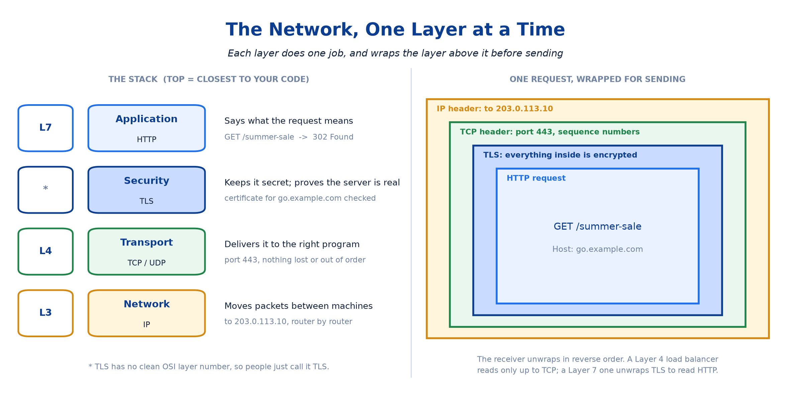
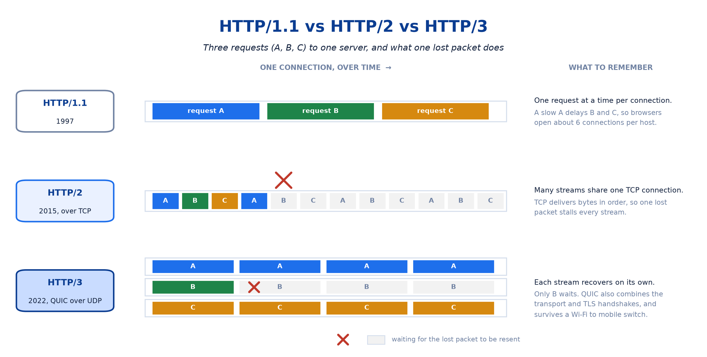

# Networking & Request Lifecycle

## Terms to know before you start

You do not need to memorize these. Come back to this table whenever a term feels unfamiliar.

| Term | What it means in plain words |
|---|---|
| **Round trip (RTT)** | The time for a message to travel from one machine to another and for the reply to come back. It is the basic unit of network cost, and it is set mostly by physical distance. |
| **Packet** | A small chunk of data, usually up to about 1,500 bytes, that travels across the network on its own. Every request and response is cut into packets. |
| **IP address** | The number that identifies a machine on a network, such as `203.0.113.10`. Packets are routed using it. |
| **Port** | A number that identifies one program on a machine. HTTPS servers usually listen on port 443, so `203.0.113.10:443` means "the web server on that machine". |
| **DNS** | The Domain Name System: the internet's phone book, which turns a name such as `go.example.com` into an IP address. |
| **TTL** (time to live) | How long a cached answer may be reused before it must be fetched again. DNS records carry a TTL, and so do cached HTTP responses. |
| **TCP and UDP** | The two common ways to send data between programs. TCP delivers everything, in order, or reports failure. UDP just sends packets and does not check whether they arrive. |
| **TLS** | The encryption layer that puts the "S" in HTTPS. It hides the data from anyone in between and proves that the server really is who it claims to be. |
| **Handshake** | The opening exchange of messages that sets up a connection before any real data can flow. Each handshake costs at least one round trip. |
| **TLS termination** | The point where encrypted traffic is decrypted. It is often the load balancer, rather than your application servers. |
| **Keep-alive** | Leaving a connection open after a request finishes, so the next request can reuse it and skip the handshakes. |
| **Connection pool** | A set of already-open connections that a program keeps ready and lends out to requests, instead of opening a new connection every time. |
| **Timeout** | The longest a caller is willing to wait for something before giving up. Every network call needs one. |
| **Edge** | Servers placed close to users, such as a CDN, that can answer or forward requests without the user's traffic crossing the whole internet. |

??? info "Java tools used on this page (open if they are new to you)"
    - **`java.net.http.HttpClient`** is the HTTP client built into Java 11 and later. One client object keeps its own pool of open connections, so an application should create one and reuse it.
    - **`Duration.ofMillis(200)`** is how modern Java expresses an amount of time, instead of a bare `long` that might be seconds or milliseconds.
    - **HikariCP** is the database connection pool used by default in Spring Boot. Its settings appear in `application.yml` under `spring.datasource.hikari`.
    - **`Instant`** is a point in time. `Duration.between(Instant.now(), deadline)` is how much time is left before a deadline.

---

## 1. The life of one request


[Basics 1](01_Interview_Framework_And_Capacity_Estimation.md) designed the URL shortener: a load balancer, a dozen stateless Link API servers, a cache, and a link store. This page follows **one click on one short link** through those boxes, and asks what happens on the wire at every step, how long each step takes, and what can go wrong. The numbers in the table match the numbers in the picture.

| Step | What happens |
|---|---|
| **1. Find the server's address (DNS)** | The browser only knows the name `go.example.com`, but the network needs a numeric IP address. It asks a DNS resolver, which answers with an address such as `203.0.113.10`. The browser and the operating system remember the answer, so later clicks usually skip this step. |
| **2. Open a secure connection (TCP + TLS)** | The browser opens a TCP connection to the load balancer, then runs a TLS handshake to agree on encryption and check the site's certificate. This is only setup: nothing about the short link has been sent yet. |
| **3. Send the request** | Over that connection, the browser sends `GET /summer-sale`, which asks: "where does this short code point?" |
| **4. Forward to a server** | The load balancer decrypts the request. This is called **TLS termination**: the browser's encrypted connection ends at the load balancer, so the servers behind it do not have to handle encryption (the [TLS section](#tls-https-and-where-encryption-ends) compares the options). It then picks one of the Link API servers and passes the request along over a connection it already has open to that server. |
| **5. Look up the code in the cache** | The Link API server asks the cache for the long URL stored under `summer-sale`. Popular links are almost always found here. |
| **6. Read the link store (only on a cache miss)** | If the cache does not have the code, the server reads it from the link store, the permanent database, and saves it in the cache for the next click. |
| **7. Send the redirect back** | The server answers `302 Found`, with the long URL in the `Location` header. The load balancer passes the answer back to the browser, which then opens the long URL. |

Steps 1, 2, 3, and 7 cross the public internet, where every round trip costs tens of milliseconds. Steps 4 to 6 stay inside the data center, where a round trip costs about half a millisecond. **For a simple request, the network usually costs far more than your code.** That single fact drives most of this page.

!!! tip "The request lifecycle in one sentence"
    Count the round trips on the path, find the ones that cross long distances, and then remove them (by reusing connections), shorten them (by answering closer to the user), or bound them (with timeouts).

---

## 2. The network, one layer at a time



Networking is built in **layers**, and each layer does exactly one job:

- **HTTP** says what the request means: "where does the short code `summer-sale` point?"
- **TLS** keeps it secret, and proves the server really is `go.example.com`.
- **TCP** (or UDP) delivers it to the right program on the server.
- **IP** moves the packets from one machine to the next until they arrive.

When the browser sends a request, each layer wraps what the layer above gave it, like a letter in an envelope inside a parcel. The receiving machine unwraps it in the reverse order. Because each layer only reads its own wrapper, HTTP never has to think about routing, and IP never has to think about status codes.

Engineers often call layers by number. The numbers come from an older seven-layer reference model called **OSI**, and two of them come up again and again in system design interviews:

| Name you will hear | What it means | Why it matters in design |
|---|---|---|
| **Layer 4** (transport) | TCP or UDP: getting data to the right program (the port) | **What it sees:** only the outer wrappers, such as `198.51.100.7:53712 → 203.0.113.10:443` (who is connecting, to which machine and port). **What it cannot see:** everything inside is still encrypted bytes, so `/summer-sale` is invisible. **So:** it hands each connection to a server without opening it. That is very fast and simple, but it cannot send `/api` and `/app` to different servers. |
| **Layer 7** (application) | HTTP: what the request asks for (method, URL, headers) | **What it sees:** after decrypting TLS, the whole request: `GET /summer-sale`, `Host: go.example.com`, and headers such as `Cookie` and `User-Agent`. **So:** it can route by URL, host, or header, for example sending `/api` to one group of servers and `/app` to another. The cost is more work per request, because it must decrypt and read every one. |

The difference between Layer 4 and Layer 7 load balancers is covered in **Basics 8 (Load Balancing & Proxying)**.

The sections below follow the request from its first round trip to the timeouts that protect it. Each one introduces one idea, applies it to the URL shortener, and then gives you a practice problem. The practice problems use the **note-taking app** from Basics 1, whose servers run in a single US East data center.

### Round trips and distance

**In one line:** every message takes time to travel, and the farther it goes, the longer it takes.

A **round trip** is a message going out plus its reply coming back. Signals in optical fiber travel at about 200,000 km per second, which gives a rule worth memorizing:

```text
Minimum round trip ≈ 1 ms for every 100 km between the two machines
```

Real cables do not run in straight lines, so real round trips are usually 1.5 to 2 times that minimum. No server tuning can beat physics. The only fix is to talk to something closer.

| Path | Distance | Typical round trip |
|---|---:|---:|
| Two servers in the same data center | Under 1 km | About 0.5 ms |
| Two data centers in the same region | About 50 km | 1–2 ms |
| New York to San Francisco | About 4,100 km | 60–70 ms |
| New York to London | About 5,600 km | 70–80 ms |
| Mumbai to US East | About 13,000 km | 190–230 ms |

Work inside a data center is much faster:

| Operation | Typical time |
|---|---:|
| Read a value from memory | About 0.0001 ms |
| Read 4 KB from an SSD | About 0.1 ms |
| Get a value from a cache server such as Redis | 0.5–1 ms |
| Run a simple indexed database query | 1–5 ms |

**What this tells us:** one round trip across a continent costs as much as about 50 cache lookups. When a request needs several trips between the user and the data center, those trips dominate the wait, so removing them is usually the cheapest speed-up.

!!! question "Practice"
    1. A user in Frankfurt uses the note-taking app in US East, about 6,500 km away. What is the minimum round trip, and what is a realistic one?
    2. Opening a note takes four round trips plus 10 ms of server work. Roughly how long does the user wait?

??? success "Answer"
    1. Minimum: 6,500 / 100 = **65 ms**. Realistic: about **100–130 ms**.
    2. With 100 ms round trips: 4 × 100 + 10 = **about 410 ms**. The server work is under 3% of that, so faster code barely helps. Fewer round trips, or a server closer to Europe, would.

### DNS, turning a name into an address

**In one line:** DNS turns a name like `go.example.com` into an IP address, and caches the answer so the full lookup is rare.


To find the IP address of `go.example.com`, the browser checks the closest answer first, and only looks further when it has to:

- **Browser cache:** has this browser looked up the name recently?
- **Operating system cache:** has any program on this machine looked it up recently?
- **Recursive resolver** (step 1 in the picture): a DNS server, usually run by the internet provider or a public service such as `8.8.8.8`, that does the full lookup for you and caches answers for all its users. It is called *recursive* because it keeps asking until it has the final answer.

No single server knows every name on the internet. Instead, DNS is a hierarchy, and each level only knows who is responsible for the level below it. When the resolver has nothing cached, it walks down that hierarchy:

1. **Root servers** (steps 2–3). The resolver asks "where is `go.example.com`?" The root does not know, but replies "ask the `.com` servers". There are 13 root server addresses, each copied to many locations around the world.
2. **`.com` servers** (steps 4–5), run by the `.com` registry. They do not know the address either, but reply "ask `ns1.example.com`" by returning `example.com`'s NS records.
3. **The authoritative server for `example.com`** (steps 6–7), usually run by your DNS provider. It is the only server that holds the actual record, so it gives the final answer: `203.0.113.10`, valid for 300 seconds (its TTL).

The resolver then hands the answer back to the browser (step 8). Each question is a small UDP message, but a full walk can still take 50–150 ms. So every answer, including the referrals from the root and `.com` servers, is cached for as long as its TTL allows. In practice the resolver almost always remembers where the `.com` servers are, and often where `example.com`'s servers are, so most lookups are answered from a cache in a millisecond or two.

**Record types.** The authoritative server stores **records**, and each type answers a different question. The answer in step 3 is an `A` record. These are the ones worth knowing:

| Type | What it answers | Example | Why it matters in design |
|---|---|---|---|
| **A** | Which IPv4 address does this name have? | `go.example.com` → `203.0.113.10` | The basic answer. With several A records, clients spread across the addresses, the simplest form of DNS load balancing (Basics 8). |
| **AAAA** | Which IPv6 address does this name have? | `go.example.com` → `2001:db8::10` | The same as A, for IPv6. Most sites publish both. |
| **CNAME** | Which *other name* should I look up instead? | `go.example.com` → `go-lb.example.net` | The answer is just another name, so the user's resolver must look that up too: one extra lookup. Lets a provider, such as a cloud load balancer, change its IP addresses without you. Not allowed on the bare domain (`example.com`), because a name with a CNAME can hold no other records, and the bare domain needs NS and MX records. |
| **ALIAS** (or ANAME) | Which IP address does this name have? Your DNS provider follows the alias for you. | `example.com` → `203.0.113.10` (the provider looked up `go-lb.example.net`) | Unlike a CNAME, the user gets an ordinary IP address back, with no extra lookup, so it works on the bare domain. Not a standard record type: a DNS provider feature, also called "CNAME flattening". |
| **NS** | Which servers should I ask about this domain? | `example.com` → `ns1.example.com` | The `.com` servers do not know your IP address; they only store these NS records, which point to the servers that do (step 2 of the picture). Moving to a new DNS provider means changing them, and resolvers keep the old ones for a day or two. |
| **MX** | Which servers receive email for this domain? | `example.com` → `mail.example.com` | Not on the request path, but a classic mistake to break while migrating DNS. |
| **TXT** | Any text the domain owner wants to publish | `example.com` → `"site-verification=4f9a2c"` | Used to prove you own a domain, for example to get a TLS certificate, and for email security settings. |

**Choosing a TTL** is a trade-off between flexibility and load. A short TTL (30–60 seconds) means a change reaches everyone within about a minute, which suits records you may need to change quickly, such as during a failover, but it sends more lookups to your DNS servers. A long TTL (hours) cuts that load and suits records that rarely change, but a change can take hours to reach every user.

**What goes wrong.** DNS sits at the very start of every request, so its failures look like the whole site is down:

| Problem | What users see | What teams do |
|---|---|---|
| The old IP is still cached after a change | Some users reach the old servers for up to one TTL | Lower the TTL a day *before* a planned move, then change the record. |
| The DNS provider has an outage | New visitors cannot find the site; visitors with a cached answer keep working | Use two independent DNS providers for critical domains. |
| A client caches longer than the TTL | Traffic keeps going to a removed server | Know your clients' caching rules, and keep old servers running for a while. |

**What this tells us:** for the URL shortener, DNS costs nothing on most clicks, because the answer is cached. It matters on a user's first visit, and it decides how fast traffic can be moved during a migration or failover.

!!! question "Practice: the note-taking app"
    The note-taking app moves to a new load balancer, with a new IP address, next Tuesday. Its DNS record has a TTL of 24 hours. What should the team do, and when?

??? success "Answer"
    At least 24 hours before the move, lower the TTL to about 60 seconds, so every cached copy of the old 24-hour record has expired by Tuesday. On Tuesday, change the record; almost all users switch within a minute. Keep the old load balancer running for a day or two for clients that ignore TTLs, then raise the TTL again.

### TCP vs UDP

**In one line:** TCP delivers everything, in order, but needs a handshake and can stall; UDP sends immediately, but packets may be lost.

With an IP address in hand, the browser still needs a way to send data to one program on that machine. That is the transport layer's job, and there are two choices:

| | TCP | UDP |
|---|---|---|
| Before sending data | A handshake (SYN, SYN-ACK, ACK): one round trip | Nothing; the first packet already carries data |
| Delivery | Every byte arrives, in order, or you get an error | Packets may be lost, duplicated, or arrive out of order |
| A packet is lost | Everything after it waits until it is resent | Nothing waits; the application decides what to do |
| Used for | Web traffic (HTTP/1.1 and HTTP/2), databases, most calls between services | DNS lookups, video calls, games, and QUIC (which carries HTTP/3) |

TCP's guarantee has a catch. Because it delivers bytes strictly in order, **one lost packet makes everything behind it wait**, even data that has already arrived. This is called **head-of-line blocking**, and it comes back in the [HTTP versions section](#http11-vs-http2-vs-http3). A new TCP connection also starts sending slowly and speeds up over a few round trips (called **slow start**), so large responses are slower on a fresh connection.

UDP suits data that is useless when late. In a video call, a frame that arrives 300 ms late is better skipped than waited for.

!!! question "Practice"
    Which transport would you choose for each, and why?
    1. Syncing note edits between the app and the server.
    2. Showing other users' cursors while they edit the same note, 20 updates per second.

??? success "Answer"
    1. **TCP**, usually through HTTP. Every edit must arrive, in order, or the note is corrupted.
    2. **UDP could fit**: a lost cursor position is replaced 50 ms later, so waiting for a resend only shows a stale cursor. In practice, many teams still send cursors over an existing WebSocket (which runs on TCP), because it is simpler and good enough at this rate. Giving both options, with the reason, is a strong answer. WebSockets are covered in **Basics 7 (API Design & Service Communication)**.

### TLS, HTTPS, and where encryption ends

**In one line:** TLS encrypts the connection and proves the server is genuine; the design decision is where the traffic gets decrypted.

TLS adds three guarantees on top of TCP:

- **Private:** nobody on the way, such as a café's Wi-Fi network, can read the data.
- **Untampered:** any change made in transit is detected.
- **Authentic:** the server proves it owns `go.example.com` with a **certificate** signed by an authority the browser trusts.

The current version, TLS 1.3, needs **one round trip** to set up; the older TLS 1.2 needs two. TLS 1.3 can even let a returning visitor send data in its very first packet (called *0-RTT*), but an attacker can replay that data, so it is only safe for harmless requests such as `GET`.

**Where should TLS end?** The point where traffic is decrypted is called **TLS termination**, and there are three common choices:

| Option | How it works | Trade-off |
|---|---|---|
| **Terminate at the load balancer** | The load balancer decrypts; servers receive plain HTTP inside the private network. | The simplest and most common. Certificates live in one place, and the load balancer can route by URL. Traffic inside the network is not encrypted. |
| **Terminate and re-encrypt** | The load balancer decrypts, routes, then opens a new TLS connection to the server. | Encrypted all the way, at the cost of more certificates and a little more CPU. Often required in regulated industries. When services also check each other's certificates, it is called **mutual TLS (mTLS)**. |
| **Pass through** | The load balancer forwards the encrypted bytes untouched; each server decrypts. | The load balancer cannot read requests, so it can only route by IP address and port (Layer 4). |

!!! warning "The most common TLS outage"
    It is not a clever attack. It is an **expired certificate**: the moment it expires, every HTTPS request fails. Certificates often last only 90 days, so automate renewal, and alert on expiry dates weeks in advance.

**What this tells us:** for the URL shortener, terminating TLS at the load balancer is the right default. The servers stay simple, certificates live in one place, and the load balancer can still route by path.

!!! question "Practice: the note-taking app"
    The note-taking app wants its load balancer to send `/api/attachments/*` requests to a separate fleet built for large files. Which TLS option rules this out, and why?

??? success "Answer"
    **Pass-through.** Routing by path means reading the HTTP request, but in pass-through mode the load balancer only sees encrypted bytes. The other two options both work.

### The price of a new connection

**In one line:** a brand-new HTTPS connection costs three round trips before the answer arrives; a reused one costs just one.


Add up the handshakes from the [TCP](#tcp-vs-udp) and [TLS](#tls-https-and-where-encryption-ends) sections:

```text
New connection (TLS 1.3)  = DNS lookup (if not cached) + 1 round trip (TCP) + 1 (TLS) + 1 (HTTP)
                          = 3 round trips, plus any DNS lookup
Reused connection         = 1 round trip
```

The URL shortener's users are about 30 ms from the data center. The server's own work takes about 3 ms either way:

| Connection type | Round trips before the answer | At 30 ms each |
|---|---:|---:|
| New, TLS 1.2 | 4 | About 120 ms |
| New, TLS 1.3 | 3 | About 90 ms |
| New, HTTP/3 (QUIC combines TCP and TLS) | 2 | About 60 ms |
| Reused (already open) | 1 | About 30 ms |

**What this tells us:** the biggest latency win is not faster code; it is **not paying for handshakes again**. That is why [keep-alive and connection pools](#keep-alive-and-connection-pools) matter so much, and why ending TLS at an edge server near the user (section 4) works so well.

!!! question "Practice"
    A user in Sydney is about 160 ms (round trip) from the note-taking app. How long do the round trips take on a new TLS 1.3 connection, compared with a reused one?

??? success "Answer"
    New: 3 × 160 = **480 ms** before the answer arrives. Reused: **160 ms**. Nearly half a second of handshakes on every new connection is why global products terminate TLS at edge locations near their users.

### HTTP, the request itself

**In one line:** the method and status code you choose change how browsers, caches, and retries treat a request.

**Methods.** Two properties matter:

- **Safe:** the request changes nothing on the server.
- **Idempotent:** doing it twice has the same effect as doing it once, so it can be retried safely after a timeout.

| Method | Typical use | Safe? | Idempotent? |
|---|---|---|---|
| `GET` | Read something, such as a redirect lookup | Yes | Yes |
| `PUT` | Replace a resource with a new version | No | Yes |
| `DELETE` | Remove a resource | No | Yes |
| `POST` | Create something, such as a new short link | No | **No**: repeating it may create two links |
| `PATCH` | Change part of a resource | No | Not guaranteed |

**Status codes.** The first digit says what happened: 2xx success, 3xx "look elsewhere", 4xx the client made a mistake, 5xx the server failed. These are the ones that shape a design:

| Code | Meaning | When it matters |
|---|---|---|
| `301 Moved Permanently` | The resource lives at the new URL forever | Browsers cache it, so repeat clicks never reach your servers. |
| `302 Found` | The resource is at another URL for now | Not cached by default, so every click reaches your servers. |
| `404 Not Found` | No such resource | An unknown short code. |
| `429 Too Many Requests` | The client is sending too fast | Rate limiting, usually with `Retry-After` saying when to try again. |
| `502 Bad Gateway` | A proxy got no valid response from the server behind it | Often a crashed server or a refused connection. |
| `503 Service Unavailable` | The server is overloaded or refusing work on purpose | Shedding load, usually with `Retry-After`. |
| `504 Gateway Timeout` | A proxy gave up waiting for the server behind it | The server was too slow. [Timeout budgets](#timeout-budgets) shows how to avoid it. |

!!! tip "A classic interview question: 301 or 302 for a URL shortener?"
    A `301` is cached by the browser, which removes repeat traffic, but you lose every repeat click from your analytics, and you can never change where that link points for those users. A `302` sends every click to your servers: more load, but complete analytics and editable links. Basics 1 records every click, so the URL shortener uses **302**. Name the trade-off and the requirement that decides it; that is the answer.

**Headers worth knowing:**

- `Host`: which site the request is for, so one server can host many.
- `Location`: where a redirect points.
- `Cache-Control`: who may cache a response, and for how long.
- `Retry-After`: when a client should try again.

The full rules of API design, such as resource naming, pagination, and versioning, are in **Basics 6 (API Correctness, Security & Resource Design)**.

!!! question "Practice: the note-taking app"
    1. A phone sends `POST /notes` to save a new note, and the connection drops before the response arrives. Is it safe to resend automatically?
    2. Which status code should the server return while it is overloaded and rejecting some requests on purpose?

??? success "Answer"
    1. **Not as it stands.** `POST` is not idempotent, and the server may have saved the note before the connection dropped, so a blind resend could create a duplicate. The fix is for the client to send a unique **idempotency key**, so the server recognizes a resend and returns the original result. See **Advanced 7 (Idempotency & Retries)**.
    2. **`503 Service Unavailable`**, with a `Retry-After` header so well-behaved clients back off instead of retrying immediately.

### HTTP/1.1 vs HTTP/2 vs HTTP/3

**In one line:** all three versions mean the same thing; they differ in how requests share a connection, and in what one lost packet does.



| | HTTP/1.1 (1997) | HTTP/2 (2015) | HTTP/3 (2022) |
|---|---|---|---|
| Runs on | TCP | TCP | QUIC, over UDP |
| Requests per connection | One at a time | Many at once, as interleaved **streams** | Many at once, as independent streams |
| One lost packet | Delays the request in flight | Stalls **every** stream, because TCP delivers in order | Stalls only its own stream |
| New connection cost | 2 round trips (TCP + TLS) | 2 round trips (TCP + TLS) | 1 round trip (combined) |
| Typical use today | Simple clients and older systems | Most browser traffic, and gRPC between services | Browsers and mobile apps on unreliable networks |

Two points are worth saying in an interview:

- **HTTP/2 moved the bottleneck rather than removing it.** It lets many requests share one connection, but they all share one TCP stream, so one lost packet stalls them all. HTTP/3 fixes this by building its own independent streams on top of UDP.
- **HTTP/3 survives network changes.** QUIC identifies a connection by an ID, not by IP address, so a phone switching from Wi-Fi to mobile data keeps its connection instead of starting over.

**What this tells us:** each click on the URL shortener sends one small request, so reusing the connection matters more than the HTTP version. HTTP/3 helps most for users on patchy mobile networks, and it is usually switched on at the edge or the load balancer, with no change to application code.

!!! question "Practice"
    The note-taking app's users often edit notes on trains, where packets are often lost. The app sends many small requests in parallel over HTTP/2. Why might it feel slow, and what would help?

??? success "Answer"
    All the parallel requests share one TCP connection, so every lost packet stalls all of them until it is resent. HTTP/3 keeps the streams independent, so a lost packet only delays its own request, and the connection survives switching networks. Enabling HTTP/3 at the edge would help.

### Keep-alive and connection pools

**In one line:** reuse open connections instead of paying for handshakes again, and keep pools small, with a short wait limit.

- **Keep-alive** leaves a connection open after a response, so the next request can reuse it.
- A **connection pool** keeps a few open connections to each dependency, and lends one to each request.

The URL shortener uses both. The load balancer keeps connections open to every Link API server, and each server keeps pools of connections to the cache and the link store. Without them, every redirect would pay for new handshakes before doing any work.

In Java, the built-in `HttpClient` pools connections for you, as long as you create one client and reuse it:

```java
// Create ONE client at startup and share it; it keeps a pool of open connections inside.
HttpClient client = HttpClient.newBuilder()
        .version(HttpClient.Version.HTTP_2)
        .connectTimeout(Duration.ofMillis(200))      // give up on unreachable hosts quickly
        .build();

HttpRequest request = HttpRequest.newBuilder(URI.create("https://profile.internal/users/42"))
        .timeout(Duration.ofMillis(300))              // the whole response must arrive within 300 ms
        .GET()
        .build();

HttpResponse<String> response = client.send(request, HttpResponse.BodyHandlers.ofString());
```

Database pools work the same way. In Spring Boot, the default pool is HikariCP:

```yaml
spring:
  datasource:
    hikari:
      maximum-pool-size: 10        # at most 10 open connections from this server
      connection-timeout: 50       # wait at most 50 ms for a free connection, then fail
      max-lifetime: 1500000        # replace connections after 25 minutes, before anything in between drops them
```

**How big should a pool be?** Use Little's Law from Basics 1: connections in use = requests per second × seconds each request holds a connection.

```text
Each Link API server handles 8,000 / 12 ≈ 670 redirects per second at peak.
Each cache lookup holds a connection for about 1 ms.
Connections in use ≈ 670 × 0.001 ≈ 0.7, so a pool of a few connections is plenty.
```

Now suppose the cache slows to 200 ms per lookup. The same formula gives 670 × 0.2 ≈ **134** connections, far more than the pool holds. Requests queue for a connection, the queue adds delay, and the slowdown spreads. That is why the pool's `connection-timeout` must be short: **failing fast beats queuing forever**.

!!! warning "Two classic pooling bugs"
    - **A new connection for every request.** On top of the handshake cost, each closed TCP connection lingers for about 60 seconds (in a state called `TIME_WAIT`). Opening 500 new connections per second to one destination keeps about 30,000 lingering, which can use up the available local ports, so new connections start failing.
    - **Pooled connections that idle too long.** Load balancers, firewalls, and NAT gateways silently drop idle connections, often after 60 seconds. A pool that keeps idle connections longer than that lends out dead ones, and requests fail at random. Set the pool's idle and lifetime limits below every device in between.

**What this tells us:** pools cut every internal call's handshakes from three round trips to zero. But a pool also becomes a queue when a dependency slows down, so size it with Little's Law and give it a short wait limit.

!!! question "Practice: the note-taking app"
    Each note-taking app server handles about 350 requests per second at peak, and each request holds a database connection for 8 ms. How many connections does one server need? What happens if the database slows to 100 ms per query?

??? success "Answer"
    Normally: 350 × 0.008 ≈ **3 connections**, so a pool of about 10 leaves plenty of headroom.
    Slow database: 350 × 0.1 = **35 connections**. The pool of 10 runs out, and requests wait. With a short `connection-timeout`, extra requests fail fast and the server stays healthy; with a long one, they pile up and the whole server slows down. Growing the pool is usually the wrong fix: 19 servers × 35 connections would hit the already-slow database even harder.

### Timeout budgets

**In one line:** give every network call a timeout, and make each one shorter than the time its caller is willing to wait.


A network call can hang forever: a server can crash mid-response, or a packet can vanish. Without a timeout, the waiting thread stays stuck, holding its memory and its pooled connection. There are four kinds of timeout:

| Timeout | What it limits | Typical value inside a data center |
|---|---|---|
| **Connect timeout** | Setting up the TCP (and TLS) connection | 100–500 ms; a healthy host answers in about a millisecond |
| **Read (response) timeout** | Waiting for the response after sending the request | The dependency's normal p99 latency, plus a margin |
| **Pool wait timeout** | Waiting for a free connection from the pool | Tens of milliseconds; waiting longer only builds a queue |
| **Overall deadline** | The whole request, across all its calls | Set from the latency target your callers depend on |

**The rule: each inner timeout must end before the timeout of whatever is waiting for it.** In the top half of the picture, the load balancer waits 500 ms and the Link API gives itself 300 ms, so the API always answers, or fails cleanly, before the load balancer gives up.

The bottom half shows what happens when the rule is broken. The database call may wait 30 seconds, but the load balancer gives up after 500 ms and sends the user a `504`. The user already has an error, yet the API thread and its database connection stay busy for another 29.5 seconds, doing work nobody will receive. Under load, these abandoned calls fill every pool, and the service falls over.

The simplest way to follow the rule is to **pass the deadline down**, so every call uses at most the time that is left:

```java
LinkTarget resolve(String code, Instant deadline) {
    Optional<String> cached = cache.get(code, Duration.ofMillis(20));    // a slow cache must not eat the budget
    if (cached.isPresent()) {
        return LinkTarget.of(cached.get());
    }
    Duration remaining = Duration.between(Instant.now(), deadline);
    if (remaining.toMillis() < 10) {
        throw new DeadlineExceededException(code);                         // too little time left to try: fail fast
    }
    Duration dbTimeout = remaining.compareTo(Duration.ofMillis(100)) < 0 ? remaining : Duration.ofMillis(100);
    return linkStore.find(code, dbTimeout);                               // never waits past the caller's deadline
}
```

gRPC does this automatically: the first caller's deadline travels with the request to every service it calls.

!!! warning "Retries multiply load"
    A timeout is often followed by a retry. If three layers of services each retry three times, one user request becomes 3 × 3 × 3 = 27 requests at the bottom layer, exactly when it is already struggling. Retry at one layer only, wait longer between attempts, and only retry idempotent requests. See **Advanced 7 (Idempotency & Retries)**.

**What this tells us:** the URL shortener's budget is 500 ms at the load balancer, a 300 ms deadline in the API, about 20 ms for the cache, and about 100 ms for the link store. A slow cache costs at most 20 ms before the API falls back to the store, and nothing ever waits longer than its caller.

!!! question "Practice: the note-taking app"
    Saving a note calls the database (normally 10 ms, p99 40 ms), then a search indexer (normally 30 ms, but it sometimes hangs). The load balancer times out at 1 second. Propose the timeouts, and spot the bigger design problem.

??? success "Answer"
    A reasonable budget: a 700 ms deadline in the API, about 150 ms for the database (several times its p99), and about 200 ms for the indexer, all inside the load balancer's 1 second.

    The bigger problem: a dependency that sometimes hangs sits in the middle of saving, and the user does not need the search index updated before seeing "saved". Save the note, reply to the user, and update the index in the background through a queue. Removing a call from the request path beats tuning its timeout. Queues are covered in **Basics 13 (Asynchronous Processing Basics)**.

---

## 3. Latency sources and network failure modes

When a request is slow, the cause is almost always one of a few things. Knowing the list helps you reason about any design, and it is what interviewers probe when they ask "why would this be slow?".

| Latency source | What causes it | What reduces it |
|---|---|---|
| **Distance** | Round trips across long physical distances | Fewer round trips, and answering closer to users at the edge |
| **Handshakes** | New TCP and TLS connections | Keep-alive, connection pools, TLS 1.3, and HTTP/3 |
| **Queuing** | Requests waiting for a thread, a pooled connection, or a busy server | Headroom, right-sized pools, and shedding load before collapse |
| **Serial calls** | Calling dependencies one after another when they could run in parallel | Making independent calls in parallel, or removing calls from the critical path |
| **Large responses** | Many packets, plus TCP slow start on new connections | Compression, smaller payloads, and pagination |
| **Packet loss** | A lost packet waiting to be resent | HTTP/3 on lossy networks, plus sensible timeouts |

Failures need the same attention, because each one looks different to the caller, and each one calls for a different response:

| Failure | What the caller sees | Safe response |
|---|---|---|
| **DNS failure** | The name cannot be resolved | Fail fast with a clear error; rely on cached answers and redundant DNS providers. |
| **Connection refused** | An immediate error, because nothing is listening on that port | Try another instance; this failure is fast and the request never started. |
| **Connect timeout** | No answer to the handshake, often because the host is down or a firewall drops packets | Try another instance after a short connect timeout. |
| **Read timeout** | The request was sent, but no response arrived in time | **The outcome is unknown**, because the server may have done the work. Retry only if the request is idempotent. |
| **Connection reset mid-response** | The connection dropped partway through | Also an unknown outcome; treat it like a read timeout. |
| **TLS failure** | Certificate expired, or does not match the name | Not retryable; alert immediately, as everyone is affected. |
| **Pool exhausted** | No free connection within the acquisition timeout | Fail fast; it means a dependency is slow, so investigate that rather than growing the pool. |
| **One lost packet** | A sudden delay, often around 200 ms, or a full second if the very first handshake packet was lost | Nothing to fix per request; it shows up in the p99, which is why percentiles matter. |

The most important row is the **read timeout**. "I do not know whether it worked" is the hardest failure in distributed systems, and it is the reason idempotency exists.

---

## 4. Putting it together: one redirect, end to end


Here is one click on `go.example.com/summer-sale`, from a user about 30 ms (one round trip) from the data center.

**The cold path: first click from a new user.**

1. **DNS (about 30 ms).** The browser and OS have no cached answer, so the resolver asks the authoritative servers.
2. **TCP (30 ms) and TLS 1.3 (30 ms).** Two round trips to set up the encrypted connection with the load balancer.
3. **HTTP (30 ms).** The browser sends `GET /summer-sale`, and the round trip completes when the response returns.
4. **Server (about 3 ms).** The load balancer forwards over a pooled connection, the Link API finds the code in the cache, and it returns `302 Found`.

Total: **about 123 ms**, of which the server's work is 3 ms.

**The warm path: a second click shortly after.** DNS is cached and the connection is still open, so only the HTTP round trip and the server's work remain: **about 33 ms**.

**The edge path.** If TLS ends at an edge server about 5 ms from the user, all the handshakes become short, and the edge forwards to the data center over a connection that is already open. The same cold click costs **about 53 ms**.

Turning that into design decisions:

| Decision | Why | Section |
|---|---|---|
| Keep connections alive between browsers and the load balancer | A returning user skips 2 of 3 round trips. | [New connection cost](#the-price-of-a-new-connection) |
| Terminate TLS at the edge for distant users | Handshakes cost 5 ms instead of 30 ms (or 160 ms from Sydney). | [TLS](#tls-https-and-where-encryption-ends) and [New connection cost](#the-price-of-a-new-connection) |
| Pool connections from the API to the cache and the store | Internal calls pay no handshakes. | [Keep-alive and connection pools](#keep-alive-and-connection-pools) |
| Return `302`, not `301` | Every click reaches the servers, so analytics stay complete. | [HTTP, the request itself](#http-the-request-itself) |
| Give every call a timeout that fits inside its caller's | A slow cache or database cannot hold requests hostage. | [Timeout budgets](#timeout-budgets) |
| Enable HTTP/3 at the edge | Mobile users on lossy networks stop stalling on lost packets. | [HTTP versions](#http11-vs-http2-vs-http3) |

**The failure path.** If the cache stops answering, each lookup waits at most 20 ms, then the API reads the link store, and the user sees a slightly slower redirect rather than an error. If the link store also fails, the API returns a fast `503` well before the load balancer's timeout. In neither case does anything wait longer than its caller.

!!! tip "Where the numbers point"
    Faster server code could save at most 3 ms. Reusing connections saves 60 ms, and ending TLS at the edge saves 70 ms on a cold click. Always find the biggest slice of the latency before optimizing anything.

---

## 5. Common beginner mistakes

- **Ignoring the round trips outside your servers.** For simple requests, the internet usually costs more than the code, so measure and design for the whole path.
- **Opening a new connection for every request.** It pays handshakes every time and can exhaust local ports. Create one HTTP client or pool and reuse it.
- **Calling a network service without a timeout.** The default in many libraries is to wait forever. One hung dependency can then hold every thread.
- **Inner timeouts longer than outer ones.** The caller gives up, but the work continues, filling pools with abandoned calls.
- **Retrying non-idempotent requests blindly.** A retried `POST` after a read timeout can charge a card twice or create duplicate records.
- **Growing the connection pool when a dependency slows down.** More connections send even more load to a struggling dependency. Find out why it is slow instead.
- **Forgetting that DNS changes take a TTL to spread.** Lower the TTL before a migration, not during it.
- **Letting a certificate expire.** Automate renewal and alert on expiry dates well in advance.

---

## 6. Test yourself

These three problems increase in difficulty. Try each one on paper before opening the answer.

!!! question "Problem 1 (warm-up): handshake arithmetic"
    An API serves users in Singapore from a data center about 70 ms away (round trip). How long do the round trips take for a cold request over TLS 1.2, a cold request over TLS 1.3, and a warm request?

??? success "Answer"
    TLS 1.2 cold: 4 × 70 = **280 ms**. TLS 1.3 cold: 3 × 70 = **210 ms**. Warm: **70 ms**. Upgrading TLS saves one round trip, and reusing the connection saves two or three.

!!! question "Problem 2 (diagnosis): the slow checkout"
    A checkout service calls the payment provider over HTTPS for every order. The provider's own dashboard shows a p99 of 40 ms, but the checkout service measures 160 ms per call, and it is about 40 ms round trip from the provider. What is the most likely cause, and how do you confirm and fix it?

??? success "Answer"
    The extra 120 ms is exactly three round trips at 40 ms: a TCP handshake, a TLS handshake, and possibly a DNS lookup. The service is most likely **creating a new HTTP client, or a new connection, for every call**, so it pays the handshakes on every request.

    Confirm it by counting new TCP connections to the provider (for example, with connection metrics or `ss`/`netstat`); they will roughly match the number of calls. Fix it by creating one shared, pooled HTTP client at startup, with connect and response timeouts. Calls should then drop to about one round trip plus the provider's processing time.

!!! question "Problem 3 (design): a global news feed"
    A news app serves 40 million users worldwide from one data center in US East. Users in India and Australia complain that the feed takes about 2 seconds to load. Loading the feed makes 6 API calls one after another over a fresh connection, and each call takes about 20 ms of server time. Explain where the time goes, and propose changes in order of impact.

??? success "Answer"
    From India, a round trip to US East is about 200 ms.

    ```text
    Handshakes on a fresh connection: DNS + TCP + TLS ≈ 3 × 200 ms   = about 600 ms
    Six calls, one after another:     6 × (200 ms + 20 ms)          = about 1,320 ms
    Total                                                            ≈ 1.9 seconds
    ```

    Server time is only 120 ms of that. The rest is round trips. In order of impact:

    1. **Stop making calls one after another.** Combine the six calls into one feed endpoint, or make independent calls in parallel. This alone saves about 1,000 ms.
    2. **Terminate TLS at edge locations near users**, with a warm connection from the edge back to US East. Handshakes drop from about 600 ms to about 30 ms.
    3. **Keep connections alive** so that refreshing the feed pays one round trip, not four.
    4. **Cache feed content at the edge** where it is the same for many users, so some requests never cross the ocean at all. This is covered in **Basics 9 (Caching Core)**.
    5. Only if that is still not enough, **serve these regions from a second data center**, which is a much bigger change, covered in **Advanced 15 (Single Region vs Multi-Region Deployment)**.

    The ordering is the lesson: the cheapest changes remove round trips, and the most expensive change, a second region, comes last.

---

## 7. How this shows up in interviews

Networking rarely gets its own interview question, but it appears inside almost every design. The classic warm-up is: **"What happens when you type a URL into the browser and press Enter?"** A strong answer follows the request lifecycle in order and puts a cost on each step:

```text
1. DNS        browser, OS, and resolver caches; otherwise the resolver walks root -> TLD -> authoritative
2. TCP        three-way handshake: 1 round trip
3. TLS        certificate check and key exchange: 1 round trip with TLS 1.3
4. HTTP       GET request; the load balancer terminates TLS and routes to a server over a pooled connection
5. Server     application code, cache, and database: usually a few milliseconds
6. Response   status code and headers; the browser follows redirects and fetches what the page needs
7. Reuse      keep-alive leaves the connection open, so the next request costs 1 round trip
```

Then mention what you would watch in production: DNS TTLs during migrations, certificate expiry, timeout budgets, and connection reuse.

Other questions that come up, with the short version of each answer:

| Question | Short answer |
|---|---|
| Why is HTTP/3 built on UDP? | To avoid TCP's head-of-line blocking and to combine the transport and TLS handshakes. QUIC rebuilds reliable, ordered delivery per stream on top of UDP. |
| Where would you terminate TLS? | At the load balancer by default; re-encrypt to the servers if compliance requires it; at the edge to cut handshake latency for distant users. |
| A dependency has a p99 of 50 ms. What timeout would you set? | A few times the p99, such as 150–200 ms, and always less than the time the caller has left. Then decide what to do when it fires. |
| Why not make the connection pool very large? | A big pool only lets more requests pile onto a slow dependency. Size it with Little's Law and fail fast when it is exhausted. |
| What does a read timeout tell you about the request? | Nothing certain: it may or may not have been processed. Only retry idempotent requests, or use idempotency keys. |

---

## 8. Checklist and what comes next

```text
[ ] TRACE the request: DNS -> TCP -> TLS -> HTTP -> load balancer -> service -> data, and back
[ ] COUNT the round trips, and multiply by the distance (about 1 ms per 100 km)
[ ] REUSE connections: keep-alive at the edge, pooled connections to every dependency
[ ] DECIDE where TLS ends, and automate certificate renewal
[ ] CHOOSE methods and status codes deliberately (idempotency, 301 vs 302, 429, 503)
[ ] SET a timeout on every call, each one shorter than its caller's, and pass deadlines down
[ ] SIZE pools with Little's Law, and fail fast when they run out
[ ] TREAT a read timeout as an unknown outcome, not a failure
```

This page skipped several topics on purpose. Here is where each one is covered once you have the right foundations:

| Topic you may have heard about | Where it is covered |
|---|---|
| Layer 4 vs Layer 7 load balancing, reverse proxies, and Anycast | Basics 8: Load Balancing & Proxying |
| CDNs, edge caching, and `Cache-Control` | Basics 9: Caching Core |
| REST vs gRPC, WebSockets, and Server-Sent Events | Basics 7: API Design & Service Communication |
| Resource design, authentication, and encryption at rest | Basics 6: API Correctness, Security & Resource Design |
| Health checks, connection draining, and graceful shutdown | Basics 14: Availability & Deployment Fundamentals |
| Thread pools, concurrency limits, and Little's Law in depth | Basics 16: Threads, Thread Pools, Parallelization |
| How the system is split into services that call each other | Basics 5: Architecture Styles & Service Decomposition |
| Retries, backoff, and idempotency keys | Advanced 7: Idempotency & Retries |
| Circuit breakers and bulkheads | Advanced 11: Fault Tolerance, Resilience & Failure Handling |
| Tail latency and load shedding | Advanced 10: Backpressure, Admission Control & Overload Protection |
| Serving users from several regions | Advanced 15: Single Region vs Multi-Region Deployment |
