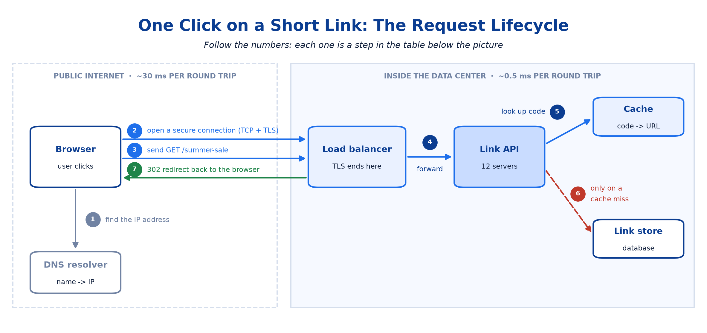
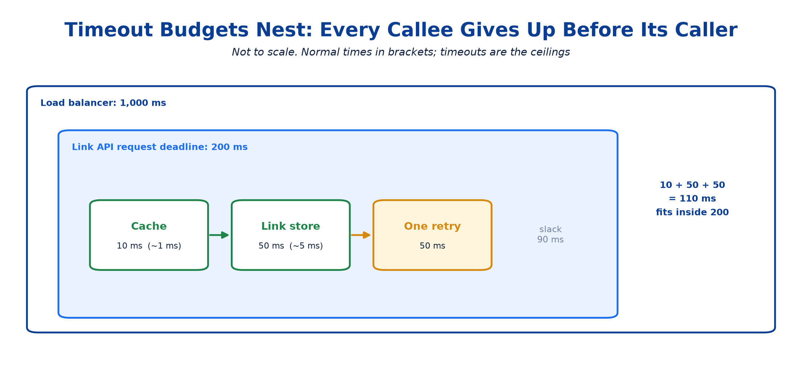

# Networking & Request Lifecycle

## Terms to know before you start

You do not need to memorize these. Come back to this table whenever a term feels unfamiliar.

| Term | What it means in plain words |
|---|---|
| **Round trip (RTT)** | The time for a message to travel from one machine to another and for the reply to come back. It is the basic unit of network cost, and it is set mostly by physical distance. |
| **Packet** | A small chunk of data, usually up to about 1,500 bytes, that travels across the network on its own. Every request and response is cut into packets. |
| **IP address** | The number that identifies a machine on a network, such as `203.0.113.10`. Packets are routed using it. |
| **Port** | A number that identifies one program on a machine. HTTPS servers usually listen on port 443, so `203.0.113.10:443` means "the web server on that machine". |
| **DNS** | The Domain Name System: the internet's phone book, which turns a name such as `go.example.com` into an IP address. |
| **TTL** (time to live) | How long a cached answer may be reused before it must be fetched again. DNS records carry a TTL, and so do cached HTTP responses. |
| **TCP and UDP** | The two common ways to send data between programs. TCP delivers everything, in order, or reports failure. UDP just sends packets and does not check whether they arrive. |
| **TLS** | The encryption layer that puts the "S" in HTTPS. It hides the data from anyone in between and proves that the server really is who it claims to be. |
| **Handshake** | The opening exchange of messages that sets up a connection before any real data can flow. Each handshake costs at least one round trip. |
| **TLS termination** | The point where encrypted traffic is decrypted. It is often the load balancer, rather than your application servers. |
| **Keep-alive** | Leaving a connection open after a request finishes, so the next request can reuse it and skip the handshakes. |
| **Connection pool** | A set of already-open connections that a program keeps ready and lends out to requests, instead of opening a new connection every time. |
| **Timeout** | The longest a caller is willing to wait for something before giving up. Every network call needs one. |
| **Edge** | Servers placed close to users, such as a CDN, that can answer or forward requests without the user's traffic crossing the whole internet. |

??? info "Java tools used on this page (open if they are new to you)"
    - **`java.net.http.HttpClient`** is the HTTP client built into Java 11 and later. One client object keeps its own pool of open connections, so an application should create one and reuse it.
    - **`Duration.ofMillis(200)`** is how modern Java expresses an amount of time, instead of a bare `long` that might be seconds or milliseconds.
    - **HikariCP** is the database connection pool used by default in Spring Boot. Its settings appear in `application.yml` under `spring.datasource.hikari`.
    - **`Instant`** is a point in time. `Duration.between(Instant.now(), deadline)` is how much time is left before a deadline.

---

## 1. The life of one request



[Basics 1](01_Interview_Framework_And_Capacity_Estimation.md) designed the URL shortener: a load balancer, a dozen stateless Link API servers, a cache, and a link store. This page follows **one click on one short link** through those boxes, and asks what happens on the wire at every step, how long each step takes, and what can go wrong. The numbers in the table match the numbers in the picture.

| Step | What happens |
|---|---|
| **1. Find the server's address (DNS)** | The browser only knows the name `go.example.com`, but the network needs a numeric IP address. It asks a DNS resolver, which answers with an address such as `203.0.113.10`. The browser and the operating system remember the answer, so later clicks usually skip this step. |
| **2. Open a secure connection (TCP + TLS)** | The browser opens a TCP connection to the load balancer, then runs a TLS handshake to agree on encryption and check the site's certificate. This is only setup: nothing about the short link has been sent yet. |
| **3. Send the request** | Over that connection, the browser sends `GET /aB3xK9`, which asks: "where does this short code point?" |
| **4. Forward to a server** | The load balancer decrypts the request. This is called **TLS termination**: the browser's encrypted connection ends at the load balancer, so the servers behind it do not have to handle encryption (Level 3 compares the options). It then picks one of the Link API servers and passes the request along over a connection it already has open to that server. |
| **5. Look up the code in the cache** | The Link API server asks the cache for the long URL stored under `aB3xK9`. Popular links are almost always found here. |
| **6. Read the link store (only on a cache miss)** | If the cache does not have the code, the server reads it from the link store, the permanent database, and saves it in the cache for the next click. |
| **7. Send the redirect back** | The server answers `302 Found`, with the long URL in the `Location` header. The load balancer passes the answer back to the browser, which then opens the long URL. |

Steps 1, 2, 3, and 7 cross the public internet, where every round trip costs tens of milliseconds. Steps 4 to 6 stay inside the data center, where a round trip costs about half a millisecond. **For a simple request, the network usually costs far more than your code.** That single fact drives most of this page.

!!! tip "The request lifecycle in one sentence"
    Count the round trips on the path, find the ones that cross long distances, and then remove them (by reusing connections), shorten them (by answering closer to the user), or bound them (with timeouts).

---

## 2. The network, one layer at a time


Networking is built in **layers**, and each layer does exactly one job:

- **HTTP** says what the request means: "where does short code `aB3xK9` point?"
- **TLS** keeps it secret, and proves the server really is `go.example.com`.
- **TCP** (or UDP) delivers it to the right program on the server.
- **IP** moves the packets from one machine to the next until they arrive.

When the browser sends a request, each layer wraps what the layer above gave it, like a letter in an envelope inside a parcel. The receiving machine unwraps it in the reverse order. Because each layer only reads its own wrapper, HTTP never has to think about routing, and IP never has to think about status codes.

Engineers often call layers by number. The numbers come from an older seven-layer reference model called **OSI**, and two of them come up again and again in system design interviews:

| Name you will hear | What it means | Why it matters in design |
|---|---|---|
| **Layer 4** (transport) | TCP or UDP: connections, ports, and delivery | A Layer 4 load balancer forwards connections without reading the requests inside them. It is fast, but it cannot route by URL. |
| **Layer 7** (application) | HTTP: methods, paths, headers, and status codes | A Layer 7 load balancer reads each request, so it can route `/api` and `/app` to different servers, but it must decrypt TLS to do so. |

The difference between Layer 4 and Layer 7 load balancers is covered in **Basics 8 (Load Balancing & Proxying)**.

The sections below form a ladder, walking down the request from the first round trip to the timeouts that protect it. Each level introduces one idea, applies it to the URL shortener, and then gives you a practice problem. The practice problems use the **note-taking app** from Basics 1, whose servers run in a single US East data center.

### Level 0: Round trips and distance

Light in optical fiber travels at about 200,000 km per second, roughly two thirds of its speed in a vacuum. Over a round trip, that gives a rule worth memorizing:

```text
Minimum round trip ≈ 1 ms for every 100 km between the two machines
```

Real routes are not straight lines and pass through routers along the way, so real round trips are typically 1.5 to 2 times this minimum. No amount of server tuning can beat physics; only moving the conversation closer to the user helps.

| Path | Distance | Minimum round trip | Typical round trip |
|---|---:|---:|---:|
| Two servers in the same data center | Under 1 km | Microseconds | About 0.5 ms |
| Two data centers in the same region | About 50 km | 0.5 ms | 1–2 ms |
| New York to San Francisco | About 4,100 km | 41 ms | 60–70 ms |
| New York to London | About 5,600 km | 56 ms | 70–80 ms |
| Mumbai to US East | About 13,000 km | 130 ms | 190–230 ms |

For comparison, here is how long the work inside a data center usually takes:

| Operation | Typical time |
|---|---:|
| Read a value from local memory | About 100 nanoseconds (0.0001 ms) |
| Read 4 KB from a local SSD | About 0.1 ms |
| Get a value from a cache server such as Redis, including the network hop | 0.5–1 ms |
| Run a simple indexed database query | 1–5 ms |

**What this tells us:** one round trip across a continent costs about as much as 50 cache lookups. When a design needs several round trips between the user and the data center, those round trips will dominate the latency, so the cheapest optimizations are the ones that remove them.

!!! question "Practice"
    1. A user in Frankfurt uses the note-taking app in US East, about 6,500 km away. What is the minimum round trip, and what is a realistic one?
    2. Opening a note takes four round trips between the user and the server, plus 10 ms of server work. Roughly how long does the user wait?

??? success "Answer"
    1. Minimum: 6,500 / 100 = **65 ms**. Realistic: about **100–130 ms**.
    2. With 100 ms round trips, 4 × 100 + 10 = **about 410 ms**. The server work is under 3% of the wait, so speeding up the code barely helps. Removing round trips, or serving European users from somewhere closer, would.

### Level 1: DNS, turning a name into an address


Before the browser can connect, it needs an IP address. It asks a **recursive resolver**, usually run by the user's internet provider or a public service such as `8.8.8.8`. If the resolver has no cached answer, it walks the DNS hierarchy: the root servers point it to the `.com` servers, which point it to the **authoritative** servers for `example.com`, which hold the real answer.

A full walk takes several round trips, so every answer is cached at every level (browser, operating system, and resolver) for the record's **TTL**. In practice, most lookups are answered from a cache in a millisecond or two, and the full walk is rare.

The TTL is a trade-off between speed and agility:

| | Short TTL (30–60 seconds) | Long TTL (hours) |
|---|---|---|
| Changing an IP address | Takes effect within a minute | Some users keep the old address for hours |
| Load on DNS servers | Higher, with more lookups | Lower |
| Typical use | Records you may need to change quickly, such as during a failover | Stable records that rarely change |

Because DNS sits at the very start of every request, its failures look like the whole site is down:

| Failure | What users see | How teams handle it |
|---|---|---|
| A changed record is still cached with the old IP | Some users reach the old servers for up to one TTL | Lower the TTL a day *before* a planned migration, then change the record. |
| The DNS provider has an outage | New visitors cannot resolve the name at all; visitors with cached answers keep working | Use two independent DNS providers for critical domains. |
| Clients cache answers longer than the TTL | Traffic keeps going to a removed server after the change | Know your clients' caching rules (see the box below), and keep old servers running for a while after a change. |

??? info "Go deeper (optional): the JVM has its own DNS cache"
    Java keeps its own cache of DNS answers, controlled by the security property `networkaddress.cache.ttl`. In current OpenJDK builds the default is 30 seconds, but older setups that installed a security manager cached successful lookups **forever**. A long-running service could then keep calling an IP address that was retired months ago. If a dependency moves IP addresses behind a stable name, which is common with cloud load balancers, check this setting. Failed lookups are cached separately, by `networkaddress.cache.negative.ttl`, which defaults to 10 seconds.

**What this tells us:** for the URL shortener, DNS adds nothing on most clicks, because the answer is cached. It matters on a user's first visit, and it decides how quickly traffic can be moved during a migration or failover.

!!! question "Practice: the note-taking app"
    The note-taking app is moving to a new load balancer with a new IP address next Tuesday. Its DNS record currently has a TTL of 24 hours. What should the team do, and when?

??? success "Answer"
    At least 24 hours before the move, lower the TTL to about 60 seconds, so every cached copy of the old long-lived record has expired by Tuesday. On Tuesday, change the record; within about a minute, almost all users will use the new address. Keep the old load balancer running for a day or two to catch clients that ignore TTLs, then raise the TTL again.

### Level 2: TCP vs UDP

Once the browser has an IP address, it needs a way to send data to one program on that machine. That is the transport layer's job, and there are two main choices.

| | TCP | UDP |
|---|---|---|
| Setup | A handshake (SYN, SYN-ACK, ACK) costs one round trip before data flows | None; the first packet already carries data |
| Delivery | Every byte arrives, in order, or the connection reports an error | Packets may be lost, duplicated, or arrive out of order |
| When a packet is lost | Later data waits until the lost packet is resent | Nothing waits; the application decides what to do |
| Typical uses | Web traffic (HTTP/1.1 and HTTP/2), databases, most service-to-service calls | DNS lookups, video calls, online games, and QUIC, which carries HTTP/3 |

TCP's guarantee has a cost that matters later on this page. Because it delivers bytes strictly in order, **one lost packet makes everything behind it wait** until that packet is resent, even data that has already arrived. This is called **head-of-line blocking**.

UDP is the right choice when a late packet is worthless anyway. In a video call, a frame that arrives 300 ms late is no use; it is better to skip it than to freeze the call while waiting for it.

??? info "Go deeper (optional): why the first request on a new connection is slower"
    TCP does not know how fast the network is, so a new connection starts cautiously, sending about 10 packets (around 14 KB) before waiting for an acknowledgment, and then doubles that each round trip. This is called **slow start**. A 100 KB response on a brand-new connection therefore needs a few extra round trips, while the same response on a connection that has been in use for a while does not. It is one more reason to reuse connections, and to keep the most important responses small.

!!! question "Practice"
    Which transport would you choose for each of these, and why?
    1. Syncing note edits between the app and the server.
    2. Showing other users' cursor positions while they edit the same note, updated 20 times per second.

??? success "Answer"
    1. **TCP**, usually through HTTP. Every edit must arrive, and in order; a lost or reordered edit would corrupt the note.
    2. **UDP could fit**, because a lost cursor position is replaced by a newer one 50 ms later, and waiting for a resend only shows a stale position. In practice, many teams still send cursors over an existing WebSocket connection (which runs on TCP), because it is simpler and good enough at this rate. Saying both, with the reason, is a strong answer. WebSockets are covered in **Basics 7 (API Design & Service Communication)**.

### Level 3: TLS, HTTPS, and where encryption ends

TLS adds three guarantees on top of TCP:

1. **Confidentiality:** nobody on the path, such as a café's Wi-Fi network, can read the data.
2. **Integrity:** nobody can change the data in transit without the change being detected.
3. **Authentication:** the server proves it owns `go.example.com` by presenting a **certificate** signed by an authority the browser trusts.

The modern version, TLS 1.3, needs **one round trip** for its handshake. The older TLS 1.2 needs two. TLS 1.3 also supports *0-RTT resumption*, which lets a returning client send data in its very first packet, but that data can be replayed by an attacker, so it is only safe for requests that can be repeated harmlessly, such as `GET`.

The design question is **where TLS ends**, which means where the traffic is decrypted:

| Option | How it works | Trade-off |
|---|---|---|
| **Terminate at the load balancer** | The load balancer decrypts; traffic to the servers is plain HTTP inside the private network. | Simplest and most common. Certificates live in one place, and the load balancer can read and route requests. Traffic inside the network is not encrypted. |
| **Terminate and re-encrypt** | The load balancer decrypts, routes, and opens a new TLS connection to the server. | Encrypted everywhere, at the cost of more certificates and slightly more CPU. Often required in regulated industries. |
| **Pass through** | The load balancer forwards encrypted bytes without decrypting them, and each server terminates TLS. | The load balancer cannot read requests, so it can only route by IP address and port (Layer 4). |

When services inside the network also prove their identity to each other with certificates, it is called **mutual TLS (mTLS)**. It is common in "zero-trust" networks and is usually handled by a service mesh rather than by application code.

!!! warning "The most common TLS outage"
    It is not a clever attack. It is an **expired certificate**: at the moment it expires, every HTTPS request fails. Certificates often last only 90 days, so renewal must be automated, and expiry dates must be monitored with alerts weeks in advance.

**What this tells us:** for the URL shortener, terminating TLS at the load balancer is the right default. The servers stay simple, certificates live in one place, and the load balancer can still route by path.

!!! question "Practice: the note-taking app"
    The note-taking app wants its load balancer to send `/api/attachments/*` requests to a separate fleet of servers built for large files. Which TLS option rules this out, and why?

??? success "Answer"
    **Pass-through.** Routing by path requires reading the HTTP request, and in pass-through mode the load balancer only sees encrypted bytes. Terminating at the load balancer, or terminating and re-encrypting, both work.

### Level 4: The price of a new connection


Now add up the handshakes. Before the browser receives the first byte of the answer on a brand-new connection, it has paid:

```text
Cold HTTPS request (TLS 1.3) = DNS (if not cached) + 1 RTT (TCP) + 1 RTT (TLS) + 1 RTT (HTTP)
                             = 3 round trips, plus any DNS lookup
Warm request (connection reused) = 1 round trip
```

With the URL shortener's users about 30 ms from the data center, a cold redirect spends about 90 ms on round trips, while a warm one spends about 30 ms. The server's own work is about 3 ms in both cases.

| Connection type | Round trips before the answer | At 30 ms per round trip |
|---|---:|---:|
| Cold, TLS 1.2 | 4 | About 120 ms |
| Cold, TLS 1.3 | 3 | About 90 ms |
| Cold, HTTP/3 (QUIC, TCP and TLS combined) | 2 | About 60 ms |
| Warm, reusing an open connection | 1 | About 30 ms |

**What this tells us:** the biggest latency win is not faster code; it is **not paying for handshakes again**. That is why keep-alive and connection pools (Level 7) matter so much, and why ending TLS at an edge server close to the user (section 4) is so effective.

!!! question "Practice"
    A user in Sydney is about 160 ms round trip from the note-taking app. How long do the handshakes alone take on a cold TLS 1.3 connection, compared with a warm one?

??? success "Answer"
    Cold: 3 × 160 = **480 ms** before the answer arrives. Warm: **160 ms**. Almost half a second of handshakes, on every new connection, is why global products terminate TLS at edge locations near their users.

### Level 5: HTTP, the request itself

Once a connection exists, HTTP gives the bytes meaning. An interviewer will expect you to choose methods and status codes deliberately, because they change how clients, caches, and retries behave.

**Methods.** Two properties matter: whether a method is **safe** (it changes nothing) and whether it is **idempotent** (repeating it has the same effect as doing it once). Idempotent requests can be retried after a timeout without fear; others cannot.

| Method | Typical use | Safe? | Idempotent? |
|---|---|---|---|
| `GET` | Read something, such as a redirect lookup | Yes | Yes |
| `PUT` | Replace a resource with the given version | No | Yes |
| `DELETE` | Remove a resource | No | Yes |
| `POST` | Create something, such as a new short link | No | **No**: repeating it may create two links |
| `PATCH` | Change part of a resource | No | Not guaranteed |

**Status codes that change a design.** The first digit says who is at fault: 2xx means success, 3xx means "look elsewhere", 4xx means the client made a mistake, and 5xx means the server failed.

| Code | Meaning | When it matters |
|---|---|---|
| `301 Moved Permanently` | The resource lives at the new URL forever | Browsers cache it, so repeat clicks never reach your servers again. |
| `302 Found` | The resource is at another URL for now | Not cached by default, so every click reaches your servers. |
| `404 Not Found` | No such resource | An unknown short code. |
| `429 Too Many Requests` | The client is sending too fast | Rate limiting, usually with a `Retry-After` header saying when to try again. |
| `502 Bad Gateway` | A proxy could not get a valid response from the server behind it | Often a crashed server or a refused connection. |
| `503 Service Unavailable` | The server is overloaded or deliberately refusing work | Shedding load, usually with `Retry-After`. |
| `504 Gateway Timeout` | A proxy gave up waiting for the server behind it | The server was too slow. Level 8 explains how to avoid it. |

!!! tip "A classic interview question: 301 or 302 for a URL shortener?"
    A `301` is cached by the browser, so it removes repeat traffic, but you then lose every repeat click from your analytics and can never change where that link points for those users. A `302` sends every click to your servers, which costs capacity but keeps analytics complete and links editable. Basics 1 records every click, so the URL shortener uses **302**. Name the trade-off and the requirement that decides it; that is the answer.

**Headers worth knowing.** `Host` says which site the request is for, so one server can host many. `Location` carries the redirect target. `Cache-Control` says who may cache a response and for how long. `Retry-After` says when a client should try again.

The full rules of API design, including resource naming, pagination, and versioning, are covered in **Basics 6 (API Correctness, Security & Resource Design)**.

!!! question "Practice: the note-taking app"
    1. A mobile client sends `POST /notes` to save a new note, and the connection drops before the response arrives. Is it safe for the client to resend it automatically?
    2. Which status code should the server return while it is overloaded and deliberately rejecting some requests?

??? success "Answer"
    1. **Not as it stands.** `POST` is not idempotent, and the server may have saved the note before the connection dropped, so a blind resend could create a duplicate note. The standard fix is for the client to send a unique **idempotency key** with the request, so the server can recognize a resend and return the original result. This is covered in **Advanced 7 (Idempotency & Retries)**.
    2. **`503 Service Unavailable`**, with a `Retry-After` header so well-behaved clients back off instead of retrying immediately.

### Level 6: HTTP/1.1 vs HTTP/2 vs HTTP/3


The meaning of HTTP (methods, status codes, headers) is the same in all three versions. What changed is how requests share a connection, and what happens when a packet is lost.

| | HTTP/1.1 (1997) | HTTP/2 (2015) | HTTP/3 (2022) |
|---|---|---|---|
| Runs on | TCP | TCP | QUIC, over UDP |
| Requests per connection | One at a time | Many at once, interleaved as **streams** | Many at once, as independent streams |
| Headers | Plain text, repeated on every request | Compressed | Compressed |
| One lost packet | Delays the request in flight | Stalls **every** stream, because TCP delivers in order | Stalls only the stream it belongs to |
| New connection cost | TCP + TLS: 2 round trips | TCP + TLS: 2 round trips | 1 round trip, as QUIC combines them |
| Typical use today | Simple clients and older systems | Most browser traffic, and gRPC between services | Browsers and mobile apps on unreliable networks |

Two points are worth saying in an interview. First, HTTP/2 fixed HTTP/1.1's one-request-at-a-time problem, but it moved the head-of-line blocking down into TCP, where one lost packet stalls all streams. HTTP/3 fixed that by building its own reliable streams on top of UDP. Second, QUIC identifies a connection by an ID rather than by IP address, so a phone that switches from Wi-Fi to mobile data keeps its connection instead of starting over.

**What this tells us:** the URL shortener sends one small request per click, so the version matters less than reusing the connection. HTTP/3 helps most for users on lossy mobile networks, and it is usually switched on at the edge or the load balancer, with no change to application code.

!!! question "Practice"
    The note-taking app's mobile users often edit notes on trains, where packet loss is high. The app makes many small requests in parallel over HTTP/2. Why might they see worse latency than expected, and what would help?

??? success "Answer"
    All their parallel requests share one TCP connection. With high packet loss, every lost packet stalls every request until it is resent, so one bad moment delays everything. HTTP/3 keeps the streams independent, so a lost packet only delays its own request, and its connection survives switching between networks. Enabling HTTP/3 at the edge would help.

### Level 7: Keep-alive and connection pools

Level 4 showed that handshakes are expensive. **Keep-alive** avoids paying for them again by leaving a connection open after a response, so the next request can reuse it. A **connection pool** takes this further: a program keeps a set of open connections to each dependency and lends one to each request.

The URL shortener uses pools in two places. The load balancer keeps open connections to each Link API server, and each Link API server keeps pools of connections to the cache and the link store. Without them, every redirect would pay a TCP handshake (and possibly TLS) to the cache and the database before doing any work.

In Java, the built-in `HttpClient` pools connections for you, as long as you reuse one client:

```java
// Create ONE client at startup and share it; it keeps a pool of open connections inside.
HttpClient client = HttpClient.newBuilder()
        .version(HttpClient.Version.HTTP_2)
        .connectTimeout(Duration.ofMillis(200))      // give up on unreachable hosts quickly
        .build();

HttpRequest request = HttpRequest.newBuilder(URI.create("https://profile.internal/users/42"))
        .timeout(Duration.ofMillis(300))              // the whole response must arrive within 300 ms
        .GET()
        .build();

HttpResponse<String> response = client.send(request, HttpResponse.BodyHandlers.ofString());
```

Database pools are configured the same way. In Spring Boot, HikariCP is the default:

```yaml
spring:
  datasource:
    hikari:
      maximum-pool-size: 10        # at most 10 open connections from this server
      connection-timeout: 50       # wait at most 50 ms for a free connection, then fail
      max-lifetime: 1500000        # replace connections after 25 minutes, before anything in between drops them
```

**How big should a pool be?** Little's Law from Basics 1 answers it: connections in use = requests per second × seconds each request holds a connection.

```text
Each Link API server handles 8,000 / 12 ≈ 670 redirects per second at peak.
Each cache lookup holds a connection for about 1 ms.
Cache connections in use ≈ 670 × 0.001 ≈ 0.7, so a pool of a few connections is plenty.
```

Now imagine the cache slows down to 200 ms per lookup. The same formula gives 670 × 0.2 ≈ **134** connections needed, far more than the pool holds. Requests start queuing for a connection, queuing adds latency, and the problem spreads to everything waiting behind them. This is why the pool's `connection-timeout` must be short: **failing fast is better than queuing forever**.

!!! warning "Two classic pooling bugs"
    - **Opening a new connection per request.** Besides the handshake cost, every closed TCP connection lingers for about 60 seconds in a state called `TIME_WAIT`. A server that opens 500 new connections per second to one destination keeps about 30,000 of them lingering, which can use up all the available local ports and make new connections fail.
    - **Pool idle time longer than the network's.** Load balancers, firewalls, and NAT gateways silently drop connections that are idle for too long (60 seconds is a common default for cloud load balancers). If the pool keeps idle connections longer than that, it lends out dead ones, and requests fail at random. Set the pool's idle and lifetime limits shorter than every device in between.

**What this tells us:** pools turn three round trips into zero for every internal call, but they also become a queue when a dependency slows down. Size them from Little's Law, and give them short acquisition timeouts.

!!! question "Practice: the note-taking app"
    Each note-taking app server handles about 350 requests per second at peak. Each request runs one database query that holds a connection for 8 ms. How many database connections does one server need at peak? What happens if the database slows to 100 ms per query?

??? success "Answer"
    Normal: 350 × 0.008 ≈ **3 connections** in use, so a pool of about 10 leaves plenty of headroom.
    Slow database: 350 × 0.1 = **35 connections** needed. A pool of 10 is exhausted, so requests wait for connections. With a short `connection-timeout`, the extra requests fail quickly and the server stays healthy; with a long one, they pile up and the whole server becomes slow. Raising the pool size is usually the wrong fix, because 19 servers × 35 connections would overload the already-slow database even more.

### Level 8: Timeout budgets



Every network call can hang forever: a server can crash mid-response, or a packet can vanish without a trace. Without a timeout, the calling thread waits forever, holding its memory and its pooled connections. So **every network call needs a timeout**, and there are several kinds:

| Timeout | What it limits | Typical value inside a data center |
|---|---|---|
| **Connect timeout** | How long to wait for the TCP (and TLS) handshake | 100–500 ms; a healthy host answers in about a millisecond |
| **Read or response timeout** | How long to wait for the response after sending the request | Set from the dependency's normal p99 latency, plus a margin |
| **Pool acquisition timeout** | How long to wait for a free connection from the pool | Tens of milliseconds; waiting longer only builds a queue |
| **Overall deadline** | The total time the whole request is allowed to take, across all its calls | Set from the latency target that callers depend on |

The timeouts must fit together as a **budget**, following one rule: **each inner timeout ends before the timeout of whatever is waiting for it.** In the picture, the load balancer waits 500 ms for the Link API, and the Link API gives itself a 300 ms deadline, so it always answers, or fails cleanly with its own error, before the load balancer gives up.

The bottom half of the picture shows what goes wrong when the rule is broken. The database call has a 30-second timeout, but the load balancer gives up after 500 ms and sends the user a `504`. The user has already received an error, yet the API thread and its database connection stay busy for another 29.5 seconds, doing work that nobody will ever receive. Under load, these abandoned calls fill every pool, and the service collapses.

The simplest way to follow the rule is to pass the **deadline** down instead of choosing each timeout separately, so every call uses at most the time that is left:

```java
LinkTarget resolve(String code, Instant deadline) {
    Optional<String> cached = cache.get(code, Duration.ofMillis(20));    // a slow cache must not eat the budget
    if (cached.isPresent()) {
        return LinkTarget.of(cached.get());
    }
    Duration remaining = Duration.between(Instant.now(), deadline);
    if (remaining.toMillis() < 10) {
        throw new DeadlineExceededException(code);                         // too little time left to try: fail fast
    }
    Duration dbTimeout = remaining.compareTo(Duration.ofMillis(100)) < 0 ? remaining : Duration.ofMillis(100);
    return linkStore.find(code, dbTimeout);                               // never waits past the caller's deadline
}
```

gRPC does this automatically: a deadline set by the first caller travels with the request to every service it calls.

!!! warning "Retries multiply load"
    A timeout is often followed by a retry. If three layers of services each retry three times, one user request can become 3 × 3 × 3 = 27 requests to the bottom layer, exactly when it is already struggling. Retry at one layer only, use backoff, and retry only idempotent requests. This is covered in **Advanced 7 (Idempotency & Retries)**.

**What this tells us:** for the URL shortener, the budget is 500 ms at the load balancer, a 300 ms deadline in the API, about 20 ms for the cache, and about 100 ms for the link store. A slow cache costs at most 20 ms, after which the API falls back to the store, and nothing ever waits longer than its caller.

!!! question "Practice: the note-taking app"
    Saving a note calls the database (normally 10 ms, p99 40 ms) and then a search indexer (normally 30 ms, but it sometimes hangs). The load balancer times out at 1 second. Propose the timeouts, and spot the bigger design problem.

??? success "Answer"
    A reasonable budget: a 700 ms request deadline in the API, about 150 ms for the database (several times its p99), and about 200 ms for the indexer, all below the load balancer's 1 second.

    The bigger problem is that a dependency that sometimes hangs sits on the critical path of saving. The user does not need the search index updated before seeing "saved". Save the note, answer the user, and update the index in the background through a queue. Removing a call from the request path beats tuning its timeout. Queues are covered in **Basics 13 (Asynchronous Processing Basics)**.

---

## 3. Latency sources and network failure modes

When a request is slow, the cause is almost always one of a few things. Knowing the list helps you reason about any design, and it is what interviewers probe when they ask "why would this be slow?".

| Latency source | What causes it | What reduces it |
|---|---|---|
| **Distance** | Round trips across long physical distances | Fewer round trips, and answering closer to users at the edge |
| **Handshakes** | New TCP and TLS connections | Keep-alive, connection pools, TLS 1.3, and HTTP/3 |
| **Queuing** | Requests waiting for a thread, a pooled connection, or a busy server | Headroom, right-sized pools, and shedding load before collapse |
| **Serial calls** | Calling dependencies one after another when they could run in parallel | Making independent calls in parallel, or removing calls from the critical path |
| **Large responses** | Many packets, plus TCP slow start on new connections | Compression, smaller payloads, and pagination |
| **Packet loss** | A lost packet waiting to be resent | HTTP/3 on lossy networks, plus sensible timeouts |

Failures need the same attention, because each one looks different to the caller, and each one calls for a different response:

| Failure | What the caller sees | Safe response |
|---|---|---|
| **DNS failure** | The name cannot be resolved | Fail fast with a clear error; rely on cached answers and redundant DNS providers. |
| **Connection refused** | An immediate error, because nothing is listening on that port | Try another instance; this failure is fast and the request never started. |
| **Connect timeout** | No answer to the handshake, often because the host is down or a firewall drops packets | Try another instance after a short connect timeout. |
| **Read timeout** | The request was sent, but no response arrived in time | **The outcome is unknown**, because the server may have done the work. Retry only if the request is idempotent. |
| **Connection reset mid-response** | The connection dropped partway through | Also an unknown outcome; treat it like a read timeout. |
| **TLS failure** | Certificate expired, or does not match the name | Not retryable; alert immediately, as everyone is affected. |
| **Pool exhausted** | No free connection within the acquisition timeout | Fail fast; it means a dependency is slow, so investigate that rather than growing the pool. |
| **One lost packet** | A sudden delay, often around 200 ms, or a full second if the very first handshake packet was lost | Nothing to fix per request; it shows up in the p99, which is why percentiles matter. |

The most important row is the **read timeout**. "I do not know whether it worked" is the hardest failure in distributed systems, and it is the reason idempotency exists.

---

## 4. Putting it together: one redirect, end to end


Here is one click on `go.example.com/aB3xK9`, from a user about 30 ms (one round trip) from the data center.

**The cold path: first click from a new user.**

1. **DNS (about 30 ms).** The browser and OS have no cached answer, so the resolver asks the authoritative servers.
2. **TCP (30 ms) and TLS 1.3 (30 ms).** Two round trips to set up the encrypted connection with the load balancer.
3. **HTTP (30 ms).** The browser sends `GET /aB3xK9`, and the round trip completes when the response returns.
4. **Server (about 3 ms).** The load balancer forwards over a pooled connection, the Link API finds the code in the cache, and it returns `302 Found`.

Total: **about 123 ms**, of which the server's work is 3 ms.

**The warm path: a second click shortly after.** DNS is cached and the connection is still open, so only the HTTP round trip and the server's work remain: **about 33 ms**.

**The edge path.** If TLS ends at an edge server about 5 ms from the user, all the handshakes become short, and the edge forwards to the data center over a connection that is already open. The same cold click costs **about 53 ms**.

Turning that into design decisions:

| Decision | Why | Section |
|---|---|---|
| Keep connections alive between browsers and the load balancer | A returning user skips 2 of 3 round trips. | Level 4 |
| Terminate TLS at the edge for distant users | Handshakes cost 5 ms instead of 30 ms (or 160 ms from Sydney). | Level 3 and Level 4 |
| Pool connections from the API to the cache and the store | Internal calls pay no handshakes. | Level 7 |
| Return `302`, not `301` | Every click reaches the servers, so analytics stay complete. | Level 5 |
| Give every call a timeout that fits inside its caller's | A slow cache or database cannot hold requests hostage. | Level 8 |
| Enable HTTP/3 at the edge | Mobile users on lossy networks stop stalling on lost packets. | Level 6 |

**The failure path.** If the cache stops answering, each lookup waits at most 20 ms, then the API reads the link store, and the user sees a slightly slower redirect rather than an error. If the link store also fails, the API returns a fast `503` well before the load balancer's timeout. In neither case does anything wait longer than its caller.

!!! tip "Where the numbers point"
    Faster server code could save at most 3 ms. Reusing connections saves 60 ms, and ending TLS at the edge saves 70 ms on a cold click. Always find the biggest slice of the latency before optimizing anything.

---

## 5. Common beginner mistakes

- **Ignoring the round trips outside your servers.** For simple requests, the internet usually costs more than the code, so measure and design for the whole path.
- **Opening a new connection for every request.** It pays handshakes every time and can exhaust local ports. Create one HTTP client or pool and reuse it.
- **Calling a network service without a timeout.** The default in many libraries is to wait forever. One hung dependency can then hold every thread.
- **Inner timeouts longer than outer ones.** The caller gives up, but the work continues, filling pools with abandoned calls.
- **Retrying non-idempotent requests blindly.** A retried `POST` after a read timeout can charge a card twice or create duplicate records.
- **Growing the connection pool when a dependency slows down.** More connections send even more load to a struggling dependency. Find out why it is slow instead.
- **Forgetting that DNS changes take a TTL to spread.** Lower the TTL before a migration, not during it.
- **Letting a certificate expire.** Automate renewal and alert on expiry dates well in advance.

---

## 6. Test yourself

These three problems increase in difficulty. Try each one on paper before opening the answer.

!!! question "Problem 1 (warm-up): handshake arithmetic"
    An API serves users in Singapore from a data center about 70 ms away (round trip). How long do the round trips take for a cold request over TLS 1.2, a cold request over TLS 1.3, and a warm request?

??? success "Answer"
    TLS 1.2 cold: 4 × 70 = **280 ms**. TLS 1.3 cold: 3 × 70 = **210 ms**. Warm: **70 ms**. Upgrading TLS saves one round trip, and reusing the connection saves two or three.

!!! question "Problem 2 (diagnosis): the slow checkout"
    A checkout service calls the payment provider over HTTPS for every order. The provider's own dashboard shows a p99 of 40 ms, but the checkout service measures 160 ms per call, and it is about 40 ms round trip from the provider. What is the most likely cause, and how do you confirm and fix it?

??? success "Answer"
    The extra 120 ms is exactly three round trips at 40 ms: a TCP handshake, a TLS handshake, and possibly a DNS lookup. The service is most likely **creating a new HTTP client, or a new connection, for every call**, so it pays the handshakes on every request.

    Confirm it by counting new TCP connections to the provider (for example, with connection metrics or `ss`/`netstat`); they will roughly match the number of calls. Fix it by creating one shared, pooled HTTP client at startup, with connect and response timeouts. Calls should then drop to about one round trip plus the provider's processing time.

!!! question "Problem 3 (design): a global news feed"
    A news app serves 40 million users worldwide from one data center in US East. Users in India and Australia complain that the feed takes about 2 seconds to load. Loading the feed makes 6 API calls one after another over a fresh connection, and each call takes about 20 ms of server time. Explain where the time goes, and propose changes in order of impact.

??? success "Answer"
    From India, a round trip to US East is about 200 ms.

    ```text
    Handshakes on a fresh connection: DNS + TCP + TLS ≈ 3 × 200 ms   = about 600 ms
    Six calls, one after another:     6 × (200 ms + 20 ms)          = about 1,320 ms
    Total                                                            ≈ 1.9 seconds
    ```

    Server time is only 120 ms of that. The rest is round trips. In order of impact:

    1. **Stop making calls one after another.** Combine the six calls into one feed endpoint, or make independent calls in parallel. This alone saves about 1,000 ms.
    2. **Terminate TLS at edge locations near users**, with a warm connection from the edge back to US East. Handshakes drop from about 600 ms to about 30 ms.
    3. **Keep connections alive** so that refreshing the feed pays one round trip, not four.
    4. **Cache feed content at the edge** where it is the same for many users, so some requests never cross the ocean at all. This is covered in **Basics 9 (Caching Core)**.
    5. Only if that is still not enough, **serve these regions from a second data center**, which is a much bigger change, covered in **Advanced 15 (Single Region vs Multi-Region Deployment)**.

    The ordering is the lesson: the cheapest changes remove round trips, and the most expensive change, a second region, comes last.

---

## 7. How this shows up in interviews

Networking rarely gets its own interview question, but it appears inside almost every design. The classic warm-up is: **"What happens when you type a URL into the browser and press Enter?"** A strong answer follows the request lifecycle in order and puts a cost on each step:

```text
1. DNS        browser, OS, and resolver caches; otherwise the resolver walks root -> TLD -> authoritative
2. TCP        three-way handshake: 1 round trip
3. TLS        certificate check and key exchange: 1 round trip with TLS 1.3
4. HTTP       GET request; the load balancer terminates TLS and routes to a server over a pooled connection
5. Server     application code, cache, and database: usually a few milliseconds
6. Response   status code and headers; the browser follows redirects and fetches what the page needs
7. Reuse      keep-alive leaves the connection open, so the next request costs 1 round trip
```

Then mention what you would watch in production: DNS TTLs during migrations, certificate expiry, timeout budgets, and connection reuse.

Other questions that come up, with the short version of each answer:

| Question | Short answer |
|---|---|
| Why is HTTP/3 built on UDP? | To avoid TCP's head-of-line blocking and to combine the transport and TLS handshakes. QUIC rebuilds reliable, ordered delivery per stream on top of UDP. |
| Where would you terminate TLS? | At the load balancer by default; re-encrypt to the servers if compliance requires it; at the edge to cut handshake latency for distant users. |
| A dependency has a p99 of 50 ms. What timeout would you set? | A few times the p99, such as 150–200 ms, and always less than the time the caller has left. Then decide what to do when it fires. |
| Why not make the connection pool very large? | A big pool only lets more requests pile onto a slow dependency. Size it with Little's Law and fail fast when it is exhausted. |
| What does a read timeout tell you about the request? | Nothing certain: it may or may not have been processed. Only retry idempotent requests, or use idempotency keys. |

---

## 8. Checklist and what comes next

```text
[ ] TRACE the request: DNS -> TCP -> TLS -> HTTP -> load balancer -> service -> data, and back
[ ] COUNT the round trips, and multiply by the distance (about 1 ms per 100 km)
[ ] REUSE connections: keep-alive at the edge, pooled connections to every dependency
[ ] DECIDE where TLS ends, and automate certificate renewal
[ ] CHOOSE methods and status codes deliberately (idempotency, 301 vs 302, 429, 503)
[ ] SET a timeout on every call, each one shorter than its caller's, and pass deadlines down
[ ] SIZE pools with Little's Law, and fail fast when they run out
[ ] TREAT a read timeout as an unknown outcome, not a failure
```

This page skipped several topics on purpose. Here is where each one is covered once you have the right foundations:

| Topic you may have heard about | Where it is covered |
|---|---|
| Layer 4 vs Layer 7 load balancing, reverse proxies, and Anycast | Basics 8: Load Balancing & Proxying |
| CDNs, edge caching, and `Cache-Control` | Basics 9: Caching Core |
| REST vs gRPC, WebSockets, and Server-Sent Events | Basics 7: API Design & Service Communication |
| Resource design, authentication, and encryption at rest | Basics 6: API Correctness, Security & Resource Design |
| Health checks, connection draining, and graceful shutdown | Basics 14: Availability & Deployment Fundamentals |
| Thread pools, concurrency limits, and Little's Law in depth | Basics 16: Threads, Thread Pools, Parallelization |
| How the system is split into services that call each other | Basics 5: Architecture Styles & Service Decomposition |
| Retries, backoff, and idempotency keys | Advanced 7: Idempotency & Retries |
| Circuit breakers and bulkheads | Advanced 11: Fault Tolerance, Resilience & Failure Handling |
| Tail latency and load shedding | Advanced 10: Backpressure, Admission Control & Overload Protection |
| Serving users from several regions | Advanced 15: Single Region vs Multi-Region Deployment |
