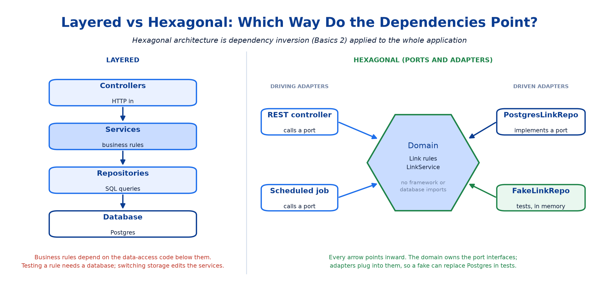
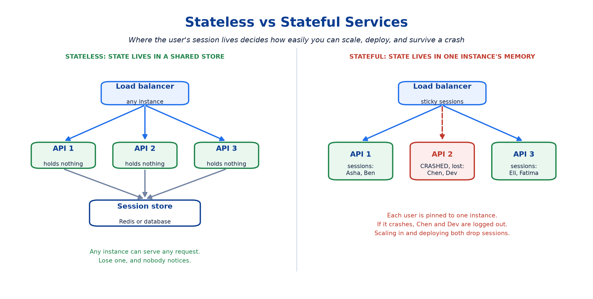
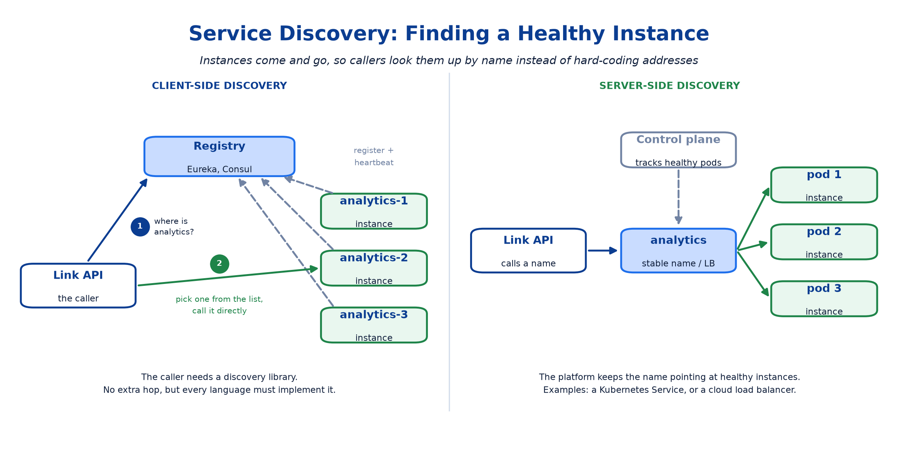

# Architecture Styles & Service Decomposition

## Terms to know before you start

You do not need to memorize these. Come back to this table whenever a term feels unfamiliar.

| Term | What it means in plain words |
|---|---|
| **Deployable unit** | One thing you build, test, and release as a whole, such as one JAR file or one container image. |
| **Monolith** | An application that is deployed as a single unit, even if its code is large and well organized. |
| **Module** | A self-contained part of a codebase with a small public interface and hidden internals. In a monolith, modules call each other with ordinary method calls. |
| **Service** | A separately deployed program that other programs call over the network. |
| **Microservices** | An architecture in which an application is split into many small services, each owned by one team and released on its own schedule. |
| **Domain** | The business area the software serves, such as links, billing, or analytics, with its own rules and vocabulary. |
| **Bounded context** | A boundary inside which every word has one exact meaning. "Link" can mean different things in billing and in analytics, and each context keeps its own model. |
| **Stateless service** | A service whose instances keep nothing between requests, so any instance can handle any request. |
| **Stateful service** | A service whose instances hold data that matters, such as a database or a server holding live user sessions. |
| **Service discovery** | How a caller finds the current network addresses of the healthy instances of a service. |
| **Configuration** | Settings that change between environments, such as database addresses and feature flags, kept outside the code. |
| **Distributed monolith** | A system split into services that still have to be changed and deployed together. It has the costs of both styles and the benefits of neither. |
| **Conway's law** | The observation that a system's structure tends to copy the communication structure of the teams that build it. |

??? info "Java and Spring features used on this page (open if they are new to you)"
    - **Packages** such as `com.shortener.links.api` are used to group classes. Classes without the `public` keyword are visible only inside their own package, which is the simplest way to hide a module's internals.
    - **ArchUnit** is a testing library that checks architecture rules, such as "nothing outside the links module uses its internal classes", as ordinary unit tests.
    - **`@Repository`** and **`@Service`** are Spring annotations that mark classes for Spring to create and connect at startup, as described in [Basics 3](03_LLD_Creational_And_Structural_Design_Patterns.md).
    - **`application.yml`** is a Spring Boot configuration file. Values such as `${DB_URL}` are filled in from environment variables when the application starts.

---

## 1. Architecture style is a decision, not a fashion

An **architecture style** answers two questions: how is the code split into parts, and how are those parts deployed and connected? The answer has little to do with what is fashionable, and everything to do with a few forces in your situation.

| Force | The question to ask | When the answer is yes, it points towards |
|---|---|---|
| **Team size** | Are several teams blocked waiting for each other to release? | Separate deployable units, so each team can release alone |
| **Different needs** | Does one part need a much higher availability, a different kind of hardware, or very different scaling than the rest? | Separating that one part |
| **Fault isolation** | Would a crash or memory leak in one feature take down a more important one? | Running them in separate processes |
| **Change rate** | Does one part change daily while the rest changes monthly? | A boundary between them, at least inside the code |
| **Operational maturity** | Can the team run many services, with automated deployment, monitoring, and tracing? | If no, fewer deployable units, whatever the other answers say |

!!! tip "The decision in one sentence"
    Start with the fewest deployable units that meet the requirements, draw strong boundaries inside them, and split a part out only when it needs something the rest of the system cannot give it.

**The running example.** [Basics 1](01_Interview_Framework_And_Capacity_Estimation.md) designed a URL shortener as one stateless application, and [Basics 4](04_Networking_And_Request_Lifecycle.md) followed one redirect through it. This page follows the same product into its **second year**, when it has grown:

| What changed | Year one | Year two |
|---|---|---|
| Features | Create links and redirect | Also user accounts, custom domains, click dashboards, and paid plans |
| Peak traffic | 8,000 redirects and 80 creates per second | 20,000 redirects, 200 creates, and about 50 dashboard requests per second |
| People | One team of 5 | Four teams, about 25 engineers |
| Availability target | 99.9% for everything | **99.99% for redirects** (a broken link looks like a broken website), 99.9% for the rest |

The question for the rest of this page: should year two split the application into services, and if so, where?

---

## 2. The styles, one level at a time


The three styles in the picture can contain the same code. What changes is **where the boundaries are, and what enforces them**: nothing but discipline in a layered monolith, rules and tests in a modular monolith, and the network itself in microservices. Each level below fixes a problem from the level before it, and adds a cost.

### Level 1: Layered architecture

The most familiar structure splits code by technical role. Each layer may only call the layer directly below it:

```text
com.shortener
├── controller     LinkController, AccountController, DashboardController   (HTTP in, JSON out)
├── service        LinkService, AccountService, BillingService              (business rules)
├── repository     LinkRepository, AccountRepository, ClickRepository       (SQL)
└── model          Link, Account, Click                                     (shared data classes)
```

**What it gets right.** Every developer knows where a controller or a repository lives, and the rule "controllers never write SQL" keeps the worst tangles out.

**What goes wrong as it grows.** The layers say nothing about the *business*. Adding custom domains touches a controller, a service, a repository, and a model, in four different packages. Worse, nothing stops `BillingService` from calling `LinkRepository` directly, or `DashboardController` from reading the `Click` table, so after a year every part of the business can reach every other part. This is often called a "big ball of mud". It is not because layers are wrong, but because layers alone draw no boundaries between business areas.

!!! question "Practice"
    In a layered codebase, where does the code for one feature, such as "custom domains", end up? Why is that a problem when four teams share the codebase?

??? success "Answer"
    It is spread across every layer: a controller, a service, a repository, and model classes. Every team edits every layer, so two teams changing unrelated features still collide in the same packages and files, and nobody owns any one package. Grouping code by business area (Level 3) gives each team its own place.

### Level 2: Hexagonal architecture (ports and adapters)



In the layered picture, the arrows point down, so the business rules depend on the database code beneath them. Testing a rule needs a database, and changing the storage means editing the services. **Hexagonal architecture**, also called *ports and adapters*, flips those arrows. It is the Dependency Inversion rule from [Basics 2](02_LLD_Object_Oriented_Principles_And_Clean_Code.md), applied to the whole application:

- The **domain** (the business rules) sits in the middle and imports no framework or database code.
- The domain defines **ports**: interfaces describing what it needs (`LinkRepository`) or offers (`CreateLink`).
- **Adapters** live outside and plug into the ports. Some *drive* the domain (a REST controller or a scheduled job calls a port); others *are driven* by it (a Postgres class implements `LinkRepository`).

```java
// Inside the domain: a port, shaped around what the business needs, not around SQL
public interface LinkRepository {
    Optional<Link> findByCode(ShortCode code);
    void save(Link link);
}

// Inside the domain: business rules, with no imports from Spring, JDBC, or HTTP
final class LinkService {
    private final LinkRepository links;
    LinkService(LinkRepository links) { this.links = links; }

    Link create(LongUrl url, AccountId owner) { /* rules: quota, blocked domains, code generation */ }
}

// Outside the domain: an adapter, and the only class that knows about Postgres
@Repository
final class PostgresLinkRepository implements LinkRepository { /* SQL lives here, and only here */ }
```

The adapter is exactly the Adapter pattern from [Basics 3](03_LLD_Creational_And_Structural_Design_Patterns.md): it translates between the interface the domain expects and the API a tool provides. In tests, a `FakeLinkRepository` backed by a `HashMap` replaces Postgres, so business rules are tested in milliseconds.

**Watch out:** for a small CRUD service with almost no business rules, ports for everything are ceremony. Use this style where the rules are worth protecting.

!!! question "Practice"
    A teammate's `LinkService` constructor creates a `JdbcTemplate` and writes SQL inline. Which two problems does that cause, and how does hexagonal architecture fix them?

??? success "Answer"
    First, the business rules cannot be tested without a real database. Second, the rules and the storage details change for different reasons but live in one class, so a schema change risks breaking a business rule. The fix is to define a `LinkRepository` port in the domain, move the SQL into a `PostgresLinkRepository` adapter, and pass the repository into `LinkService` through its constructor.

### Level 3: The modular monolith

Hexagonal architecture organizes one area well. A **modular monolith** applies boundaries between areas: the code is split by **business capability**, each module hides its internals behind a small public API, and the whole thing still deploys as one unit.

```text
com.shortener
├── links
│   ├── api          LinkApi, LinkView                    <- the only classes other modules may use
│   └── internal     LinkService, PostgresLinkRepository  <- hidden: package-private or checked by tests
├── accounts
│   ├── api          AccountApi, PlanLimits
│   └── internal     ...
├── billing
└── analytics
```

A modular monolith lives or dies by three rules:

1. **Modules talk only through each other's `api` package.** No module calls another module's internal classes.
2. **Each module owns its tables.** Each module gets its own database schema, and no module reads another module's tables, even though they share a database server.
3. **The rules are checked automatically**, because a rule that is not tested will eventually be broken by someone in a hurry.

The third rule is a few lines with ArchUnit, and it runs with the other unit tests:

```java
@ArchTest
static final ArchRule modulesUseOnlyPublicApis =
        noClasses().that().resideOutsideOfPackage("..links..")
                .should().dependOnClassesThat().resideInAPackage("..links.internal..");
```

(Spring Modulith provides the same checks for every module at once, based on the package structure.)

**What this gives year two.** Each team owns one module and its schema. Teams still share one build and one release, but their code no longer tangles. And if one module must later become its own service, its boundary is already clean: the `LinkApi` interface becomes a network API, and its schema moves to its own database. That is a far smaller step than untangling a big ball of mud.

!!! question "Practice: code review"
    To build a dashboard faster, the analytics module runs `SELECT title FROM links.links WHERE code = ?` directly. The query works. Which rule does it break, and why does it matter?

??? success "Answer"
    It breaks **"each module owns its tables"**. Analytics now depends on the exact structure of the links table, so the links team cannot rename that column, split the table, or move it to another database without breaking analytics, often without knowing analytics depends on it. The fix is to call `LinkApi` (for example, `linkApi.titlesFor(codes)`), or to keep a copy of titles inside analytics, updated by events (section 5).

### Level 4: Microservices

**Microservices** take module boundaries and turn each one into a separate deployable unit, with its own process, its own data store, and usually its own team. The boundary is now enforced by the network: another team physically cannot call your internal classes.

| What you gain | What you pay |
|---|---|
| Each team releases on its own schedule, without coordinating a shared release. | Every call between services is a network call, with the latency, timeouts, pools, and failure modes from Basics 4. |
| One service can scale, or use different hardware, independently. | Data is spread across stores, so cross-service queries and transactions become hard (section 5). |
| A crash or memory leak stays inside one service. | Failures become partial: one service is down while others are up, and every caller must handle that. |
| Each service can use the technology that best fits its job. | Every service needs its own build pipeline, deployment, monitoring, alerts, and on-call rotation. |
| Ownership is unmistakable: one team, one service. | Debugging one user request means following it across many services, which needs distributed tracing. |

The network cost is the one beginners underestimate. A method call inside one process takes nanoseconds and never fails because of the network. A call to another service in the same data center takes about half a millisecond at best, and it can time out, be refused, or return an unknown outcome. Chains of calls multiply both problems: if one user request passes through five services, each 99.9% available, the chain is only about 0.999⁵ ≈ **99.5%** available, which allows roughly 44 hours of downtime a year instead of 9. Combining availabilities is covered in **Basics 14 (Availability & Deployment Fundamentals)**.

??? info "Go deeper (optional): the fallacies of distributed computing"
    In the 1990s, engineers at Sun Microsystems listed false assumptions that people make when they move code across a network. The first four do the most damage when splitting a monolith: *the network is reliable*, *latency is zero*, *bandwidth is infinite*, and *the network is secure*. Every one of them is true of a method call and false of a network call. Each time you draw an arrow between two services, ask what happens when that arrow is slow, fails, or is attacked.

**When microservices are the right answer.** When there are several teams blocked by a shared release, when parts of the system have truly different availability, scaling, or security needs, and when the organization can already run many services well. If those conditions are not met, a modular monolith gives most of the benefits at a fraction of the cost.

!!! question "Practice"
    A startup with 6 engineers and one product wants to begin with 12 microservices "so we can scale later". What would you tell them?

??? success "Answer"
    Twelve services for six engineers means each engineer runs two services, with twelve pipelines, twelve sets of alerts, and network calls where method calls would do. Nothing in their situation needs independent releases or isolation yet. Start with a modular monolith with strict module boundaries. If a team or a scaling need later demands it, a clean module can be extracted into a service. Splitting is easier than merging, but only when the boundaries were clean in the first place.

### Other styles you will hear about

| Style | The idea in one line | Where it is covered |
|---|---|---|
| **Event-driven architecture** | Services publish facts ("LinkCreated") and others react, instead of calling each other directly. | Basics 13 and Advanced 6 |
| **Serverless (functions as a service)** | You deploy single functions; the platform runs and scales them per request, and you pay per call. Good for spiky, short tasks. | Mentioned here only |
| **Service-oriented architecture (SOA)** | An older style of large shared services, often connected through a central message bus that held business logic. Microservices grew partly as a reaction to it. | Mentioned here only |
| **Cell-based architecture** | The whole stack is copied into independent "cells", each serving a slice of users, so a failure affects only one cell. | Related ideas in Advanced 19 (isolation) |

---

## 3. Stateless vs stateful services



Whatever the style, each running part is either **stateless**, keeping nothing between requests, or **stateful**, holding data that matters. This one property decides how easily a part can be scaled, deployed, and recovered.

The classic mistake is to keep user sessions in a server's memory:

```java
// Stateful: the session exists only inside this one server's memory
final class SessionHolder {
    private final Map<String, Session> sessions = new ConcurrentHashMap<>();
    Session find(String sessionId) { return sessions.get(sessionId); }   // null on any other server
}
```

This works on one server. With twelve, a user who logs in on server 3 appears logged out on server 7. The usual workaround is **sticky sessions**, where the load balancer always sends the same user to the same server, but the picture shows the price: when that server crashes, is scaled in, or is redeployed, its users lose their sessions.

The fix is to move the state out of the instances, so that every instance looks the same:

| Option | How it works | Trade-off |
|---|---|---|
| **Shared session store** | Sessions live in Redis or a database that every instance reads. | One extra fast lookup per request, plus a store to run. |
| **Signed token** | The session data travels with each request in a signed token, such as a JWT, that any instance can verify. | No lookup at all, but a token is hard to revoke before it expires. Covered in Basics 6. |

Some parts are stateful by nature: databases, caches, message brokers, and servers that hold open WebSocket connections. You cannot make them stateless, so you treat them differently:

| | Stateless services | Stateful services |
|---|---|---|
| Scaling | Add identical instances behind a load balancer. | Split the data across instances (partitioning) and copy it (replication). Basics 12. |
| An instance crashes | Nothing is lost; the load balancer stops sending it traffic. | Its data must survive on a replica, and something must take over its role. |
| Deploying | Replace instances one at a time, at any moment. | Move or drain the data and the connections first, then restart carefully. |
| Where they fit | Application logic: the Link API, the dashboard backend | Data and live connections |

**The design rule:** push state down into a few well-run stateful systems, and keep everything above them stateless.

!!! question "Practice: the note-taking app"
    The note-taking app keeps each user's unsaved draft in the memory of the server handling their requests, with sticky sessions. What happens during a deployment, and how would you fix it?

??? success "Answer"
    A rolling deployment restarts every server, so every user loses their unsaved draft at some point, and a crash loses the drafts of everyone on that server. Save drafts to a shared store instead: write them to the database every few seconds, or keep them in Redis with an expiry. The servers become stateless, deployments and crashes stop losing work, and sticky sessions are no longer needed.

---

## 4. Drawing boundaries: bounded contexts and ownership


Whether the boundaries become modules or services, the hard part is **where to draw them**. The most reliable tool comes from domain-driven design: the **bounded context**.

Look at what the word "link" means in each part of the year-two URL shortener. To link management, a link has an owner, a title, tags, and an expiry date. To the redirect path, a link is just a code and a long URL, nothing else. To analytics, a link is a code plus click counts by day and country. To billing, it is one unit of a plan's quota. Forcing one `Link` class to serve all four creates a class that every team edits and nobody owns. Instead, **each context keeps its own small model**, and the contexts exchange only what they need.

**Signals that a boundary is in the right place:**

| A good boundary | A poor boundary |
|---|---|
| It follows a **business capability**: "manage links", "serve redirects", "bill customers". | It follows a **technical layer**: a "database service" or a "validation service". |
| Things that **change together** sit together. | Every feature needs changes in three services at once. |
| Data that must be **consistent in one transaction** sits together. | A simple operation needs a transaction across services. |
| **One team** owns it completely. | Two teams share it, or one team's work is spread across many services. |
| Calls across it are **few and coarse**: "create this link". | Calls across it are many and small: "get the owner", then "get the owner's plan", then "get the plan's limits". |

!!! warning "The entity-service trap"
    A very common first attempt makes one service per noun: `LinkService`, `UserService`, `ClickService`, each a thin wrapper around one table. Every real feature then needs several of them, called in sequence, so the services are tightly coupled through constant, chatty calls. Split by what the business **does** (capabilities), not by the nouns in the database.

**Ownership and Conway's law.** Systems tend to copy the communication structure of the teams that build them. If two teams share one service, its code soon develops a seam along the team boundary anyway; if one team owns parts of five services, every feature needs five releases. So design teams and boundaries together: each context should have exactly one owning team that builds it, runs it, and is on call for it. Deliberately shaping teams to get the architecture you want is called the **inverse Conway maneuver**.

!!! question "Practice: the note-taking app"
    The note-taking app now has these features: writing and editing notes, sharing notes with other users, full-text search, and a paid plan with storage limits. Propose bounded contexts, and name one word that means different things in two of them.

??? success "Answer"
    A reasonable split is **Notes** (writing, editing, and versions), **Sharing** (who can see or edit which note), **Search** (indexing and querying), and **Billing** (plans and storage limits).

    "Note" is a good example. In Notes, it is the full document with its history. In Search, it is a set of searchable words plus an ID. In Billing, it is only a size in bytes that counts against a storage limit. Each context keeps just the fields it needs.

---

## 5. Data ownership: shared database or one per service


Boundaries in the code mean little if every part still reads every table. **Whoever owns a context owns its data**, and that leaves three practical options:

| Option | How it works | Trade-off |
|---|---|---|
| **Shared tables** | Every module or service reads and writes the same tables. | Easy joins and transactions, but every table becomes a shared contract: one team's column rename breaks another team's code, and one team's heavy query slows everyone. |
| **Shared server, schema per owner** | One database server, but each owner has its own schema, and nobody reads anyone else's. | The right default for a modular monolith. Ownership is clear, and moving a schema to its own server later is straightforward. |
| **Database per service** | Each service has its own data store, possibly of a different type. | Full independence, and each store fits its access pattern (key-value for redirects, columnar for analytics), but data must be copied between services, and those copies lag behind. |

**When you need data you do not own**, you have three choices:

| Choice | Example | Cost |
|---|---|---|
| **Ask the owner, synchronously** | The dashboard calls `LinkApi.titlesFor(codes)` when it renders. | Adds a network call and a runtime dependency: if links is down, the dashboard is degraded. |
| **Keep a local copy, updated by events** | Analytics stores each link's title when it receives `LinkCreated` or `LinkRenamed`. | No runtime dependency, but the copy is briefly out of date, which is called **eventual consistency**. |
| **Move the boundary** | If two contexts constantly need each other's data in one transaction, they may really be one context. | A redesign, but often the honest fix. |

!!! warning "Publishing events reliably"
    "Save to my database, then publish an event" has a gap: if the service crashes between the two steps, the event is lost and every copy is wrong forever. The standard fix, the **outbox pattern**, saves the event in the same database transaction as the change, and a separate process publishes it. It is covered in **Advanced 6 (Event-Driven Systems & Message Queues)**. When an operation must change data in several services, such as "charge the card, then upgrade the plan", it becomes a **saga**: a sequence of local transactions with undo steps if a later step fails, covered in **Advanced 4 (Distributed Transactions & Consensus)**.

!!! question "Practice"
    The URL shortener's dashboard shows each link's title next to its click count. Titles belong to link management; click counts belong to analytics, in a separate store. Give two ways to build this page, and the trade-off between them.

??? success "Answer"
    1. **Compose at read time:** the dashboard asks analytics for the counts and link management for the titles, then joins them in memory. The data is always current, but the page depends on both services being up and fast.
    2. **Keep a copy:** analytics stores each link's title, updated from `LinkCreated` and `LinkRenamed` events, so one query returns both. The page has a single dependency and is faster, but a renamed link may show its old title for a few seconds.

    For a dashboard, a few seconds of stale titles is acceptable, so the copy is usually the better choice. For something that must be exact, such as a bill, it would not be.

---

## 6. How services find and configure each other



Once there is more than one service, two practical problems appear: how a caller finds the instances of a service that keep starting and stopping, and how each service gets the right settings in each environment.

**Service discovery.** Hard-coding IP addresses breaks the moment an instance is replaced, so callers use a name, and something keeps that name pointing at healthy instances.

| Approach | How it works | Trade-off | Examples |
|---|---|---|---|
| **Client-side discovery** | Instances register with a registry and send heartbeats. The caller asks the registry for the list and picks an instance itself. | No extra network hop, but every caller needs a discovery library, in every language used. | Eureka, Consul |
| **Server-side discovery** | The caller calls a stable name; a load balancer or platform routes it to a healthy instance. | Callers stay simple. The platform does the work, and adds a small hop. | Kubernetes Services, cloud load balancers |
| **Service mesh** | A small proxy runs beside every instance and handles discovery, retries, and mTLS for it. | Powerful and language-neutral, but one more complex system to run. | Istio, Linkerd |

All of them depend on **health checks** to remove broken instances, which are covered in **Basics 14 (Availability & Deployment Fundamentals)**, and on the timeout lessons from Basics 4: a discovery system that sends you to a hung instance is only safe if your call has a timeout.

**Configuration management.** The same build should run in every environment, so anything that differs between environments lives outside the code:

```yaml
# application.yml: one artifact, configured per environment at startup
links:
  redirect-cache-ttl: 10m                  # a safe default, kept in the code
spring:
  datasource:
    url: ${DB_URL}                         # different in dev, staging, and production
    password: ${DB_PASSWORD}               # injected from a secrets manager, never committed to git
features:
  custom-domains-enabled: ${CUSTOM_DOMAINS_ENABLED:false}   # a feature flag, off unless switched on
```

| Kind of setting | Where it lives | Rule |
|---|---|---|
| Safe defaults | In the code | Change them through code review. |
| Environment settings, such as addresses and pool sizes | Environment variables or a config service | The same artifact is promoted unchanged from staging to production. |
| Secrets, such as passwords and API keys | A secrets manager, such as Vault or a cloud equivalent | Never in git, never in logs, and rotated regularly. |
| Feature flags | A flag service | They switch behavior at runtime without a deployment, which also gives a fast "off switch" for a bad release. |

!!! question "Practice"
    A team stores the production database password in `application-prod.yml`, inside the git repository, "because the repository is private". What are two risks, and what is the fix?

??? success "Answer"
    First, everyone with read access to the repository, plus every laptop, CI system, and backup that holds a copy, now holds the production password, and git history keeps it forever even after the file is changed. Second, rotating the password requires a code change and a deployment. Store it in a secrets manager, inject it at startup as `${DB_PASSWORD}`, rotate it, and treat the old value as leaked.

---

## 7. Splitting a monolith safely

When a part really does need to become a service, do not rewrite it from scratch. The safest path, called the **strangler fig** after a vine that slowly grows around a tree, moves traffic over gradually:

```text
1. MODULARIZE  Give the part a clean module boundary and its own schema, inside the monolith.
2. ROUTE       Put a router (often the load balancer) in front, so its traffic can be sent elsewhere.
3. BUILD       Run the new service beside the monolith, behind the same API contract.
4. SHIFT       Move traffic gradually: 1% -> 10% -> 50% -> 100%, comparing results and errors.
5. MIGRATE     Move the data to the service's own store, keeping both in sync during the switch.
6. DELETE      Remove the old module from the monolith. Until this step, rolling back is one config change.
```

Step 1 does most of the work. A part that cannot be separated cleanly *inside* the monolith will not separate cleanly across a network either. Moving data without downtime is covered in **Advanced 16 (Data Migration & Zero-Downtime Evolution)**.

---

## 8. Putting it together: the URL shortener, year two


Now apply the forces from section 1 to the year-two requirements. The rule is to split only where a part needs something the rest cannot give it.

| Part | Decision | The need that justifies it |
|---|---|---|
| **Redirect service** | Extract as its own small, stateless service, with its own key-value store of code → URL. | It alone needs **99.99%** availability, and it carries **99% of the traffic** (20,000 requests per second against about 250 for everything else). It must keep working when the dashboards, billing, or the main database fail, and it must not be redeployed every time billing ships a change. |
| **Click workers and analytics store** | Run separately, fed by `LinkClicked` events. | Recording 20,000 clicks per second is write-heavy batch work with a different shape from everything else, and it was already asynchronous in Basics 1. A slow analytics pipeline must never slow down a redirect. |
| **Links, accounts, billing, and dashboards** | Keep together as one **modular monolith**, with a schema per module. | They share a 99.9% target, a modest load, and frequent features that cross modules (such as "plan limits on links"). Four teams can work in four modules without the cost of four services. |

**How data flows.** Link management owns the links. When a link is created, changed, or deleted, it publishes an event (through an outbox), and the redirect service updates its own key-value copy. The redirect service publishes `LinkClicked` for every redirect, and the click workers aggregate those clicks into the analytics store, which the dashboards module queries through analytics' API rather than its tables. No part reads another part's tables.

**The failure path.**

1. **The main database goes down.** Users cannot create links or view dashboards, but every existing link keeps redirecting, because the redirect service reads only its own store. This is exactly why it was extracted.
2. **The event bus is delayed.** A brand-new link may not redirect for a few seconds. If that is unacceptable, the redirect service can, on a miss, ask link management directly with a tight timeout. That adds back a runtime dependency on the rarely used miss path only, which is a trade-off worth stating out loud.
3. **The analytics pipeline falls behind.** Dashboards show slightly old numbers; redirects are unaffected, because events wait safely in the queue.

**Change walkthrough.** A good decomposition keeps each likely change inside one part:

| Change request | What changes | What stays untouched |
|---|---|---|
| Add a new plan tier | The billing and accounts modules | The redirect service and analytics |
| Redirects must work for custom domains | The redirect service's lookup key (domain + code), and the events that feed it | Billing and dashboards |
| Add a "clicks by device" chart | The click workers and the dashboards module | The redirect service, apart from adding the device to `LinkClicked` |
| Billing grows to its own team, with weekly compliance releases | Extract the billing module into a service, using the strangler fig steps in section 7 | Everything else, because the module boundary and schema already exist |

The last row is the payoff of the modular monolith: when a new need arrives, the next split is a known, low-risk procedure instead of a rewrite.

!!! tip "The headline to say out loud"
    "One service is extracted because it alone needs 99.99% availability and carries 99% of the traffic. Everything else stays a modular monolith with strict module boundaries, so any part can be extracted later if a real need appears."

---

## 9. Common beginner mistakes

- **Starting with microservices.** Without several teams or truly different needs, services add network calls, pipelines, and on-call work, and give little back.
- **A distributed monolith.** If two services must always be changed and deployed together, they are one component paying network costs. Merge them, or move the boundary.
- **Sharing tables between services.** The schema becomes a hidden contract that no team can change safely.
- **One service per database table.** Entity services make every feature a chain of chatty calls. Split by business capability instead.
- **Long chains of synchronous calls.** Five services in a row multiply latency and divide availability. Prefer one coarse call, or an event.
- **Keeping sessions in instance memory.** It forces sticky sessions and loses users' state on every crash and deployment.
- **Boundaries without enforcement.** A modular monolith without automated rules quietly turns back into a big ball of mud.
- **Secrets in the repository.** Use a secrets manager, and inject secrets at startup.

---

## 10. Test yourself

These three problems increase in difficulty. Try each one on paper before opening the answer.

!!! question "Problem 1 (warm-up): stateless or stateful?"
    Classify each, and say how you would scale it: (a) a REST API that reads products from a database; (b) a chat server holding 50,000 open WebSocket connections; (c) PostgreSQL; (d) an image-resizing worker that reads jobs from a queue.

??? success "Answer"
    (a) **Stateless**: add instances behind a load balancer. (b) **Stateful**, because each connection lives on one server: scale by adding servers and spreading users across them, and drain connections gracefully during deployments. (c) **Stateful**: add read replicas, then partition the data if writes outgrow one machine. (d) **Stateless**: add workers; the queue holds the state, and any worker can take any job.

!!! question "Problem 2 (diagnosis): the services that deploy together"
    A company has `OrderService`, `OrderItemService`, and `OrderPricingService`. Almost every feature needs changes to all three, they are always deployed together in a fixed order, and placing one order takes 9 calls between them. What has gone wrong, and what would you do?

??? success "Answer"
    It is a **distributed monolith**, created by splitting one bounded context (orders) into entity services. The three change together, need consistent data together, and talk constantly, so every signal says they belong to one context.

    Merge them into one `Orders` service, or into one module of a monolith, with one schema, one transaction for placing an order, and in-process calls instead of nine network calls. If something inside orders genuinely needs separating later, such as a pricing engine with a different team and release schedule, split along *that* need, with one coarse call such as `quote(cart)`.

!!! question "Problem 3 (design): a food-delivery startup"
    A food-delivery company has 30 engineers in 5 teams: restaurants and menus, ordering and checkout, payments, delivery tracking (driver locations update every 4 seconds from 20,000 active drivers), and notifications. Today everything is one layered monolith, releases happen weekly and often break, and a bug in menu editing recently took down checkout. Propose an architecture for the next year.

??? success "Answer"
    Start by giving every capability a module with its own schema and enforced rules, so the five teams stop tangling. Then split only where a need differs:

    | Part | Decision | Reason |
    |---|---|---|
    | **Delivery tracking** | Separate service | 20,000 drivers every 4 seconds is about 5,000 location writes per second, of short-lived data, with a different store (in-memory or time-series) and very different scaling from the rest. |
    | **Payments** | Separate service | It needs strict security and compliance controls, a small audited surface, and careful releases. |
    | **Checkout** | Isolate from menu editing | The outage showed that a menu bug can kill revenue. Keep the menu *read* path that checkout needs fast and separate from the menu *editing* tools, for example through a copy of menus updated by events. |
    | **Notifications** | Asynchronous worker fed by events | Nothing should wait for an SMS. Order events go on a queue, and a worker sends messages. |
    | **Restaurants, menus, and ordering** | Stay in the modular monolith for now | Moderate load and shared release needs; extract later using the strangler fig if a team needs independence. |

    The expected outcome: tracking load and payment risk are isolated, a menu bug can no longer break checkout, and the team runs three or four deployable units instead of fifteen. Checkout and payments together need a saga for "charge, then confirm the order, or refund" (Advanced 4).

---

## 11. Checklist and what comes next

In an interview, architecture style comes up as "would you use microservices here?", or as a follow-up when your diagram grows. A strong answer always names the force behind each boundary: "I split this because it needs X that the rest cannot give it." It also names what that split costs, and what the simpler alternative would have been.

```text
[ ] START from the forces: teams, differing needs, fault isolation, change rate, operational maturity
[ ] DEFAULT to a modular monolith: modules by business capability, a schema per module, rules enforced by tests
[ ] PROTECT business rules with ports and adapters where the rules are worth it
[ ] KEEP services stateless; push state down into a few well-run stateful systems
[ ] DRAW boundaries around bounded contexts with one owning team, never around tables or layers
[ ] OWN data: no reading another context's tables; use APIs, events, or move the boundary
[ ] SPLIT only where a part needs something the rest cannot give it, and say what the split costs
[ ] EXTRACT with the strangler fig, keeping a one-step rollback until the end
```

This page skipped several topics on purpose. Here is where each one is covered once you have the right foundations:

| Topic you may have heard about | Where it is covered |
|---|---|
| REST vs gRPC, synchronous vs asynchronous calls, and API versioning | Basics 7: API Design & Service Communication |
| Sessions, cookies, and JWT trade-offs | Basics 6: API Correctness, Security & Resource Design |
| Load balancers and reverse proxies in front of services | Basics 8: Load Balancing & Proxying |
| Designing each service's data model | Basics 11: Practical Data Modeling & Query Design |
| Partitioning and replicating stateful systems | Basics 12: Data Partitioning, Sharding & Replication |
| Queues and events between services | Basics 13: Asynchronous Processing Basics |
| Health checks, rolling deployments, and availability arithmetic | Basics 14: Availability & Deployment Fundamentals |
| Sagas and transactions that span services | Advanced 4: Distributed Transactions & Consensus |
| Event-driven systems and the outbox pattern | Advanced 6: Event-Driven Systems & Message Queues |
| Circuit breakers and bulkheads between services | Advanced 11: Fault Tolerance, Resilience & Failure Handling |
| Tracing a request across many services | Advanced 14: Observability, Monitoring & Alerting |
| Extracting a service and moving its data without downtime | Advanced 16: Data Migration & Zero-Downtime Evolution |
| Cells, tenants, and isolating customers from each other | Advanced 19: Multi-Tenancy, Isolation & Fairness |
