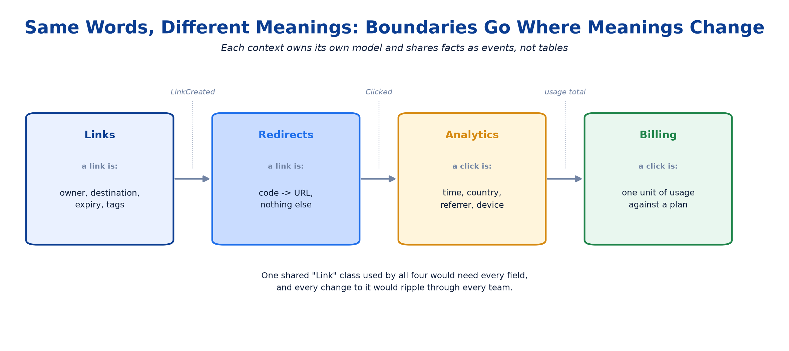
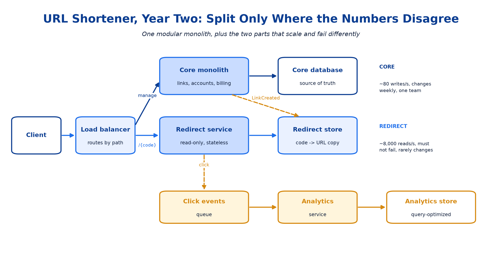

# Architecture Styles & Service Decomposition

## Terms to know before you start

You do not need to memorize these. Come back to this table whenever a term feels unfamiliar.

| Term | What it means in plain words |
|---|---|
| **Architecture style** | The overall shape of a system: how its code is grouped, how the groups talk to each other, and how they are deployed. |
| **Monolith** | One application, built and deployed as a single unit. Its parts call each other directly, inside one process. |
| **Module** | A group of code inside an application, with a clear job and a small public interface that the rest of the code must use. |
| **Microservice** | A small application that is deployed on its own, owns its own data, and talks to other services over the network. |
| **Deployable unit** | Whatever gets released together. A monolith is one deployable unit; ten microservices are ten. |
| **Stateless** | A service that keeps no user data in its own memory between requests, so any copy of it can handle any request. |
| **Stateful** | A service that keeps data in its own memory or disk, such as a database, so requests must reach the copy holding that data. |
| **Bounded context** | A part of the business inside which every term has exactly one meaning. "Click" can mean one thing to Analytics and another to Billing. |
| **Blast radius** | How much of the system breaks when one part fails or one bad change is released. |
| **Service discovery** | How one service finds the current network addresses of another service's healthy copies. |

---

## 1. Architecture style is a decision, not a fashion

Basics 1 designed a URL shortener with a single stateless Link API, a cache, a database, and a queue for click analytics, and it said: "no microservices; none of the numbers require them." This page explains how to recognize the moment when the numbers, or the organization, *do* require something different, and how to split a system well when they do.

Every architecture style answers the same few questions, and the answers come from your situation, not from what large tech companies use:

| Force | The question it raises |
|---|---|
| **Team size** | How many people change this code every week, and do they keep getting in each other's way? |
| **Release pace** | Does one part need to be released daily while another changes once a quarter? |
| **Scale profile** | Does one part handle 100 times the traffic of another? |
| **Failure isolation** | Must one part keep working while another is broken? |
| **Data ownership** | Is it clear who is allowed to change each piece of data, and its structure? |

!!! tip "Decomposition in one sentence"
    Split a system along the lines where its parts change, scale, or fail differently, and only when the cost of the split is smaller than the cost of keeping those parts together.

There is also a social force, known as **Conway's law**: systems tend to mirror the communication structure of the teams that build them. Three teams that rarely talk will drift towards three loosely connected components, whether or not anyone planned it. Good boundaries work with the team structure instead of against it.

---

## 2. The styles, one level at a time


The sections below form a ladder, like the earlier pages. Each level introduces one idea, applies it to the URL shortener, and ends with a practice problem about the note-taking app from Basics 1, now a year older and growing.

### Level 1: Layered architecture

Most applications start in layers, each with one technical job:

```text
LinkController   (API layer)        parses the HTTP request, returns the HTTP response
LinkService      (business layer)   applies the rules: valid URL, code not taken, expiry
LinkRepository   (data layer)       reads and writes the link table
```

The rule that makes layers useful is that **dependencies point one way**: the controller calls the service, the service calls the repository, and never the reverse. Basics 2's Dependency Inversion principle refines this: the business layer owns the `LinkRepository` interface, and the database code implements it, so business rules never depend on database details.

Layers have one well-known weakness. They group code by *technical role*, but changes usually arrive by *business feature*. Adding "links can be password-protected" touches the controller, the service, and the repository at once. When an application grows to many features, every change cuts across every layer, and layers that only pass calls through without adding anything (sometimes called "lasagna code") become pure overhead.

!!! question "Practice: the note-taking app"
    The note-taking app adds a rule: "a note can be shared with at most 50 people." Which layer should own that rule, and what goes wrong if it lives in the controller instead?

??? success "Answer"
    The **business layer** (`SharingService` or similar). If it lives in the controller, any other way of sharing, such as a batch import or a future mobile API, skips the check, because it calls the service directly. Rules belong where every path must pass through them.

### Level 2: The modular monolith

A **modular monolith** keeps the single deployable unit but organizes the code *by business area* instead of only by layer. Each module owns its own slice of every layer, its own database tables, and a small public interface. For the URL shortener a year later, the modules might be Links, Redirects, Analytics, and Accounts.

The rules that make it work:

- Each module **exposes a small public interface** and hides everything else.
- **No module reads another module's tables.** Analytics asks the Links module through its interface; it never queries the link table directly.
- Modules talk through **plain method calls or in-process events**, which are fast and cannot fail the way network calls can.

In Java, the simplest enforcement is package-private visibility: only the module's public interface is `public`, and everything else is invisible outside its package.

```java
package com.example.shortener.links;

public interface LinksApi {                       // the only door into the module
    Optional<String> destinationFor(String code);
}

class LinkService implements LinksApi { /* ... */ }   // package-private: hidden
class LinkRepository { /* ... */ }                    // package-private: hidden
```

Larger teams add automated architecture tests that fail the build when one module imports another module's internals.

A modular monolith keeps most of a monolith's advantages: one build, one deployment, fast in-process calls, simple transactions, and easy refactoring when a boundary turns out to be in the wrong place. Its costs are that every module shares one release schedule, one runtime, and one scaling decision. A memory leak in Analytics can crash the process that serves redirects, and the whole application must be scaled to handle the busiest module's load.

!!! question "Practice: the note-taking app"
    The note-taking app now has notes, sharing, search, attachments, and billing. A developer makes the search feature faster by querying the notes table directly from the search module. What rule did they break, and what will it cost later?

??? success "Answer"
    They broke **"no module reads another module's tables."** The search module now depends on the exact structure of the notes table, so the notes team can no longer rename a column or change how notes are stored without breaking search, often without knowing it. If search is ever moved into its own service, this hidden dependency must be untangled first. The fix is to go through the notes module's interface, or to have search keep its own index updated from "note saved" events.

### Level 3: Microservices

**Microservices** take the module boundaries and turn each one into a separately deployed application that owns its data and talks to the others over the network. What that buys and what it costs:

| What you gain | What you pay |
|---|---|
| Each service is released on its own schedule. | Every call between services is now a network call, with all the latency, timeouts, pools, and failure modes from Basics 4. |
| Each service scales on its own. | Data is split, so there are no joins or transactions across services, and copies of data can be briefly out of date. |
| A crash in one service does not take the process of another down with it. | You must monitor, trace, deploy, and secure many applications instead of one. |
| Teams own services end to end and choose fitting tools. | API changes must stay backward compatible, because callers upgrade on their own schedule. |

The network cost is the one beginners underestimate. A method call inside one process takes well under a microsecond and practically never fails. A call to another service in the same data center takes around a millisecond, about a thousand times longer, and can fail in every way Basics 4 described. Availability also multiplies along a chain of synchronous calls. If one request must pass through five services, each available 99.9% of the time:

```text
Availability of the chain = 0.999 × 0.999 × 0.999 × 0.999 × 0.999 ≈ 99.5%
Allowed downtime per year: about 8.8 hours for one service, but about 44 hours for the chain
```

The worst outcome is a **distributed monolith**: services that are separately deployed but so tightly connected that they must be released together, or that call each other back and forth in long synchronous chains. It has the costs of microservices and the coupling of a monolith.

| | Layered monolith | Modular monolith | Microservices |
|---|---|---|---|
| Deployable units | One | One | One per service |
| Calls between parts | In-process | In-process, through module interfaces | Over the network |
| Data | One shared schema | One database, tables owned per module | One database per service |
| Scaling | All together | All together | Per service |
| Failure isolation | None | Limited (same process) | Strong, if calls are designed for failure |
| Fits best | Small apps, small teams | Most products, most teams | Large organizations whose parts truly differ in scale, pace, or reliability needs |

!!! question "Practice: the note-taking app"
    The note-taking app is built by one team of 6 engineers who release twice a week. Someone proposes splitting it into 8 microservices "to be ready for growth." What would you recommend, and why?

??? success "Answer"
    **Stay with a modular monolith.** Six people releasing twice a week are not blocking each other, the traffic (about 19 servers' worth, from Basics 1) is easily handled by one scaled application, and 8 services would multiply deployments, monitoring, and network failure modes with no requirement asking for them. Good module boundaries now make a later split cheap if a real force appears: a much larger team, or one part with a very different scale or reliability need.

### Level 4: Stateless vs stateful services


A **stateless** service keeps nothing about users in its own memory between requests. Everything it needs comes with the request or from a shared store. The Link API from Basics 1 is stateless, which is why the load balancer can send any request to any of its 12 servers, and why servers can be added, removed, or replaced at any time.

A **stateful** service keeps data locally, so requests must reach the specific copy holding that data. Databases, caches, and servers holding open real-time connections are stateful by nature. They need more care: replication so data survives a crash, routing so requests find the right copy, and careful, slower deployments.

The healthy pattern is to **push state into a few well-run stores and keep everything else stateless**. A common mistake is a service that looks stateless but quietly is not: for example, it stores login sessions in local memory. Then the load balancer must use *sticky sessions* (always sending a user to the same server), and when that server restarts, its users are logged out. Moving sessions into a shared store, or into a signed token the client carries, makes the service stateless again.

!!! question "Practice: the note-taking app"
    The note-taking app is adding live collaborative editing: several people type in the same note and see each other's changes instantly over open connections. Which components are stateless and which are stateful, and how should collaboration requests be routed?

??? success "Answer"
    The Note API is **stateless**. The database and the cache are **stateful**. The collaboration servers are **stateful** too: they hold open connections and the live state of each document being edited.

    All editors of the same note must reach the **same collaboration server**, so route by note ID rather than randomly, and save the document's state frequently, so another server can take over if that one fails.

---

## 3. Drawing boundaries (Level 5)



The hardest part of decomposition is not the technology; it is choosing where the lines go. The most reliable guide is the **bounded context**: a region of the business in which every important word has exactly one meaning.

In the URL shortener a year later, the word "link" means an owner, a destination, an expiry date, and tags to the Links team, but only "code → URL" to the redirect path. "Click" means an event with a time, country, and referrer to Analytics, but one unit of usage counted against a paid plan to Billing. A single shared `Link` class serving all four would need every field from every context, and every change to it would ripple through every team. Where a word changes meaning, a boundary probably belongs.

Other useful signals for a good boundary:

- **Data that changes together stays together.** A link and its expiry date are always edited together; a link and its click counts are not.
- **One team owns it end to end**: the code, the data, the API, and the pager when it breaks. Shared ownership usually means no ownership.
- **It changes at its own pace.** Billing rules change with every pricing experiment; the redirect logic barely changes at all.

Signals that a boundary is in the wrong place: most features require coordinated changes in several services, two services call each other many times per request, or two services read and write the same tables.

!!! question "Practice: the note-taking app"
    In the note-taking app, list what "note" means to the Notes, Search, Sharing, and Billing areas. What does that suggest about a single shared `Note` class?

??? success "Answer"
    - **Notes:** the content, title, and version history.
    - **Search:** a set of words to index and rank.
    - **Sharing:** a resource with an owner and a list of permissions.
    - **Billing:** some bytes counted against a storage quota.

    One shared `Note` class would mix four unrelated concerns. Each area should keep its own model and share only an ID and the facts it needs, typically through events such as "note saved."

---

## 4. Data ownership: shared database or one per service (Level 6)


Sharing a database between services is the tightest coupling two services can have. If Analytics reads the Links service's tables directly, then renaming a column in Links breaks Analytics, a slow analytics query can slow down link creation, and nobody can say who owns the table's structure.

**Database per service** means each service is the only one allowed to touch its data. Others get what they need in one of two ways:

| Approach | How it works | Trade-off |
|---|---|---|
| **Ask through an API** | Analytics calls the Links service's API to look up a link's owner. | Always current, but adds a network call and a runtime dependency: if Links is down, the lookup fails. |
| **Keep a local copy from events** | Links publishes a "LinkCreated" event; Analytics stores the fields it needs. | Fast and independent, but the copy can lag behind by a moment (*eventual consistency*). |

The price of database per service is that **cross-service joins and transactions disappear**. Reporting needs data to be copied together somewhere, and a business operation that spans two services needs patterns such as sagas, covered in **Advanced 4 (Distributed Transactions & Consensus)** and **Advanced 6 (Event-Driven Systems & Message Queues)**.

There is a practical middle ground, especially for a modular monolith: **one database server, one schema per module, and no module touching another's schema**. It is cheap to run, keeps ownership clear, and makes a later split far easier.

!!! question "Practice: the note-taking app"
    The search feature needs the text of every note. Compare reading the notes database directly with keeping a search index updated from "note saved" events. Which would you choose, and what does the user experience as a result?

??? success "Answer"
    Reading the notes database directly couples search to the notes schema, and heavy search queries would compete with note saves for database capacity.

    **Choose events**: the notes module publishes "note saved," and search updates its own index. The result is that a just-saved note can take a second or two to appear in search results, which is an acceptable trade for most users. The important part is to say that trade-off out loud.

---

## 5. Finding services and configuring them (Level 7)


Once services call each other, each needs a way to find the others. Hard-coding IP addresses fails as soon as instances are replaced, scaled out, or moved, which in a modern deployment happens daily. **Service discovery** solves this: services are found by *name*, and something keeps the list of healthy addresses for each name up to date.

| Shape | How it works | Typical examples |
|---|---|---|
| **DNS-based** | The service name resolves to the addresses of healthy instances. | Kubernetes Services |
| **Client-side registry** | Instances register and send heartbeats; callers ask the registry and pick an instance themselves. | Consul, Eureka |
| **Server-side** | Callers send requests to a load balancer, which knows the healthy instances. | A cloud load balancer in front of each service |
| **Sidecar proxy** | A small proxy next to each service does discovery, retries, and encryption for it. | Envoy, often as part of a service mesh such as Istio |

All of them depend on health checks to remove broken instances, which **Basics 14 (Availability & Deployment Fundamentals)** covers, and on the timeout lessons from **Basics 4**: a discovery list that is a few seconds out of date means callers will occasionally reach an instance that just died.

**Configuration management** answers a related question: where do settings such as database addresses, timeouts, and feature switches live? The widely used rules are:

- **Keep configuration out of the code**, so the same build runs in testing and production with different settings.
- **Keep secrets out of configuration files**, in a dedicated secrets store, covered in **Basics 6 (API Correctness, Security & Resource Design)**.
- **Treat configuration changes like code changes**: review them, validate them, and roll them out gradually. A large share of real outages are caused by a bad configuration change pushed everywhere at once.
- **Use feature flags** for behavior that should change without a deployment, such as turning a new feature on for 5% of users first.

!!! question "Practice: the note-taking app"
    The attachment size limit is hard-coded at 10 MB. Product now wants 100 MB for premium users, starting with a small group, and the storage bucket's access key is currently in the same configuration file. What would you change?

??? success "Answer"
    - Move the limit into configuration, keyed by plan (10 MB free, 100 MB premium), so it can change without a code change.
    - Put the premium limit behind a **feature flag** and enable it for a small group first.
    - Move the bucket access key into a **secrets store**. Configuration files are widely readable and often committed to version control; secrets must not be.

---

## 6. Putting it together: the URL shortener, year two



A year after the design in Basics 1, the URL shortener has grown: users have accounts, paid plans offer custom domains and analytics dashboards, and the team has grown to about 20 engineers. Should it become microservices? Go area by area, and let the forces from section 1 decide:

| Area | Scales differently? | Fails differently? | Changes at its own pace? | Verdict |
|---|---|---|---|---|
| Links (create, edit, expire) | No: about 80 writes per second | No | Weekly, with product features | Module in the core monolith |
| Accounts | No | No | Occasionally | Module in the core monolith |
| Billing | No | No | Often, with pricing experiments | Module in the core monolith, owned by one team |
| **Redirects** | **Yes: about 8,000 reads per second, 100 times the writes** | **Yes: must keep working when everything else is down** | **Rarely** | **Separate, stateless, read-only service** |
| **Analytics** | **Yes: a write-heavy event stream** | **Yes: may lag without harming anyone** | Often, with new reports | **Separate service, fed by a queue** |

The result is deliberately modest: **one modular monolith plus two services.** The redirect service is tiny, stateless, and read-only. It answers from its own store of code-to-URL mappings, kept up to date by "LinkCreated" events from the core, so a bad billing release cannot break a single redirect. Analytics consumes click events from the queue that Basics 1 already introduced, at its own pace and on its own data store. Links, Accounts, and Billing share one core database, with a schema per module, because nothing in the numbers asks for more.

Splits like these are done gradually. The usual technique, the *strangler fig* approach, routes a small slice of traffic to the new service, compares results, and moves the rest over once it is proven, while the old code path still works. It is covered in **Advanced 16 (Data Migration & Zero-Downtime Evolution)**.

Notice what would justify the next split: Billing being extracted when it needs a separate release process for compliance, or Links being split when its team grows past what one codebase comfortably supports. Name those triggers, rather than splitting in advance.

---

## 7. Common beginner mistakes

- **Starting with microservices.** Splitting before the boundaries are understood usually puts them in the wrong place, and moving a boundary between services is far harder than moving one between modules.
- **Splitting by technical layer.** A "database service" and a "validation service" turn every feature into a multi-service change. Split by business area.
- **Sharing a database between services.** It keeps the coupling of a monolith and adds the costs of distribution.
- **Building long chains of synchronous calls.** Latency adds up and availability multiplies down; prefer fewer hops, local copies, or asynchronous events.
- **Calling a service stateless while it keeps sessions in memory.** Sticky sessions hide the problem until a server restarts.
- **Treating configuration changes as harmless.** Unreviewed configuration pushed everywhere at once is a classic cause of outages.
- **Having no clear owner.** Every service and every table needs one team that is responsible for it.

---

## 8. Test yourself

These three problems increase in difficulty. Try each one on paper before opening the answer.

!!! question "Problem 1 (warm-up): name the smell"
    Name the problem in each situation:
    1. Three services must always be deployed together, in a specific order.
    2. The Reports service queries the Orders service's tables directly.
    3. Users get logged out whenever one particular server restarts.
    4. Showing one page requires the Profile service to call Settings, which calls Preferences, which calls Settings again.

??? success "Answer"
    1. A **distributed monolith**: separate deployments with monolith-level coupling.
    2. A **shared database**: Reports depends on Orders' internal schema.
    3. **Hidden state**: sessions kept in server memory, so the service is not really stateless.
    4. **Chatty, circular synchronous calls**: a sign the boundary between Settings and Preferences is in the wrong place.

!!! question "Problem 2 (numbers): the cost of a chain"
    A request passes synchronously through 4 services. Each is available 99.9% of the time, does about 20 ms of work, and each network hop adds about 1 ms. What are the availability and latency of the whole request, and what could you change?

??? success "Answer"
    ```text
    Availability = 0.999⁴ ≈ 99.6%   (about 35 hours of downtime per year, instead of 8.8)
    Latency      = 4 × (20 ms + 1 ms) = 84 ms
    ```

    Options:
    - Merge services that are always called together, since they are probably one bounded context.
    - Call independent services in parallel instead of in sequence.
    - Replace a synchronous lookup with a local copy kept current by events.
    - Move work that the user does not wait for onto a queue.

    Each option removes a hop from the chain, which helps both numbers at once.

!!! question "Problem 3 (full design): the note-taking app, year two"
    The note-taking app now has notes, sharing, billing, full-text search, image attachments up to 100 MB, and live collaborative editing. The team has grown to 30 engineers in 4 teams. Traffic is still about 6,000 reads and 600 writes per second at peak, and up to 50,000 people may be editing collaboratively at once. Propose a decomposition, and justify every split with a force from section 1.

??? success "Answer"
    **A core modular monolith for notes, sharing, and billing.** Their traffic fits one scaled application, they change together often, and one database with a schema per module keeps transactions simple. Billing gets its own module and owning team.

    **A separate collaboration service.** It is **stateful**: it holds 50,000 open connections and live document state. It scales by concurrent connections rather than requests per second, and it is routed by note ID. Running it inside the core would mean every core release disconnects every editor.

    **A separate search service with its own index.** It needs a different kind of data store and can lag a second or two behind. It is fed by "note saved" events, so a search outage never blocks saving a note.

    **Attachments in object storage, not a new service.** The client uploads straight to storage using a short-lived upload link issued by the core, so 100 MB files never pass through the application servers. Storage types are covered in **Advanced 13 (Storage Types)**.

    That gives **one monolith, two services, and object storage**: four teams can each own an area, and every split exists because of a scaling, state, or failure difference, not because of fashion.

---

## 9. Checklist and what comes next

```text
[ ] NAME the forces: team size, release pace, scale profile, failure isolation, data ownership
[ ] START with a modular monolith: business-area modules, small interfaces, owned tables
[ ] KEEP services stateless; push state into a few well-run stores
[ ] DRAW boundaries where meanings, data, ownership, or pace of change differ
[ ] GIVE every service its own data; share through APIs or events, and state the lag
[ ] FIND services by name through discovery; keep configuration and secrets out of code
[ ] SPLIT only where the numbers disagree, and name the trigger for the next split
```

This page skipped several topics on purpose. Here is where each one is covered:

| Topic you may have heard about | Where it is covered |
|---|---|
| REST vs gRPC, synchronous vs asynchronous calls, and API versioning | Basics 7: API Design & Service Communication |
| Load balancers and reverse proxies in front of services | Basics 8: Load Balancing & Proxying |
| Designing each service's data model | Basics 11: Practical Data Modeling & Query Design |
| Queues and events between services | Basics 13: Asynchronous Processing Basics |
| Health checks, rolling deployments, and graceful shutdown | Basics 14: Availability & Deployment Fundamentals |
| Transactions that span services, and sagas | Advanced 4: Distributed Transactions & Consensus |
| Event-driven architectures and message brokers | Advanced 6: Event-Driven Systems & Message Queues |
| Circuit breakers and bulkheads between services | Advanced 11: Fault Tolerance, Resilience & Failure Handling |
| Tracing a request across many services | Advanced 14: Observability, Monitoring & Alerting |
| Extracting a service without downtime (strangler fig) | Advanced 16: Data Migration & Zero-Downtime Evolution |
| Serving many customers from shared services | Advanced 19: Multi-Tenancy, Isolation & Fairness |
