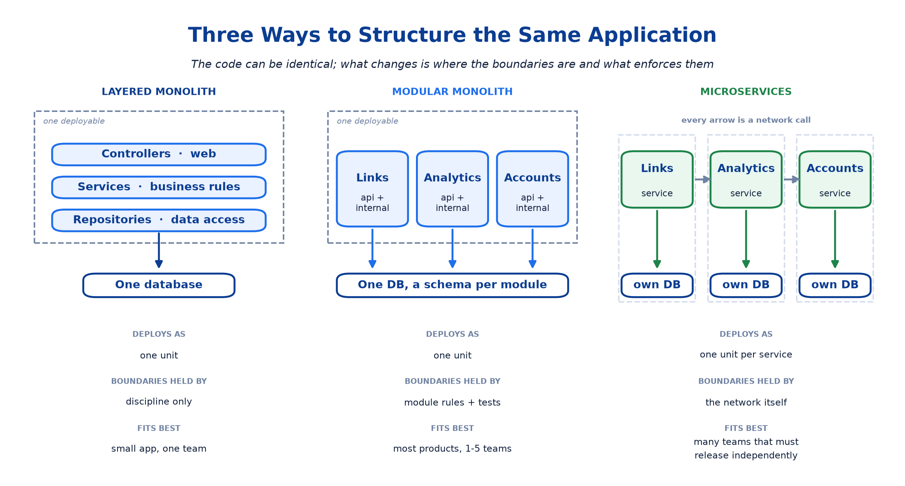
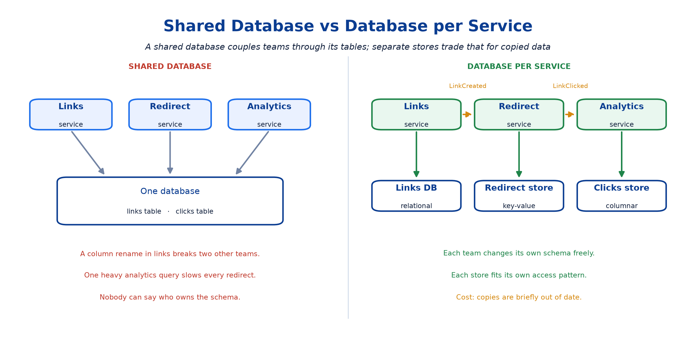

# Architecture Styles & Service Decomposition

## Terms to know before you start

You do not need to memorize these. Come back to this table whenever a term feels unfamiliar.

| Term | What it means in plain words |
|---|---|
| **Deployable unit** | One thing you build, test, and release as a whole, such as one JAR file or one container image. |
| **Monolith** | An application that is deployed as a single unit, even if its code is large and well organized. |
| **Module** | A self-contained part of a codebase with a small public interface and hidden internals. In a monolith, modules call each other with ordinary method calls. |
| **Service** | A separately deployed program that other programs call over the network. |
| **Microservices** | An architecture in which an application is split into many small services, each owned by one team and released on its own schedule. |
| **Domain** | The business area the software serves, such as links, billing, or analytics, with its own rules and vocabulary. |
| **Bounded context** | A boundary inside which every word has one exact meaning. "Link" can mean different things in billing and in analytics, and each context keeps its own model. |
| **Stateless service** | A service whose instances keep nothing between requests, so any instance can handle any request. |
| **Stateful service** | A service whose instances hold data that matters, such as a database or a server holding live user sessions. |
| **Service discovery** | How a caller finds the current network addresses of the healthy instances of a service. |
| **Configuration** | Settings that change between environments, such as database addresses and feature flags, kept outside the code. |
| **Distributed monolith** | A system split into services that still have to be changed and deployed together. It has the costs of both styles and the benefits of neither. |
| **Conway's law** | The observation that a system's structure tends to copy the communication structure of the teams that build it. |

??? info "Java and Spring features used on this page (open if they are new to you)"
    - **Packages** such as `com.shortener.links.api` are used to group classes. Classes without the `public` keyword are visible only inside their own package, which is the simplest way to hide a module's internals.
    - **ArchUnit** is a testing library that checks architecture rules, such as "nothing outside the links module uses its internal classes", as ordinary unit tests.
    - **`@Repository`** and **`@Service`** are Spring annotations that mark classes for Spring to create and connect at startup, as described in [Basics 3](03_LLD_Creational_And_Structural_Design_Patterns.md).
    - **`application.yml`** is a Spring Boot configuration file. Values such as `${DB_URL}` are filled in from environment variables when the application starts.

---

## 1. Architecture style is a decision, not a fashion

An **architecture style** answers two questions: how is the code split into parts, and how are those parts deployed and connected? The answer has little to do with what is fashionable, and everything to do with a few forces in your situation.

| Force | The question to ask | When the answer is yes, it points towards |
|---|---|---|
| **Team size** | Are several teams blocked waiting for each other to release? | Split the system into separately deployable units, so each team can release without waiting for the others. |
| **Different needs** | Does one part need a much higher availability, a different kind of hardware, or very different scaling than the rest? | Pull out just that one part, so it can be scaled, hosted, and protected on its own terms. |
| **Fault isolation** | Would a crash or memory leak in one feature take down a more important one? | Run them in separate processes, so a failure in one cannot crash the other. |
| **Change rate** | Does one part change daily while the rest changes monthly? | Put a clear boundary between them, at least as separate modules in the code, so the fast-moving part does not keep disturbing the stable one. |
| **Operational maturity** | Can the team run many services, with automated deployment, monitoring, and tracing? | If not, keep the number of deployable units small, whatever the other answers say. Every extra service is one more thing to deploy, watch, and fix. |

!!! tip "The decision in one sentence"
    Start with the fewest deployable units that meet the requirements, draw strong boundaries inside them, and split a part out only when it needs something the rest of the system cannot give it.

**The running example.** [Basics 1](01_Interview_Framework_And_Capacity_Estimation.md) designed a URL shortener as one stateless application, and [Basics 4](04_Networking_And_Request_Lifecycle.md) followed one redirect through it. This page follows the same product into its **second year**, when it has grown:

| What changed | Year one | Year two |
|---|---|---|
| Features | Users can create short links and get redirected. | Users also get accounts, custom domains, click dashboards, and paid plans. |
| Peak traffic | 8,000 redirects and 80 new links per second. | 20,000 redirects, 200 new links, and about 50 dashboard requests per second. |
| People | One team of 5 engineers. | Four teams, about 25 engineers in total. |
| Availability target | 99.9% for everything. | **99.99% for redirects**, because a broken link looks like a broken website to whoever shared it. 99.9% for everything else. |

The question for the rest of this page: should year two split the application into services, and if so, where?

---

## 2. The architecture styles



The three styles in the picture can contain the same code. What changes is **where the boundaries are, and what enforces them**: nothing but discipline in a layered monolith, rules and tests in a modular monolith, and the network itself in microservices. Each style below fixes a problem with the one before it, and adds a cost.

### Layered architecture

The most familiar structure splits code by technical role. Each layer may only call the layer directly below it:

```text
com.shortener
├── controller     LinkController, AccountController, DashboardController   (HTTP in, JSON out)
├── service        LinkService, AccountService, BillingService              (business rules)
├── repository     LinkRepository, AccountRepository, ClickRepository       (SQL)
└── model          Link, Account, Click                                     (shared data classes)
```

**What it gets right.** Every developer knows where a controller or a repository lives, and the rule "controllers never write SQL" keeps the worst tangles out.

**What goes wrong as it grows.** The layers say nothing about the *business*. Adding custom domains touches a controller, a service, a repository, and a model, in four different packages. Worse, nothing stops `BillingService` from calling `LinkRepository` directly, or `DashboardController` from reading the `Click` table, so after a year every part of the business can reach every other part. This is often called a "big ball of mud". It is not because layers are wrong, but because layers alone draw no boundaries between business areas.

!!! question "Practice"
    In a layered codebase, where does the code for one feature, such as "custom domains", end up? Why is that a problem when four teams share the codebase?

??? success "Answer"
    It is spread across every layer: a controller, a service, a repository, and model classes. Every team edits every layer, so two teams changing unrelated features still collide in the same packages and files, and nobody owns any one package. Grouping code by business area, as the modular monolith does below, gives each team its own place.

### Hexagonal architecture (ports and adapters)


In the layered picture, the arrows point down, so the business rules depend on the database code beneath them. Testing a rule needs a database, and changing the storage means editing the services. **Hexagonal architecture**, also called *ports and adapters*, flips those arrows. It is the Dependency Inversion rule from [Basics 2](02_LLD_Object_Oriented_Principles_And_Clean_Code.md), applied to the whole application:

- The **domain** (the business rules) sits in the middle and imports no framework or database code.
- The domain defines **ports**: interfaces describing what it needs (`LinkRepository`) or offers (`CreateLink`).
- **Adapters** live outside and plug into the ports. Some *drive* the domain (a REST controller or a scheduled job calls a port); others *are driven* by it (a Postgres class implements `LinkRepository`).

```java
// Inside the domain: a port, shaped around what the business needs, not around SQL
public interface LinkRepository {
    Optional<Link> findByCode(ShortCode code);
    void save(Link link);
}

// Inside the domain: business rules, with no imports from Spring, JDBC, or HTTP
final class LinkService {
    private final LinkRepository links;
    LinkService(LinkRepository links) { this.links = links; }

    Link create(LongUrl url, AccountId owner) { /* rules: quota, blocked domains, code generation */ }
}

// Outside the domain: an adapter, and the only class that knows about Postgres
@Repository
final class PostgresLinkRepository implements LinkRepository { /* SQL lives here, and only here */ }
```

The adapter is exactly the Adapter pattern from [Basics 3](03_LLD_Creational_And_Structural_Design_Patterns.md): it translates between the interface the domain expects and the API a tool provides. In tests, a `FakeLinkRepository` backed by a `HashMap` replaces Postgres, so business rules are tested in milliseconds.

**Watch out:** for a small CRUD service with almost no business rules, ports for everything are ceremony. Use this style where the rules are worth protecting.

!!! question "Practice"
    A teammate's `LinkService` constructor creates a `JdbcTemplate` and writes SQL inline. Which two problems does that cause, and how does hexagonal architecture fix them?

??? success "Answer"
    First, the business rules cannot be tested without a real database. Second, the rules and the storage details change for different reasons but live in one class, so a schema change risks breaking a business rule. The fix is to define a `LinkRepository` port in the domain, move the SQL into a `PostgresLinkRepository` adapter, and pass the repository into `LinkService` through its constructor.

### The modular monolith

A **modular monolith** is still one application, built and deployed as a single unit. What changes is how the code inside it is organized: it is split into **modules by business area**, such as links, accounts, billing, and analytics. Each module is a closed box. Other modules may use only its small public API, never its internal classes or its tables.

The layered style groups code by *technical job*: all controllers in one package, all services in another, all repositories in a third, so one feature is spread across all of them. A modular monolith groups code by *business area* instead, so everything about links lives in one place, owned by one team.

**Is this different from hexagonal architecture?** Yes. The two answer different questions, and they work well together:

| | Hexagonal architecture | Modular monolith |
|---|---|---|
| **The question it answers** | How is the code *inside one area* arranged? | How is the *whole application* split into areas? |
| **Where it draws the line** | Between the business rules and the technical tools, such as the database and HTTP. | Between business areas, such as links and billing. |
| **What it protects against** | Business rules breaking when the database or the framework changes. | One team's change breaking another team's code. |

So hexagonal architecture separates *rules from tools*, and a modular monolith separates *one business area from another*. You can use both at once: each module can be hexagonal on the inside, as `links` is below.

```text
com.shortener
├── links                one module = one business area, owned by one team
│   ├── api              LinkApi, LinkView          <- public: the only classes other modules may use
│   └── internal         LinkService                <- hidden from other modules, and hexagonal inside:
│                        LinkRepository                the domain, its port,
│                        PostgresLinkRepository        and the adapter that implements it
├── accounts
│   ├── api              AccountApi, PlanLimits
│   └── internal         ...
├── billing
└── analytics
```

Here `api` is just a Java package of public interfaces, not a REST API. Modules call each other with ordinary method calls, inside the same process, with no network involved.

A modular monolith lives or dies by three rules:

1. **Modules talk only through each other's `api` package.** No module calls another module's internal classes.
2. **Each module owns its tables.** Each module gets its own database schema, and no module reads another module's tables, even though they share a database server.
3. **The rules are checked automatically**, because a rule that is not tested will eventually be broken by someone in a hurry.

The third rule is a few lines with ArchUnit, and it runs with the other unit tests:

```java
@ArchTest
static final ArchRule modulesUseOnlyPublicApis =
        noClasses().that().resideOutsideOfPackage("..links..")
                .should().dependOnClassesThat().resideInAPackage("..links.internal..");
```

(Spring Modulith provides the same checks for every module at once, based on the package structure.)

**What this gives year two.** Each team owns one module and its schema. Teams still share one build and one release, but their code no longer tangles. And if one module must later become its own service, its boundary is already clean: the `LinkApi` interface becomes a network API, and its schema moves to its own database. That is a far smaller step than untangling a big ball of mud.

!!! question "Practice: code review"
    To build a dashboard faster, the analytics module runs `SELECT title FROM links.links WHERE code = ?` directly. The query works. Which rule does it break, and why does it matter?

??? success "Answer"
    It breaks **"each module owns its tables"**. Analytics now depends on the exact structure of the links table, so the links team cannot rename that column, split the table, or move it to another database without breaking analytics, often without knowing analytics depends on it. The fix is to call `LinkApi` (for example, `linkApi.titlesFor(codes)`), or to keep a copy of titles inside analytics, updated by events (section 5).

### Microservices

**Microservices** take module boundaries and turn each one into a separate deployable unit, with its own process, its own data store, and usually its own team. The boundary is now enforced by the network: another team physically cannot call your internal classes.

**Do modules in a modular monolith call each other over the network too?** No, and that is the key difference. In a modular monolith, when analytics needs link titles it calls `linkApi.titlesFor(codes)`, an ordinary Java method call inside the same running program. Nothing is sent over the network, and the two modules can even share one database transaction if they need to. In microservices, that same call becomes a network request, such as `GET /links/titles?codes=...` over HTTP or gRPC: the arguments are turned into bytes, sent to another machine, and the answer comes back the same way. The boundary sits in the same place, and the interface can look identical. What changes is what happens each time you cross it, which is why almost every cost in the right-hand column below comes from the network.

| What you gain | What you pay |
|---|---|
| Each team releases on its own schedule, without coordinating a shared release. | Every call between services is a network call, with the latency, timeouts, pools, and failure modes from Basics 4. |
| One service can scale, or use different hardware, independently. | Data is spread across stores, so cross-service queries and transactions become hard (section 5). |
| A crash or memory leak stays inside one service. | Failures become partial: one service is down while others are up, and every caller must handle that. |
| Each service can use the technology that best fits its job. | Every service needs its own build pipeline, deployment, monitoring, alerts, and on-call rotation. |
| Ownership is unmistakable: one team, one service. | Debugging one user request means following it across many services, which needs distributed tracing. |

The network cost is the one beginners underestimate. A method call inside one process takes nanoseconds and never fails because of the network. A call to another service in the same data center takes about half a millisecond at best, and it can time out, be refused, or return an unknown outcome. Chains of calls multiply both problems: if one user request passes through five services, each 99.9% available, the chain is only about 0.999⁵ ≈ **99.5%** available, which allows roughly 44 hours of downtime a year instead of 9. Combining availabilities is covered in **Basics 14 (Availability & Deployment Fundamentals)**.

??? info "Go deeper (optional): the fallacies of distributed computing"
    In the 1990s, engineers at Sun Microsystems listed false assumptions that people make when they move code across a network. The first four do the most damage when splitting a monolith: *the network is reliable*, *latency is zero*, *bandwidth is infinite*, and *the network is secure*. Every one of them is true of a method call and false of a network call. Each time you draw an arrow between two services, ask what happens when that arrow is slow, fails, or is attacked.

**When microservices are the right answer.** When there are several teams blocked by a shared release, when parts of the system have truly different availability, scaling, or security needs, and when the organization can already run many services well. If those conditions are not met, a modular monolith gives most of the benefits at a fraction of the cost.

!!! question "Practice"
    A startup with 6 engineers and one product wants to begin with 12 microservices "so we can scale later". What would you tell them?

??? success "Answer"
    Twelve services for six engineers means each engineer runs two services, with twelve pipelines, twelve sets of alerts, and network calls where method calls would do. Nothing in their situation needs independent releases or isolation yet. Start with a modular monolith with strict module boundaries. If a team or a scaling need later demands it, a clean module can be extracted into a service. Splitting is easier than merging, but only when the boundaries were clean in the first place.

### Other styles you will hear about

| Style | The idea | A typical use case |
|---|---|---|
| **Event-driven architecture** | Services announce facts, such as "LinkCreated", and any service that cares reacts to them. The sender does not call the others directly, or wait for them. | When a short link is created, the abuse scanner, the analytics store, and the search index each react to one `LinkCreated` event. Adding a fourth reaction later needs no change to the Link API. |
| **Serverless (functions as a service)** | You deploy single functions instead of servers. The platform starts them when a request or event arrives, scales them automatically, and charges per call. Best for short tasks with spiky or rare traffic. | Making a QR code image each time a link is created. Nothing runs, or costs money, between requests, and a burst of 1,000 new links simply runs 1,000 copies at once. |
| **Service-oriented architecture (SOA)** | An older style of large services shared across a whole company, often connected through a central message bus that also held business logic. Microservices grew partly as a reaction to its central bottleneck. | A bank in the 2000s, where online banking, branches, and the call center all use one shared Customer service through an enterprise service bus. You meet it today mostly in older enterprise systems. |
| **Cell-based architecture** | The whole stack, from servers to databases, is copied into independent "cells", and each cell serves its own slice of users. A failure or a bad release stays inside one cell. | A business app with thousands of customer companies places each company in one of 20 cells. When one cell's database fails, about 5% of customers are affected instead of all of them. |

---

## 3. Stateless vs stateful services


Whatever the style, each running part is either **stateless**, keeping nothing between requests, or **stateful**, holding data that matters. This one property decides how easily a part can be scaled, deployed, and recovered.

The classic mistake is to keep user sessions in a server's memory:

```java
// Stateful: the session exists only inside this one server's memory
final class SessionHolder {
    private final Map<String, Session> sessions = new ConcurrentHashMap<>();
    Session find(String sessionId) { return sessions.get(sessionId); }   // null on any other server
}
```

This works on one server. With twelve, a user who logs in on server 3 appears logged out on server 7. The usual workaround is **sticky sessions**, where the load balancer always sends the same user to the same server, but the picture shows the price: when that server crashes, is scaled in, or is redeployed, its users lose their sessions.

The fix is to move the state out of the instances, so that every instance looks the same:

| Option | How it works | Trade-off |
|---|---|---|
| **Shared session store** | Sessions are kept in Redis or a database that every instance can read, so any instance can serve any user. | Every request needs one extra, fast lookup, and you have one more system to run and keep available. |
| **Signed token** | The session data travels with each request in a signed token, such as a JWT, that any instance can verify. | No lookup is needed, but a token is hard to cancel before it expires, for example when a user logs out or is banned. Covered in Basics 6. |

Some parts are stateful by nature: databases, caches, message brokers, and servers that hold open WebSocket connections. You cannot make them stateless, so you treat them differently:

| | Stateless services | Stateful services |
|---|---|---|
| **What an instance keeps** | A stateless instance keeps nothing that matters between requests. Everything it needs either arrives with the request or is read from a shared store. | A stateful instance keeps data or connections that later requests depend on, such as stored rows, cached values, or a user's open WebSocket. |
| **Scaling up** | You add more identical copies behind a load balancer. Because any copy can handle any request, a new copy starts helping as soon as it is running. | Adding a machine is not enough on its own. You also have to split the data across machines (partitioning) and keep copies of it for safety (replication). Both are covered in Basics 12. |
| **When an instance crashes** | Nothing is lost when a stateless instance crashes. The load balancer stops sending it traffic, and the other copies carry on serving users. | The crashed instance's data survives only if another machine holds a copy of it (a replica). That machine must then take over the crashed instance's job. |
| **Deploying a new version** | You can replace the instances one at a time, whenever you like, because they are all interchangeable. | You must first hand over the instance's data and open connections, then restart one instance at a time. Otherwise, users lose data or get disconnected. |
| **Typical examples** | Most application logic is stateless, such as the Link API and the dashboard backend. | Databases, caches, message brokers, and servers that hold WebSocket connections are all stateful. |

**The design rule:** push state down into a few well-run stateful systems, and keep everything above them stateless.

!!! question "Practice: the note-taking app"
    The note-taking app keeps each user's unsaved draft in the memory of the server handling their requests, with sticky sessions. What happens during a deployment, and how would you fix it?

??? success "Answer"
    A rolling deployment restarts every server, so every user loses their unsaved draft at some point, and a crash loses the drafts of everyone on that server. Save drafts to a shared store instead: write them to the database every few seconds, or keep them in Redis with an expiry. The servers become stateless, deployments and crashes stop losing work, and sticky sessions are no longer needed.

---

## 4. Drawing boundaries: domain-driven design and bounded contexts

Whether the boundaries become modules or services, the hard part is **where to draw them**. Boundaries drawn around technical layers or database tables usually go wrong (see the entity-service trap below). The most reliable guide is **domain-driven design**.

### Domain-driven design in a nutshell

**Domain-driven design (DDD)** is an approach, introduced by Eric Evans in 2003, that shapes software around the business it serves instead of around the database or the framework. Its central habit is simple: developers and business experts work out the business together, use the same words for the same things, and let those words shape both the code and its boundaries.

These are the ideas worth knowing at this stage:

| Idea | What it means | In the URL shortener |
|---|---|---|
| **Domain** | The business area the software serves, with its own rules and vocabulary. | Creating short links, redirecting visitors, and charging for plans. |
| **Subdomains** | The smaller business areas inside the domain. The *core* subdomain is what makes the product special, so it gets the most care. *Supporting* ones are needed but not special. *Generic* ones are the same at every company, so they are often bought instead of built. | Core: link management and redirects. Supporting: analytics. Generic: payments, which a payment provider handles. |
| **Ubiquitous language** | One shared vocabulary that business people and developers both use, in meetings and in the code. If the business says "quota", the class is called `Quota`, not `UsageLimitRecord`. | "Short code", "expiry", and "quota" mean exactly the same thing in a planning meeting as in the code. |
| **Bounded context** | A boundary inside which every word has one exact meaning and one model. The same word can mean something else in another context, and that is fine. | "Link" means four different things in four contexts, as the next part shows. |
| **Context map** | A picture of the contexts and how they relate: who calls whom, who listens to whose events, and what data crosses each line. | The arrows in the picture below. |
| **Aggregate** | A small group of objects that must always change together, in one transaction, through one entry point. | A link and its tags. Tags are changed only through their link, so the two are always saved together. |

The first five ideas are DDD's *strategic* side: they decide where boundaries go, which is what this section is about. Aggregates belong to its *tactical* side, the patterns for code inside one context, and you have already met others in this doc. `ShortCode` and `LongUrl` are *value objects*, `LinkRepository` is a *repository*, and `LinkCreated` is a *domain event*. Most of DDD's value comes from the strategic side, so start there.

### Bounded contexts: one word, four meanings


Look at what the word "link" means in each part of the year-two URL shortener:

- **Link management** cares about everything a user can edit: the code, the long URL, the owner, a title, tags, and an expiry date.
- **Redirect** needs only the code and the long URL. Nothing else helps it send a visitor on their way.
- **Analytics** sees a link as a code plus its clicks, broken down by day, country, and referrer.
- **Billing** sees a link as one unit of a plan's quota. Its URL and title do not matter at all.

Forcing one `Link` class to serve all four, as in the red box, creates a class that every team edits and no team owns, so a change made for analytics can break redirects. Instead, **each context keeps its own small model**, and the contexts exchange only what they need.

### Signals that a boundary is in the right place

| A good boundary | A poor boundary |
|---|---|
| It follows a **business capability**: "manage links", "serve redirects", "bill customers". | It follows a **technical layer**: a "database service" or a "validation service". |
| Code that **changes for the same reason** lives inside the same boundary. | A typical feature needs changes in three services, released together. |
| Data that must stay **consistent within one transaction** lives inside the same boundary. | A simple operation needs a transaction that spans several services. |
| **One team** owns it completely, from the code to the on-call rotation. | Two teams share it, or one team's work is spread across many services. |
| Calls across it are **few and coarse**: "create this link". | Calls across it are many and small: "get the owner", then "get the owner's plan", then "get the plan's limits". |

!!! warning "The entity-service trap"
    A very common first attempt makes one service per noun: `LinkService`, `UserService`, `ClickService`, each a thin wrapper around one table. Every real feature then needs several of them, called in sequence, so the services are tightly coupled through constant, chatty calls. Split by what the business **does** (capabilities), not by the nouns in the database.

### Ownership and Conway's law

Systems tend to copy the communication structure of the teams that build them. If two teams share one service, its code soon develops a seam along the team boundary anyway; if one team owns parts of five services, every feature needs five releases. So design teams and boundaries together: each context should have exactly one owning team that builds it, runs it, and is on call for it. Deliberately shaping teams to get the architecture you want is called the **inverse Conway maneuver**.

!!! question "Practice: the note-taking app"
    The note-taking app now has these features: writing and editing notes, sharing notes with other users, full-text search, and a paid plan with storage limits. Propose bounded contexts, and name one word that means different things in two of them.

??? success "Answer"
    A reasonable split is **Notes** (writing, editing, and versions), **Sharing** (who can see or edit which note), **Search** (indexing and querying), and **Billing** (plans and storage limits).

    "Note" is a good example. In Notes, it is the full document with its history. In Search, it is a set of searchable words plus an ID. In Billing, it is only a size in bytes that counts against a storage limit. Each context keeps just the fields it needs.

---

## 5. Data ownership: shared database or one per service



Boundaries in the code mean little if every part still reads every table. **Whoever owns a context owns its data**, and that leaves three practical options:

| Option | How it works | Trade-off |
|---|---|---|
| **Shared tables** | Every module or service reads and writes the same tables. | Easy joins and transactions, but every table becomes a shared contract: one team's column rename breaks another team's code, and one team's heavy query slows everyone. |
| **Shared server, schema per owner** | One database server, but each owner has its own schema, and nobody reads anyone else's. | The right default for a modular monolith. Ownership is clear, and moving a schema to its own server later is straightforward. |
| **Database per service** | Each service has its own data store, which can even be a different type of database. | Full independence, and each store fits its access pattern (key-value for redirects, columnar for analytics), but data must be copied between services, and those copies lag behind. |

**When you need data you do not own**, you have three choices:

| Choice | Example | Cost |
|---|---|---|
| **Ask the owner, synchronously** | The dashboard calls `LinkApi.titlesFor(codes)` when it renders. | Adds a network call and a runtime dependency: if links is down, the dashboard is degraded. |
| **Keep a local copy, updated by events** | Analytics stores each link's title when it receives `LinkCreated` or `LinkRenamed`. | No runtime dependency, but the copy is briefly out of date, which is called **eventual consistency**. |
| **Move the boundary** | If two contexts constantly need each other's data in one transaction, they may really be one context. | It means a redesign, but it is often the honest fix, because the boundary was drawn in the wrong place. |

!!! warning "Publishing events reliably"
    "Save to my database, then publish an event" has a gap: if the service crashes between the two steps, the event is lost and every copy is wrong forever. The standard fix, the **outbox pattern**, saves the event in the same database transaction as the change, and a separate process publishes it. It is covered in **Advanced 6 (Event-Driven Systems & Message Queues)**. When an operation must change data in several services, such as "charge the card, then upgrade the plan", it becomes a **saga**: a sequence of local transactions with undo steps if a later step fails, covered in **Advanced 4 (Distributed Transactions & Consensus)**.

!!! question "Practice"
    The URL shortener's dashboard shows each link's title next to its click count. Titles belong to link management; click counts belong to analytics, in a separate store. Give two ways to build this page, and the trade-off between them.

??? success "Answer"
    1. **Compose at read time:** the dashboard asks analytics for the counts and link management for the titles, then joins them in memory. The data is always current, but the page depends on both services being up and fast.
    2. **Keep a copy:** analytics stores each link's title, updated from `LinkCreated` and `LinkRenamed` events, so one query returns both. The page has a single dependency and is faster, but a renamed link may show its old title for a few seconds.

    For a dashboard, a few seconds of stale titles is acceptable, so the copy is usually the better choice. For something that must be exact, such as a bill, it would not be.

---

## 6. Running many services: discovery and configuration

Once a system is split into services, each service needs two things to run. It must find the other services it calls, and it must get its own settings for each environment, such as dev, staging, and production. The two meet at one point: a service's configuration holds the *name* of each service it calls, and discovery turns that name into a healthy instance.

### Service discovery: finding the other services


Instances are replaced all the time, and each new one gets a new IP address. So callers use a service name instead, and a discovery system keeps that name pointing at the healthy instances.

| Approach | How it works | Trade-off | Examples |
|---|---|---|---|
| **Client-side discovery** | Each instance registers with a registry and keeps sending heartbeats to show it is alive. The caller asks the registry for the list of instances and picks one itself. | There is no extra network hop. However, every caller needs a discovery library, in every language you use. | Eureka and Consul are common registries. |
| **Server-side discovery** | The caller sends its request to a stable name. A load balancer behind that name forwards the request to a healthy instance. | Callers stay simple because the platform does the work. The cost is one small extra network hop. | Kubernetes Services and cloud load balancers work this way. |
| **Service mesh** | A small proxy runs beside every instance and handles its calls. The proxy takes care of discovery, retries, and encryption between services (mTLS). | It works the same way for every language. However, it is one more complex system that you must run and debug. | Istio and Linkerd are popular service meshes. |

All three approaches rely on **health checks** to remove broken instances, as the crashed instance in the picture shows. Health checks are covered in **Basics 14 (Availability & Deployment Fundamentals)**. You also still need the timeouts from Basics 4. If discovery sends your request to an instance that has hung, only a timeout stops your call from waiting forever.

### Configuration: one build, every environment

Each service also needs settings that differ between environments, such as database addresses, passwords, and feature flags. A monolith needs these too, but every new service adds its own set of settings and secrets to manage. The rule is to build the code once and run that same build everywhere, so anything that differs between environments lives outside the code:

```yaml
# application.yml: the same build runs in every environment; each ${...} value is filled in at startup
link-api:                                  # this service's own settings
  redirect-cache-ttl: 10m                  # 10 minutes; same in every environment, so written directly
  analytics-url: http://analytics          # a service name; discovery finds a healthy instance
database:
  url: ${DB_URL}                           # the database's address; each environment sets its own DB_URL
  password: ${DB_PASSWORD}                 # filled in from a secrets manager; never stored in git
features:                                  # feature flags
  custom-domains-enabled: ${CUSTOM_DOMAINS_ENABLED:false}   # off unless switched on
```

| Kind of setting | Where it lives | Rule |
|---|---|---|
| **Safe defaults** | Safe defaults live in the code itself, for example in `application.yml`. That is Spring Boot's settings file, and other frameworks use similar files, such as `appsettings.json` in .NET. | You change them through normal code review, like any other code. |
| **Environment settings**, such as database addresses and pool sizes | They live in environment variables or in a config service. On Kubernetes, environment variables usually come from a ConfigMap. Common config services are Spring Cloud Config, Consul, and AWS Systems Manager Parameter Store. | You build the code once and deploy that same build to staging, then to production. Only the settings change. |
| **Secrets**, such as passwords and API keys | They live in a secrets manager. Common choices are HashiCorp Vault and Akeyless, or the one built into your cloud: AWS Secrets Manager, Azure Key Vault, or Google Secret Manager. | You never commit them to git or write them to logs, and you rotate them regularly. |
| **Feature flags** | They live in a feature-flag service. Common choices are LaunchDarkly, Unleash, and Flagsmith. | A flag changes behavior at runtime without a deployment. This also gives you a fast off switch for a bad release. |

!!! question "Practice"
    A team stores the production database password in `application-prod.yml`, inside the git repository, "because the repository is private". What are two risks, and what is the fix?

??? success "Answer"
    First, anyone who can read the repository now has the production password. So does every laptop, CI system, and backup that holds a copy, and git history keeps the password even after the file is changed. Second, changing the password now needs a code change and a deployment.

    The fix is to store the password in a secrets manager and have it filled in at startup through `${DB_PASSWORD}`. Then rotate it, and treat the old value as leaked.

---

## 7. Splitting a monolith safely

When a part really does need to become a service, do not rewrite it from scratch and switch over in one go. Instead, build the new service next to the old code and send it a small share of the traffic at first, then more and more. The old code keeps running the whole time, so if something goes wrong you can send the traffic back. You delete the old code only once the new service handles everything.

This approach is called the **strangler fig** pattern. A strangler fig is a vine that starts small on a tree, slowly grows around it, and in the end takes the tree's place. The new service does the same thing to the old module. The steps are:

```text
1. MODULARIZE  Give the part a clean module boundary and its own schema, inside the monolith.
2. ROUTE       Put a router (often the load balancer) in front, so its traffic can be sent elsewhere.
3. BUILD       Run the new service beside the monolith, behind the same API contract.
4. SHIFT       Move traffic gradually: 1% -> 10% -> 50% -> 100%, comparing results and errors.
5. MIGRATE     Move the data to the service's own store, keeping both in sync during the switch.
6. DELETE      Remove the old module from the monolith. Until this step, rolling back is one config change.
```

Step 1 does most of the work. A part that cannot be separated cleanly *inside* the monolith will not separate cleanly across a network either. Moving data without downtime is covered in **Advanced 16 (Data Migration & Zero-Downtime Evolution)**.

---

## 8. Putting it together: the URL shortener, year two

![URL shortener in year two, with two numbered flows. Creating a link, steps 1 to 4: the load balancer sends POST /app/links to the Links module, which saves the link and an outbox row in the main database; an outbox relay publishes LinkCreated to the event bus; the redirect service reads it and saves a copy in its own store. Following a link, steps A to D: the load balancer sends GET /abc123 to the redirect service, which looks the code up in its store, publishes LinkClicked to the event bus, and click workers save totals in the analytics store](assets/topic-05/url_shortener_year_two.png)

Now apply the forces from section 1 to the year-two requirements. The rule is to split only where a part needs something the rest cannot give it.

| Part | Decision | The need that justifies it |
|---|---|---|
| **Redirect service** | Extract as its own small, stateless service, with its own key-value store of code → URL. | It alone needs **99.99%** availability, and it carries **99% of the traffic** (20,000 requests per second against about 250 for everything else). It must keep working when the dashboards, billing, or the main database fail, and it must not be redeployed every time billing ships a change. |
| **Click workers and analytics store** | Run separately, fed by `LinkClicked` events. | Recording 20,000 clicks per second is write-heavy batch work with a different shape from everything else, and it was already asynchronous in Basics 1. A slow analytics pipeline must never slow down a redirect. |
| **Links, accounts, billing, and dashboards** | Keep together as one **modular monolith**, with a schema per module. | They share a 99.9% target, a modest load, and frequent features that cross modules (such as "plan limits on links"). Four teams can work in four modules without the cost of four services. |

**How data flows.** The picture shows two separate flows, and each one has its own trail of numbers. The key idea in both is the same: **the parts do not call each other while a user is waiting**. They pass events through the event bus instead, so a slow or broken part cannot hold up the others.

**Creating a link (steps 1 to 4).** Asha creates the short link `/abc123` from her dashboard.

| Step | Who talks to whom | How | What happens |
|---|---|---|---|
| **1** | Asha's browser → load balancer → **Links module** | Call: `POST /app/links` | The load balancer sees the `/app` path and forwards the request to the link management app, where the Links module checks that the link is valid. |
| **2** | Links module → **main database** | Call, in one transaction | The Links module saves the new link. In the same transaction, it also saves a `LinkCreated` row in an **outbox** table, so the link and its event are saved together or not at all (see "Publishing events reliably" in section 5). Asha gets her reply now. |
| **3** | Outbox relay → **event bus** | Event: `LinkCreated` | A small background process in link management reads new outbox rows and publishes them to the event bus. |
| **4** | Event bus → **redirect service** → redirect store | Event, then a write | The redirect service reads `LinkCreated` and saves `abc123 → long URL` in its own redirect store. From this moment, the short link works. |

Notice who **never** calls whom: link management does not call the redirect service, and does not wait for it. If the redirect service is down for a minute, Asha can still create links, and the redirect service catches up from the event bus when it comes back. Changing or deleting a link follows exactly the same four steps, with `LinkChanged` or `LinkDeleted` events.

**Following a short link (steps A to D).** A visitor clicks `/abc123`.

| Step | Who talks to whom | How | What happens |
|---|---|---|---|
| **A** | Visitor's browser → load balancer → **redirect service** | Call: `GET /abc123` | The load balancer sees a short-link path and forwards the request to the redirect service. |
| **B** | Redirect service → **redirect store** | Call: a read | The redirect service looks up `abc123` in its own store and replies with a `302` redirect. It never calls link management, and never reads the main database. |
| **C** | Redirect service → **event bus** | Event: `LinkClicked` | After replying, the redirect service publishes one `LinkClicked` event. The visitor does not wait for this. |
| **D** | Event bus → **click workers** → analytics store | Event, then a write | The click workers read `LinkClicked` events, count them in batches, and save the totals in the analytics store. |

Later, when Asha opens her click dashboard, the Dashboards module **calls analytics' API** to get the totals. This is the only direct call between two parts, and it happens on the quiet dashboard path, never on the busy redirect path. No part ever reads another part's tables.

**The failure path.**

1. **The main database goes down.** Users cannot create links or view dashboards, but every existing link keeps redirecting, because the redirect service reads only its own store. This is exactly why it was extracted.
2. **The event bus is delayed.** A brand-new link may not redirect for a few seconds. If that is unacceptable, the redirect service can, on a miss, ask link management directly with a tight timeout. That adds back a runtime dependency on the rarely used miss path only, which is a trade-off worth stating out loud.
3. **The analytics pipeline falls behind.** Dashboards show slightly old numbers; redirects are unaffected, because events wait safely in the queue.

**Change walkthrough.** A good decomposition keeps each likely change inside one part:

| Change request | What changes | What stays untouched |
|---|---|---|
| Add a new plan tier | Only the billing and accounts modules change. | The redirect service and analytics are not touched. |
| Redirects must work for custom domains | The redirect service looks links up by domain plus code, and the events that feed it now carry the domain. | Billing and dashboards are not touched. |
| Add a "clicks by device" chart | The click workers record the device, and the dashboards module draws the chart. | Everything else. The redirect service only adds the device to the `LinkClicked` event it already sends. |
| Billing grows to its own team, with weekly compliance releases | The billing module is extracted into its own service, following the strangler fig steps in section 7. | Everything else stays as it is, because the module boundary and its schema already exist. |

The last row is the payoff of the modular monolith: when a new need arrives, the next split is a known, low-risk procedure instead of a rewrite.

!!! tip "The headline to say out loud"
    "One service is extracted because it alone needs 99.99% availability and carries 99% of the traffic. Everything else stays a modular monolith with strict module boundaries, so any part can be extracted later if a real need appears."

---

## 9. Common beginner mistakes

- **Starting with microservices.** Without several teams or truly different needs, services add network calls, pipelines, and on-call work, and give little back.
- **A distributed monolith.** If two services must always be changed and deployed together, they are one component paying network costs. Merge them, or move the boundary.
- **Sharing tables between services.** The schema becomes a hidden contract that no team can change safely.
- **One service per database table.** Entity services make every feature a chain of chatty calls. Split by business capability instead.
- **Long chains of synchronous calls.** Five services in a row multiply latency and divide availability. Prefer one coarse call, or an event.
- **Keeping sessions in instance memory.** It forces sticky sessions and loses users' state on every crash and deployment.
- **Boundaries without enforcement.** A modular monolith without automated rules quietly turns back into a big ball of mud.
- **Secrets in the repository.** Use a secrets manager, and have secrets filled in at startup.

---

## 10. Test yourself

These three problems increase in difficulty. Try each one on paper before opening the answer.

!!! question "Problem 1 (warm-up): stateless or stateful?"
    Classify each, and say how you would scale it: (a) a REST API that reads products from a database; (b) a chat server holding 50,000 open WebSocket connections; (c) PostgreSQL; (d) an image-resizing worker that reads jobs from a queue.

??? success "Answer"
    (a) **Stateless**: add instances behind a load balancer. (b) **Stateful**, because each connection lives on one server: scale by adding servers and spreading users across them, and drain connections gracefully during deployments. (c) **Stateful**: add read replicas, then partition the data if writes outgrow one machine. (d) **Stateless**: add workers; the queue holds the state, and any worker can take any job.

!!! question "Problem 2 (diagnosis): the services that deploy together"
    A company has `OrderService`, `OrderItemService`, and `OrderPricingService`. Almost every feature needs changes to all three, they are always deployed together in a fixed order, and placing one order takes 9 calls between them. What has gone wrong, and what would you do?

??? success "Answer"
    It is a **distributed monolith**, created by splitting one bounded context (orders) into entity services. The three change together, need consistent data together, and talk constantly, so every signal says they belong to one context.

    Merge them into one `Orders` service, or into one module of a monolith, with one schema, one transaction for placing an order, and in-process calls instead of nine network calls. If something inside orders genuinely needs separating later, such as a pricing engine with a different team and release schedule, split along *that* need, with one coarse call such as `quote(cart)`.

!!! question "Problem 3 (design): a food-delivery startup"
    A food-delivery company has 30 engineers in 5 teams: restaurants and menus, ordering and checkout, payments, delivery tracking (driver locations update every 4 seconds from 20,000 active drivers), and notifications. Today everything is one layered monolith, releases happen weekly and often break, and a bug in menu editing recently took down checkout. Propose an architecture for the next year.

??? success "Answer"
    Start by giving every capability a module with its own schema and enforced rules, so the five teams stop tangling. Then split only where a need differs:

    | Part | Decision | Reason |
    |---|---|---|
    | **Delivery tracking** | Separate service | 20,000 drivers every 4 seconds is about 5,000 location writes per second, of short-lived data, with a different store (in-memory or time-series) and very different scaling from the rest. |
    | **Payments** | Separate service | It needs strict security and compliance controls, a small audited surface, and careful releases. |
    | **Checkout** | Isolate from menu editing | The outage showed that a menu bug can kill revenue. Keep the menu *read* path that checkout needs fast and separate from the menu *editing* tools, for example through a copy of menus updated by events. |
    | **Notifications** | Asynchronous worker fed by events | Nothing should wait for an SMS. Order events go on a queue, and a worker sends messages. |
    | **Restaurants, menus, and ordering** | Stay in the modular monolith for now | Moderate load and shared release needs; extract later using the strangler fig if a team needs independence. |

    The expected outcome: tracking load and payment risk are isolated, a menu bug can no longer break checkout, and the team runs three or four deployable units instead of fifteen. Checkout and payments together need a saga for "charge, then confirm the order, or refund" (Advanced 4).

---

## 11. Key takeaways

- **Architecture style is a decision driven by forces, not fashion.** The forces are team size, parts with very different needs, fault isolation, change rate, and how many services the team can actually run.
- **Start with the fewest deployable units, and strong boundaries inside them.** The default is a modular monolith: modules by business capability, a schema per module, and boundaries enforced by tests.
- **Protect business rules with ports and adapters where the rules are worth it.** Infrastructure depends on the business core, never the other way round.
- **Keep services stateless.** Push state down into a few well-run stateful systems, so that any instance can handle any request and instances can be added or replaced freely.
- **Draw boundaries around bounded contexts, each owned by one team.** Never draw them around tables or layers: entity services that must change together become a distributed monolith.
- **Whoever owns a context owns its data.** Never read another context's tables. Ask its API, keep a copy updated by events, or move the boundary. Publish those events reliably with the outbox pattern.
- **Services find each other by name, and one build runs everywhere.** Discovery turns a name into healthy instances. Configuration is filled in at startup, and secrets come from a secrets manager.
- **Split only where a part needs something the rest cannot give it.** In year two, only the redirect service was extracted, because it alone needs 99.99% availability and carries 99% of the traffic.
- **Extract with the strangler fig.** Move traffic to the new service gradually, and keep a one-step rollback until the old code is deleted.
- **In interviews, name the force behind every boundary.** Say "I split this because it needs X that the rest cannot give it", then say what the split costs and what the simpler alternative would have been.
