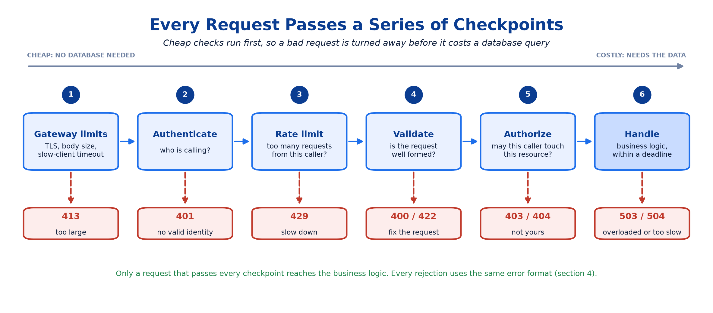
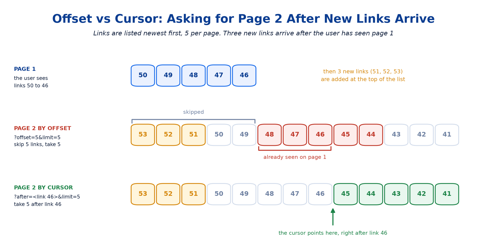
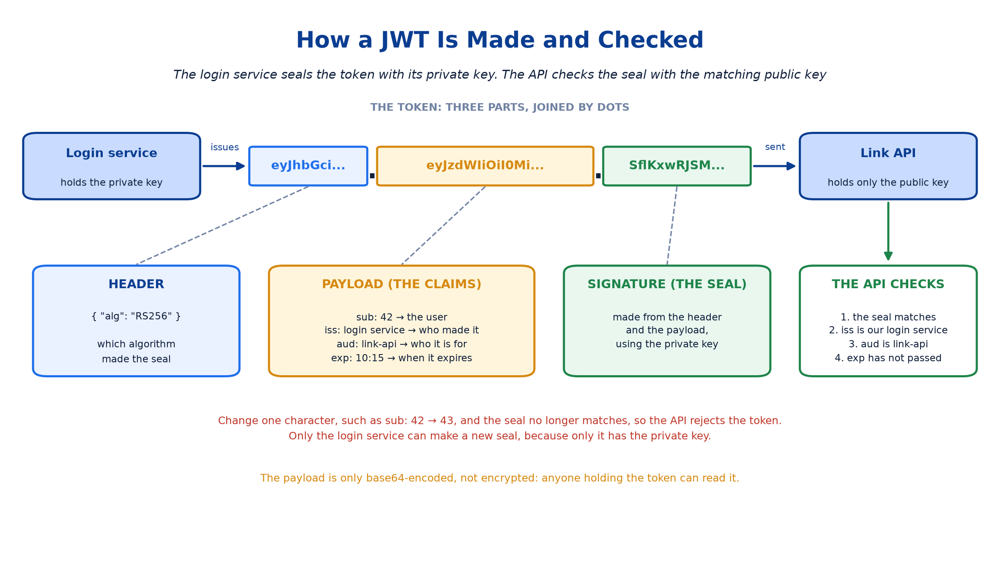
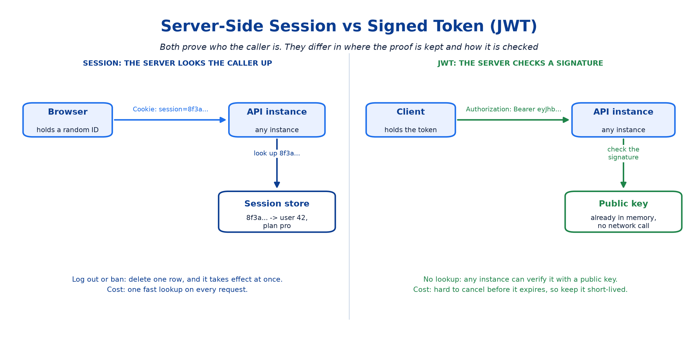
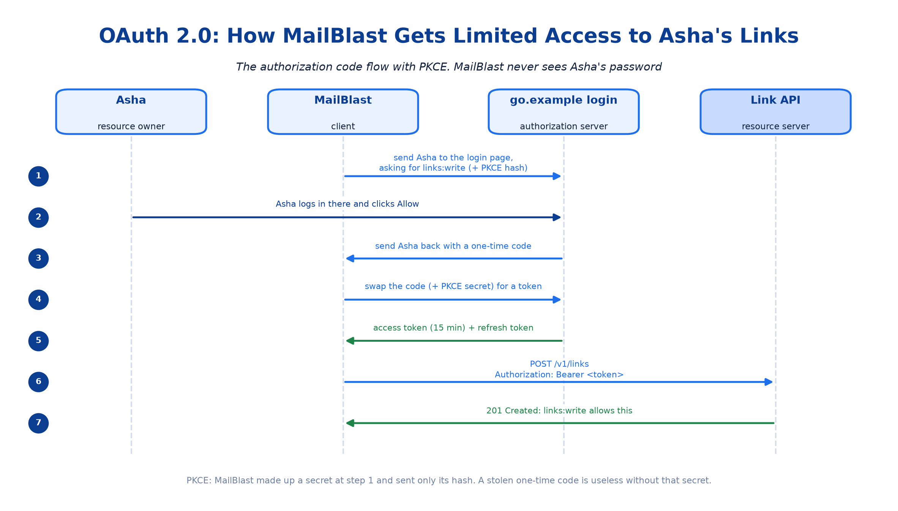

# API Correctness, Security & Resource Design

## Terms to know before you start

You do not need to memorize these. Come back to this table whenever a term feels unfamiliar.

| Term | What it means in plain words |
|---|---|
| **Resource** | A thing your API exposes, such as a link, a domain, or an account. Each resource has its own URL. |
| **Pagination** | Returning a long list one page at a time, so no single response is huge. |
| **Cursor** | A bookmark that the server returns with a page of results. The client sends it back to get the next page. |
| **Partial update** | Changing only some fields of a resource, instead of sending the whole resource again. |
| **Authentication (AuthN)** | Proving *who* the caller is, for example with a password, a token, or an API key. |
| **Authorization (AuthZ)** | Deciding *what* that caller is allowed to do, for example "Asha may edit her own links, but not Ben's". |
| **Session** | A record kept on the server that says "this browser belongs to user 42". The browser holds only a random ID for it, usually in a cookie. |
| **JWT (JSON Web Token)** | A signed token that carries facts about the caller, such as their user ID and expiry time. Any server holding the right key can check it without a lookup. |
| **OAuth 2.0** | A standard that lets a user give an app limited access to their data, without giving that app their password. |
| **OIDC (OpenID Connect)** | A thin layer on top of OAuth 2.0 that also tells the app *who* the user is. It powers "Sign in with Google". |
| **Scope** | A named permission inside a token, such as `links:read`. It limits what the token can do. |
| **API key** | A long random secret that identifies a calling program, such as a partner's server. |
| **Problem Details** | A standard JSON format for error responses (RFC 9457), so every error from every endpoint looks the same. |
| **Encryption at rest** | Encrypting data where it is stored, on disk or in backups, so stolen storage is unreadable. |
| **Secret** | Any value that grants access, such as a password, an API key, or a signing key. |

??? info "Java and Spring features used on this page (open if they are new to you)"
    - **`record`** declares a small, immutable data class in one line. Records work well for request and response bodies.
    - **Bean Validation** annotations such as `@NotBlank`, `@Size`, and `@Pattern` describe rules for fields. Adding `@Valid` to a controller parameter makes Spring check those rules before your method runs, and reject the request if any rule fails.
    - **`ProblemDetail`** is Spring's built-in class for the Problem Details error format.
    - **Spring Security** is the Spring library that handles authentication and authorization. Its `@AuthenticationPrincipal` annotation hands the current caller to a controller method.

---

## 1. An API is a promise to strangers

The moment other people's code calls your API, every URL, field, and error code becomes a promise. You can change the code behind the API whenever you like, but a careless change to the API itself breaks clients that you cannot see and cannot fix. That is why APIs deserve more care than ordinary internal code.

A correct and safe API answers four questions for every request:

| Question | What goes wrong if you skip it | Section |
|---|---|---|
| **What can the caller ask for, and in what shape?** | Clients get inconsistent URLs, huge unbounded lists, and updates that wipe out each other's changes. | 2 |
| **Who is calling, and what may they do?** | Strangers read other users' data. This is the most common serious API bug. | 3 |
| **What happens when a request is wrong, too big, or too slow?** | One bad client can crash a server, and every client has to guess what each error means. | 4 |
| **How are secrets and stored data protected?** | One leaked password or one stolen backup exposes every customer. | 5 |



The picture shows the order in which a well-built API applies these checks. The order matters: **the cheap checks come first**. Rejecting an oversized body costs almost nothing, while checking who owns a link needs a database query. A request that fails early never costs you the expensive steps.

**The running example.** [Basics 5](05_Architecture_Styles_And_Service_Decomposition.md) left the URL shortener in its second year, with a link management app (a modular monolith) and a separate redirect service. This page designs the **public API** of the link management app. It now has three kinds of caller:

| Caller | Who it is | What it needs |
|---|---|---|
| **The dashboard** | The company's own web app, running in a user's browser. | To manage the logged-in user's links, domains, and plan. |
| **The mobile app** | The company's own phone app. | The same as the dashboard, from a device that can be lost or stolen. |
| **Partner tools** | Other companies' software, such as MailBlast, an email-marketing tool that creates short links for every campaign email. | To create and read links in a customer's account, and nothing more. |

---

## 2. Designing resources

### Resources, not actions

A **resource-oriented** API is organized around *things* rather than *actions*. Each thing gets a URL, and the HTTP method says what to do with it. The methods and their retry rules were covered in [Basics 4](04_Networking_And_Request_Lifecycle.md#http-the-request-itself); here we use them.

| Action-style URL (avoid) | Resource-style URL (prefer) |
|---|---|
| `POST /createLink` | `POST /v1/links` |
| `GET /getLinkStats?code=summer-sale` | `GET /v1/links/summer-sale/clicks` |
| `POST /updateLinkTarget` | `PATCH /v1/links/summer-sale` |
| `POST /deleteLink?code=summer-sale` | `DELETE /v1/links/summer-sale` |

Action-style URLs grow without limit, because every new feature invents a new verb. Resource-style URLs stay predictable: once a developer has learned how links work, they can guess how domains work. The `/v1` prefix in these URLs is one way to version an API, and versioning strategies are covered in **Basics 7 (API Design & Service Communication)**. Here is the whole resource map of the URL shortener's API:

```text
/v1/links                           GET  list my links (paginated)     POST create a link
/v1/links/{code}                    GET  one link     PATCH change it   DELETE remove it
/v1/links/{code}/clicks             GET  click statistics for one link
/v1/domains                         GET  list my custom domains        POST add a domain
/v1/domains/{domain}/verifications  POST start a DNS ownership check
```

These rules produced that map:

- **Use plural nouns for collections**, such as `/links`, and put the ID after them, such as `/links/summer-sale`.
- **Nest a resource only when it cannot exist without its parent.** Clicks belong to one link, so `/links/{code}/clicks` makes sense. Keep nesting to one level, because deeper paths become hard to read and to change.
- **Put filters and options in the query string**, not in the path. For example, use `/links?status=active`, not `/links/active`.
- **Model awkward actions as resources or fields.** "Verify this domain" is not create, read, update, or delete, so it becomes a new *verification* resource. "Archive this link" can simply be `PATCH` with `{"status": "archived"}`.
- **Return what you created.** A successful `POST /v1/links` returns `201 Created`, the new link in the body, and a `Location` header pointing to its URL.

### Pagination

An endpoint that returns a list must never return *all* of it. A user with 200,000 links would get a response of many megabytes, the database would read every row, and the server could run out of memory. Every list endpoint therefore returns one **page** at a time, with a default size (such as 20) and a maximum size (such as 100) that the server enforces whatever the client asks for.

There are two common ways to ask for the next page. The picture compares them in a simple case: a user sees page 1 (links 50 to 46), and three new links are added before they ask for page 2.



- **Offset** (`?offset=5&limit=5`) means "skip 5 links, then give me 5". The new links pushed every old link down three places, so skipping 5 now lands on link 48, and the user sees links 48, 47, and 46 again.
- **Cursor** (`?after=<cursor>&limit=5`) means "give me 5 links after link 46". New links at the top make no difference, so page 2 correctly starts at link 45.

The server returns the cursor with each page, and the client sends it back unchanged to get the next page:

```json
{
  "data": [
    { "code": "link-50" }, { "code": "link-49" }, { "code": "link-48" },
    { "code": "link-47" }, { "code": "link-46" }
  ],
  "nextCursor": "bGluay00Ng",
  "hasMore": true
}
```

The next request is `GET /v1/links?after=bGluay00Ng&limit=5`. Here the cursor is simply `link-46` in base64.

| | Offset | Cursor |
|---|---|---|
| **Jump to page 40** | You can jump to any page directly. | You cannot jump; you can only go forward (or back) one page at a time. |
| **Speed on deep pages** | It gets slower the deeper you go, because the database still reads every row it skips. | It is equally fast on every page, because an index takes the database straight to the cursor. |
| **Links added or deleted while paging** | Links are shown twice when new ones are added, and skipped when old ones are deleted. | No link is repeated or skipped. |
| **Best for** | It suits small admin tables where people really do want page numbers. | It suits feeds, infinite scrolling, public APIs, and partners syncing all their data. |

**Two rules for cursors.** First, make the cursor **opaque**: tell clients it is a meaningless string, even if it is only base64 inside, so that they never build or edit one, and you can change what is inside it later. Second, sort by something **unique**. If two links can share the same `createdAt`, sort by `(createdAt, code)` instead, so the cursor always points to exactly one place. How the database executes these queries is covered in **Basics 11 (Practical Data Modeling & Query Design)**.

### Filtering and sorting

Filters and sort orders go in the query string:

```text
GET /v1/links?status=active&domain=go.acme.com&createdAfter=2026-01-01&sort=-createdAt&limit=50
```

Here `sort=-createdAt` means "newest first", where the minus sign means descending. Three rules keep this safe and fast:

- **Allow a fixed list of fields.** Each filterable or sortable field needs a database index, or the query becomes a slow full scan. Do not let clients filter on any column they like.
- **Reject unknown parameters** with a clear error, instead of silently ignoring them. A client that misspells `stauts=active` and gets back *every* link has a hidden bug that nobody notices.
- **Always apply a default sort order**, so that the same request returns the same order every time, and cursors stay valid.

### Partial updates

`PUT` replaces the whole resource, so the client must send every field. `PATCH` changes only the fields it mentions. For most edits, `PATCH` is what clients want, because they do not have to read and resend fields they are not changing.

The simplest format is **JSON Merge Patch** (RFC 7396). The body lists only the fields to change:

```http
PATCH /v1/links/summer-sale
Content-Type: application/merge-patch+json
If-Match: "v7"

{ "targetUrl": "https://shop.example.com/autumn", "expiresAt": null }
```

This request means three different things for three kinds of field:

- **A field with a value** is set to that value. The target URL changes.
- **A field set to `null`** is cleared. The link no longer expires.
- **A field that is missing** is left unchanged. The link keeps its title, tags, and everything else.

A common bug is to bind the body to an ordinary Java class, where a missing field and a `null` field both arrive as `null`. Then "leave the expiry alone" and "remove the expiry" look the same. Read the body as a JSON tree, or use a type that can tell "absent" from "null".

**Preventing lost updates.** Imagine two teammates editing the same link. Both load version 7. Asha changes the target URL and saves. Ben changes the title and saves a moment later, and if his request sends the old target URL, he silently overwrites Asha's change. The fix is a version check:

1. When a client reads a link, the response includes a version tag in the `ETag` header, such as `"v7"`.
2. When the client updates the link, it sends that tag back in the `If-Match` header.
3. The server applies the update only if the link is still at version 7. Otherwise it returns **`412 Precondition Failed`**, and the client reloads and tries again.

This is called **optimistic concurrency control**, and it is covered in depth in **Advanced 3 (Concurrency Control, Race Conditions & Locking)**.

!!! question "Practice: the note-taking app"
    The note-taking app lists notes with `GET /notes?page=3`, using offset pagination. Users who write notes on their phone while scrolling on their laptop report seeing the same note twice. Users also want to pin a note to the top. How would you fix the first problem, and how would you design pinning?

??? success "Answer"
    Switch to cursor pagination sorted by `(updatedAt, noteId)`, returning a `nextCursor` with each page. New notes no longer shift the pages, so nothing appears twice. For pinning, do not invent a `POST /pinNote` endpoint. Pinning is just a field on the note: `PATCH /notes/{id}` with `{"pinned": true}`, and the list endpoint sorts pinned notes first.

---

## 3. Who is calling, and what may they do?

Every request raises two questions, and the server must answer them in this order:

| | Authentication (AuthN) | Authorization (AuthZ) |
|---|---|---|
| **The question it answers** | It answers "Who is this caller?" | It answers "Is this caller allowed to do this action, on this particular resource?" |
| **A hotel analogy** | It is like showing your ID at the front desk when you check in. | It is like your key card, which opens room 412 and the gym, but not room 413. |
| **The status code when it fails** | The server returns `401 Unauthorized`, which means "We do not know who you are." Despite its name, `401` is about identity, not permission. | The server returns `403 Forbidden`, which means "We know who you are, and the answer is no." Sometimes it returns `404` instead, as explained at the end of this section. |
| **Where the check usually happens** | It happens once, at the edge of the system, such as in the API gateway. | It happens inside the service that owns the data, because only that service knows who owns what. |

### Sessions and cookies

The classic way to keep a browser user logged in is a **server-side session**. It works in three steps:

1. The user logs in with their password.
2. The server creates a session record, such as "session 8f3a... belongs to user 42", and keeps it in a shared session store such as Redis.
3. The server sends the browser only the random session ID, inside a cookie:

```http
Set-Cookie: session=8f3a91c2d4...; HttpOnly; Secure; SameSite=Lax; Path=/; Max-Age=86400
```

From then on, the browser sends this cookie automatically with every request to the site, and the server looks up the session to find out who is calling. The flags after the ID protect the cookie:

| Flag | What it does | Why it matters |
|---|---|---|
| `HttpOnly` | JavaScript running on the page cannot read the cookie. | If an attacker manages to run a script on your page (an attack called cross-site scripting, or XSS), the script still cannot steal the session. |
| `Secure` | The browser sends the cookie only over HTTPS, never over plain HTTP. | Someone on the same café Wi-Fi cannot read the cookie as it travels. |
| `SameSite=Lax` | The browser does not attach the cookie to most requests that start on another website. | It stops **cross-site request forgery (CSRF)**. Without it, an evil website could make your browser send `DELETE /v1/links/summer-sale`, and the browser would attach your cookie automatically. |
| `Max-Age=86400` | The cookie expires after the given number of seconds, here one day. | A forgotten browser on a shared computer does not stay logged in forever. |

`SameSite` blocks most CSRF attacks. For sensitive actions, many sites also add a **CSRF token**: a random value placed in the page, which must come back with every request that changes data. Another website cannot read that value, so it cannot forge the request.

### Signed tokens (JWTs)

A **JWT** works the other way round. Instead of keeping the facts on the server and handing out an ID, the login service writes the facts into the token itself, and seals the token so that nobody can change them:



Reading the picture from left to right:

1. **The login service makes the token.** It writes facts about the user, called **claims**, into the payload: who the user is (`sub`), who issued the token (`iss`), which API it is for (`aud`), and when it expires (`exp`). Then it seals the header and payload with its **private key**. That seal is the signature.
2. **The client sends the token** with every request, in the `Authorization: Bearer ...` header.
3. **The API checks the token** with the matching **public key**. A public key can check a seal but cannot make one, so it is safe to give to every server.

Here is what such a token looks like. It is split over three lines here so the parts are easy to see, but the real token is one long line, with the parts joined by dots:

```text
eyJhbGciOiJSUzI1NiIsInR5cCI6IkpXVCJ9
.eyJzdWIiOiI0MiIsImlzcyI6ImxvZ2luLmdvLmV4YW1wbGUuY29tIiwiYXVkIjoibGluay1hcGkiLCJleHAiOjE3OTI0OTEzMDB9
.Kq3xJ8vNw2TQb7m...   (the signature, shortened here)
```

Decoding the first two parts from base64 gives plain JSON, which anyone can read:

```text
Header:   {"alg": "RS256", "typ": "JWT"}
Payload:  {"sub": "42", "iss": "login.go.example.com", "aud": "link-api", "exp": 1792491300}
```

The `exp` value counts seconds since 1 January 1970. This one means 20 October 2026 at 10:15 UTC.

If anyone changes even one character of the payload, for example to pretend to be user 43, the seal no longer matches, and the API rejects the token. The API must also check the three claims in the picture: `iss` must be the login service it trusts, `aud` must be its own API (so that a token meant for another service cannot be used here), and `exp` must not have passed. One trap to avoid: the header names the algorithm, but the API must always use the algorithm it expects, never whatever the header says, and never `alg: none`.

!!! warning "A JWT is signed, not encrypted"
    The payload is only base64-encoded, so anyone who has the token can decode and read it. Never put secrets or sensitive personal data in a JWT.

Sessions and JWTs have opposite strengths:



| | Server-side session | JWT |
|---|---|---|
| **Where the login facts are kept** | They are kept in a session store that every server can reach. | They are kept inside the token, which the client sends with every request. |
| **Work per request** | The server does one fast lookup in the session store on every request. | The server only checks the signature, which is a quick calculation with no lookup. |
| **Logging a user out** | The server deletes the session record, and the user is logged out at once. | It is hard, because the token stays valid until it expires. A block list fixes this, but it brings the lookup back. |
| **Size** | The cookie holds only a short random ID. | The token is often over 1 KB, and it travels with every request. |
| **Where it fits best** | It fits browser apps that talk to their own backend. | It fits calls between services, and APIs that many independent servers must check. |

**The usual compromise** combines the two. The client gets a **short-lived access token**, a JWT that lasts 5 to 15 minutes and can be checked quickly anywhere. It also gets a **long-lived refresh token**, which is stored on the server and can therefore be revoked. When the access token expires, the client trades the refresh token for a new one. A banned user loses access within minutes, and the server only does a lookup every few minutes instead of on every request. In a browser, keep these tokens in an `HttpOnly` cookie, not in `localStorage`, because any script on the page can read `localStorage`, so a single XSS bug would leak every user's token.

### OAuth 2.0 and OpenID Connect

**The problem.** Asha uses **MailBlast**, an email-marketing app, and she wants it to create a short link for every campaign email it sends. To do that, MailBlast needs access to her account on the URL shortener. The bad old way was to give MailBlast her password. Then MailBlast could do everything she can, including deleting links and changing billing, and the only way to stop it would be to change her password.

**OAuth 2.0** is the standard fix. It works like a valet key for a car: the valet can drive the car, but cannot open the trunk or the glovebox. Asha never shares her password. Instead, she sees a screen like this on the URL shortener's own website, and clicks Allow:

```text
  go.example.com
  ─────────────────────────────────────────────────────────────
  MailBlast wants to:
   - create short links in your account      (scope: links:write)
   - see your short links                    (scope: links:read)
  It will not be able to see billing or delete your account.
                                          [ Cancel ]  [ Allow ]
```

Each permission on the screen is called a **scope**. When Asha clicks Allow, MailBlast gets an **access token** that allows only those scopes. Asha can cancel it at any time from her settings, and nothing else is affected. Here is the whole flow, called the **authorization code flow**:



Two details make the flow safe:

- **Asha types her password only on the URL shortener's own login page** (step 2). MailBlast never sees it.
- **The token never passes through Asha's browser.** The browser carries back only a one-time code (step 3), and MailBlast swaps that code for the token directly with the login service (step 4). **PKCE** (pronounced "pixie") protects the code: at step 1, MailBlast makes up a random secret and sends only its hash. To swap the code at step 4, it must show the secret itself, so a stolen code is useless to anyone else.

OAuth has a few flows, called **grant types**, for different situations:

| Grant type | When to use it |
|---|---|
| **Authorization code + PKCE** | Use it whenever an app acts on behalf of a user, like MailBlast. This covers web apps, mobile apps, and other companies' apps. |
| **Client credentials** | Use it when one service calls another and no user is involved, such as a nightly billing job calling the Link API. |
| *Implicit* and *password* grants | Do not use them in new designs. They are deprecated, because they expose tokens or passwords. |

**OpenID Connect (OIDC) is for signing in.** OAuth answers "what may this app do for the user?", but it does not say who the user is. OIDC adds that, and you have used it many times: it is the **Sign in with Google** button. When Asha clicks it on the URL shortener's login page, she logs in at Google, and Google sends back an **ID token**: a JWT that says "this is asha@gmail.com, verified by Google". The URL shortener checks the token's signature, then logs Asha in. It never sees her Google password, and she does not need another password. Underneath, it is the same flow as the picture; the app just adds the `openid` scope to its request.

| | OAuth 2.0 | OpenID Connect |
|---|---|---|
| **The question it answers** | It answers "What may this app do on the user's behalf?" | It answers "Who is this user?" |
| **What the app receives** | It receives an access token, which it sends to an API. | It also receives an ID token, a JWT about the user, which the app reads itself. |
| **Everyday example** | MailBlast creating short links in Asha's account. | "Sign in with Google" on the URL shortener's login page. |

**API keys** are the simple option for a partner's server when no user is involved. An API key is a long random string tied to one account. It is easy to use, but it never expires on its own, and anyone who copies it can use it. Section 5 shows how to issue and store API keys safely.

**Choosing a method:**

| Who is calling | What to use | Why |
|---|---|---|
| Your own web app, in a browser | Use a session cookie with the `HttpOnly`, `Secure`, and `SameSite` flags. | You can log the user out instantly, and scripts on the page cannot steal the cookie. |
| Your own mobile app | Use the OAuth code flow with PKCE, with short-lived access tokens and refresh tokens. | A phone app cannot keep a secret safe, and if a phone is lost, you can revoke its refresh token. |
| Another company's app, acting for a user | Use the OAuth code flow with PKCE, with narrow scopes. | The user grants limited access without sharing a password, and can take it back at any time. |
| Another company's server, with no user involved | Use an API key, or OAuth client credentials. | An API key is the simplest option for the partner. Client credentials add expiry and scopes. |
| One of your own services calling another | Use mutual TLS, or client-credentials tokens. | Each service proves who it is, without a long-lived shared password. |

### Authorization: checking every object

Knowing that the caller is Asha is not enough. You still have to check whether Asha may use *this particular* link. Suppose she requests `/v1/links/q4-pricing`, which belongs to Ben. If the API only checks that she is logged in, she gets Ben's link. This bug is called **broken object level authorization (BOLA)**. It is the most common serious API vulnerability, and it is first on the OWASP API Security Top 10. The attack is easy: log in as yourself, then change the ID in the URL.

The safest fix is to build the ownership check into the database query itself, so that nobody can forget it:

```java
// Risky: finds the link first, then relies on someone remembering to check the owner
Link link = links.findByCode(code).orElseThrow(NotFoundException::new);

// Safe: the query can only ever find the caller's own links
Link link = links.findByAccountIdAndCode(caller.accountId(), code)
        .orElseThrow(() -> new NotFoundException("link", code));   // 404, not 403
```

Notice the `404`. If the API answered `403 Forbidden` for Ben's link, but `404 Not Found` for a code that does not exist, an attacker could find out which codes exist just by trying them. Returning `404` in both cases reveals nothing.

Beyond ownership, three more checks are worth knowing:

- **Roles (role-based access control, or RBAC).** In a team account, an *owner* can manage billing, an *editor* can change links, and a *viewer* can only read them. Check the caller's role on every action.
- **Scopes.** A token's scopes limit what an app may do for the user. The app can only do what *both* allow: the user's role and the token's scopes. If an editor gives a partner a token with only `links:read`, the partner can only read links, even though the editor could change them.
- **Field-level rules.** If you copy the request body straight onto your database entity, a caller can add `"plan": "enterprise"` to a link update and upgrade themselves for free. This is called **mass assignment**. Copy requests into a dedicated request class that contains only the fields a caller is allowed to set.

!!! question "Practice: the note-taking app"
    Notes can now be shared with other users as "viewer" or "editor". A developer adds `GET /notes/{id}`, which checks that the caller is logged in and then returns the note. What is wrong, and what should the check be?

??? success "Answer"
    It checks authentication but not authorization, so any logged-in user can read any note by guessing IDs (BOLA). The check must be: the caller owns the note, **or** the note is shared with the caller. For `PATCH` and `DELETE`, the caller must be the owner or have the editor role. Return `404` when the caller has no access at all, so that note IDs cannot be discovered. Put the rule in one place, such as a `NoteAccess` policy class or a query scoped by user, rather than repeating it in every controller.

---

## 4. Rejecting bad requests cleanly

### Validate every request on the server

Validation in the browser or the mobile app is there to help honest users. It is not protection, because an attacker can skip your app and send any request directly. **The server must validate everything itself.** Validation happens in layers, and each layer has its own typical status code:

| Layer | Example | Typical response |
|---|---|---|
| **Shape** | The body is not valid JSON, or `targetUrl` is a number. | `400 Bad Request` |
| **Field rules** | `targetUrl` is longer than 2,048 characters, or `customCode` contains spaces. | `400` or `422 Unprocessable Content` |
| **Business rules** | The custom code `summer-sale` is already taken (`409 Conflict`), or the target uses a blocked scheme such as `javascript:` (`422`). | `409` or `422`, with a specific error type |

`400` means "I could not understand this request", and `422` means "I understood it, but the values are not acceptable". Many APIs use `400` for both. Either convention is fine, as long as you pick one and use it everywhere.

With Spring and Bean Validation, the field rules sit on the request class itself:

```java
record CreateLinkRequest(
        @NotBlank @Size(max = 2048) @Pattern(regexp = "https?://.+") String targetUrl,
        @Size(min = 3, max = 32) @Pattern(regexp = "[a-z0-9-]+") String customCode,   // optional
        @Future Instant expiresAt) { }                                                  // optional
@PostMapping("/v1/links")
ResponseEntity<LinkResponse> create(@Valid @RequestBody CreateLinkRequest request,
                                    @AuthenticationPrincipal Caller caller) {
    Link link = linkService.create(caller.accountId(), request);   // business rules live here
    return ResponseEntity.created(URI.create("/v1/links/" + link.code())).body(LinkResponse.from(link));
}
```

Spring rejects a request that breaks these rules before `create` runs. Rules that need data, such as "this code is already taken" or "this code is reserved, like `admin`", belong in the service, because the request class cannot know them.

Three principles apply to every validator, on top of using a dedicated request class (section 3):

- **Allow known-good values, rather than blocking known-bad ones.** Accepting only `http` and `https` URLs is safe. Trying to list every dangerous scheme is a race you will lose.
- **Validation does not prevent SQL injection.** Parameterized queries do. Use them always, however well you validate.

### One error format for every error

When each endpoint invents its own error shape, every client has to write special code for every endpoint. **Problem Details** (RFC 9457) is the standard fix: every error, from every endpoint, uses the same JSON shape:

```json
HTTP/1.1 422 Unprocessable Content
Content-Type: application/problem+json

{
  "type": "https://api.go.example.com/problems/invalid-fields",
  "title": "Some fields are invalid",
  "status": 422,
  "detail": "2 fields failed validation.",
  "instance": "/v1/links",
  "traceId": "4bf92f3577b34da6",
  "errors": [
    { "field": "targetUrl",  "message": "must start with http:// or https://" },
    { "field": "customCode", "message": "must be between 3 and 32 characters" }
  ]
}
```

| Field | What it is for |
|---|---|
| `type` | A stable identifier for this *kind* of error. Client code branches on this, and never on the human-readable title. |
| `title` and `detail` | Human-readable explanations for developers reading logs. |
| `status` | The HTTP status code, repeated so the body makes sense on its own. |
| `instance` and `traceId` | Point to this exact failure, so a support engineer can find it in the logs. `traceId` is an extension field, which the standard allows. |
| `errors` | Another extension field that lists **every** invalid field at once, so the user can fix them all in one go. |

**What an error must never contain:** stack traces, SQL statements, internal host names, or library versions. These help attackers far more than they help clients. Log the details on the server, and return the `traceId` so the two can be matched.

The remaining status codes that matter for API correctness (the server-side codes such as `429`, `503`, and `504` were covered in Basics 4):

| Code | Use it when |
|---|---|
| `401 Unauthorized` | No valid credentials were sent. Include a `WWW-Authenticate` header that says how to authenticate. |
| `403 Forbidden` | The caller is known, but is not allowed to do this. |
| `404 Not Found` | The resource does not exist, **or the caller may not know that it exists**. |
| `409 Conflict` | The request clashes with the current state, such as a custom code that is already taken. |
| `412 Precondition Failed` | The `If-Match` version no longer matches, because someone else changed the resource first. |
| `413 Content Too Large` | The body is bigger than the server accepts. |
| `415 Unsupported Media Type` | The `Content-Type` is wrong, such as XML sent to a JSON-only endpoint. |

### Limits on size and time

Every input without a limit is a way to hurt your service. A 2 GB request body, an array of ten million items, or a client that sends one byte every ten seconds can each tie up a server. OWASP calls this **unrestricted resource consumption**. The fix is a limit on everything, enforced as early as possible:

| What to limit | Where | Example value | Response when exceeded |
|---|---|---|---|
| **Request body size** | Gateway, and again in the server | 1 MB for JSON (Nginx's default) | `413 Content Too Large` |
| **Header size** | Gateway | 8 to 16 KB | `431 Request Header Fields Too Large` |
| **Individual fields** | Application | `targetUrl` at most 2,048 characters | `400` or `422` |
| **Page size** | Application | Default 20, maximum 100 | Use the maximum, or reject with `400` |
| **Items in one batch** | Application | At most 100 links per batch request | `422` |
| **Time to receive the request** | Gateway | 10 to 30 seconds | `408 Request Timeout`, then close the connection |
| **Time to handle the request** | Application | A deadline of a few seconds | `503` or `504` |
| **Requests per caller** | Gateway | Set per plan | `429 Too Many Requests` |

The **receive timeout** stops a **slowloris** attack, where a client opens many connections and sends each request extremely slowly, so the server's connection slots fill up with requests that never finish.

The **handling deadline** stops a slow request from holding resources forever. Set it a little shorter than the gateway's own timeout, so your service returns a clean Problem Details error before the gateway gives up and returns a bare `504`. This is the timeout budget rule from [Basics 4](04_Networking_And_Request_Lifecycle.md#timeout-budgets): every inner timeout is shorter than the one outside it. Rate-limiting algorithms are covered in **Advanced 9 (Rate Limiting & Throttling)**.

!!! question "Practice: the note-taking app"
    The note-taking app's `POST /notes` has no limits. One user pastes a 200 MB file into a note, and another client sends a "bulk import" with 2 million notes in one array. Both requests take a server down. Which limits would you add, and where?

??? success "Answer"
    At the gateway: a body limit of a few MB, which rejects the 200 MB paste with `413` before it reaches the application. In the application: a maximum note length, such as 1 MB of text, and a maximum batch size, such as 500 notes, returning `422` with a clear message. Point large imports to an asynchronous import job that accepts a file upload and processes it in the background. Add a handling deadline so that no single request can hold a server thread for minutes.

---

## 5. Protecting secrets and data

Three words come up again and again in this section: **encoding**, **encryption**, and **hashing**. They all turn data into something that looks like gibberish, so people mix them up. But they do very different jobs, and using the wrong one causes real breaches. The next three subsections explain each one with an example, and the fourth compares them.

### Encoding: changing the format

**Encoding** rewrites data in a different format, so that it can travel safely through systems that only accept certain characters. There is no key and no secret. Anyone who knows the format, which is public, can turn it back.

**Example.** Base64 turns any data into plain letters and digits, which is handy for putting binary data or JSON inside a URL, a header, or a JWT:

```text
"asha@example.com"   --base64-->   "YXNoYUBleGFtcGxlLmNvbQ=="
```

Paste `YXNoYUBleGFtcGxlLmNvbQ==` into any online base64 decoder, and you get `asha@example.com` straight back. URL encoding is another common format: it turns `summer sale & more` into `summer%20sale%20%26%20more`, so the spaces and the `&` do not break the URL.

**Where this page uses it:** JWT payloads (section 3) and pagination cursors (section 2). That is exactly why the rule is: **encoding hides nothing**. Never use it to protect a secret.

### Encryption: locking data with a key

**Encryption** scrambles data with a **key**, so that only someone who has the key can turn it back into the original. Without the key, the scrambled data (called *ciphertext*) is useless.

**Example.** The URL shortener needs to email Asha, so it must be able to read her address later. It stores the address encrypted:

```text
encrypt("asha@example.com", key)        -->  "Wq7ZP0vXr2c9...k9w="     (unreadable)
decrypt("Wq7ZP0vXr2c9...k9w=", key)     -->  "asha@example.com"
decrypt("Wq7ZP0vXr2c9...k9w=", wrong)   -->  error
```

(The ciphertext here is illustrative. Real encryption mixes in a random value, so encrypting the same address twice gives different output each time.)

There are two kinds of encryption:

- **Symmetric encryption** uses the same key to lock and unlock, like a house key. It is fast, so it is used for stored data. The usual choice is **AES**.
- **Asymmetric encryption** uses a pair of keys: a **public key** that anyone may have, and a **private key** that only the owner keeps. HTTPS uses a key pair to set up each connection, and a JWT's signature (section 3) uses the same idea.

**Use encryption** whenever you must read the original again later: email addresses, phone numbers, and card numbers when they are stored, and all data when it travels over the network. Encryption is only as safe as its key, so the hard part is keeping the key safe. The "Encryption at rest" subsection below shows how.

### Hashing: a one-way fingerprint

**Hashing** turns data into a fixed-length fingerprint. It has three useful properties:

1. The same input always gives the same fingerprint.
2. A tiny change to the input gives a completely different fingerprint.
3. There is no way to turn the fingerprint back into the input. Hashing is one-way, and there is no key.

**Example.** Here are the SHA-256 fingerprints of two passwords that differ by one character:

```text
sha256("sunflower42")  -->  4568199f85cf84263ed16d17f400fc7f68ecf69387abccbe10c08a186ceeb5af
sha256("sunflower43")  -->  fb6bd25358290a039fc6f226edf98519eb1d16c70253f5d4759d553fa09d9111
```

So how can a server check a password it cannot read back? It never needs to. When Asha signs up, the server stores only the fingerprint of her password. When she logs in, the server hashes whatever she typed and compares the two fingerprints. If they match, the password was right. If the database leaks, the attacker gets fingerprints, not passwords.

Passwords need two extra protections:

- **A slow hash**, such as **Argon2id** or **bcrypt**. People choose guessable passwords, so an attacker with the database will try billions of guesses. A slow hash makes every guess expensive. A fast hash such as SHA-256 lets them guess billions per second.
- **A salt**: a random value stored with each user and mixed into their hash. Two users with the same password then get different fingerprints, and an attacker cannot use a ready-made table of common passwords and their hashes. Argon2id and bcrypt add the salt for you.

**API keys can use a fast hash** such as SHA-256. A 32-byte random key cannot be guessed in any practical amount of time, however fast the hash is.

### Comparing the three

| | Encoding | Encryption | Hashing |
|---|---|---|---|
| **What it does** | It changes the format of data so it can travel safely. | It scrambles data so that only someone with the key can read it. | It turns data into a fixed fingerprint. |
| **Can it be reversed?** | Yes, by **anyone**. It is not security at all. | Yes, but only with the key. | No. It is one-way. |
| **Common examples** | Base64, URL encoding | AES for stored data, TLS for data in transit | SHA-256; Argon2id and bcrypt for passwords |
| **Use it for** | JWT payloads, cursors, and binary data inside JSON | Data you must read again later, such as email addresses and card numbers | Checking a value without storing it, such as passwords and API keys |

**A quick way to choose:** ask whether you will ever need the original value back. If not, **hash** it. If you do and it is secret, **encrypt** it. If you do and it only has to travel safely, **encode** it.

### Handling secrets

[Basics 5](05_Architecture_Styles_And_Service_Decomposition.md) explained *where* secrets live: in a secrets manager, injected when the application starts. These rules cover how to *handle* them once they are there:

- **Keep secrets out of code, container images, URLs, and logs.** URLs are especially dangerous, because query strings are written to access logs, browser history, and proxy logs. Mask secrets in logs automatically, rather than trusting everyone to remember.
- **Give each service its own credentials, with the least privilege it needs.** The click workers need to write to the analytics store, not to read the billing tables. A leaked credential can then do only limited damage.
- **Prefer short-lived credentials.** Database passwords that a secrets manager creates for one hour, or cloud identities attached to a workload, need no rotation at all, and a leaked one expires on its own.
- **Rotate with an overlap.** To change a long-lived secret without downtime, make the new one valid *alongside* the old one, move every user of the secret over, and only then revoke the old one. A system that accepts only one valid key at a time cannot rotate without an outage.

**Issuing API keys to customers** follows the same thinking:

```text
1. Generate 32 random bytes from a secure random source, and add a readable prefix:   sk_live_7Hq2...9xT
2. Show the full key to the customer ONCE, when it is created.
3. Store only its SHA-256 hash, plus the prefix and last four characters for display:  sk_live_...9xT
4. On each request, hash the incoming key and look up the hash.
5. Let customers create several keys, give each key its own scopes, and revoke any key on its own.
```

If the database leaks, the attacker gets hashes that cannot be used as keys. The readable prefix lets secret-scanning tools spot a key that was accidentally pushed to a public repository, and lets support staff identify a key without ever seeing it.

### Encryption in transit

**Encryption in transit** protects data while it moves across a network, so that nobody along the way can read or change it. The tool is TLS. [Basics 4](04_Networking_And_Request_Lifecycle.md#tls-https-and-where-encryption-ends) explained how the TLS handshake works and showed what someone on café Wi-Fi can see. This subsection covers the part that is easy to forget: **one request crosses several network hops, and each hop needs its own encryption.**

**Example: following one request.** When Asha creates a link, her request travels like this:

```text
Asha's browser ──(1)──> API gateway ──(2)──> Link Management ──(3)──> PostgreSQL, Redis, Kafka
                        TLS ends here
```

| Hop | What often happens by default | What to do instead |
|---|---|---|
| **1. Browser to gateway** | HTTPS works, but a user who types `http://go.example.com` sends one unencrypted request first, which someone on the same network can intercept. | Redirect HTTP to HTTPS, and send the HSTS header shown below, so that the browser uses only HTTPS from then on. |
| **2. Gateway to service** | TLS ended at the gateway, so the request crosses the company network as plain HTTP. Anyone who gets into that network can read email addresses and tokens. | Use **mutual TLS (mTLS)** between services. A service mesh usually sets this up, so the traffic is encrypted and each side proves who it is. |
| **3. Service to database, cache, and queue** | Many drivers connect without TLS unless you ask. Others encrypt the connection but never check the server's certificate. | Turn on TLS in every driver, and make it check the certificate, as in the database setting below. |

The HSTS header tells the browser, "For the next year, reach this site only over HTTPS":

```http
Strict-Transport-Security: max-age=31536000; includeSubDomains
```

For PostgreSQL, the setting is part of the connection URL. `sslmode=verify-full` means "encrypt the connection, and check that the certificate really belongs to `links-db`". A weaker mode such as `require` encrypts but does not check, so a fake server could still sit in the middle and read everything:

```yaml
spring:
  datasource:
    url: jdbc:postgresql://links-db:5432/links?sslmode=verify-full
```

**Mutual TLS** is ordinary TLS where *both* sides show a certificate. In normal HTTPS, only the server proves who it is. With mTLS, Link Management also knows that the caller really is the API gateway, and it can refuse every other caller. Checking every caller like this, instead of trusting anything that is inside the company network, is called **zero trust**.

### Encryption at rest

**Encryption at rest** protects data while it is stored: on disks, in database files, and in backups. Stored data matters because it has many copies that outlive the servers, such as old disks, nightly backups, and snapshots copied to other accounts. It comes in three layers, and each layer protects against a different threat:

| Layer | How it works | It protects against | It does not protect against |
|---|---|---|---|
| **Disk or volume encryption** | The cloud provider or operating system encrypts the whole disk. | Stolen disks and badly disposed hardware. | Anyone who can log in to the database, and application bugs such as SQL injection. |
| **Database encryption** (often called TDE) | The database encrypts its data files and backups. | Stolen data files and backup copies. | Database users, including administrators, and application bugs. |
| **Field-level encryption** | The application encrypts chosen fields, such as email addresses, before saving them. | Database administrators, leaked database dumps, and SQL injection reading those columns. | A compromised application, which holds the keys. |

**Example: which layer protects Asha's email?** Here are four things that can go wrong, and whether her email address is exposed with each layer turned on:

| What goes wrong | Disk encryption only | Plus database encryption | Plus field-level encryption |
|---|---|---|---|
| A failed disk is thrown away without being wiped. | Safe | Safe | Safe |
| A copy of the database's files ends up in a public storage bucket. | **Exposed**, because the files were copied after the disk decrypted them. | Safe | Safe |
| An attacker uses SQL injection, or a curious admin runs `SELECT email FROM users`. | **Exposed** | **Exposed** | Safe, because they see only scrambled bytes. |
| An attacker takes over the application itself. | **Exposed** | **Exposed** | **Exposed**, because the application can decrypt. |

Each layer covers one more row. No layer protects you once the application itself is taken over. That is why secrets handling and least privilege still matter.

Disk and database encryption are cheap and almost invisible, so turn them on everywhere. Field-level encryption has a real cost: the database cannot search, sort, or index encrypted fields, because it only sees scrambled bytes. Use it for the few fields where a leak would be serious.

!!! question "Practice"
    A backup of the URL shortener's database is accidentally left in a public storage bucket. The database has disk encryption only, and API keys are stored as plain text. What has leaked, and what would have limited the damage?

??? success "Answer"
    Disk encryption does not help here, because the backup was made by the database, which reads the data decrypted. **Everything** in it has leaked, including every customer's working API keys. Storing only **hashes** of the API keys would have made them useless to the attacker. **Field-level encryption** of email addresses would have left them unreadable without the key. **Encrypted backups** with a separate key would have made the whole file useless. Right now: revoke and reissue every API key, rotate any secrets in the backup, and tell affected customers.

---

## 6. Putting it together: the URL shortener's public API


Each concern on this page has **one home**, so that no team has to repeat it, and no team can forget it:

| Concern | Where it lives | Why there |
|---|---|---|
| TLS, body and header size limits, slow-client timeouts | API gateway | These checks are cheap and identical for every endpoint, so they reject junk before it reaches any service. |
| Authentication (session cookie, OAuth token, or API key hash) | API gateway | It is done once. Services receive a trusted caller identity, instead of each parsing credentials in its own way. |
| Rate limits per caller and per plan | API gateway | Bad traffic is stopped before it uses service capacity. |
| Request validation and business rules | Link management | Only the service knows that `admin` is a reserved code, or that a plan's limit is used up. |
| Authorization: roles, scopes, and ownership | Link management | Only the service that owns the data knows who owns each link. |
| Problem Details errors | A shared library used by every service | Every error looks the same to every client. |
| Encryption at rest and stored API key hashes | Database and link management | A stolen copy of the data is useless on its own. |

**One request, end to end.** The partner tool calls `POST /v1/links` with an API key and a 3 KB body:

1. **Gateway limits.** TLS ends at the gateway. The body is under 1 MB, so it passes.
2. **Authentication.** The gateway hashes the API key and finds it: it belongs to the Acme account, with the scope `links:write`. The gateway forwards the request with a trusted header that says "account Acme, scopes `links:write`".
3. **Rate limit.** Acme is on the Pro plan, with 100 requests per second, and is using 12, so the request passes.
4. **Validation.** Link management checks the body. The custom code `spring-sale` is valid, but it is already taken, so it returns `409 Conflict` as Problem Details, with the type `.../problems/code-taken`. The partner's code branches on that type and retries with `spring-sale-2`, which succeeds.
5. **Authorization.** Creating a link needs `links:write`, which the key has. The new link is saved under Acme's account, so only Acme can read it later.
6. **Response.** `201 Created`, with the new link in the body and a `Location: /v1/links/spring-sale-2` header.

**When things go wrong:**

| Event | What protects the system |
|---|---|
| A partner's API key is pushed to a public GitHub repository. | The `sk_live_` prefix lets secret scanners spot it within minutes. Acme revokes that one key and creates a new one, and their other keys keep working. The key's scope was only `links:write`, so it could never touch billing. |
| An attacker logs in and requests `/v1/links/` followed by thousands of guessed codes. | The query is scoped by account, so every guess returns `404`. Rate limits slow the attack, and the spike in `404` responses triggers an alert. |
| A buggy client sends a 50 MB body in a loop. | The gateway rejects each one with `413` before it reaches link management, and rate limits cap the loop. |
| A user is banned for spreading malware links. | Their dashboard session is deleted, so they are logged out at once. Their mobile access tokens expire within 15 minutes, and their refresh tokens are revoked immediately. |
| A partner syncs all 2 million of a customer's links while new links are being created. | Cursor pagination returns every link exactly once, and each page costs the same as the first. |

!!! tip "The headline to say out loud"
    "Cheap checks such as size limits, authentication, and rate limits happen once at the gateway. Validation and per-object authorization happen in the service that owns the data, with every query scoped to the caller's account. Every error uses one format, every list is paginated with a cursor, and nothing secret is ever stored in a form that is useful to someone who steals it."

---

## 7. Common beginner mistakes

- **Checking who the caller is, but not what they own.** Logging in must never be enough to read any object by its ID. Scope every query by account, and return `404` for other people's objects.
- **Unbounded lists.** Every list endpoint needs a maximum page size, enforced by the server.
- **Offset pagination for feeds and syncing.** It repeats and skips items as data changes, and it slows down on deep pages.
- **Binding request bodies to database entities.** It lets callers set fields such as `plan` or `role` (mass assignment).
- **Treating a JWT as secret, or as revocable.** Anyone can read its payload, and it stays valid until it expires. Keep it short-lived, and keep it out of `localStorage`.
- **A different error format on every endpoint**, or errors that leak stack traces and SQL.
- **No limits on size or time.** One client can then exhaust memory, threads, or connections for everyone.
- **Storing API keys or passwords in a form that can be reversed.** Hash API keys with SHA-256, and hash passwords with Argon2id or bcrypt.
- **Secrets in URLs or logs.** Query strings end up in access logs, browser history, and analytics tools.

---

## 8. Test yourself

These three problems increase in difficulty. Try each one on paper before opening the answer.

!!! question "Problem 1 (warm-up): pick the status code"
    Which status code fits each situation? (a) A request has no `Authorization` header. (b) A viewer tries to delete a link in their team's account. (c) Asha requests a link that belongs to Ben. (d) Two editors save the same link, and the second one sends an old `If-Match` version. (e) A body of 5 MB is sent to an endpoint with a 1 MB limit. (f) A client asks for the custom code `promo`, which is already taken.

??? success "Answer"
    (a) **`401`**: no identity was given. (b) **`403`**: the caller is known and can see the link, but the viewer role cannot delete it. (c) **`404`**: Asha must not learn that Ben's link exists. (d) **`412 Precondition Failed`**: the version check failed, so the client should reload and retry. (e) **`413 Content Too Large`**. (f) **`409 Conflict`**, with a Problem Details `type` that the client can branch on.

!!! question "Problem 2 (diagnosis): review this endpoint"
    A teammate proposes this design for the note-taking app: `GET /api/getNotes?userId=42&page=900&token=eyJhb...`. The token is a JWT with a 30-day expiry, which the web app keeps in `localStorage`. The server returns all of user 42's notes for that page, and on any failure it returns `500` with the exception's stack trace. List the problems and propose a fix for each.

??? success "Answer"
    | Problem | Fix |
    |---|---|
    | `getNotes` is an action-style URL. | Use `GET /v1/notes`. |
    | `userId=42` comes from the client, so anyone can change it to 43 (BOLA). | Take the user from the authenticated identity, and scope the query to that user. |
    | `page=900` uses offset pagination, which is slow and inconsistent at depth. | Use cursor pagination, with a maximum page size. |
    | The token is in the URL, so it is written to logs and browser history. | Send it in a cookie or in the `Authorization` header. |
    | A 30-day JWT cannot be revoked in any practical way. | Use a session cookie for the web app, or a short access token with a refresh token. |
    | `localStorage` lets any XSS bug steal the token. | Use an `HttpOnly`, `Secure`, `SameSite` cookie. |
    | Every failure is a `500` with a stack trace. | Return the correct `4xx` code as Problem Details with a `traceId`, and log the stack trace on the server only. |

!!! question "Problem 3 (design): a food-delivery partner API"
    The food-delivery company from Basics 5 wants to let restaurant point-of-sale systems connect to it. Through the API, a restaurant's system must be able to update its own menu (up to 500 items), and fetch its new orders every few seconds. A restaurant owner connects their point-of-sale system once, from the company's website. Design the resources, authentication, pagination, errors, and limits.

??? success "Answer"
    | Concern | Design |
    |---|---|
    | **Resources** | Use `/v1/restaurants/{id}/menu-items` (`GET`, `POST`, `PATCH /{itemId}`, `DELETE /{itemId}`), and `/v1/restaurants/{id}/orders` (`GET`), with `PATCH /orders/{orderId}` taking `{"status": "accepted"}`. |
    | **Authentication** | Use the OAuth code flow + PKCE. The owner approves the scopes `menu:write` and `orders:read` once, and the point-of-sale vendor gets a refresh token per restaurant. Access tokens last 15 minutes. |
    | **Authorization** | Every query is scoped to the restaurant in the token, so a token for restaurant 17 can never read restaurant 18's orders, and those requests get `404`. Check scopes on every endpoint. |
    | **Pagination** | Orders use a cursor sorted by `(createdAt, orderId)`. Each poll sends the last cursor, so no order is ever missed or shown twice. |
    | **Updates** | Menu edits use `PATCH` with merge patch and `If-Match`, so two tablets editing the same menu cannot overwrite each other. |
    | **Errors** | Problem Details everywhere, with types such as `item-not-found` and `menu-limit-reached`. |
    | **Limits** | A 1 MB body limit, at most 500 menu items, and rate limits per restaurant, such as one order poll per second, returning `429` with `Retry-After`. Owners can revoke a point-of-sale connection from the website at any time. |

    A good follow-up: polling every few seconds from thousands of restaurants is wasteful. A push connection, such as WebSockets or Server-Sent Events, would deliver new orders the moment they arrive. Both are covered in Basics 7.

---

## 9. Key takeaways

- **An API is a promise to strangers.** Every URL, field, and error code becomes a contract with clients you cannot see and cannot fix.
- **Cheap checks come first.** Gateway limits, authentication, rate limits, validation, authorization, then the business logic. A bad request is turned away before it costs a database query.
- **Model resources as nouns, and let the HTTP method say what to do.** Use plural collections and shallow nesting, and turn awkward actions into new resources or fields.
- **Paginate every list with a cursor and a server-enforced maximum page size.** Offset pagination repeats and skips items as data changes, and slows down on deep pages. Allow filtering and sorting only on indexed fields, and reject unknown parameters.
- **Update partially with `PATCH`, and guard against lost updates with `ETag` and `If-Match`.** A stale version gets `412 Precondition Failed` instead of silently overwriting someone else's change.
- **Authentication is not authorization.** `401` means "who are you?" and `403` means "no". Pick credentials by caller: a session cookie for the browser, the OAuth code flow with PKCE for mobile and third-party apps, and API keys for partners' servers. A JWT is signed, not encrypted, and hard to revoke, so keep it short-lived.
- **Authorize every object in the service that owns the data.** Scope every query to the caller's account, and return `404` for other people's data. Skipping this is the most common serious API bug.
- **Validate on the server, and answer with one error format.** Use dedicated request classes, so that callers cannot set fields like `plan` or `role`. Return Problem Details with a stable `type` and a `traceId`, never a stack trace.
- **Limit everything.** Body size, field sizes, page sizes, batch sizes, the time to receive a request, and the time to handle it.
- **Encoding, encryption, and hashing do different jobs.** Hash passwords slowly and API keys quickly, and never store a secret in a form that can be reversed. Keep secrets out of git, URLs, and logs. Encrypt every hop in transit, because TLS often ends at the gateway, and encrypt at rest in layers, with field-level encryption for sensitive fields.
- **In interviews, these topics arrive as follow-ups.** "How does a client get the next page?", "How do you stop one user reading another's data?", "What happens if someone sends a huge request?" A strong answer names the mechanism, the reason for it, and what it costs.
