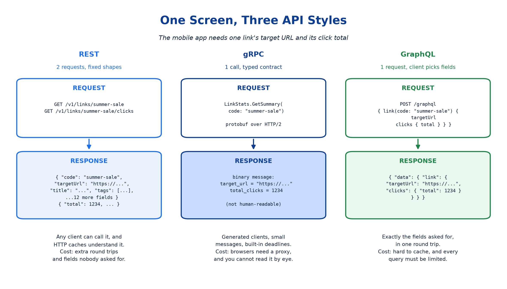

# API Design & Service Communication

## Terms to know before you start

You do not need to memorize these. Come back to this table whenever a term feels unfamiliar.

| Term | What it means in plain words |
|---|---|
| **REST** | An API style built from resources with URLs, plain HTTP methods, and usually JSON bodies. [Basics 6](06_API_Correctness_Security_And_Resource_Design.md) designed one. |
| **gRPC** | A way for one program to call a function in another program over the network, as if it were a local method. Both sides share a contract file and use generated code. |
| **Protocol Buffers (protobuf)** | The compact binary format gRPC uses for its messages, and the language of its `.proto` contract files. |
| **GraphQL** | An API style with one endpoint, where the client writes a query that names exactly the fields it wants back. |
| **Resolver** | In GraphQL, the small function that fetches the value of one field. |
| **N+1 problem** | Fetching a list with one query, then making one more query *per item*. Twenty items cost twenty-one queries. |
| **Polling** | The client asking again and again, "anything new?". |
| **Server-Sent Events (SSE)** | One long HTTP response that the server keeps open, writing a new event into it whenever something happens. Server to client only. |
| **WebSocket** | A connection that starts as HTTP and is then upgraded, so that both sides can send messages at any time. |
| **Webhook** | A URL that a partner gives you, so that your server can send them a request when something happens. |
| **Synchronous call** | The caller sends a request and waits for the answer before it carries on. |
| **Asynchronous message** | The caller hands a message to a broker and carries on at once. The work happens later. |
| **Message broker / event bus** | The system that stores messages until their receivers read them, such as RabbitMQ or Kafka. |
| **Backward compatible** | A newer server still works with older clients. |
| **Forward compatible** | Older code still works with data produced by a newer version, usually by ignoring what it does not recognize. |
| **Breaking change** | A change that makes existing callers fail or, worse, silently misbehave. |
| **Deprecation** | Announcing that something will be removed, and when, while it still works. |

??? info "Java and Spring features used on this page (open if they are new to you)"
    - **gRPC stubs** are client classes generated from a `.proto` file. Calling `stub.getSummary(request)` sends a network request. `withDeadlineAfter(...)` sets how long the call may take.
    - **Spring for GraphQL** connects a GraphQL schema to Java methods. `@BatchMapping` marks a method that loads one field for a whole list of parents in a single call.
    - **`SseEmitter`** is Spring MVC's class for Server-Sent Events. A controller returns it, and the application calls `send(...)` on it whenever there is a new event.
    - **Jackson** is the library Spring uses to turn JSON into Java objects. Spring Boot configures it to **ignore** JSON fields that the Java class does not have, which matters in section 5.

---

## 1. Every call answers four questions

[Basics 6](06_API_Correctness_Security_And_Resource_Design.md) designed what one API looks like from the outside. This page is about the *conversations*: between apps and servers, and between your own services. Every time one program talks to another, four decisions get made, either on purpose or by accident:

| Question | The options | Section |
|---|---|---|
| **What shape does the conversation take?** | REST, gRPC, or GraphQL. | 2 |
| **Who speaks first?** | The client asks (polling), or the server pushes (SSE, WebSockets, webhooks). | 3 |
| **Does the caller wait for the answer?** | A synchronous call, or an asynchronous message. | 4 |
| **How does the contract change without breaking callers?** | Compatible changes, versions, and deprecation. | 5 |

!!! tip "The decision in one sentence"
    Use the plainest option that meets the need: REST for anything public, a typed RPC for internal calls that someone waits for, push only when users must see changes as they happen, and an asynchronous message whenever nobody needs to wait.

**The running example.** [Basics 5](05_Architecture_Styles_And_Service_Decomposition.md#8-putting-it-together-the-url-shortener-year-two) split the URL shortener into a link management app, a redirect service, and click workers joined by an event bus. [Basics 6](06_API_Correctness_Security_And_Resource_Design.md#6-putting-it-together-the-url-shorteners-public-api) gave it a public API. Now four new requests have arrived:

| Request | Who asked | Section |
|---|---|---|
| The mobile home screen needs three requests, over a slow network, to show each link with its click total and domain status. | The mobile team | 2 |
| During a campaign launch, users want click counts that update live, without pressing refresh. | Product | 3 |
| Partners want to import 50,000 links from one CSV file, and the request times out. | Partners | 4 |
| A link can now send visitors to several weighted targets for A/B tests, but 300 partner integrations read the single `targetUrl` field. | Product and partners | 5 |

---

## 2. Choosing a protocol: REST, gRPC, or GraphQL

All three styles usually travel over HTTP. They differ in **who decides the shape of the response**, and **how strictly the contract is enforced**. The picture shows the mobile app's problem from the running example, solved in each style.



### REST: resources over plain HTTP

REST was the subject of Basics 6, so here we only weigh it against the others.

- **What it gives you:** every language, tool, and developer can call it, even with `curl`. A `GET` URL names one resource, so browsers, CDNs, and proxies can cache it using `ETag` and `Cache-Control`. And it is easy to read when debugging.
- **What it costs:** the server decides the shape of every response. A client gets fields it does not need (**over-fetching**), or must make several requests to get what it does need (**under-fetching**), which hurts on slow mobile networks. The contract is only as strict as the OpenAPI document you publish and test against.

### gRPC: typed calls between services

With gRPC you write the contract first, in a `.proto` file. A compiler turns it into client and server code for each language, so a call to another service looks like a normal method call. Messages travel as compact binary protobuf over HTTP/2, which was covered in [Basics 4](04_Networking_And_Request_Lifecycle.md#http11-vs-http2-vs-http3).

```protobuf
syntax = "proto3";
package shortener.analytics.v1;                       // the major version lives in the package name

service LinkStats {
  rpc GetSummary(GetSummaryRequest) returns (LinkSummary);           // one request, one response
  rpc WatchClicks(GetSummaryRequest) returns (stream LinkSummary);   // the server keeps sending
}

message GetSummaryRequest { string code = 1; }

message LinkSummary {
  string code = 1;               // on the wire, the number identifies the field, not the name
  int64 total_clicks = 2;
  int64 clicks_last_hour = 3;
}
```

The Java caller gets a generated stub, and sets a deadline on every call:

```java
LinkSummary summary = linkStats
        .withDeadlineAfter(300, TimeUnit.MILLISECONDS)   // give up after 300 ms; the server is told the deadline too
        .getSummary(GetSummaryRequest.newBuilder().setCode("summer-sale").build());
```

| Feature | What it gives you | What it costs |
|---|---|---|
| **A compiled contract** | Both sides are generated from one file, so a wrong field name fails at compile time, not in production. | Every caller needs the generated code. You cannot simply try a call with `curl`; you need a tool such as `grpcurl`. |
| **Binary messages** | Smaller and faster to parse than JSON, which matters at thousands of internal calls per second. | Nobody can read a message by eye, so debugging needs tools. |
| **Deadlines and streaming** | Deadlines are built in and passed on to the server, and a call can stream many messages in either direction. | Browsers cannot speak gRPC directly. They need gRPC-Web and a translating proxy. |
| **Long-lived HTTP/2 connections** | Many calls share one connection, with no handshake per call. | A simple layer-4 load balancer sends every call on a connection to the same server, so balancing needs a layer-7 proxy or the client's help. This is covered in **Basics 8 (Load Balancing & Proxying)**. |

### GraphQL: the client chooses the fields

A GraphQL API has one endpoint, usually `POST /graphql`, and a **schema** that describes every type and field. The client sends a query naming exactly the fields it wants, and the server runs a **resolver** for each field to fetch its value.

```graphql
type Query {
  links(first: Int = 20, after: String): LinkPage!
}
type LinkPage { nodes: [Link!]!  nextCursor: String }
type Link {
  code: String!
  targetUrl: String!
  clicks: ClickStats!     # resolved by calling the analytics service
  domain: Domain!         # resolved from the domains table
}
type ClickStats { total: Int!  lastHour: Int! }
type Domain { name: String!  verified: Boolean! }
```

The mobile home screen then asks for exactly what it shows, in one round trip:

```graphql
query HomeScreen {
  links(first: 20) {
    nodes { code targetUrl clicks { total } domain { verified } }
    nextCursor
  }
}
```

**The N+1 trap.** Written naively, this query makes one call for the 20 links, then one analytics call *per link* for `clicks`, and one lookup *per link* for `domain`: 41 calls for one screen. The fix is to **batch**: collect the keys for a whole level of the query, and fetch them all at once. Spring for GraphQL does this with `@BatchMapping`:

```java
@BatchMapping                                       // called once with all 20 links, not once per link
Map<Link, ClickStats> clicks(List<Link> links) {
    return analytics.totalsFor(links);              // one call to analytics, for every link on the page
}
```

The query now costs 3 calls instead of 41. GraphQL's other costs are just as real:

| Cost | Why it happens | The usual fix |
|---|---|---|
| **HTTP caching stops working** | Every query is a `POST` to the same URL, so browsers and CDNs cannot cache the answers. | Use **persisted queries**: the client registers its queries in advance, then sends a `GET` with a query ID, which can be cached. |
| **One query can be very expensive** | A client can nest fields many levels deep, or ask for 10,000 items at once. | Limit the depth and page size, give each field a cost, and reject any query over a budget. These are the limits from [Basics 6](06_API_Correctness_Security_And_Resource_Design.md#limits-on-size-and-time), applied to queries. |
| **Errors hide behind `200 OK`** | A query that partly fails often returns `200` with an `errors` array next to partial `data`. | Monitor the `errors` array, not just the HTTP status codes. |
| **Authorization must be checked per field** | One query can reach links, domains, and billing at once. | Check permissions in the service layer that every resolver calls, never only at the endpoint. |

### Choosing between them

| | REST | gRPC | GraphQL |
|---|---|---|---|
| **Who decides the response shape** | The server decides, per endpoint. | The contract decides, per method. | The client decides, per query. |
| **How strict the contract is** | It is only as strict as your OpenAPI document and tests. | Very strict, because both sides are generated from the contract. | Strict, because every query is checked against the schema. |
| **Can a browser call it?** | Yes, directly. | Only through gRPC-Web and a proxy. | Yes, directly. |
| **HTTP caching** | It works with no extra effort. | It does not apply. | Only with persisted queries. |
| **Best fit** | Public and partner APIs, and simple resources. | Internal calls between your own services, especially frequent ones that need deadlines or streaming. | Several of your own apps with different data needs over the same connected data. |

**The decision for the running example.** The mobile team's problem is one screen that needs three requests. GraphQL would solve it, but it brings a new server, new limits, new monitoring, and new caching rules, all for one screen. A smaller REST fix solves the same problem: let the list endpoint embed related data on request, as in `GET /v1/links?include=clicks,domain`. The server batches the lookups exactly as `@BatchMapping` does, and the app gets everything in one round trip. If a third and fourth app arrive, each wanting different shapes, GraphQL becomes worth its cost.

!!! question "Practice: the note-taking app"
    Which style fits each of these, and why? (a) A public API so that third-party developers can build plugins. (b) The notes service asking the search service for matching note IDs, 2,000 times per second. (c) A new web editor whose screens each need a different mix of notes, folders, and collaborators.

??? success "Answer"
    (a) **REST**: plugin developers use every language and tool, and they expect to try calls with `curl`. (b) **gRPC**: both services are yours, the call rate is high, and the caller needs a strict deadline. (c) **GraphQL** is a good fit if many screens and apps need different shapes. If only a few screens differ, one tailored REST endpoint per screen is cheaper.

---

## 3. Who speaks first: polling, SSE, and WebSockets

Plain HTTP only lets the client speak first: the server can answer, but it cannot start a conversation. To show new data quickly, the client must either ask often, or keep a channel open so that the server can push.


### Short polling and long polling

**Short polling** asks on a timer, for example every 2 seconds. It is simple and works everywhere, but the cost adds up fast. In the running example, 10,000 open dashboards polling every 2 seconds would send **5,000 requests per second**, twenty times the roughly 250 requests per second that everything except redirects handles today. Almost every answer would say "nothing new", and new data would still be up to 2 seconds late. Short polling suits data that changes slowly, such as a status page that refreshes every minute.

**Long polling** sends a request that the server *holds open* until there is new data, or until about 25 to 30 seconds pass. Then the server answers, and the client immediately asks again. Data arrives almost at once, and it works through any proxy. Three details matter:

- The hold time must be shorter than the idle timeout of every proxy and load balancer on the way, which is often 60 seconds. Otherwise they cut the request off.
- The client sends the ID of the last event it saw, such as `?after=1041`, so that nothing that happened between two requests is lost.
- It still costs one full request for every answer, and one held connection for every waiting client.

### Server-Sent Events (SSE)

With SSE, the client sends one ordinary request, and the server's response simply never ends. The server writes an event into it whenever something happens:

```text
GET /v1/links/summer-sale/clicks/stream          ← the dashboard's request
Accept: text/event-stream

HTTP/1.1 200 OK                                  ← the response, which stays open
Content-Type: text/event-stream
Cache-Control: no-cache

id: 1042
event: clicks
data: {"code":"summer-sale","total":1290}

: keep-alive

id: 1043
event: clicks
data: {"code":"summer-sale","total":1312}
```

Each event ends with a blank line. A line starting with `:` is a comment, sent every 15 to 30 seconds so that idle proxies do not close the connection. The `id` makes the stream **resumable**: if the connection drops, the browser's built-in `EventSource` reconnects by itself and sends `Last-Event-ID: 1043`, so the server knows what the client has already seen.

In Spring, the controller checks access once, when the stream opens, and returns an `SseEmitter`:

```java
@GetMapping(path = "/v1/links/{code}/clicks/stream", produces = MediaType.TEXT_EVENT_STREAM_VALUE)
SseEmitter stream(@PathVariable String code, @AuthenticationPrincipal Caller caller) {
    linkService.requireOwner(caller.accountId(), code);          // authorize once, when the stream opens
    SseEmitter emitter = new SseEmitter(Duration.ofMinutes(30).toMillis());
    clickStreams.register(code, emitter);                        // new totals are sent to it from now on
    return emitter;
}
```

Each new total is then written with `emitter.send(SseEmitter.event().id("1043").name("clicks").data(total))`. SSE has a few limits to know:

- **One direction only.** Anything the client wants to say goes in ordinary requests.
- **Text only**, which is fine for JSON.
- **No custom headers.** The browser's `EventSource` cannot add an `Authorization` header, so SSE relies on the session cookie. That suits the dashboard, which already uses one ([Basics 6](06_API_Correctness_Security_And_Resource_Design.md#sessions-and-cookies)).
- **Connection limits on HTTP/1.1.** Browsers allow about 6 connections per site, shared across all tabs, so a user with seven dashboard tabs gets stuck. HTTP/2 removes the limit, because every stream shares one connection.
- **Buffering proxies.** Some proxies collect a response before passing it on, which holds events back. Turn buffering off for stream routes.

### WebSockets

A WebSocket starts as an ordinary HTTP request that asks to switch protocols:

```http
GET /v1/notes/77/live HTTP/1.1
Host: api.notes.example
Upgrade: websocket
Connection: Upgrade
Sec-WebSocket-Key: dGhlIHNhbXBsZSBub25jZQ==
Sec-WebSocket-Version: 13
Origin: https://app.notes.example

HTTP/1.1 101 Switching Protocols
Upgrade: websocket
Connection: Upgrade
Sec-WebSocket-Accept: s3pPLMBiTxaQ9kYGzzhZRbK+xOo=
```

After `101 Switching Protocols`, the connection is no longer HTTP. Both sides can send messages at any time, in either direction, over the same TCP connection, encrypted with TLS when the URL starts with `wss://`. That freedom has a price: everything HTTP used to do for you, you now build yourself.

| What HTTP gave you for free | What you must build on a WebSocket |
|---|---|
| A status code and an error format for every reply | Your own message types, including errors. |
| Each response matched to its request | A message ID in every request, repeated in its reply. |
| Authentication on every request | Authenticate once, at the handshake, with the session cookie or a short-lived ticket. Check the `Origin` header so that other websites cannot open a connection using your user's cookie. Recheck access when a token expires, because a connection can stay open for hours. |
| A clean failure when the server disappears | Ping and pong heartbeats, so that both sides notice a dead connection within seconds. |
| A simple retry | Reconnect with a random delay, then ask for every message since the last ID you saw. |

WebSockets are the right choice when **both sides talk often**: chat, collaborative editing, multiplayer games, and the live cursors from the [Basics 4](04_Networking_And_Request_Lifecycle.md#tcp-vs-udp) practice question.

### Running many open connections

Long polling, SSE, and WebSockets all keep connections open for minutes or hours, which changes how you run the servers:

- **Plan capacity by open connections**, not requests per second. Each connection holds memory and a socket. Use a non-blocking server, so that an idle connection does not hold a thread; thread pools are covered in **Basics 16 (Threads, Thread Pools, Parallelization)**.
- **The event must reach the instance that holds the connection.** Asha's stream lives on one of many instances. Either every instance receives every event and forwards the ones its clients want, or events go through a pub/sub channel keyed by link.
- **A deploy drops every connection at once.** If every client reconnects at the same moment, the servers face a reconnect storm. Spread reconnects out with a random delay, and drain connections gradually, as covered in **Basics 14 (Availability & Deployment Fundamentals)**.
- **Load balancing gets uneven.** A new instance gets no connections until clients reconnect, and idle timeouts on load balancers must be longer than your heartbeat interval.

### Webhooks: pushing to another server

When the receiver is another company's *server*, there is a simpler option: the partner registers a URL, and you send it a `POST` when something happens, such as "link `spring-sale` was blocked as malware". Sign every webhook with a shared secret and a timestamp, so that the partner can check it really came from you. Retry failed deliveries with growing delays. Because a delivery can then arrive twice, give each event an ID, so that the partner can ignore repeats. Request signing and replay protection are covered in **Advanced 20 (Security, Privacy & Abuse Resistance)**.

### Choosing a push style

| Style | Direction | How late is new data? | Cost per client | Best for |
|---|---|---|---|---|
| **Short polling** | The client asks. | Up to one polling interval. | One request per interval, mostly empty. | Slow-changing data, such as a status page. |
| **Long polling** | The server answers when ready. | Almost none. | One request per message, plus one held request. | A fallback when streams are blocked. |
| **SSE** | Server to client. | Almost none. | One open connection. | Live counters, feeds, notifications, progress bars, and streamed AI answers. |
| **WebSocket** | Both ways. | Almost none. | One open connection, plus your own protocol. | Chat, collaborative editing, and games. |
| **Webhook** | Your server to a partner's server. | Seconds. | One request per event. | Partner integrations. |

**The decision for the running example.** Live click counts use **SSE**. Data only flows to the browser, the browser already has a session cookie, and `EventSource` reconnects and resumes on its own. The click workers publish at most **one update per link per second**, so even a viral link with 2,000 clicks per second costs each viewer one small message per second. A WebSocket would add a protocol to design and secure, with no benefit, because the dashboard never sends anything back on the stream.

!!! question "Practice: the note-taking app"
    The note-taking app adds shared notes, where 2 to 10 people edit together and see each other's cursors. It also adds a "your export is ready" notice for exports that take a few minutes. Which push style fits each feature?

??? success "Answer"
    Shared editing needs a **WebSocket**: every editor both sends and receives small messages many times a second. The export notice is one message from the server, so **SSE** fits if the app is open, or an email or phone notification if it is not. If an editing WebSocket is already open, sending the notice over it is fine too. There is no need for a second channel just for one message.

---

## 4. Who waits for whom: synchronous vs asynchronous

A **synchronous** call means the caller waits for the answer before it carries on. An **asynchronous** message means the caller hands the work to a broker and carries on at once. The work happens later, and its result arrives some other way, or not at all.


### What a synchronous chain costs

The picture shows the same three follow-up jobs done both ways. Done synchronously, they cost three things:

- **Latency adds up.** The user waits 30 + 20 + 120 + 25 = 195 ms instead of 30 ms.
- **Availability multiplies.** Four parts at 99.9% each give 0.999⁴ ≈ **99.6%**, or about 35 hours of downtime a year instead of 9.
- **Slowness spreads.** If the scanner slows to 5 seconds, every Links module thread ends up waiting for it, and soon nobody can create a link. This is a **cascading failure**, covered in **Advanced 11 (Fault Tolerance, Resilience & Failure Handling)**.

Some calls must stay synchronous. Give each one a deadline shorter than its caller's, as in the [Basics 4 timeout budget](04_Networking_And_Request_Lifecycle.md#timeout-budgets). Cap its retries, and decide *before* it fails what the caller will do instead.

### Asynchronous messages

Messages come in two kinds, and naming the kind makes a design easier to discuss:

| | Command | Event |
|---|---|---|
| **What it says** | "Please do this." For example, `ScanLink`. | "This happened." For example, `LinkCreated`. |
| **Who receives it** | One receiver, which is expected to act. | Any number of receivers, each getting its own copy. |
| **Coupling** | The sender knows the receiver exists. | The publisher does not know who listens, so adding a receiver needs no change to the publisher. |

Moving work into messages gives you a lot: the user waits less, a queue absorbs traffic spikes, a receiver that is down simply catches up later, and new receivers can be added freely. But asynchronous work is not free:

- **Data is briefly out of date.** For a moment after a link is created, analytics does not know about it yet, and the screens must cope with that.
- **Messages can arrive twice.** Most brokers deliver *at least once*, so every receiver must be **idempotent**: it stores each message ID and skips repeats. This is covered in **Advanced 7 (Idempotency & Retries)**.
- **Order is not guaranteed.** `LinkChanged` can overtake `LinkCreated`, unless both use the link code as their ordering key. This is covered in **Advanced 6 (Event-Driven Systems & Message Queues)**.
- **Failures are quiet.** A broken receiver returns no error to anyone; its messages just pile up. Monitor queue lag and the dead-letter queue, which are covered in **Basics 13 (Asynchronous Processing Basics)**.
- **Debugging needs a thread to follow.** Put a trace ID in every message, so that one link creation can be followed across every service.
- **Publishing must be reliable.** Save the event in the same transaction as the change, using the outbox pattern from [Basics 5](05_Architecture_Styles_And_Service_Decomposition.md#5-data-ownership-shared-database-or-one-per-service).

!!! warning "Asynchronous changes *when* work happens, not *whether* it must happen first"
    If a link to malware must never redirect, not even for a few seconds, the scan cannot simply happen "later". Either keep the scan synchronous, with a tight deadline, or save the link as `pending`, and let the redirect service serve it only after a `LinkApproved` event arrives. Moving a check into a message never removes a rule that the check must finish first.

### Long jobs: 202 Accepted and a status resource

The partners' 50,000-link CSV import takes about two minutes, far longer than any request should be held open. The answer is the **asynchronous request-reply** pattern. The server accepts the job, replies at once, and gives the client a URL where it can check progress:

```http
POST /v1/imports
Content-Type: text/csv
Idempotency-Key: 9f1c2e7a-4b1d-4c55-9a0e-1d2f3a4b5c6d

HTTP/1.1 202 Accepted
Location: /v1/imports/imp_81
Retry-After: 5
```

```http
GET /v1/imports/imp_81

HTTP/1.1 200 OK
{ "id": "imp_81", "status": "running", "processed": 31000, "total": 50000 }
```

- **`202 Accepted`** means "I have your job, but it is not done yet". `Location` points to a new **import** resource, and `Retry-After` suggests how often to check.
- The client polls that resource until `status` is `succeeded` or `failed`. A partner can register a webhook instead, and the dashboard can show progress over SSE.
- The **`Idempotency-Key`** means that if the partner's request times out and they send it again, the server returns the same `imp_81` instead of importing 50,000 links twice.
- A 5 MB CSV breaks the 1 MB body limit from Basics 6. Give this one route a larger limit, such as 20 MB. For bigger files, have clients upload to object storage first and send its location.

### Choosing

| Ask this | If the answer is yes |
|---|---|
| Does the caller need the result to carry on, as in "is this custom code free?" | Make a synchronous call, with a deadline. |
| Will the work take longer than a request should be held, meaning more than a few seconds? | Use `202 Accepted` with a status resource. |
| Do other parts only need to *know* that something happened? | Publish an event. |
| Must the work finish before the user's action counts? | Keep it synchronous, or use a pending state that an event completes. |
| Is the receiver slower or less reliable than the caller? | Put a queue between them. |

!!! question "Practice: the note-taking app"
    When a user shares a note, the app (1) checks that the recipient's account exists, (2) emails the recipient, (3) adds the note to the recipient's search index, and (4) writes an audit record. Which steps should be synchronous, and which asynchronous?

??? success "Answer"
    Step 1 is **synchronous**, because the user needs to know at once if they mistyped the address. Steps 2 to 4 hang off one **`NoteShared` event**, published through an outbox so that it is never lost, which matters most for the audit record. The email sender must be idempotent, using the event ID, so that a repeated event does not send two emails.

---

## 5. Changing an API without breaking callers

Every successful API changes. The skill is changing it **without breaking callers you cannot see**, including mobile apps that stay un-updated on people's phones for months.

### Backward and forward compatibility

- **Backward compatible:** the new server still works with old clients. Old partner code keeps working after you deploy.
- **Forward compatible:** old code still works with data from a newer version, usually by ignoring what it does not recognize. An old consumer reads an event from a newer producer without crashing.

You need both. During a rolling deploy, old and new versions of a service run side by side for minutes, and old app versions stay in use for months. Here is what each kind of change does to existing callers:

| Usually safe | Breaking |
|---|---|
| Adding an optional request field. | Adding a required request field. |
| Adding a response field. | Removing or renaming a response field. |
| Adding an endpoint. | Removing an endpoint, or changing its URL. |
| Accepting inputs that used to be rejected. | Rejecting inputs that used to be accepted. |
| Adding an enum value, **but only if** clients were told to expect unknown values. | Changing a field's type, such as a string becoming a list. |
| | Changing a default, such as the sort order or page size. |
| | Changing a field's *meaning*, such as `expiresAt` switching from UTC to local time. This is the worst kind, because nothing fails loudly. |

**Clients must be tolerant readers.** They ignore fields they do not know, and treat an unknown enum value as "other", instead of crashing. Spring Boot's Jackson setup already ignores unknown fields, so never switch on `FAIL_ON_UNKNOWN_PROPERTIES` in a client. Say it in your API docs too: "we add fields without notice".

### Versioning strategies

When a breaking change cannot be avoided, a **version** lets the old and new contracts run side by side:

| Strategy | Example | What it is good at | What it costs |
|---|---|---|---|
| **Version in the URL path** | `/v1/links`, then `/v2/links` | It is obvious in logs, easy to route at the gateway, and easy to try in a browser. | It versions the whole API at once, so every client must change every URL. |
| **Version in a header** | `Accept: application/vnd.goexample.v2+json` | URLs stay the same, and each resource can be versioned separately. | It is invisible in logs and harder to test, and caches must vary by the header. |
| **Dated version per account** | `Api-Version: 2026-10-01`, with each account pinned to the date it started | Many small changes, each adopted when the client is ready. Stripe works this way. | The server must keep a translation step for every old date, forever. |
| **No versions, only additive changes** | New fields, with old ones marked deprecated | There is nothing to maintain. This is common for GraphQL and internal gRPC. | It takes discipline, and a real break needs a new field or a new method. |

A sensible default: **public REST APIs** carry a major version in the path (`/v1`) that changes rarely, maybe every few years, with only additive changes inside it. **Internal gRPC services** put the version in the package name (`shortener.analytics.v1`) and add fields freely. **Events** only ever grow. A breaking change becomes a new event type, and both are published during the move.

### Expand, migrate, contract

Most changes that look breaking can be made in three safe steps. The running example's change, from one `targetUrl` to a list of weighted `targets`, shows how:


1. **Expand.** Add `targets` next to `targetUrl`. Responses carry both, with `targetUrl` showing the highest-weighted target. Writes accept either field. If an old client writes `targetUrl` to a link that has several targets, return `409` with the Problem Details type `multiple-targets`, rather than silently wiping out someone's A/B test.
2. **Migrate.** Mark `targetUrl` as deprecated in the docs and changelog, with a date. Count the API keys that still *write* it, and contact the last few directly.
3. **Contract.** Remove `targetUrl` only when nobody uses it. There is a catch: the server can count who *writes* a field, but not who *reads* it. So public APIs often keep an old response field until the next major version, or forever, because it is cheap.

The same three steps apply to database columns, where they are covered in **Advanced 16 (Data Migration & Zero-Downtime Evolution)**.

**Retiring a whole endpoint or version** uses two standard response headers:

```http
HTTP/1.1 200 OK
Deprecation: @1798761600
Sunset: Thu, 01 Apr 2027 00:00:00 GMT
Link: <https://developer.go.example.com/migrate-to-v2>; rel="deprecation"
```

`Deprecation` (RFC 9745) says the resource has been deprecated since a moment in time, given in Unix seconds; here it is 1 January 2027. `Sunset` (RFC 8594) says when it may stop working, and `Link` points to the migration guide. Meanwhile, count each API key's calls to the old version, so that you know exactly who still needs a nudge.

### Schema evolution for gRPC and events

In protobuf, a field is identified on the wire by its **number**, not its name. That gives three rules: add fields with new numbers, because old readers skip numbers they do not know; never change a field's number or type; and never reuse a deleted field's number. Reserve it instead:

```protobuf
message LinkSummary {
  reserved 3;                     // was clicks_last_hour; this number can never be used again
  reserved "clicks_last_hour";
  string code = 1;
  int64 total_clicks = 2;
  int64 clicks_last_24h = 4;      // the replacement gets a new number
}
```

If an old client received a reused number 3 with a different meaning, it would read the wrong value without any error.

**Events are harder**, because they live in the event bus for days and can be replayed months later. A consumer may read events written by producer versions that no longer exist. So events only ever grow: consumers must cope with missing and unknown fields, and a real break means a new event type. A **schema registry** can check every new event schema for compatibility before the producer deploys, as covered in **Advanced 6 (Event-Driven Systems & Message Queues)**.

**Contract tests catch breaks before production.** With consumer-driven contract tests, using tools such as Pact or Spring Cloud Contract, each consumer records the requests it sends and the fields it relies on. The provider's build replays them, and fails if a change would break any consumer.

!!! question "Practice: the note-taking app"
    `GET /v1/notes/{id}` returns tags as one string, `"tags": "work,urgent"`, and the team wants a proper list. The mobile apps stay installed for months without updating. How would you make the change?

??? success "Answer"
    Do not change the type of `tags` in place, because every old app would crash. **Expand:** add `"tagList": ["work", "urgent"]` next to `tags`, and accept either on writes. **Migrate:** ship new app versions that use `tagList`, and watch the app versions in your request logs. **Contract:** drop `tags` only when old app versions have almost disappeared, or keep it until `/v2`. Unlike partners, apps report their version in every request, so here you *can* measure who still reads the old field.

---

## 6. Putting it together: how the URL shortener talks

![URL shortener year two, showing the style of every connection. Dashboard, mobile app, and partner tool call the API gateway with REST, and the dashboard also receives an SSE stream. The gateway calls link management with REST. Link management calls analytics with gRPC and a 300 ms deadline. The redirect service calls link management with gRPC on a store miss only, with a 50 ms deadline. Link management publishes LinkCreated and LinkChanged to the event bus, the redirect service publishes LinkClicked, click workers save totals to analytics, and ClicksCounted events flow back to link management for the live streams](assets/topic-07/url_shortener_communication.png)

Each connection uses the plainest style that meets its need:

| Connection | Style | Why this one |
|---|---|---|
| Dashboard, mobile app, and partners → gateway → link management | **REST + JSON** | Anyone can call it with any tool, and every check from Basics 6 applies at the gateway. |
| The mobile home screen | **REST with `include=clicks,domain`** | It gives one round trip without running a GraphQL server for one screen. |
| Live click counts → dashboard | **SSE** | Data flows one way, the session cookie already authenticates it, and reconnecting is built in. |
| Dashboards module → analytics | **gRPC, 300 ms deadline** | Both sides are internal, the contract is typed, and if the deadline passes, the page shows "clicks unavailable" instead of failing. |
| Redirect service → link management, only on a store miss | **gRPC, 50 ms deadline** | The path is rare, and the tight deadline means a slow link management can never slow redirects down. |
| Link changes → redirect service; clicks → click workers | **Events** | Nobody waits: 20,000 clicks per second must never slow a redirect, and the redirect service catches up after any outage. |
| Click totals → link management | **`ClicksCounted` events, one per link per second** | They feed the live streams with batched totals, never one message per click. |
| Bulk import | **`202 Accepted` + status resource** | The work outlives any request. |
| `targetUrl` → `targets` | **Expand, migrate, contract inside `/v1`** | One changed field does not justify a `/v2`. |

**One flow, end to end.** Asha watches her `summer-sale` campaign launch live:

1. Her dashboard opens `GET /v1/links/summer-sale/clicks/stream` with its session cookie. The gateway authenticates her, link management checks that she owns the link, and the stream starts with the current total as event `1042`.
2. A visitor clicks the link. The redirect service replies `302` at once, then publishes `LinkClicked`.
3. The click workers count the clicks for one second, save the totals to analytics, and publish one `ClicksCounted` event for `summer-sale`.
4. Every link management instance receives it. The instance holding Asha's stream writes event `1043` into it.
5. Asha's Wi-Fi drops for 20 seconds. `EventSource` reconnects with `Last-Event-ID: 1043`, and the server sends the latest total. There is nothing to replay, because each total includes everything before it.

**When things go wrong:**

| Event | What protects the system |
|---|---|
| Analytics becomes slow. | The gRPC deadline expires after 300 ms. The dashboard loads its links and shows "clicks unavailable" for the counts. |
| Link management is redeployed. | Every SSE connection drops. The server sends each client a different `retry:` delay, between 1 and 5 seconds, so the reconnects are spread out. |
| The event bus is down for two minutes. | New links and edits wait safely in the outbox. Existing links keep redirecting. Live counts pause, then jump forward. |
| A partner writes `targetUrl` to a link with two targets. | They get `409` with the Problem Details type `multiple-targets`, which tells them to use `targets`. Nobody's A/B test is wiped out. |
| A partner's import request times out, and they send it again. | The same `Idempotency-Key` returns the same `imp_81`. No link is imported twice. |

!!! tip "The headline to say out loud"
    "Public callers get REST, because anyone can use it. Internal calls that someone waits for use gRPC with a deadline and a fallback. Anything nobody waits for becomes an event. The dashboard gets SSE, because it only listens. And every contract change is additive first, measured, and removed only when nobody depends on it."

---

## 7. Common beginner mistakes

- **Picking gRPC or GraphQL for a public API because it is newer**, without asking who has to call it.
- **GraphQL without batching or limits.** One innocent query can make hundreds of calls, and one hostile query can take the server down.
- **WebSockets for one-way updates.** SSE does the job with plain HTTP, cookies, and reconnection built in.
- **Fast polling from thousands of clients.** Count the requests per second before choosing it.
- **Long chains of synchronous calls on the user's path**, especially without deadlines. Latency adds up, and availability multiplies down.
- **Treating asynchronous work as free:** no idempotent receivers, no lag monitoring, and no dead-letter queue.
- **Raising timeouts until a slow job "works"**, instead of returning `202 Accepted`.
- **Changing a field's type or meaning in place.**
- **Clients that crash on unknown fields or enum values.**
- **Reusing a protobuf field number.**
- **Creating `/v2` for one small change**, or the opposite: never deprecating anything, ever.

---

## 8. Test yourself

These three problems increase in difficulty. Try each one on paper before opening the answer.

!!! question "Problem 1 (warm-up): pick the style"
    Pick a communication style for each: (a) a public web page showing stock prices that change several times a second; (b) the payment service asking the fraud service for a risk score before every charge, 2,000 times a second; (c) a 2-million-row report requested from a dashboard; (d) a partner who wants to know whenever one of their links is blocked as malware; (e) sending a welcome email after signup; (f) a team chat app.

??? success "Answer"
    (a) **SSE**: the data flows one way, to many browsers. (b) **A synchronous gRPC call with a deadline**: the charge cannot go ahead without the score, and both services are internal. Decide in advance what happens when the deadline passes. (c) **`202 Accepted`** with a status resource, and a download link when it is done. (d) **A signed webhook**, with retries and event IDs. (e) **An event**, such as `UserSignedUp`, because nobody waits for the email. (f) **A WebSocket**, because both sides send messages often.

!!! question "Problem 2 (diagnosis): the slow order page"
    An order page calls five services one after another: users, cart, pricing, inventory, and recommendations. Each takes about 80 ms and has 99.9% availability. The page is slow, and it fails whenever the recommendation service is being deployed. Last week, the pricing team renamed the response field `price` to `amount`, and the mobile app crashed. What went wrong, and how would you fix each problem?

??? success "Answer"
    | Problem | Fix |
    |---|---|
    | The calls run one after another, so the page waits 5 × 80 = 400 ms. | Call the independent services in parallel. The page then waits about as long as the slowest one. |
    | Availability is 0.999⁵ ≈ 99.5%, and a deploy of an *optional* service breaks the page. | Give recommendations a short deadline and a fallback, such as showing none. Only cart and pricing are truly required. |
    | The page depends on five services at request time. | Cache data that changes rarely, such as the user's profile. Or keep a local copy, updated by events. |
    | Renaming `price` to `amount` was a breaking change. | Expand, migrate, contract: add `amount`, keep `price`, and remove `price` only when no app version reads it. Add consumer-driven contract tests, so that the pricing build fails before the change ships. |
    | The app crashed instead of degrading. | Make the app a tolerant reader: a missing field shows a placeholder, never a crash. |

!!! question "Problem 3 (design): live orders for the food-delivery company"
    In Basics 6, restaurant point-of-sale systems polled for new orders every few seconds. Now the company wants three things. Orders should reach restaurants the moment they are placed, and many restaurants run the point-of-sale software on tablets behind ordinary routers. Customers should watch their courier move on a map. And the order service needs an arrival-time estimate from the routing service when a customer opens their order. Design the communication for each.

??? success "Answer"
    | Need | Design |
    |---|---|
    | **New orders → restaurant tablets** | A tablet behind a home or shop router cannot accept incoming connections, so a webhook to it is out. The tablet opens an outgoing **SSE** stream instead, `GET /v1/restaurants/{id}/orders/stream`, and receives each new order at once. On reconnect, it sends `Last-Event-ID`, or calls the existing cursor-paginated `GET /orders?after=...`, so no order is ever missed. Vendors with real servers can choose **signed webhooks** instead. |
    | **Courier location → customer** | The courier app sends its position every 4 seconds with an ordinary `POST`. The customer's app opens an **SSE** stream for that one order, which receives a position at most every few seconds, only while the order is active. A WebSocket is not needed, because the customer sends nothing back. |
    | **Order service → routing service** | **gRPC with a 200 ms deadline.** If it passes, show the last known estimate, marked as approximate. |
    | **Order placed → kitchen, payment, notifications** | One **`OrderPlaced` event**, published through an outbox. Every receiver is idempotent. |
    | **Changing the partner API** | Keep `/v1` REST with only additive changes. Retire old endpoints with `Deprecation` and `Sunset` headers, and track each vendor's usage. |

    A good follow-up: storing and querying thousands of moving couriers needs careful partitioning, which is covered in **Basics 12 (Data Partitioning, Sharding & Replication)**.

---

## 9. Key takeaways

- **Every call answers four questions.** What shape does it take, who speaks first, does the caller wait, and how will the contract change? Answer them on purpose, or they get answered by accident.
- **Use REST for public APIs, gRPC for internal calls that someone waits for, and GraphQL when many apps need different shapes.** A smaller fix often wins: `?include=clicks,domain` solved the mobile screen without running a GraphQL server.
- **GraphQL needs batching and limits from day one.** Batching cut one screen from 41 calls to 3. Limit query depth, page size, and cost, and monitor the `errors` array, not just status codes.
- **Push only when users must see changes as they happen.** Use SSE when only the server talks, with cookie authentication and automatic resume through `Last-Event-ID`. Use WebSockets only when both sides talk often, because you must build your own protocol on top. Use webhooks for partners' servers, and short polling only for slow-changing data.
- **Open connections change how you run servers.** Plan capacity by open connections, deliver events to every instance, and spread reconnects out with random delays.
- **Synchronous chains add latency and multiply unavailability.** Four parts at 99.9% give about 99.6%. Give every synchronous call a deadline and a decided fallback.
- **Publish events for work nobody waits for, but asynchronous work is not free.** Receivers must be idempotent, order is not guaranteed, failures are quiet, and events must be published through an outbox. Asynchronous changes *when* work happens, not *whether* it must finish first.
- **Long jobs return `202 Accepted` with a status resource.** An `Idempotency-Key` makes a repeated request return the same job instead of starting a second one.
- **Change contracts additively, and read them tolerantly.** Clients ignore unknown fields and enum values. Never change a field's type or meaning in place.
- **Expand, migrate, and contract before reaching for a new version.** Retire whole versions with `Deprecation` and `Sunset` headers, never reuse a protobuf field number, and let events only grow.
- **In interviews, every arrow you draw invites a question.** "Is that call synchronous?", "How does the client find out?", "What happens when that field changes?" A strong answer names the style, the reason for it, and what it costs.
